# IIP repository map

This map helps contributors find the owning module before changing code or documentation. It describes current repository boundaries; it does not replace [`AGENTS.md`](../../AGENTS.md), code, tests, CI, or approved architecture decisions.



## Top-level structure

```text
IIP V2/
├── src/           .NET product modules
├── tests/         .NET tests
├── web/portal/    Next.js IIP Operations portal
├── infra/         Bicep, deployment parameters, and infrastructure scripts
├── docs/          Product knowledge, decisions, evidence, and delivery guidance
├── scripts/       Repeatable setup and maintenance automation
├── tools/         Operator and QA utilities
├── prototypes/    Explicitly non-production experiments
├── .github/       CI and repository collaboration configuration
├── .agents/       Repository-scoped agent skills and workflows
├── .claude/       Claude-specific repository integration
└── .scratch/      Temporary work; never an authoritative product source
```

Generated or local-only material such as `.nuget-packages/`, `output/`, and `tmp/` is not source. Release evidence intended for review belongs in a named, governed location under `docs/07-qa/`; disposable run output stays ignored.

## Code modules and dependency direction

| Module | Responsibility | May depend on |
|---|---|---|
| `InsuranceIntelligence.Domain` | Business meaning, entities, value objects, and invariants | No Application, Infrastructure, API, or UI module |
| `InsuranceIntelligence.Application` | Use cases, ports, permissions, tenant policy, human gates, and audit policy | Domain |
| `InsuranceIntelligence.Infrastructure` | EF, Azure, email, communication, and provider adapters | Application and Domain |
| `InsuranceIntelligence.Api` | HTTP transport, authentication, middleware, and composition | Application, Infrastructure, and Domain |
| `InsuranceIntelligence.Functions` | Background and event-triggered composition | Application, Infrastructure, and Domain as required |
| `InsuranceIntelligence.LocalTestDoubles` | Isolated test adapters | Application and Domain only |
| `web/portal` | UI consuming versioned HTTP contracts | API contracts, never server-side business authority |

The important seams live in Application interfaces. Provider SDKs and persistence details stay behind Infrastructure adapters. A new folder earns its place only when it creates a clear owner, reduces caller knowledge, and improves locality; a pass-through folder adds cognitive load.

## Where common changes go

| Change | Start here |
|---|---|
| Business invariant or domain language | `src/InsuranceIntelligence.Domain/` plus the owning product/architecture document |
| Use case, permission, tenant rule, approval, or audit behavior | `src/InsuranceIntelligence.Application/` |
| Database, Azure, provider, email, or external-system integration | `src/InsuranceIntelligence.Infrastructure/` |
| HTTP route, authentication middleware, or composition | `src/InsuranceIntelligence.Api/` |
| Background/event processing | `src/InsuranceIntelligence.Functions/` |
| Operator interface | `web/portal/` plus the owning UI specification |
| Deployment or Azure resources | `infra/` plus deployment/release documentation |
| Product or delivery decision | Owning document and an ADR under `docs/06-decisions/` when material |
| Test evidence | Tests beside the owning test project; dated live evidence under `docs/07-qa/` |

## Organization trade-offs

- **Optimized for:** discoverability, stable architectural seams, explicit authority, and low-cost change.
- **Accepted:** the existing numbered documentation pack remains physically intact, including duplicate ordinals, to avoid a high-risk link migration in a dirty worktree.
- **Rejected:** mass-moving files based only on names. A document's authority, owner, lifecycle, and inbound references must be known first.
- **Deferred:** physical normalization items are recorded in [`reorganization-backlog.md`](reorganization-backlog.md).

## Related navigation

- [`../README.md`](../README.md) — task-oriented documentation home
- [`documentation-governance.md`](documentation-governance.md) — document placement and lifecycle
- [`reorganization-backlog.md`](reorganization-backlog.md) — reviewed move matrix
- [`../CATALOG.md`](../CATALOG.md) — exhaustive generated inventory
- [Mermaid source](diagrams/repository-map_01_flowchart_repository-ownership.mmd) — editable source for the validated diagram
