# IIP Release 1 Scope Control Register

| Field | Value |
|---|---|
| Version | 2.1 |
| Date | 2026-08-05 |
| Status | Proposed; stakeholder and target-insurer approval pending |
| Decision horizon | Release 1 controlled pilot and production-candidate gate |
| Normative requirements | `iip_release_1_requirements_baseline.md` |

## Scope decision

Select the smallest end-to-end slice that tests whether IIP can improve evidence-complete review of non-injury motor own-damage work without weakening insurer authority, privacy, security, accessibility, recovery, or operational control.

## Inclusion criteria

A capability is Release 1 only when it:

1. is required to complete or safely recover the canonical intake → evidence → review/correction → completeness → proposal → human decision → controlled outcome → audit path;
2. enforces a platform invariant or pilot/production obligation;
3. produces evidence for a named Release 1 decision or risk;
4. cannot be deferred without breaking the outcome, safety, support, or measurement;
5. has an owner, requirement ID, acceptance evidence, and release gate.

Stakeholder influence, legal obligations, and human-harm controls are not reduced to a numeric score.

## Selected scope

| Outcome/capability | Primary users | Evidence/value | Obligation | Dependencies | Effort | Reversibility | Requirement IDs |
|---|---|---|---|---|---|---|---|
| Server-authorized staff entry and scoped work | Claims staff, supervisors, admins | Existing code/invariant; prevents cross-tenant harm | Mandatory | Membership/permission store, Entra | Existing + hardening | Low | R1-FUN-001, R1-SEC-001–004 |
| Structured motor FNOL/case and work queue | Claims staff/supervisors | Required operational entry and ownership | Core value | Case contracts, roles, rules | Existing + reconciliation | Medium | R1-FUN-002–004 |
| Document intake, validation and real-provider extraction | Claims/document reviewers | Release 1 problem hypothesis | Core value + security | Blob/SQL, provider, document rules | Medium/high | Medium | R1-FUN-005–006 |
| Source-side human review and correction | Reviewers | Safety, quality, rework reduction | Mandatory | Evidence viewer, audit, versioning | Medium | Low | R1-FUN-007, R1-DAT-003 |
| Completeness and evidence-gap follow-up | Claims/customer service | Central wedge hypothesis | Core value | Approved tenant rules/templates | Medium | Medium | R1-FUN-008–010, R1-FUN-014 |
| WhatsApp intake, case-linked conversation and reviewed follow-up | Customers, claims/customer-service staff | Required Release 1 operating channel | Mandatory | Approved provider/business account, server-side mapping, consent/legal basis, templates/languages, webhook security | High | Medium | R1-WA-001–004, R1-FUN-014 |
| Downstream invalidation/re-evaluation | Reviewers/approvers | Prevents stale reliance | Mandatory | Dependency lineage/workflow | Existing remediation | Low | R1-FUN-009, R1-DAT-003 |
| Grounded proposed action and human approval | Claims approvers | Human-accountable decision preparation | Mandatory | Current evidence, workflow/approval versions | High | Low | R1-FUN-010–013, R1-AI-001–007 |
| Controlled execution/communication where approved | Authorized staff/operators | Proves outcome without fake success | Conditional core | Real provider, exact approval, reconciliation | High | Low after external effect | R1-FUN-013–014, R1-DAT-006 |
| Contestability/review request | Claims/compliance/customer-facing staff | Correction and recourse | Pilot obligation | Review ownership/response policy | Medium | Medium | R1-FUN-017, R1-AI-003 |
| Audit/evidence export | Claims/compliance/audit | Reconstruction and release evidence | Mandatory | Safe audit, scoped export | Existing + verification | Low | R1-FUN-015, R1-PRI-004 |
| Accessibility, multilingual-safe data and low-bandwidth recovery | All users/affected parties | Research-backed risk; no participant validation yet | Cross-cutting | Design, content, contracts, QA | Medium | Medium | R1-A11Y-*, R1-L10N-*, R1-RES-001–002 |
| Operations, recovery and release evidence | Support, security, delivery | Required for trustworthy pilot/production | Mandatory | Telemetry, runbooks, backup/restore, UAT | High | Medium | R1-OPS-*, R1-REL-* |

## Conditional activation

These capabilities are in the architecture but activate for Release 1 only after the target insurer approves the dependency:

- document provider and supported language/document matrix;
- exact required-document/completeness rules;
- WhatsApp provider/business account, templates, languages, consent/legal basis, sender authority, webhook/callback policy and live credentials; the WhatsApp capability itself is mandatory;
- core-system read/export/write-back depth;
- deployment route, region, network, support access and data-transfer basis;
- retention, deletion, legal hold and audit schedules;
- approval expiry, delegation, two-person control and escalation rules;
- algorithm evaluation corpus, severe-error thresholds and review workload;
- pilot volume, performance load and recovery objectives.

Unconfigured conditional capability remains `Not configured`; it is never simulated in a protected runtime.

## Explicitly excluded

| Exclusion | Consequence/reason | Re-evaluation trigger |
|---|---|---|
| Bodily injury, fatality, medical, life, workers' compensation, reinsurance, contested-liability and specialist commercial claims | Different harms, evidence, authority and legal/operational model | Separate discovery, requirements, impact assessment and approval |
| Autonomous consequential insurance outcomes | Violates platform ceiling | No planned trigger; invariant |
| Core policy/claim/payment replacement | IIP is an operations layer | Separate product/architecture decision |
| Customer self-service portal | Not needed for staff evidence-review wedge | Validated user/buyer need and safety/privacy design |
| Sales/leads, full underwriting, fraud intelligence, early warning and billing | Disconnected from Release 1 outcome | Release 1 evidence plus separate discovery |
| Full offline processing | Major consistency/security/operations expansion | Observed need, funded architecture and security model |
| Additional customer channels as Release 1 dependencies | WhatsApp is the selected mandatory intake/follow-up channel; adding email/SMS/web as required paths expands validation and operations | Approved target-insurer need and change control |
| Marketplace/Managed Application as mandatory first deployment | Procurement preference unvalidated | Qualified buyer requirement and account eligibility |
| Broad analytics/ROI promises | Baselines and attribution absent | Finance-approved pilot evidence |

## Dependency sequence

```mermaid
flowchart LR
  A["Approve problem, scope and role hypotheses"] --> B["Approve insurer rules, data, deployment and evaluation inputs"]
  B --> C["Verify tenant authority, data ownership and zero simulation"]
  C --> D["Verify intake, evidence, review and correction"]
  D --> E["Verify grounding, invalidation and human approval"]
  E --> F["Verify provider execution, reconciliation and recourse"]
  F --> G["Verify performance, resilience, accessibility, usability and recovery"]
  G --> H["UAT, risk acceptance and six-function release decision"]
```

## Scope-change control

Every proposed change records: requester; user/outcome; evidence IDs; legal/safety obligation; affected requirements; value; risk; dependency; effort range; reversibility; operational cost; excluded/deferred displacement; acceptance evidence; approvers; decision; and review date.

No P2 expansion enters Release 1 while any P0 traceability or approval gap remains unless the accountable owners explicitly record why the expansion is needed to close that gap.

## Review and kill triggers

Review scope at research synthesis, prototype result, target-insurer selection, architecture/security review, UAT entry, pilot midpoint and any material incident/regulatory/provider change.

Rethink or stop if the evidence-review problem is not material; a simpler configuration solves it at lower risk/cost; real human oversight is infeasible; data/provenance/recourse is unacceptable; required provider/deployment cannot be made safe; representative users cannot recover from critical errors; or no qualified buyer commits data, staff, security review and a paid/contracted next step.

## Approval

Scope is **not frozen**. Product, Insurance, Operations, Security/Privacy, Architecture and Delivery must each decide against baseline version 0.10; the approval record lives in the baseline. Target-insurer rules require separate client approval.
