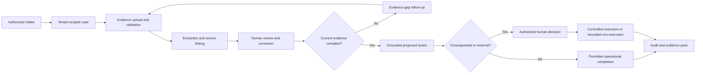

# IIP Release 1 Requirements Baseline

| Field | Value |
|---|---|
| Version | 0.14 |
| Date | 2026-08-10 |
| Status | Proposed baseline; stakeholder approval and target-insurer validation pending |
| Release | Release 1 — non-injury motor own-damage evidence review and approval preparation |
| Owners required | Product, Insurance, Operations, Security/Privacy, Architecture, Delivery |

## 1. Authority and use

`AGENTS.md` and the approved product-intent documents remain higher authority. This baseline is the normative atomic requirements candidate for Release 1. The PRD explains broader product intent; the scope register selects the slice; the acceptance register defines gates; the traceability matrix links implementation evidence.

No requirement is “approved” because it appears here. `Proposed` means ready for stakeholder decision. `Constraint` means inherited from repository authority but still requires release evidence. Institution-specific values remain `Conditional` until a target insurer approves them.

The action-level conversion of this baseline into permissions, audit events, flows, states, screens, APIs, tests, UAT, and readiness is maintained in `iip_release_1_interaction_requirements_traceability.md`.

## 2. Requirement quality and priority

| Field | Meaning |
|---|---|
| P0 | Invariant, legal/safety/security boundary, or required for the end-to-end Release 1 outcome |
| P1 | Required for a credible controlled pilot, but may be conditionally deferred from internal demonstration |
| P2 | Useful expansion that does not belong in the Release 1 production gate |
| Constraint | Non-negotiable platform ceiling |
| Proposed | Awaiting named stakeholder approval |
| Conditional | Requires target-insurer configuration or evidence |
| Deferred | Explicitly outside the current release |

Requirement form: `When [context], IIP shall [observable behavior] so that [outcome].`

## 3. Release 1 outcome and workflow

An authorized claims worker receives or creates a motor own-damage case, including required WhatsApp intake and evidence follow-up, assembles and reviews source evidence, corrects extracted information, resolves evidence gaps, prepares a grounded next action, routes consequential work and customer communication to an accountable human, and produces an auditable evidence pack. Provider absence, interruption, correction, conflict, denial, and external ambiguity remain visible and recoverable.

## 4. Business and scope requirements

| ID | Atomic obligation | Source/rationale | Priority | Acceptance | Status |
|---|---|---|---|---|---|
| R1-BUS-001 | When Release 1 scope is evaluated, IIP shall include only non-injury motor own-damage evidence review and approval preparation so that the release remains a coherent testable wedge. | Charter; research program | P0 | Scope register contains the boundary and no P2 workflow is required by a P0 path. | Proposed |
| R1-BUS-002 | When an insurer decision is consequential, IIP shall preserve an accountable human as final decision-maker so that regulated authority is not delegated to AI. | `AGENTS.md` | P0 | Every executable consequential path contains an unavoidable authorized-human decision; bypass tests fail. | Constraint |
| R1-BUS-003 | When IIP exchanges data with a core insurer system, IIP shall act as an operations layer rather than the policy, payment, or accounting system of record so that ownership remains explicit. | Product charter | P0 | Data map names the authoritative owner and no Release 1 path invents policy/payment truth. | Proposed |
| R1-BUS-004 | Before a pilot target or ROI claim is approved, IIP shall link it to insurer-owned baseline definitions and data so that value claims are attributable. | Research and ROI model | P1 | Every non-zero target has evidence ID, population, window, owner, exclusions, and finance/operations approval. | Conditional |
| R1-BUS-005 | When research changes a requirement, IIP shall record evidence IDs, method, confidence, limits, disposition, owner, and approver so that product decisions retain provenance. | Research repository | P0 | Change record is complete and linked from requirement and roadmap. | Proposed |

## 5. Functional and workflow requirements

| ID | Atomic obligation | Actor/context | Priority | Acceptance | Status |
|---|---|---|---|---|---|
| R1-FUN-001 | When staff enter IIP, the system shall resolve current membership, workspace, role, and permissions server-side. | Workforce user | P0 | Valid membership enters assigned workspace; missing/revoked/cross-workspace membership fails closed. | Constraint |
| R1-FUN-002 | When authorized staff submit valid FNOL data, the system shall create one tenant-scoped case with structured motor details and correlation identity. | Claims worker | P0 | One request creates one case; invalid/replayed requests return deterministic outcomes and audit evidence. | Proposed |
| R1-FUN-003 | When staff open the work queue, the system shall expose assigned/unassigned work, status, priority, evidence gaps, approval need, SLA state, and filters from current backend data. | Claims worker/supervisor | P0 | Representative queue tasks are findable; empty/error/unauthorized states contain no fabricated rows. | Implemented locally; protected multi-role, scale, accessibility and practitioner validation pending |
| R1-FUN-004 | When staff open a case, the system shall present current claim context, motor details, timeline, tasks, documents, communications, approvals, and evidence references permitted to that role. | Claims worker | P0 | Task walkthrough reconstructs the case without a second untracked source; restricted data is absent. | Proposed |
| R1-FUN-005 | When an authorized user uploads a supported document, the system shall validate and durably associate it with the exact case and scope before processing. | Claims/document reviewer | P0 | Invalid, oversized, unsupported, unsafe, duplicate, and storage-failure cases have explicit outcomes and no false success. | Proposed |
| R1-FUN-006 | When a real document provider is configured, the system shall classify/extract fields with provider identity, timestamp, field confidence, and source location where available. | System/reviewer | P0 | Output is linked to source; missing provider is `Not configured`; provider failure is not converted to empty success. | Conditional |
| R1-FUN-007 | When extraction needs review, the system shall let an authorized reviewer accept, correct, reject, return, or escalate fields while preserving before/after evidence. | Document reviewer | P0 | Each committed action records reviewer, reason, timestamp, versions, and source reference. | Proposed |
| R1-FUN-008 | When completeness is checked, the system shall use the current approved tenant rule set and received evidence to identify gaps. | Claims worker | P0 | No configured rule produces no invented requirement; rule version and gap basis are visible. | Conditional |
| R1-FUN-009 | When reviewed evidence changes, the system shall invalidate stale dependent work and re-evaluate affected downstream steps before further reliance. | Reviewer/system | P0 | Stale summaries/tasks/proposals cannot execute; invalidation and new version are audited. | Constraint |
| R1-FUN-010 | When IIP prepares a summary or proposed action, it shall re-retrieve current approved evidence and disclose missing, conflicting, stale, and excluded sources. | Claims worker/approver | P0 | Deliberately changed evidence makes the previous proposal stale and blocks execution. | Constraint |
| R1-FUN-011 | When an action requires approval, the system shall create a review item naming the exact action, subject, evidence, risk, authority, and expiry/version conditions. | Reviewer/approver | P0 | Generic or mismatched approval cannot authorize execution. | Constraint |
| R1-FUN-012 | When an authorized human decides a review item, the system shall support approve, reject, return/correct, and escalate with a required reason. | Human approver | P0 | Each outcome is permission/state checked, durable, audited, and leaves a valid next state. | Constraint |
| R1-FUN-013 | When an approved action is executed, the system shall verify current permission, evidence, approval, policy/workflow version, target, and provider state before one controlled attempt. | System/operator | P0 | Stale/missing/mismatched prerequisites block; ambiguous external outcome enters reconciliation, not success. | Constraint |
| R1-FUN-014 | When a customer update is needed, the system shall prepare a customer-safe draft and require authorized review before sending unless a separately approved low-risk policy exists. | Claims/customer service | P0 | Draft, approval, send, failure, and provider reference are distinct auditable states. | Conditional |
| R1-FUN-015 | When a user requests an evidence pack, the system shall export only authorized current case evidence, human outcomes, versions, and safe audit metadata. | Compliance/claims | P0 | Cross-tenant export fails; exported pack has generator, scope, time, filters, sources, and integrity/version metadata. | Proposed |
| R1-FUN-016 | When work is interrupted, the system shall preserve durable work state and resume only after re-resolving authority and current evidence. | Workforce user | P1 | Session expiry/network interruption restores case/work pointer and draft where supported without stale authority or duplicate action. | Proposed |
| R1-FUN-017 | When a review/correction request is submitted, the system shall provide acknowledgement, owned review, resolution reason, correction propagation, and auditable closure. | Claimant-facing operator/compliance | P1 | Request remains visible through resolution; corrected data invalidates affected derived outputs. | Proposed |
| R1-FUN-018 | When authorized staff search IIP, the system shall return only current tenant/workspace records and work items they may open, without disclosing restricted existence, counts, snippets, or sensitive fields. | Claims worker/supervisor | P0 | API tests prove tenant, assignment, object-permission, count, and field filtering; exact references rank above urgency and recency; the portal covers loading, grouped results, no-authorized-results, partial, error, keyboard, open, and return states. | Implemented locally; protected-staging and practitioner validation pending |
| R1-FUN-019 | When a claim requires an external assessor/adjuster handoff, IIP shall create an immutable referral/evidence-pack version and distinguish export, staff-attested transmission, Graph acceptance, unknown outcome, assessor acknowledgement, report receipt, late receipt, human evidence review, supersession, and reissue so that manual baseline and optional configured Graph exchange remain traceable without granting claim-decision authority. | Claims worker/assessor | P1 | Unapproved recipient/disclosure/permission/configuration blocks release; due/expiry never implies remote revocation; timeout/response loss reconciles before retry; duplicate/unmatched/late/unsafe returns enter owned review; revisions preserve history; no external portal or assessor-path core write-back exists. | Approved scope via DEC-018; permission, audit, insurer configuration, implementation and protected UAT pending |
| R1-FUN-020 | When a claimant or authorized representative questions assessor involvement, disclosed data, an accommodation need, report accuracy/limitations, or downstream reliance, IIP shall support mediated intake without requiring an internal-app account, acknowledge and assign the request, link the exact disclosure/referral/report versions, preserve originals and context, mark materially disputed evidence `Contested`, block new reliance until authorized human reconsideration, record a useful reason, and propagate any correction, invalidation, remedy or escalation. | Customer Service/Complaints/authorized reviewer | P0 | WhatsApp/staff-assisted and approved-channel tests prove acknowledgement, owner, accessible participation, exact-version lineage, reliance pause, independent review where required, reason, remedy/escalation and downstream correction; the claimant need not prove a system defect to request review. | Proposed by assessor ethical review; policy, state/API, permissions, notice, service target, implementation and claimant validation absent |

### Required WhatsApp channel

| ID | Atomic obligation | Actor/context | Priority | Acceptance | Status |
|---|---|---|---|---|---|
| R1-WA-001 | When WhatsApp sends an inbound message or document, IIP shall verify the provider request, resolve tenant/workspace from approved server-side channel configuration, deduplicate the provider message, and correlate it to an authorized case or manual-review queue. | Customer/channel operator | P0 | Invalid signatures and mappings fail safely; replay causes no duplicate effect; unmatched content is retained for authorized review and never invents case authority. | Source-complete/local tests; protected-staging provider proof pending |
| R1-WA-002 | When authorized staff review WhatsApp work, IIP shall present the case-linked conversation and document context with sender/recipient, source, timestamps, provider identity, delivery state and role-safe content. | Claims/customer-service staff | P0 | Staff can reconstruct the permitted thread and case relationship; restricted/internal or other-tenant content is absent. | Source-complete/local tests; multi-role staging/UAT pending |
| R1-WA-003 | When staff send a WhatsApp update, IIP shall require a customer-safe draft, approved recipient, purpose, consent/legal basis, language/template policy and authorized human review before one controlled provider attempt. | Customer-service worker/approver | P0 | Missing or stale approval/policy blocks send; provider absence is `Not configured`; no protected runtime simulates acceptance or delivery. | Source-complete/local tests; insurer policy/template/live-send approvals pending |
| R1-WA-004 | When WhatsApp returns an acknowledgement, status callback, timeout or error, IIP shall preserve distinct queued, provider-accepted, delivered, read, failed and unknown states where supported, using idempotent processing and reconciliation before retry. | Operator/system | P0 | Lost response, duplicate callback and provider failure never become false sent/delivered success; final state and provider reference are auditable. | Source-complete/local tests; callback/reconciliation staging evidence pending |

## 6. Decision, grounding, and responsible-algorithm requirements

| ID | Atomic obligation | Priority | Acceptance | Status |
|---|---|---|---|---|
| R1-AI-001 | IIP shall never finally approve, reject, repudiate, settle, pay, bind, price, make an adverse underwriting/fraud determination, issue a final complaint response, or submit a regulatory filing. | P0 | Policy, graph, API, worker, adversarial, and alternate-path tests prove no system/agent actor can complete these outcomes. | Constraint |
| R1-AI-002 | Every consequential AI/rule output shall show source evidence, uncertainty/limitations, data/rule/model/workflow versions, and the required human role. | P0 | Reviewer can identify material basis, missing evidence, and authority without inspecting logs. | Constraint |
| R1-AI-003 | Human oversight shall provide real authority, sufficient evidence, manageable queue/load, correction, return, escalation, and recourse. | P0 | Usability/UAT includes wrong-output cases; reviewer can disagree and remedy without prohibited workaround. | Proposed |
| R1-AI-004 | Inputs from documents, OCR, email, customer content, retrieval, and models shall be treated as untrusted data and shall not grant tool or policy authority. | P0 | Prompt-injection/tool-escalation tests are blocked, safely logged, and do not leak restricted data. | Constraint |
| R1-AI-005 | Every active model, prompt, rule, threshold, tool permission, workflow definition, and data-source schema shall have an immutable version linked to outputs and runs. | P0 | Historical decision reconstruction resolves exact versions after a newer publish. | Constraint |
| R1-AI-006 | Before pilot activation, each consequential algorithm/rule shall have an impact assessment covering purpose, baseline, affected parties, data/proxy risk, errors, recourse, monitoring, stop conditions, and owners. | P0 | Required fields completed and residual risk signed by named owners; unresolved critical risk blocks pilot. | Proposed |
| R1-AI-007 | When systematic harm, invalid provenance, untestable population risk, or absent recourse is detected, the system shall support pause/kill, preserve evidence, identify affected work, correct downstream state, and require reapproval before restart. | P0 | Incident exercise proves stop, trace, correction, and controlled restart. | Proposed |
| R1-AI-008 | Assessor referral, report, staff reliance, contest outcome and downstream claim outcome shall not become a training label, retrieval authority, assessor ranking, credibility/risk/fraud score or automated-referral target without a separately approved purpose, data authority, impact assessment, fairness definition, affected-party recourse and monitoring/stop plan. | P0 | Source, configuration, dataset, retrieval, prompt/model and analytics inventories show zero unapproved reuse; any approved future use has separate versioned controls, evaluation, recourse and stop evidence. | Constraint proposed by assessor ethical review; runtime/data-governance evidence absent |

## 7. Data, security, and privacy requirements

| ID | Atomic obligation | Priority | Acceptance | Status |
|---|---|---|---|---|
| R1-DAT-001 | Every important fact shall have one named authoritative owner, write path, durability point, read/derived copies, retention, and recovery rule. | P0 | API/data contract map contains no ownerless Release 1 fact. | Proposed |
| R1-DAT-002 | Every row, blob, index document, cache item, message, workflow, export, and audit record shall carry or derive validated tenant/workspace scope. | P0 | Cross-tenant tests cover reads, writes, background work, blobs, search, exports, replay, and audit. | Constraint |
| R1-DAT-003 | Every derived artifact shall retain source references, freshness, derivation/version, review state, and invalidation relationship. | P0 | Source correction identifies and invalidates every dependent Release 1 artifact. | Constraint |
| R1-DAT-004 | Claim, case, document processing, field review, completeness, task, approval, communication, execution, and provider health shall remain separate state domains. | P0 | Contracts do not collapse unlike meanings into one status; illegal transitions fail. | Proposed |
| R1-DAT-005 | Session/conversation state shall store bounded pointers and user-authored draft state, not raw claim evidence, OCR, prompts, provider payloads, or long model output. | P0 | Storage inspection and privacy tests find no prohibited payload classes. | Constraint |
| R1-DAT-006 | Important retries/replays shall use stable idempotency/correlation identity and reconcile unknown external outcomes before retry. | P0 | Duplicate and lost-response tests produce at most one confirmed effect and an auditable final state. | Constraint |
| R1-DAT-007 | Retention, legal hold, correction, deletion, export, and derived-store propagation shall be configurable and approved before real pilot data. | P0 | Data lifecycle matrix and deletion rehearsal cover SQL, Blob, search, queues, backups, logs, audit exceptions, and exports. | Conditional |
| R1-DAT-008 | Search indexes, caches, summaries, metrics, and projections shall be treated as derived data with freshness, rebuild, and repair paths. | P1 | Rebuild/repair test restores a consistent authorized view without making a derived store authoritative. | Proposed |
| R1-DAT-009 | When material evidence is evaluated, IIP shall retain provenance/version and distinguish current, superseded, historical snapshot, unverified and contradicted evidence so that missing, low-confidence, stale, unauthorized, unsupported, duplicate, corrupt, or unsafe material cannot silently support a consequential output. | P0 | Decision-tree tests prove each condition reaches an owned review, denial, quarantine, replacement, refresh, or historical path; only eligible current reviewed evidence supports execution. | Proposed; source model and target retention/access rules pending approval |
| R1-DAT-010 | When a user submits a write against mutable case, evidence, approval, communication, conversation, or export state, IIP shall verify the current object/state version and return an explicit conflict without overwriting newer work so that the user can compare, reload, and intentionally reapply. | P0 | Concurrent-write tests preserve both committed state and safe user input; stale/mismatched writes produce a machine-readable conflict and no hidden overwrite or duplicate effect. | Proposed; current client/API version coverage is partial (`PAR-GAP-01`) |
| R1-DAT-011 | When a critical interaction is attempted or committed, IIP shall record the applicable action name, tenant/workspace scope, actor, object, before/after state, evidence/provider/approval references, reason, correlation, and timestamp using safe metadata so that the action can be reconstructed. | P0 | Interaction traceability maps every action to an existing `ActionName`, an explicit non-business telemetry owner, or `AUD-GAP-*`; sampled events contain required applicable fields and no prohibited payload. | Proposed; `AUD-GAP-01`–`05` remain open |
| R1-SEC-001 | All sensitive reads and writes shall enforce server-side membership, permission, tenant/workspace, object-state, and action policy. | P0 | Frontend/body/header/token claims cannot widen authority; negative tests pass. | Constraint |
| R1-SEC-002 | Unauthorized and cross-tenant responses shall not reveal record existence, restricted metadata, counts, or content. | P0 | Enumeration tests receive safe not-found/forbidden behavior with no differential leak beyond policy. | Constraint |
| R1-SEC-003 | Secrets and credentials shall remain in managed identity, Key Vault, secure configuration, or an approved secret store. | P0 | Repository, build artifact, browser bundle, logs, telemetry, audit, exports, and errors pass secret scanning/review. | Constraint |
| R1-SEC-004 | Protected runtimes shall fail closed when auth, storage, provider, workflow, or safety configuration is invalid. | P0 | Misconfiguration matrix prevents readiness/unsafe action and exposes operator-safe diagnostics. | Constraint |
| R1-SEC-005 | Before a role participates in consequential review, approval, override, correction, reassignment, export, or external disclosure, IIP shall map each action to an explicit least-privilege server permission, object/state guard, delegation and separation-of-duty policy so that a broad role label cannot grant unintended authority. | P0 | Route/action inventory has no unexplained permission; negative, revoked, cross-role, delegation-expiry and separation-of-duty tests pass; unresolved mappings block protected UAT. | Conditional: current coarse permission gaps and target-insurer OQ-009 remain open |
| R1-SEC-006 | Before releasing an assessor referral or accepting an assessor acknowledgement/report association, IIP shall verify the current insurer-approved appointment and recipient, tenant/workspace/case, purpose, minimum manifest, evidence/pack version, due/expiry, channel configuration, permission and object state so that sender text, reply chains, correlation tokens and stale directory entries cannot grant identity or disclosure authority. | P0 | Valid/current and spoofed, look-alike, forwarded, stale, changed, revoked, delegated, wrong-case and cross-tenant tests prove that any material change invalidates preflight and unverified identity/disclosure fails closed. | Proposed by assessor threat assessment; directory/policy/permission/runtime absent |
| R1-SEC-007 | Every external assessor attachment shall remain untrusted and quarantined until bounded size, extension, file signature/type, malware, parser-safety and unsafe-content controls succeed; no quarantined or failed source may reach extraction, preview, search, AI, export or current evidence. | P0 | Valid corpus plus empty, oversized declared/actual, mismatch, polyglot, archive/decompression bomb, malformed, malware-test, unsafe HTML/script, prompt-injection, scanner-unavailable and quarantine-bypass tests pass with safe state/audit and no downstream processing. | Proposed; current Graph attachment path lacks shared validation/quarantine/malware proof (`SEC-GAP-ASR-01`) |
| R1-SEC-008 | Release 1 assessor exchange shall not use public/reusable object URLs, SAS URLs, forwarded correlation tokens or other bearer material as access authority; cancellation/expiry shall be represented as workflow/currentness controls and shall never claim to revoke a transmitted email attachment or external copy. | P0 | Link/token replay, stale/superseded pack, forwarded material, cancellation, expiry and late-return tests expose no evidence and show accurate recovery/non-revocation messaging; source/log/browser inspection contains no SAS or bearer evidence URL. | Constraint; email forwarding residual risk requires insurer acceptance |
| R1-SEC-009 | Every assessor referral, pack, attempt, mailbox, message, attachment, report, queue item, audit event, replay and export shall derive and enforce one server-owned tenant/workspace scope, and optional Graph activation shall require independently verified mailbox application-access restriction rather than a configuration assertion alone. | P0 | Foreign identifiers and spoofed scope across route, worker, provider, blob, match, reconciliation, DLQ/replay, audit and export return safe denial/no-op; protected evidence proves the app cannot access an unapproved mailbox. | Proposed; adjacent scoped controls exist, assessor contract and protected Graph-scope proof absent |
| R1-PRI-001 | IIP shall minimize collection, display, logging, export, and retention to the approved purpose and role. | P0 | Data inventory maps each field to purpose, legal/contract authority, audience, retention, and deletion/correction route. | Conditional |
| R1-PRI-002 | Before production deployment, IIP shall record controller/processor roles, region, cross-border basis, subprocessors, support access, backups, retention, deletion, audit rights, and exit. | P0 | Legal/security/client approvals exist for the exact deployment; otherwise production gate is blocked. | Conditional |
| R1-PRI-003 | Customer-facing and unauthorized outputs shall exclude internal notes, reserves, fraud/risk signals, prompts, secrets, restricted audit/provider detail, and other-tenant data. | P0 | Redaction and adversarial export/message tests contain zero prohibited disclosures. | Constraint |
| R1-PRI-004 | Audit and telemetry shall use safe metadata and references rather than unnecessary sensitive payloads. | P0 | Sampling across sensitive actions finds correlation/provenance but no raw evidence, prompt, token, or secret. | Constraint |
| R1-PRI-005 | Before any assessor disclosure, IIP shall persist an immutable purpose-bound disclosure manifest that records each approved question and evidence item, item-level necessity, recipient, authority/basis, exclusions/redactions, versions, due/expiry, channel, handling condition and authorizing actor; an entire file, convenience, assessor preference, speed or prior practice is not a necessity reason. | P0 | Default-deny preflight and sampled exports prove every disclosed item maps to an approved question and necessity reason, prohibited/unnecessary items are absent, redactions and exclusions are visible, and the released bytes match the authorized manifest. | Proposed by assessor ethical review; taxonomy, insurer policy, permission, UI/API and runtime absent |
| R1-PRI-006 | The insurer shall provide an accessible claimant notice before assessor disclosure, or record a narrow approved exception with owner, reason, scope, expiry and later-notice/review rule, covering recipient/category, purpose/questions, data categories, material use, channel and non-revocability, handling/retention owner, correction/accommodation/contestability path and the human-decision boundary; notice shall not be represented as blanket consent. | P0 | Language, disability/accessibility, timing, exception and comprehension tests prove useful notice and a working mediated response path without coercing unrelated disclosure; records distinguish notice, basis and consent where consent is actually required. | Conditional insurer/legal/privacy rule; wording, timing, basis, exceptions and validation absent |
| R1-PRI-007 | A Release 1 assessor shall receive no IIP staff seat or general tenant/case browse/search access; external-professional handling terms shall bind purpose, permitted delegates, onward sharing, AI/subprocessor use, confidentiality, storage location, retention, deletion/return, incident notification and audit/assurance before disclosure. | P0 | Access and contract/configuration review proves only the immutable approved pack is disclosed, no internal notes/reserves/risk signals/prompts/audit detail/unrelated claims are exposed, and every delegate/subprocessor and residual email-copy risk has an approved owner. | Conditional insurer contract; terms, assurance and residual-risk acceptance absent |

## 8. Accessibility, usability, multilingual, and content requirements

| ID | Atomic obligation | Priority | Acceptance | Status |
|---|---|---|---|---|
| R1-UX-001 | Every Release 1 surface shall define loading, empty, partial, stale/conflict, unauthorized, `Not configured`, timeout, error, recovery, and success states where applicable. | P0 | State inventory and tests cover applicable states with no dead end or fake success. | Proposed |
| R1-UX-002 | Every consequential review shall distinguish source evidence, derived artifact, proposed action, human decision, execution status, and recourse. | P0 | In moderated wrong/stale-evidence tasks, every participant identifies each state without consequential error. | Proposed |
| R1-A11Y-001 | Critical Release 1 workflows shall conform to WCAG 2.2 Level AA. | P0 | Automated checks plus manual keyboard, screen-reader, zoom/reflow, contrast, focus, error, and status-message evidence have no open critical/serious barrier. | Proposed |
| R1-A11Y-002 | Every critical workflow shall be operable using keyboard alone with logical focus order, visible unobscured focus, no trap, and equivalent actions. | P0 | 100% of critical steps complete without pointer; no keyboard trap or inaccessible custom control. | Proposed |
| R1-A11Y-003 | Content shall retain information and functionality at 200% text zoom and at 400% browser zoom/320 CSS-pixel reflow, except genuinely two-dimensional evidence. | P0 | Manual tests show no loss/overlap/clipped action or two-dimensional scrolling outside documented exception. | Proposed |
| R1-A11Y-004 | Dynamic status, validation, error, progress, and completion messages shall be programmatically determinable without unexpected focus movement. | P0 | Supported screen reader announces changes once with useful context; focus remains task-appropriate. | Proposed |
| R1-A11Y-005 | When a modal dialog or modal drawer opens, IIP shall move focus to its heading or first required control, contain forward/reverse focus, make the background inoperable, and return focus to the invoker or documented fallback on close. | P0 | Keyboard tests pass entry, forward/reverse containment, Escape/cancel boundary, removed-invoker fallback, and focus return for every modal primitive. | Proposed; local diagnostic currently fails (`A11Y-GAP-01`) |
| R1-A11Y-006 | Every interactive control shall expose a programmatic name matching its visible purpose, native or equivalent role, current state, associated instructions, and associated validation/error content. | P0 | Automated and supported-screen-reader tests find zero critical/serious name, role, state, label, instruction, or error-association barrier on critical surfaces. | Proposed; local diagnostic currently fails (`A11Y-GAP-02`/`04`) |
| R1-A11Y-007 | Primary, consequential, destructive, icon-only, and repeated touch controls shall provide at least a 44 by 44 CSS-pixel target; all other targets shall meet WCAG 2.2 Target Size (Minimum) or a documented exception. | P0 | Desktop, mobile-emulated, and physical-touch audits find zero unexplained sub-24-pixel target and 100% required high-impact targets meet 44 by 44 CSS pixels. | Proposed; local diagnostic currently fails (`A11Y-GAP-03`) |
| R1-A11Y-008 | Essential text, controls, focus indicators, and meaningful graphics shall meet WCAG 2.2 AA contrast and remain perceivable without color, including Windows forced-colors mode. | P0 | Rendered-state checks pass 4.5:1 normal text, 3:1 large text/control/focus contrast, non-color state cues, and forced-colors operation with no critical/serious barrier. | Proposed; local diagnostic currently fails (`A11Y-GAP-06`/`07`) |
| R1-A11Y-009 | When reduced motion is requested, IIP shall remove nonessential translation, scale, parallax, pulsing, animated progress, and transition while preserving immediate textual and semantic state feedback. | P0 | Reduced-motion browser tests find no nonessential motion on critical surfaces and every state transition remains understandable without animation. | Proposed; local diagnostic currently fails (`A11Y-GAP-05`) |
| R1-UX-003 | Before pilot, representative users shall complete each critical task with at least 90% unassisted completion and zero unrecovered consequential error. | P0 | Moderated study reports sample/context, task results, errors, assistance, exclusions, and confidence; target is conditional on role validation. | Conditional |
| R1-UX-004 | A user shall recover from an injected upload, provider, stale-data, permission, and session-expiry failure in each critical workflow without losing committed work. | P0 | At least 90% recover unassisted; 100% retain committed work and avoid duplicate consequential action. | Conditional |
| R1-UX-005 | When a user initiates a consequential, externally visible, disclosure, destructive, export, or irreversible action, IIP shall present the exact purpose, target, effect, prerequisites, authority, reversibility, and audit consequence before submission so that consent is specific and informed. | P0 | Every applicable `ACT-R1-*` preflight names all required fields, has explicit confirm/cancel, contains no preselected consequential outcome, and becomes invalid when target/evidence/version changes. | Proposed |
| R1-UX-006 | When any critical action changes state, its control and owning status region shall expose default, disabled, loading/pending, success, failure, retry eligibility, and duplicate-submit behavior without claiming success before authoritative confirmation. | P0 | Control/state tests cover every applicable transition; one pending request suppresses duplicate activation; provider acceptance, delivery, and domain completion remain distinct. | Proposed |
| R1-UX-007 | When validation, permission, session, stale/conflict, offline, provider, timeout, or partial failure interrupts a critical action, IIP shall preserve safe input and committed work, explain the failed scope and possible effect, identify the recovery owner, and restore focus to the relevant error/recovery region. | P0 | Injected-failure tests prove no committed-work loss, no hidden retry, no restricted-data leak, and a keyboard/screen-reader-operable correction, reauthentication, reconciliation, escalation, or safe exit. | Proposed; current client recovery parity is partial (`A11Y-GAP-08`, `PAR-GAP-01`–`03`) |
| R1-L10N-001 | English may be the initial staff UI language, but Release 1 architecture shall not assume English-only source documents, names, addresses, or customer communication. | P0 | Data/API/UI accept Unicode and preserve original text/language metadata without lossy normalization. | Constraint |
| R1-L10N-002 | Every source document and customer communication shall record known/declared language or `undetermined`, plus translation/transliteration provenance where used. | P1 | Mixed-language case retains original, derived translation, tool/human/version, reviewer, and uncertainty separately. | Proposed |
| R1-L10N-003 | When a document language or script is unsupported, IIP shall preserve the source, disclose the limitation, and route to qualified human review without invented extraction. | P0 | Unsupported-language test produces no fabricated fields or misleading completeness. | Constraint |
| R1-L10N-004 | Customer-facing templates shall be institution-approved per language, purpose, channel, consent/legal basis, and reviewer role before send. | P0 | Unapproved language/template/channel cannot send; fallback requires human-authored reviewed content, not silent machine translation. | Conditional |
| R1-L10N-005 | Dates, times, numbers, currency, names, identifiers, and addresses shall preserve canonical values while rendering approved locale formats. | P1 | Round-trip tests across configured locale never change the canonical value or claim identity. | Proposed |

## 9. Performance, resilience, operations, and release requirements

Targets below are engineering acceptance hypotheses until pilot load, region, device/network, and business-impact owners approve them. Existing stricter committed thresholds are not relaxed by this document.

| ID | Atomic obligation | Priority | Acceptance | Status |
|---|---|---|---|---|
| R1-PERF-001 | Under the approved representative authenticated load, health shall meet p95 ≤300 ms, claims list p95 ≤800 ms, and claim detail p95 ≤1,200 ms with <1% unexpected errors. | P0 | Near-region staging run reports p50/p95/p99, concurrency, volume, payload, cache state, dependencies, and zero threshold manipulation. | Proposed; current dev claims-list p95 fails |
| R1-PERF-002 | At the 75th percentile of supported field sessions, critical portal pages shall meet LCP ≤2.5 s, INP ≤200 ms, and CLS ≤0.1. | P1 | Field/RUM or representative lab evidence is segmented by route, device, network, and role. | Proposed |
| R1-PERF-003 | Long-running provider work shall acknowledge acceptance or a safe synchronous failure within 2 seconds and expose durable progress/status without claiming completion. | P1 | Timeout/provider-delay tests return accepted/work identity or error within target and remain resumable. | Proposed |
| R1-RES-001 | Under a throttled 400 kbps down/100 kbps up, 600 ms RTT, 2% loss profile, critical metadata shall become usable within 10 seconds and all actions shall remain honestly pending/failed/retryable. | P0 | Each critical flow is tested; no duplicate, silent loss, or false completion. Profile must be replaced if participant evidence shows a harsher common condition. | Proposed |
| R1-RES-002 | After a 30-second disconnection during draft/review/upload, committed work shall survive and resumable operations shall continue without duplicate effects. | P0 | Network interruption/reconnect test passes for each critical workflow; non-resumable upload states explain safe restart. | Proposed |
| R1-RES-003 | Release 1 production-candidate recovery shall target RPO ≤15 minutes and RTO ≤4 hours until business-impact analysis approves different values. | P1 | Restore rehearsal measures data loss and time across SQL/Blob/configuration; unmet target blocks production-candidate status. | Conditional |
| R1-RES-004 | Queue/provider retries shall be bounded, back off, preserve idempotency, dead-letter poison work, and expose authorized replay. | P0 | Duplicate, timeout, outage, poison, replay, and cancellation tests prove bounded attempts and operator-visible recovery. | Constraint |
| R1-OPS-001 | Operators shall observe success/failure, latency, queue age, retries, duplicates, freshness, version, tenant-safe correlation, and human-review state for critical flows. | P0 | Dashboard/query and alert tests trace a representative incident without raw sensitive payload. | Proposed |
| R1-OPS-002 | Every critical dependency shall expose configured/healthy/degraded/unavailable state and an owned runbook/escalation path. | P0 | Dependency outage drill surfaces user-safe state and operator action; absent capability remains `Not configured`. | Proposed |
| R1-OPS-003 | Schema/configuration/workflow changes shall support versioning, compatibility window where needed, migration evidence, and rollback or forward recovery. | P0 | Rehearsal covers old/new coexistence, failed migration, restore/repair, and removal condition. | Proposed |
| R1-OPS-004 | A release shall identify artifact/configuration/model/workflow versions, environment, known limits, rollback owner, support owner, and monitoring window. | P0 | Release record is complete and linked to requirements/evidence before activation. | Proposed |
| R1-REL-001 | Demo, UAT, pilot, staging, production-candidate, and production decisions shall remain distinct evidence gates. | P0 | Acceptance register blocks promotion when any required gate lacks matching evidence or sign-off. | Constraint |
| R1-REL-002 | Production-candidate status shall require functional, security/privacy, tenant, AI safety, data lifecycle, performance, resilience, accessibility, usability, operational, restore, UAT, and release evidence. | P0 | Traceability matrix has no P0 gap and all conditional client values are approved. | Proposed |
| R1-REL-003 | Product, Insurance, Operations, Security/Privacy, Architecture, and Delivery shall record approve/approve-with-conditions/reject decisions over the exact baseline version. | P0 | Named person, role, decision, date, conditions, expiry, and evidence are present; blanks mean not approved. | Proposed |
| R1-REL-004 | Every critical `ACT-R1-*` interaction shall link its requirements, acceptance criteria, current permission/enforcement seam, audit action or gap, flow, surface/state, API/implementation seam, UAT/test evidence, and readiness so that no interaction obligation is orphaned. | P0 | The interaction RTM contains one unique row for every critical interaction; automated validation finds no missing ID, invalid enum/action name, or unclassified gap. | Proposed |

## 10. Explicitly deferred

- Bodily injury, fatality, medical, life, workers' compensation, reinsurance, contested-liability, and specialist commercial claim decisions.
- Autonomous claim, settlement, payment, underwriting, fraud, complaint, or regulatory decisions.
- Core policy/claims/payment system replacement.
- General customer portal, sales/leads, full underwriting, fraud intelligence, early warning, billing, and broad analytics as Release 1 dependencies.
- Full offline claims processing; Release 1 provides interruption tolerance and honest low-bandwidth recovery only.
- Any customer channel other than required WhatsApp, machine translation, core write-back, Managed Application/private plan, or customer-tenant deployment until approved for the target insurer. For assessor exchange, controlled manual export/import is the Release 1 baseline and Graph email is an optional tenant-configured enhancement; external assessor portal and insurer-system integration/write-back are explicitly deferred by DEC-018. WhatsApp and Graph provider/identity/consent/scope/configuration still require target-insurer approval and evidence.

## 11. Stress conditions required before approval

Requirements must be tested against: revoked membership mid-session; cross-tenant identifiers; duplicate/reordered events; corrupt/oversized/malicious and mixed-language documents; missing/conflicting/stale evidence; correction after downstream preparation; simultaneous review; expired/mismatched approval; provider timeout with unknown outcome; network interruption; queue poison; restore from backup; inaccessible custom control; 400% reflow; screen-reader status; unsupported language; and attempted prompt/tool injection.

## 12. Approval record

| Function | Named approver | Decision | Conditions/evidence | Date | Expiry/review |
|---|---|---|---|---|---|
| Product | Required | Pending | — | — | — |
| Insurance | Required | Pending | — | — | — |
| Operations | Required | Pending | — | — | — |
| Security/Privacy | Required | Pending | — | — | — |
| Architecture | Required | Pending | — | — | — |
| Delivery | Required | Pending | — | — | — |

Until every row is completed for this exact version, the baseline is suitable for design, estimation, testing preparation, and gap remediation—not scope freeze, pilot activation, or production commitment.
