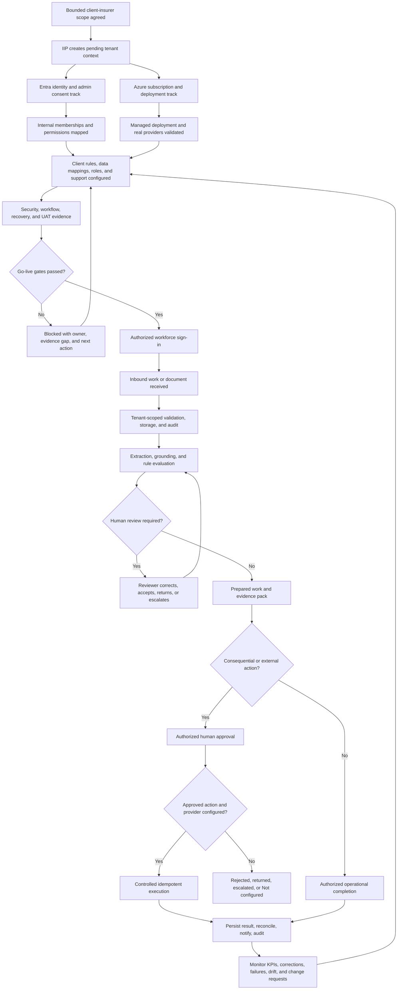
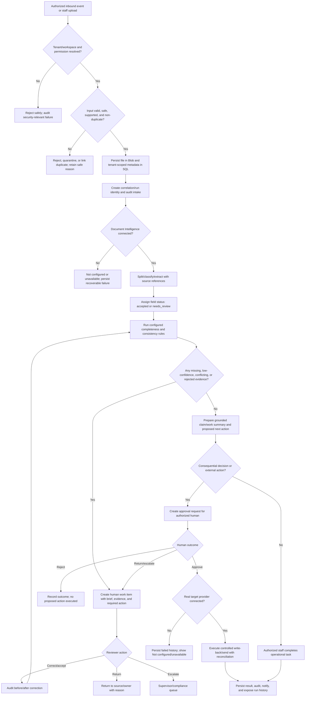
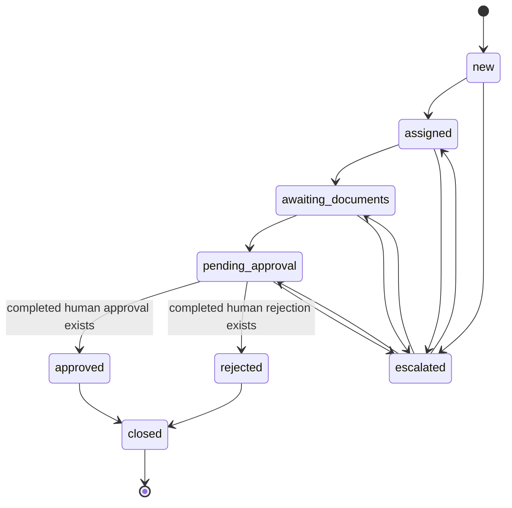

# IIP End-to-End User Flow Architecture

| Field | Value |
|---|---|
| Product | Insurance Intelligence Platform (IIP) |
| Staff application | IIP Operations |
| Version | 1.2 |
| Status | Proposed design baseline; requirements, research validation and client rules remain gated |
| Audience | Product, Design, Engineering, QA, Delivery, Client Insurer, Security, Compliance, Support |
| Date | 2026-08-07 |

## 1. Purpose and authority

This document turns the existing IIP architecture, client-pilot material, and Bevaya benchmark findings into complete user flows. It covers:

1. client-insurer onboarding and readiness;
2. workforce sign-in and workspace resolution;
3. authorized work or document intake;
4. extraction, evidence review, correction, and completeness checking;
5. claim review, human approval, controlled write-back, and communication;
6. failures, retries, cancellation, re-entry, notifications, and measurement;
7. insurer, IIP/Otic, and shared responsibilities.

Authority order remains:

1. `AGENTS.md`;
2. `IIP_IMPLEMENTATION_GUARDRAILS.md`;
3. implementation contracts and current code;
4. this flow document.

Route names, destination labels, navigation ownership, and screen IDs are governed by `iip_information_architecture_navigation_and_screen_inventory.md`. This document owns behavior and transitions, not a competing sitemap.

### Governed Release 1 flow pack

| Artifact | Owns | Must not own |
|---|---|---|
| This document | Canonical lifecycle, responsibility boundary, flow registry, safe exits, and companion-artifact index | Detailed role research model, routes, new enums/permissions, or duplicated implementation status |
| `iip_release_1_role_journey_maps.md` | Evidence-labeled before/within/after journeys, jobs, authority, pain points, and handoffs | Routes, permissions, insurer policy, or validated-user claims |
| `iip_release_1_intelligence_layer_service_blueprint.md` | System/data/provider boundaries, authoritative facts, remote-operation failure, reconciliation, human/AI authority | New adapters, retry values, client rules, or code contracts |
| `iip_release_1_task_flow_exception_state_catalog.md` | Stable flow/step/decision/exception/state IDs, task transitions, recovery, coordinated UI patterns, permission/audit gaps | New routes, state enums, permissions, or audit events |
| `iip_release_1_interaction_authority_and_inventory.md` | Critical-action coverage, artifact contracts, evidence/assumption/constraint/decision ledger, and dimensioned design-to-runtime parity | Detailed task transitions, new runtime contracts, or aggregate implementation claims |
| `iip_release_1_action_purpose_human_ai_authority_contracts.md` | Action purpose, user intent, feedback, attention demand, authority classes, meaningful oversight, and human/AI boundaries | Routes, current permissions, insurer policy, detailed control states, or implementation-complete claims |
| `iip_release_1_surface_control_interaction_contracts.md` | Reusable control states and coordinated cues, evidence, approval, dialog, panel, table, and status-region behavior | Domain state/authority, routes, permissions, visual-token values, or implementation-complete claims |
| `iip_release_1_interaction_accessibility_and_runtime_parity.md` | Accessibility requirements on every interaction, low-fidelity screen state and complex pattern plus client/API/provider/concurrency/audit/idempotency reconciliation | New runtime contracts, formal WCAG conformance claims, legal advice or protected-runtime completion |
| `../01-strategy-requirements-roadmap/iip_release_1_interaction_requirements_traceability.md` | Per-action requirements, acceptance, permissions, audit, flow/state/screen/API/test/UAT links and readiness | Duplicate behavior definitions, invented runtime contracts, or aggregate completion claims |
| `iip_release_1_state_exception_recovery_contracts.md` | Independently changing region states and shared confirmation, cancellation, duplicate/idempotency, interruption, stale/conflict, session-expiry, succession, and recovery rules | New runtime state, retry/session values, insurer policy, or implementation-complete claims |
| `iip_release_1_low_fidelity_wireframe_state_inventory.md` | Low-fidelity screen coverage, shared layout anatomy, seven required state variants, role/entry/responsive mapping and wireframe QA priority | Routes, business rules, visual approval, implementation or participant-validation claims |
| `iip_release_1_responsive_adaptive_reflow_contract.md` | Intrinsic desktop/tablet/mobile reflow, navigation and component transformations, input/capability adaptation, state/focus preservation and responsive test scenarios | Device-specific authority, new routes/states, implementation parity, accessibility conformance or user-validation claims |
| `iip_release_1_complex_operational_pattern_contracts.md` | Task-level queue, evidence-review, approval-cockpit, table, panel and dialog anatomy, state coordination, ownership, recovery, adaptations, analytics and tests | Product policy, runtime state/authority, component implementation, accessibility conformance or practitioner findings |
| `../04-testing-security-quality/iip_release_1_assessor_handoff_ethical_review.md` | Focused minimum-disclosure, claimant-privacy, external-professional-access, fairness/feedback and contestability assessment | Legal advice, insurer policy, runtime authority, practitioner findings or activation approval |

The Release 1 requirements baseline owns obligations; the acceptance register, UAT script, and RTM own validation evidence. Current code/OpenAPI remains implementation truth. A companion artifact may cite an owning contract but must not silently redefine it.

This document does not create new API routes, persistence enums, permissions, approval rules, SLA thresholds, or autonomous decision rights. Labels prefixed `ONB`, `AUTH`, or `OPS` are journey markers only until a separate implementation decision models them as durable states.

## 2. Scope contract

| Element | Definition |
|---|---|
| Primary actor | Authorized client-insurer workforce user |
| Primary goal | Turn authorized inbound insurance work into reviewed, evidence-backed, auditable work without giving AI final decision authority |
| Secondary goal | Onboard an insurer and prove identity, configuration, provider, workflow, UAT, and support readiness before activation |
| Entry triggers | Signed implementation scope; staff sign-in; authorized channel event; manual upload; staff-created FNOL/case |
| Preconditions | Valid runtime profile; server-resolved tenant/workspace; required permission; configured provider or honest `Not configured`; approved workflow/rules; audit and correlation context |
| Success | Human-reviewed work and any authorized external action are recorded with tenant/workspace scope, evidence, actor, timestamps, provider metadata, and audit history |
| Safe exits | Awaiting client input; unauthorized; not found/not visible; `Not configured`; provider unavailable; review returned; approval rejected/escalated; failed action retained for recovery; user cancellation before irreversible execution |
| System boundary | IIP Operations, `/api/v1`, Application services, Azure persistence/providers, workflow control plane, audit, telemetry |
| External boundary | Insurer Entra tenant, Azure subscription, core insurance systems, email/channel providers, policyholder/claimant/broker inputs, regulator or third-party systems where separately authorized |

### Explicitly out of scope

- AI approval or rejection of claims.
- AI repudiation, settlement approval, payment release, policy binding, pricing, adverse underwriting outcome, fraud determination, final complaint response, or regulatory submission.
- Invented regulator, payment, identity, core-system, or data-sharing integrations.
- Client-specific rules not yet confirmed.
- A new onboarding API or persisted onboarding state machine.
- Production use of mock, simulated, placeholder, seeded-demo, fallback, in-memory, SQLite, or development-auth behavior.

## 3. Terminology and actors

Canonical domain language lives in repository-root `CONTEXT.md`. `Customer` is ambiguous and must not be used alone in implementation requirements.

| Required term | Meaning |
|---|---|
| Client Insurer / Tenant Organization | The organization buying, configuring, and operating IIP; may also be a broker, TPA, HMO, or bancassurance organization |
| Policyholder / Claimant / Prospect / Broker | External person or intermediary interacting with the insurer |
| Client-insurer workforce user | Authenticated staff member using IIP Operations |
| IIP/Otic operator | Publisher, delivery, support, or platform-operations staff acting within approved access |
| IIP system actor | Application service, workflow worker, or provider adapter; never a human decision-maker |

### Actor goals and authority

| Actor | Goal | May decide | Must not do |
|---|---|---|---|
| Client executive sponsor | Approve scope, risk posture, and go/no-go | Pilot or rollout acceptance | Grant application permissions directly from a browser or token claim |
| Client operations owner | Define workflow, rules, SLAs, queues, and operating model | Operational configuration within platform ceiling | Relax non-bypassable human-decision or audit controls |
| Client Entra admin | Complete organizational consent and coarse entry setup | Entra consent/assignment | Treat consent, `tid`, app role, or group as IIP business authorization |
| Client Azure/subscription owner | Supply deployment subscription and deploy Managed Application | Customer control-plane deployment choices | Treat subscription targeting as application data access |
| Client IT/security owner | Approve data access, connectors, networking, security, and incidents | Client-side technical controls | Send secrets through ordinary documents, logs, or UI fields |
| Claims/document reviewer | Review evidence, correct fields, prepare work | Evidence acceptance/correction and non-consequential work preparation | Approve outside assigned permission and approval policy |
| Human approver/supervisor | Review evidence and record consequential outcomes | Authorized human approval, rejection, return, or escalation | Approve without evidence or outside tenant/workspace scope |
| Compliance/audit user | Inspect history, evidence, access, and exports | Compliance review/sign-off in assigned scope | Alter append-oriented audit history |
| IIP/Otic delivery/operator | Configure platform-owned components and prove readiness | Platform release/support actions within approved access | Decide insurer claims or silently change client business policy |
| IIP system/AI | Retrieve, extract, summarize, flag, draft, route, and record | Deterministic technical routing inside approved rules | Make consequential insurance decisions or execute unapproved external actions |
| External sender | Submit a message, form, email, or document | Content submission only | Gain staff authority by supplying identifiers or instructions in content |

## 4. Responsibility boundary

| Area | Client insurer owns | IIP/Otic owns | Shared |
|---|---|---|---|
| Business scope | Included products, workflows, branches, exclusions, success definition | Explain supported capability and platform ceiling | Bounded implementation charter |
| Governance | Accountable executives, approvers, legal basis, regulatory review, decision policy | Technical governance controls, auditability, provider transparency | Risk assessment, acceptance gates, change control |
| Identity/access | Authorized users, Entra admin consent, joiner/mover/leaver inputs | Multitenant app, secure token validation, internal membership/permission enforcement | Role mapping and access tests |
| Deployment | Target subscription, region/residency constraints, client approvals | Managed Application package, IaC, protected-runtime validation | Deployment and recovery rehearsal |
| Data | Lawful data, quality, labels, retention requirements, approved test corpus | Secure storage, tenant isolation, data-flow implementation, redaction controls | Mapping, minimization, migration validation |
| Workflow rules | Required documents, SLAs, approval thresholds, escalation owners | Typed rule enforcement, versioning, queues, evidence, safe defaults | Workflow mapping and acceptance |
| Integrations | Source-system access, client contacts, schemas, credentials through approved channels | Provider-agnostic ports, adapters, health, idempotency, diagnostics | Mapping, reconciliation, outage procedure |
| AI quality | Domain reviewers, representative samples, acceptance tolerance | Evaluation tooling, model/provider metadata, safe routing, drift signals | Ground truth, calibration, severe-error review |
| Human decisions | Final consequential insurance decisions | Enforce non-bypassable human gate | Evidence presentation and decision audit |
| Adoption | Staff participation, training attendance, process ownership | Product guidance, training material, support enablement | UAT, pilot support, feedback cadence |
| Operations | Business continuity and client incident contacts | Monitoring, platform incident response, runbooks, recovery tooling | Incident triage and communications |

Therefore, this is not “all on the customer side.” The insurer owns its business authority and lawful operating inputs; IIP/Otic owns the product's technical safety and dependable execution; successful implementation requires shared configuration and verification.

## 5. Canonical end-to-end lifecycle



## 6. Flow A — client-insurer onboarding and activation

### A1. Shortest successful path

| Step | Journey marker | Initiator | Action and system response | Data changed | Feedback/next state |
|---:|---|---|---|---|---|
| 1 | `ONB-01 Scope pending` | IIP/Otic delivery | Create a pending internal Tenant record after bounded scope is agreed | Pending tenant metadata | Onboarding link/checklist issued |
| 2 | `ONB-02 Intake` | Client sponsor/admin | Provide legal name, expected Entra tenant/domain, initial admin, workspaces, deployment subscription IDs, contacts, and constraints | Onboarding intake | Missing or invalid fields shown; no activation |
| 3 | `ONB-03 Identity consent` | Client Entra admin | Sign in with insurer work account and complete admin consent | External Entra tenant lookup metadata | Consent success is acknowledged but does not grant business access |
| 4 | `ONB-04 Deployment target` | Client Azure owner | Supply target Azure subscription ID(s) separately | Deployment-target metadata | Invalid/CSP-reseller blocker shown before private-plan work |
| 5 | `ONB-05 Bootstrap access` | IIP system/operator | Validate onboarding state; create bootstrap membership in IIP store | User/membership/role assignment | Runtime access still requires resolver and permission lookup |
| 6 | `ONB-06 Configuration` | Client + IIP/Otic | Configure roles, branches/workspaces, rules, templates, providers, mappings, SLAs, retention, support, and escalation | Versioned tenant configuration | Readiness gaps remain visible with owner/date |
| 7 | `ONB-07 Validation` | Client testers + IIP/Otic | Validate real providers using approved synthetic Staging/UAT records, role isolation, workflows, audit, failure, recovery, and human gates | Test evidence/defects/sign-offs | Critical failures block progression |
| 8 | `ONB-08 Activation decision` | Authorized human signatories | Record go/no-go against release and client acceptance evidence | Activation/sign-off record | Only a passed gate permits operational activation |

### A2. Onboarding decisions

| Decision | Condition | Owner | Pass path | Fail/recovery path |
|---|---|---|---|---|
| Scope bounded? | Included/excluded workflows, users, data, and human gates documented | Client sponsor + IIP/Otic | Create pending tenant | Return charter for completion |
| Entra identity valid? | Organizational account, expected tenant/domain, signed state, successful consent | Client Entra admin + IIP identity service | Store external identity lookup | Retry consent; no membership from callback alone |
| Deployment target valid? | GUID valid, audience route supported, CSP blocker absent | Client Azure owner + IIP/Otic operations | Prepare private-plan/deployment | Correct subscription or choose approved deployment route |
| Membership authorized? | Internal membership and workspace role exist | Client admin + IIP permission store | Permit scoped runtime resolution | Deny; admin corrects membership |
| Rules complete? | Required documents, SLA, approval, escalation, communication, retention, and support decisions signed | Client owners | Freeze/version configuration | Remain configuration-blocked |
| Providers ready? | Protected runtime resolves only to real configured providers; health passes | IIP/Otic + client IT | Proceed to UAT | `Not configured`/unavailable; owner remediates |
| UAT accepted? | Critical scenarios pass; no open critical defects; high defects resolved or signed workaround | Client signatories | Activation decision | Fix and rerun affected scenarios |

### A3. Parallel identity/deployment rule

The Entra tenant ID and Azure subscription ID are separate inputs:

- Entra tenant ID supports workforce identity lookup and consent.
- Azure subscription ID supports private-plan audience targeting and deployment.
- Neither grants runtime business access.
- Runtime authority remains `AuthenticatedTenantResolver` → `IPermissionReadRepository` → `TenantContext`.

## 7. Flow B — workforce sign-in and workspace entry

```mermaid
sequenceDiagram
    actor User as Client workforce user
    participant Portal as IIP Operations
    participant Entra as Microsoft Entra ID
    participant API as IIP API
    participant Resolver as AuthenticatedTenantResolver
    participant Perms as IPermissionReadRepository

    User->>Portal: Open Login at /
    Portal->>Entra: Organizational sign-in
    Entra-->>Portal: Validated token
    Portal->>API: Request /api/v1 with bearer token
    API->>Resolver: Resolve tid + oid identity hint and requested workspace
    Resolver->>Perms: Get effective membership
    alt Membership and permission valid
        Perms-->>Resolver: TenantId, WorkspaceId, roles, permissions
        Resolver-->>API: Server-authoritative TenantContext
        API-->>Portal: Authorized response
        Portal-->>User: Enter /app with permitted navigation and honest states
    else No valid membership or workspace access
        Perms-->>Resolver: No effective membership
        API-->>Portal: Unauthorized/forbidden safe response
        Portal-->>User: Access denied; contact tenant admin
    end
```

### B1. Alternate and recovery paths

| Condition | System behavior | User recovery | Owner |
|---|---|---|---|
| Token invalid/expired | Reject request; do not create session authority | Reauthenticate | User + identity platform |
| Consent incomplete | Do not bootstrap operational access | Authorized admin resumes onboarding | Client Entra admin |
| Valid token, no IIP membership | Deny without revealing tenant data | Contact client tenant admin | Client admin |
| Workspace requested but not assigned | Deny or show authorized workspace selector only | Select assigned workspace/request access | User + client admin |
| App role exists but fine permission missing | API denies action | Admin updates internal IIP membership if justified | Client admin |
| User leaves and returns | Revalidate token, membership, permissions, and workspace | Resume from durable work-item/case pointer only | IIP system |
| Permission changes during session | Next request re-resolves current authority | Refresh/re-enter; no stale authority retained | IIP system |

## 8. Flow C — document-to-reviewed-work operation

This is the first proof flow in the Bevaya-parity release blueprint. “Decision” means preparation and routing of evidence-backed work. It never means autonomous claim approval or rejection.

### C1. Shortest successful path



### C2. Operational steps and ownership

| Step | Initiator | IIP behavior | Human/system gate | Durable evidence |
|---:|---|---|---|---|
| 1. Receive | External channel, integration, or authorized staff | Validate source, resolve tenant/workspace, assign correlation/run identifiers | Reject unresolved tenant/workspace | Intake and security audit events |
| 2. Validate | IIP system | Validate file/type/size/schema; scan or quarantine using selected security service | Malware-scanning service remains an implementation decision | Validation outcome and safe reason |
| 3. Deduplicate | IIP system | Use approved source/event/document identity and reconciliation rules | Ambiguous match routes to human review | Idempotency/dedup record; strategy still open where not implemented |
| 4. Store | IIP system | Store bytes in Blob; metadata in Azure SQL; never raw evidence in chat session state | Storage/provider health | Blob reference, metadata, audit |
| 5. Extract | IIP system | Check provider health, then classify/extract through provider interface | `Not configured` or unavailable stops downstream stale work | Provider/model/version, source page/coordinates, field confidence |
| 6. Evaluate | IIP system | Apply configured required-document, confidence, and consistency rules | No configured rule means no invented requirement | Rule version, gaps, exceptions |
| 7. Review | Claims/document reviewer | Show original evidence beside extracted values; accept, correct, reject, return, or escalate | `documents.review` and tenant/workspace scope | Before/after values, reason, reviewer, timestamp |
| 8. Re-evaluate | IIP system | Re-run completeness after correction | Downstream work remains blocked until current evidence is evaluated | Re-evaluation event and result |
| 9. Prepare | IIP AI/Application services | Re-retrieve authoritative evidence; create summary, exception brief, and proposed action | Evidence missing/conflicting routes to human | Evidence references, provider/prompt version, bounded output |
| 10. Decide | Authorized human | Review evidence and record approve/reject/return/escalate | `ApprovalDecisionGuard`; tenant policy may only narrow capability | Human actor, outcome, reason, evidence, timestamp |
| 11. Execute | IIP system after approval | Validate permission, approval evidence, provider health, action schema, and target; execute or fail safely | Consequential types require completed human approval | Pending/succeeded/failed history, external reference, correlation ID |
| 12. Close/monitor | Staff + IIP system | Notify authorized recipients, surface outcome, maintain audit/run history, measure flow | Claim closes only through canonical claim graph | Audit, notifications, KPIs, improvement input |

## 9. Separate state domains

The UI and implementation must not collapse unlike state machines into one generic `status`.

| Domain | Current authoritative states or values | Rule |
|---|---|---|
| Case operational status | Current `CaseStatus`: `New`, `Assigned`, `InReview`, `MissingDocuments`, `ReadyForReview`, `PendingApproval`, `ReadyForExport`, `Escalated`, `Settled`, `Closed` | This enum is implementation truth, not proof that settlement/closure semantics are approved. Release 1 stops at approval preparation/export; `Settled`/`Closed` activation requires OQ-020. |
| Extracted field review | `accepted`, `needs_review`, `corrected`, `rejected` | Human corrections/status changes are tenant-scoped and audited |
| Completeness gap | `missing`, `low_confidence`, `needs_review` | Derive only from configured rules and received evidence |
| Write-back history | `pending`, `succeeded`, `failed` | Persist failure before surfacing provider exception |
| Provider health | connected/configured equivalent, `Not configured`, unavailable | Never convert missing/unhealthy provider into simulated success |
| Human work item | Existing control-plane work-item states only | Do not add a new enum from this document; support accept-prepared-work, return, escalation, and durable re-entry |
| Workflow run/node | Existing durable run/node states only | Preserve run ID, bounded output, failure code, retries/DLQ, and diagnostics |

### Proposed claim transition overlay — not the current code contract

The diagram below is a design hypothesis and conflicts with the current `CaseStatus` enum. Do not implement it as written. Reconcile claim decision, settlement, payment, export and closure meanings through OQ-020 and a domain/architecture decision before activating terminal workflows.



No direct `new` → `approved` or `rejected` transition is allowed. The transition service verifies an already-recorded human outcome; it does not create the decision.

## 10. Decision table

| ID | Decision condition | Decision owner | True path | False/unknown path |
|---|---|---|---|---|
| D-01 | Authenticated identity valid? | Entra validation + IIP API | Resolve membership | Reject/re-authenticate |
| D-02 | Effective tenant/workspace membership and permission valid? | IIP permission services | Continue scoped action | Deny without data disclosure |
| D-03 | Inbound source mapped to tenant/workspace? | IIP integration configuration | Process | Quarantine/hold; operator resolves mapping |
| D-04 | Input valid and safe? | IIP validation/security controls | Store/process | Reject or quarantine with safe reason |
| D-05 | Duplicate or replay? | Approved idempotency/reconciliation rule | Link/no-op or route ambiguous match | Create new canonical record |
| D-06 | Required provider configured and healthy? | IIP provider health | Call provider | `Not configured` or unavailable; no stale downstream run |
| D-07 | Extraction/rule result requires review? | Configured deterministic rule | Create work item | Continue to completeness/preparation |
| D-08 | Required documents complete? | Configured completeness rules | Prepare work | Request/await evidence; no invented checklist |
| D-09 | Evidence current, sufficient, and non-conflicting? | Application rule + reviewer | Prepare proposal | Return/escalate/retrieve again |
| D-10 | Action consequential? | Platform action classification | Human approval mandatory | Apply permission and tenant policy for low-risk action |
| D-11 | Human approval evidence valid for exact action? | Approval service/repository | Permit controlled execution | Block, return, reject, or escalate |
| D-12 | External provider confirms action? | Provider adapter + reconciliation | Mark succeeded | Mark failed; retain history and recovery path |
| D-13 | Claim transition allowed? | `ClaimWorkflowTransitionGraph` | Persist transition and audit | Conflict; leave prior state unchanged |

## 11. Error and recovery matrix

| Failure/edge case | User-visible outcome | Data/audit outcome | Recovery | Responsible owner |
|---|---|---|---|---|
| Invalid/expired token | Unauthorized; sign in again | Security telemetry; no business read/write | Reauthenticate | User/Entra |
| Cross-tenant or hidden record request | Not found/not visible or forbidden | Permission failure audit as appropriate | Correct membership/request | Client admin + IIP |
| Missing mailbox/source mapping | Processing held; no case created | Quarantine/failed integration event | Configure mapping, then replay idempotently | Shared |
| Unsupported/corrupt file | Clear rejected-file state | Safe validation reason; no extraction | Replace file | External sender/reviewer |
| Suspected malware | Quarantined; no downstream processing | Security event; restricted evidence | Security runbook | IIP/Otic + client security |
| Duplicate event/document | Existing item linked or ambiguous-review item | Dedup/reconciliation evidence | Reviewer resolves ambiguity; replay remains no-op | Shared |
| Blob/storage failure | Upload failed; no fake success | Failed upload/audit record as designed | Retry after health restored | IIP/Otic |
| Document provider not configured | `Not configured` | No provider call; recoverable run/work state | Configure provider, then authorized retry | IIP/Otic + client IT where access needed |
| Document provider unavailable/timeout | Temporarily unavailable | Mark extraction failed; audit failure | Bounded retry, then work item/DLQ per approved policy | IIP/Otic |
| Provider returns empty fields | Honest empty result, not fabricated fields | Completion audit with empty output | Human review or resend better evidence | Reviewer/sender |
| Low confidence/conflicting fields | Review required with source evidence | Field status/gap and work item | Correct/reject/escalate; re-run completeness | Reviewer |
| No configured completeness rules | No invented gaps; configuration warning where applicable | Empty result and configuration trace | Configure/version rules before operational reliance | Client operations + IIP/Otic |
| Concurrent field correction | Stale update rejected/conflict shown | Preserve winning version and audit | Reload current evidence and reapply intentionally | Reviewer + IIP |
| User leaves mid-review | Work remains durable, unapproved | No completion event | Resume from work queue; re-check permission and latest evidence | IIP system |
| Approval returned/rejected | Proposed action not executed | Human outcome and reason audited | Correct/resubmit if allowed or end path | Human approver/reviewer |
| Approval expires or policy changes | Execution blocked | Stale/invalid approval evidence retained | Re-evaluate and obtain new approval | Human approver + IIP |
| Write-back provider not configured | Failed history and `Not configured` | Attempted/failed audit; no external change claimed | Configure provider; reconcile before retry | Shared |
| Network ambiguity after external call | Pending/failed/manual-intervention state per future policy | Preserve correlation/external reference | Reconcile target before any retry | IIP/Otic + client IT |
| Retry exhausts / poison message | Operator-visible failure/DLQ | Attempts, failure code, run history | Authorized replay after cause fixed | IIP/Otic support |
| Notification send fails | Work outcome remains separate from send outcome | Failed send record/audit | Retry/re-draft per policy; never claim sent | IIP/Otic + client communications owner |
| Claim already closed | Transition conflict | No status change | Reopen only through a separately approved future rule | Client operations/product decision |

## 12. Cancel, undo, retry, save, resume, and concurrency

| User need | Required behavior |
|---|---|
| Cancel before submission | Discard unsaved local edits or confirm if material work would be lost; no workflow transition |
| Save draft | Persist only where an existing draft contract supports it; identify author/version; do not treat draft as approval |
| Leave and resume | Resume from durable case/work item/run reference; re-resolve permission and re-retrieve current evidence |
| Undo field correction | Do not erase audit history; submit a new reviewed correction restoring the prior value with reason |
| Return work | Require reason; route to named source/queue; keep work visible and resumable |
| Retry provider step | Require failed/retryable state, current permission, bounded policy, and same idempotency identity |
| Retry external action | Reconcile external target first; do not blindly repeat after timeout or ambiguous confirmation |
| Cancel queued work | Allowed only before irreversible provider execution and only under an approved permission/policy; preserve cancellation audit |
| Concurrent review | Use optimistic concurrency/version check; stale reviewer reloads current values before resubmission |
| Concurrent approval | First valid committed outcome wins unless the approval contract explicitly supports multi-person approval; later stale actions fail safely |
| After write-back | No generic undo. Use an explicit compensating action with its own permission, human approval, provider support, and audit |

## 13. Notifications and escalation

Notifications are separate from workflow truth. A failed notification must not roll back or falsely change the underlying case, approval, or write-back outcome.

| Event | Recipient | Content boundary | Channel behavior |
|---|---|---|---|
| Work item assigned | Authorized reviewer | Case/work reference, reason, due/SLA context; minimum sensitive data | In-app required; external notification only if configured |
| Review returned | Prior owner/queue | Return reason and required correction | In-app; configured email/Teams optional |
| SLA risk/breach | Supervisor/operations owner | Queue/item reference and timing | Deduplicate repeated alerts; escalation policy client-configured |
| Approval requested | Authorized approver | Proposal, evidence references, action class, expiry if configured | Never include approve-by-link without secure authenticated review |
| Approval outcome | Requester and authorized stakeholders | Human outcome and next action | Policyholder notification remains separate and reviewed |
| Provider/run failure | IIP/Otic support and client technical contact where relevant | Safe failure code, correlation ID, impact | No raw payload, secret, token, or provider stack trace |
| DLQ/manual intervention | Authorized operator | Run/node, attempt count, safe failure, replay requirements | Requires owned response target |
| Customer communication ready | Authorized communications reviewer | Draft and evidence context | Human review before sensitive send |
| External action succeeded/failed | Initiator/operations owner | Confirmed outcome or explicit failure | Never state success without provider confirmation |

## 14. Analytics and evidence

### Required flow events

- onboarding started, identity consent completed/failed, deployment target validated/blocked;
- readiness gate passed/failed and UAT scenario result;
- sign-in authorized/denied and workspace resolution result;
- intake accepted/rejected/quarantined/deduplicated;
- upload stored/failed;
- extraction started/completed/failed;
- review routed, opened, corrected, returned, escalated, completed;
- completeness checked and gap status changed;
- proposal prepared and evidence retrieved;
- approval requested, approved, rejected, returned, escalated, expired;
- write-back/send attempted, succeeded, failed, reconciled, retried;
- run retried, exhausted, dead-lettered, replayed, cancelled;
- user abandoned and resumed work.

### Safe event dimensions

Use tenant/workspace, correlation ID, run/work-item ID, action class, provider/model/version, rule/workflow version, outcome, duration, attempt count, review reason code, and human-review status where applicable. Do not put raw documents, OCR text, claim/policy content, email bodies, prompts, secrets, tokens, or unnecessary personal data into telemetry.

### Outcome metrics

| Category | Measures |
|---|---|
| Flow | End-to-end cycle time, stage latency, throughput, abandonment, resume rate |
| Quality | Class/field accuracy, severe-error rate, duplicate rate, evidence-link success |
| Human review | Review coverage, minutes per item, correction/override rate, return/escalation rate |
| Reliability | Provider failure, retry success, DLQ rate, reconciliation backlog, notification failure |
| Governance | Unauthorized attempts, approval bypass attempts, stale-action conflicts, audit completeness |
| Business | SLA-risk reduction and operational outcomes against client-approved baseline; no fabricated ROI |
| Economics | Cost per processed bundle/work item, provider cost, storage, support, and review cost |

Metrics must be segmented by document type, source quality, insurer/workspace, product, workflow version, and severity where lawful and useful. Aggregate “accuracy” alone is insufficient.

## 15. UI and interaction requirements

- `/` is Login; authorized staff enter the `/app/*` operator tree.
- Every state supports loading, empty, error, unauthorized, and `Not configured` presentation.
- Work items show: brief, exception reason, evidence, proposed action, required human action, run status, and safe diagnostics.
- Document review shows original evidence beside extracted fields and source coordinates where available.
- Approval controls name the exact action and make the human-decision boundary explicit.
- Buttons reflect current server authority and state, but API permission/state checks remain authoritative.
- Pending/failed/returned work remains reachable from a queue; no dead-end confirmation screen.
- Long-running work shows accepted/queued progress, last update, safe retry status, and a route back to the work queue.
- Customer-facing content never exposes internal notes, reserves, fraud/risk signals, prompts, model traces, raw provider errors, or restricted audit details.
- Untrusted email, OCR, document, customer, and AI content is rendered safely; content instructions never become tool authority.

## 16. Flow completeness verification

| Check | Result |
|---|---|
| Initiator, entry point, trigger, and preconditions named | Covered in scope and each flow |
| Data changed and next-state rule visible | Covered in step and decision tables |
| Success and safe exits defined | Covered |
| Invalid input, latency, provider failure, timeout, duplicate, and concurrency covered | Covered |
| Cancel, undo, retry, save, resume, and leave/re-entry covered | Covered, with unsupported operations explicitly bounded |
| Human/system decision ownership explicit | Covered |
| Notifications and recipients defined | Covered without assuming configured providers |
| Analytics and audit signals defined | Covered with sensitive-data exclusions |
| Every non-terminal path has a next action | Covered; configuration, human-input, and manual-intervention waits retain owner and route |
| Consequential AI decision path exists | No; prohibited |
| Cross-tenant or client-controlled authorization path exists | No; prohibited |

## 17. Assumptions and unresolved rules

The following are not decided by this document:

| ID | Open decision | Owner | Flow impact |
|---|---|---|---|
| UF-OQ-01 | First signed client insurer and exact pilot workflows | Product/Commercial/Client sponsor | Actors, configuration, corpus, training, UAT |
| UF-OQ-02 | First core insurance system and read-only, export, or write-back depth | Product/Engineering/Client IT | Integration states, reconciliation, recovery |
| UF-OQ-03 | Client-specific document lists, SLAs, roles, branches, thresholds, and escalation routes | Client operations | Rule decisions and queues |
| UF-OQ-04 | Malware scanning/quarantine service and operator procedure | Security/Engineering | Intake validation and recovery |
| UF-OQ-05 | Idempotency keys, retry limits, backoff, DLQ retention, and replay authority for each provider/action | Engineering/Operations/Security | Duplicate prevention and recovery |
| UF-OQ-06 | Approval expiry, two-person approval thresholds, delegation, and concurrent-decision policy | Client governance/Product | Approval state and stale-action handling |
| UF-OQ-07 | Which low-risk communications, if any, may be sent under pre-approved policy | Client governance/Compliance | Draft/send review path |
| UF-OQ-08 | Compensating-action policy after confirmed write-back | Client operations/Engineering/Compliance | Undo and reconciliation |
| UF-OQ-09 | Final deployment route, region, private networking, data residency, retention, and support-access model | Leadership/Client IT/Security/Legal | Onboarding and go-live gates |
| UF-OQ-10 | First outbound/inbound channel providers and client mailboxes | Product/Integrations/Client IT | Notification and ingestion paths |
| UF-OQ-11 | Uganda-specific evaluation corpus, lawful basis, label policy, acceptance tolerances, and severe-error thresholds | Client domain owners/Compliance/IIP AI quality | Review routing and release evidence |
| UF-OQ-12 | Claim reopen policy after `closed` | Product/Client operations/Compliance | Terminal-state recovery |

## 18. Implementation traceability

| Flow area | Existing authority or implementation surface |
|---|---|
| Login and app entry | `/` and `/app/*`; multitenant Entra; `AuthenticatedTenantResolver`; `IPermissionReadRepository` |
| Case/FNOL | `POST /api/v1/cases`; Claim Intake and Workflow Transition services |
| Document upload/list | `GET/POST /api/v1/cases/{caseId}/documents` |
| Document review | correct-field, reclassify, and approve-extraction routes under `/api/v1/cases/{caseId}/documents/{documentId}` |
| Completeness | `GET /api/v1/cases/{caseId}/document-checklist`; `ICompletenessCheckService` |
| Workflow evaluation | `POST /api/v1/cases/{caseId}/workflow/evaluate` |
| Approval | `/api/v1/approvals` query and decision routes; `ApprovalDecisionGuard` |
| Claim state | `ClaimWorkflowTransitionGraph` and completed-human-approval evidence check |
| Write-back | Integration Write-Back Execution service; provider adapter and history |
| Communication | Notification Draft/Send services and provider-agnostic outbound adapter |
| Audit | `IAuditWriter`, audit repository, `/api/v1/compliance/*` |
| Workflow operations | Automation Studio, Agent Work Items, Agent Run Debugger, durable workflow control plane |
| Readiness | Client Readiness Checklist, Client Configuration Workbook, UAT Plan, release gates |

This flow architecture should be used to derive screen-state inventories, acceptance tests, analytics schemas, service contracts, and client implementation workshops. Any change that creates a new status, route, permission, irreversible action, or client obligation requires the relevant product/architecture decision and documentation update first.
## 19. WhatsApp thread, reviewed outbound and delivery flow addendum (2026-08-07)

The canonical external-channel flow is defined in `iip_whatsapp_thread_outbound_delivery_spec.md`: signed inbound → server scope/business-number resolution → replay-safe retained thread → authorized case link or manual-link review → exact recipient/content/purpose/basis/language/template preflight → recorded human approval → one idempotent provider attempt → explicit provider-accepted/delivered/read/failed/unknown reconciliation. Re-entry restores retained messages and provider state; no browser success or AI draft is authority.

## 20. Release 1 stable flow registry and validation boundary

| Flow ID | Canonical outcome | Companion detail |
|---|---|---|
| `FLW-R1-AUTH-01` | Current authorized workspace entry and safe resume | Task-flow catalog section 3 |
| `FLW-R1-WA-01` | Verified replay-safe WhatsApp intake and owned correlation | Task-flow catalog; WhatsApp delivery specification |
| `FLW-R1-INTAKE-01` | One scoped case/reference from valid non-duplicate intake | Task-flow catalog |
| `FLW-R1-QUEUE-01` | Explicit owner, next action, return/escalation, and safe handoff | Task-flow catalog; role journeys |
| `FLW-R1-DOC-01` | Durable source and honest extraction/review state | Task-flow catalog; service blueprint |
| `FLW-R1-EVIDENCE-01` | Current reviewed evidence or explicit owned gap with lineage | Task-flow catalog; service blueprint |
| `FLW-R1-ASSESSOR-01` | Purpose-bound minimal versioned assessor referral/report loop: controlled manual baseline, optional configured Graph, claimant notice/contestability, explicit acknowledgement/expiry/reconciliation | Task catalog, DEC-018 ADR, assessor threat and ethical reviews; scope accepted, ethical/security/permission/audit/configuration/UAT blocked |
| `FLW-R1-DECISION-01` | Exact authorized human outcome with valid next state | Task-flow catalog; AIA |
| `FLW-R1-COMMS-01` | Reviewed customer-safe communication and honest delivery state | Task-flow catalog; WhatsApp delivery specification |
| `FLW-R1-HANDOFF-01` | Versioned export or confirmed/reconciled external effect | Task-flow catalog; service blueprint |

Source-complete documentation requires unique and valid IDs, one owner per fact/state, an exit for every nonterminal path, exact current permission/audit mappings or explicit gaps, and no consequential alternate path around `FLW-R1-DECISION-01`.

Local runtime checks can prove contracts and invariants, not target-insurer usability or protected-runtime readiness. Protected UAT remains blocked until environment-matched identities, target role/configuration decisions, real providers or honest `Not configured`, correlated audit/telemetry, and retained execution evidence exist. Practitioner comprehension, workload, trust, and preference remain outside this segment and unvalidated.
