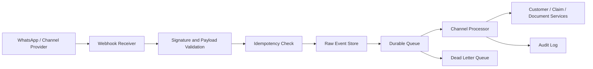

# Hybrid Cloud Mirror / Resilient Channel Buffer Architecture

## Common IIP Context Used

The Insurance Intelligence Platform (IIP) is an Azure-native, human-reviewed insurance operations platform for African insurers and related insurance organizations. It acts as an intelligent operational layer across staff, customers, core insurance systems, documents, channels, knowledge sources, and AI agents. The current MVP direction is Motor Claims & Document Intelligence for a mid-to-large insurer pilot.

Confirmed implementation direction:

- Frontend: Next.js, React, TypeScript, Tailwind CSS.
- Backend: .NET 8 / ASP.NET Core, EF Core, Azure SQL.
- Azure services: Azure SQL, Blob Storage, Key Vault, Azure AI Search, Azure OpenAI, Azure AI Document Intelligence, Service Bus or Event Grid, Functions or Durable Functions, API Management, Application Insights and Log Analytics.
- Identity: Microsoft Entra ID / MSAL / OAuth 2.0.
- Primary internal modules: Command Center, Claims, Documents, Channels, Customers, Sales & Leads, Knowledge Base, Approvals, Compliance & Audit, Reports & Analytics, Integrations, Admin Settings, Support & Health.
- Customer entry points: WhatsApp-first, with web chat, SMS, email, broker, call center, Teams, and website forms as planned or future channels.
- Governance rule: AI prepares insurance work; humans make consequential decisions.

Non-negotiable AI boundary:

- AI may summarize, classify, extract, flag, draft, route, and recommend.
- AI must not approve or reject claims, bind policies, set final premiums, accuse customers of fraud, release payments, promise settlement, or make final regulated decisions.

## Purpose

This document defines the resilient channel buffer concept for IIP. The objective is to protect customer channel interactions, especially WhatsApp-first intake, from message loss and operational confusion during temporary provider, network, or platform disruptions.

## Scope

This document does not define a fully offline IIP platform for MVP. It defines a resilience architecture for channel events, retries, duplicate protection, and recovery.

## Resilience Principles

| Principle | Requirement |
|---|---|
| Do not lose channel events | Incoming messages should be acknowledged, stored, queued, and replayable where provider behavior allows. |
| Avoid duplicates | Retried webhooks must not create duplicate customers, claims, or documents. |
| Fail visibly | If a channel is Not configured or degraded, users must see it. |
| Preserve auditability | Ingestion, retry, failure, and recovery events must be logged. |
| Graceful degradation | Manual intake must remain possible when automation is unavailable. |

## Target Flow

## Core Components

| Component | Responsibility |
|---|---|
| Webhook receiver | Accept channel events, validate signatures, generate correlation IDs. |
| Raw event store | Preserve inbound payload and metadata for replay and troubleshooting. |
| Idempotency service | Prevent duplicate processing of retried events. |
| Durable queue | Buffer work until processors can handle it. |
| Channel processor | Converts messages into customers, leads, claims, tasks, or document records. |
| Dead letter queue | Holds failed events for manual investigation. |
| Provider health monitor | Shows configured/not configured, provider status, failures, and backlog. |

## Idempotency Design

| Key | Usage |
|---|---|
| Provider message ID | Primary duplicate prevention key where available. |
| Channel conversation ID | Groups messages into conversation threads. |
| Attachment hash | Helps prevent duplicate document ingestion. |
| Tenant/workspace/channel ID | Ensures duplicate checks are tenant-scoped. |
| Time window | Supports duplicate detection for providers that lack stable IDs. |

## Failure Modes and Behavior

| Failure Mode | System Behavior | User/Admin Visibility |
|---|---|---|
| Provider not configured | Do not show fake channel data. | Not configured state in Channels/Admin. |
| Webhook validation failure | Reject or quarantine event. | Security/Integration log entry. |
| Queue backlog | Continue accepting if safe; show degraded state. | Provider health and support dashboard. |
| Processor failure | Retry with backoff; dead-letter after threshold. | Integration failure queue. |
| AI service unavailable | Continue intake; skip AI enrichment. | AI degraded state. |
| Document extraction unavailable | Store document; queue extraction later; allow manual review. | Document processing backlog. |

## Manual Recovery Workflow

1. Support reviews provider health and queue metrics.
2. Dead-letter events are inspected with correlation IDs.
3. Events are replayed if safe and idempotency keys confirm no duplicate domain action.
4. Manual claim/customer correction is applied where required.
5. Client is informed if customer-facing updates were delayed.
6. Incident or known issue is recorded where applicable.

## MVP vs Future Capability

| Capability | MVP | Future |
|---|---|---|
| Durable channel queue | Required. | Enhanced multi-region support. |
| Idempotent webhook processing | Required. | Provider-normalized event contracts. |
| Dead-letter handling | Required. | Self-service replay console. |
| Raw event storage | Recommended. | Full event replay analytics. |
| Offline branch app | Out of scope. | Possible future module. |
| Local cloud mirror | Conceptual only unless client requires it. | Edge/local buffer for specific enterprise contexts. |

## Acceptance Criteria

- Incoming channel events are idempotently processed.
- Retried events do not create duplicate claims or documents.
- Failed events are visible and recoverable.
- Provider health is displayed in Admin/Support areas.
- Manual intake path remains usable when automation is degraded.

## Open Questions

| ID | Open Question | Owner | Impact if Unresolved |
|---|---|---|---|
| OQ-01 | Which insurer will be the first signed pilot customer and what exact internal processes will be included? | Product / Commercial | Final configuration, training, and pilot timelines may change. |
| OQ-02 | Which claims/core system will be integrated first, and will MVP require read-only lookup, export, or direct write-back? | Product / Engineering / Client IT | Impacts integration complexity and deployment schedule. |
| OQ-03 | Which Azure deployment path is selected first: customer-tenant Managed Application or Otic-hosted SaaS pilot? | Leadership / Engineering | Impacts tenancy, support access, IaC, billing, and security review. |
| OQ-04 | Which WhatsApp Business provider will be used for the first pilot? | Product / Integrations | Impacts webhook schemas, retry behavior, and channel onboarding. |
| OQ-05 | What client-specific SLAs, roles, branches, claim categories, and document checklists must be configured? | Client Operations | Impacts workflow rules and acceptance testing. |
| OQ-06 | What final regulatory, legal, and data residency requirements must be signed off for the first pilot? | Legal / Compliance | Impacts production readiness and contractual commitments. |
