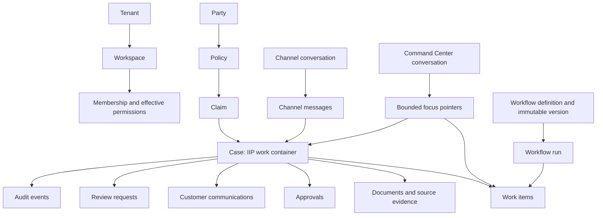

# IIP Information Architecture, Navigation, and Screen Inventory

| Field | Value |
|---|---|
| Version | 1.0 |
| Date | 2026-08-05 |
| Status | Proposed canonical IA; code-reconciled; named approval requested; practitioner validation not yet executed |
| Applies to | Authenticated staff portal `/app/*` |
| Owners required | Product, Insurance, Operations, Design, Architecture, Security/Privacy, Delivery |
| Approval pack | `iip_information_architecture_stakeholder_approval_pack.md` — no named decisions recorded |

## 1. Authority and boundary

This document owns the staff portal's canonical object model for findability, module tree, route-to-label map, navigation layers, screen/state inventory, search/recent-work model, cross-surface handoffs, and IA validation protocol. It does not override business meaning in root `CONTEXT.md`, Release 1 scope, API/domain contracts, server authorization, visual tokens, or detailed workflow state machines.

`iip_release_1_task_flow_exception_state_catalog.md` applies stable `ST-R1-{SURFACE}-{STATE}` behavior to the Release 1 task regions while this document continues to own route/screen IDs and state-profile applicability. The catalog cannot create a route or durable state enum; any conflict resolves to current code plus the owning approved requirement/decision.

Authority order for this segment:

1. `AGENTS.md`, root `CONTEXT.md`, approved product intent, and Release 1 requirements/scope;
2. current Domain/Application contracts, `Program.cs` routes, `/api/v1/me`, mounted portal routes, and tests;
3. this canonical IA projection;
4. platform behavior, flow, recent-conversation, frontend-handoff, and visual specifications;
5. historical route examples, prototypes, fixtures, and screenshots.

A mounted route proves only that a surface exists. It does not prove Release 1 inclusion, live data, permission correctness, usability, or release readiness.

## 2. Evidence, assumptions, constraints, and decisions

| Type | Statement | Evidence/status |
|---|---|---|
| Constraint | Tenant/workspace membership and effective permissions are resolved server-side; browser role selection is never authority. | `AGENTS.md`; `/api/v1/me`; request permission filters |
| Constraint | WhatsApp intake and reviewed follow-up are mandatory Release 1 capabilities. | DEC-017; R1-WA-001–004 |
| Evidence | `/api/v1/me` returns effective permissions, but the portal previously discarded them and filtered navigation from browser role configuration. | Reconciled in `runtimeContext.tsx`, `Sidebar.tsx`, `AppShell.tsx`, `roles.ts` |
| Evidence | Global search now submits to `/app/search`, calls a permission-filtered `/api/v1/search` contract, groups authorized case/document/task/approval results, and records a safe audit event without raw query text. | `TopBar.tsx`; `GlobalSearch.tsx`; `GlobalSearchService`; search tests; protected-runtime validation pending |
| Evidence | Recent Conversations has mounted owner-scoped history routes, SQL persistence, active/archived views, and a sidebar recent list; advanced search/grouping, automatic change summaries, policy approval, and validation remain open. | Companion specification, route mappings, migration, service tests and portal build; local evidence only |
| Evidence | `My Work` now uses a permission-filtered `/api/v1/my-work` projection across workflow tasks, approvals, document reviews, communication reviews, and agent work items while retaining source identity/state and source-owned actions. | Companion My Work specification; service/endpoint tests; portal and visual fixture; protected validation pending |
| Assumption | Work-centered grouping will outperform organization-chart or technology grouping for daily insurance operations. | Desk research/design rationale; tree/card validation pending |
| Assumption | `My Work`, `Claims`, `Channels`, `Customers`, `Documents`, and `Communications` match practitioner vocabulary across target insurers. | Terminology validation pending |
| Decision | Organize global navigation by work, records, specialist work, automation, oversight, platform, and administration. | Proposed IA decision; practitioner and stakeholder approval pending |
| Decision | Keep route labels stable across roles; permissions change visibility and actions, not destination names. | Proposed IA decision |

## 3. UX-plane diagnosis

| Plane | Current status | IA consequence |
|---|---|---|
| Strategy | Release 1 outcome and human-accountability boundary defined; target insurer and practitioner validation pending | Do not claim local vocabulary or task priority is validated |
| Scope | Release 1 staff evidence-review loop and WhatsApp requirements defined; broad portfolio routes still mounted | Mark route scope instead of equating route presence with release inclusion |
| Structure | Object and work models exist across documents but overlap or conflict | This document establishes one findability model and controlled vocabulary |
| Skeleton | Shell, permission-derived navigation, global search, Recent Conversations, and Universal My Work baselines exist locally | Use server permissions for protected visibility; validate handoffs and remaining advanced states |
| Surface | Visual system exists | Labels and states here govern meaning; visual tokens remain elsewhere |

Lowest unresolved plane: **Structure validation**. The proposed taxonomy and terminology need representative practitioner tree testing/card sorting before they can be called validated.

## 4. Canonical object model



| Object | User meaning | Stable identity and lifecycle | Key relationships | Do not call it |
|---|---|---|---|---|
| Tenant | Insurance organization and authority boundary | Tenant ID; active/configured lifecycle | Workspaces, configurations, data | Account, workspace |
| Workspace | Governed operational subdivision | Workspace ID; membership/configuration lifecycle | Queues, records, provider configuration | Tenant, browser context |
| Membership | Server-authoritative access relationship | User + tenant + workspace; active/revoked | Roles and effective permissions | Token role, UI role |
| Party | Person or organization involved in insurance work | Party/customer ID; corrections/merge policy | Policies, claims, communications | User account |
| Policy | Contract and coverage source owned by insurer/core system | Policy number/ID; imported snapshot freshness | Party, coverage, claim | Case |
| Claim | Request for indemnity or benefit | Claim identity and insurer decision lifecycle | Policy, claimant, incident, claim file | Case, work item |
| Case | IIP operational container around claim-related work | Case ID; intake-to-operational closure | Claim context, evidence, tasks, approvals, communication, audit | Claim decision |
| Source evidence | Authoritative material used in work | Source ID, version, dates, provenance, current/superseded state | Case, document, derived artifacts | Chat memory, AI output |
| Document | A file and its processing/review states | Document ID; received/processing/review lifecycle | Case, evidence, extraction, corrections | Evidence decision |
| Work item | Queue-addressable projection of the next owned operational outcome | Type + source identity; owner/status/due/evidence readiness | Case, task, approval, document review, communication review | Record, notification |
| Workflow task | Domain task in a case workflow | Task ID and workflow state | Case, assignment, SLA | Agent work item |
| Agent work item | Human checkpoint in a versioned agent workflow run | Work-item ID and decision state | Workflow run/node, evidence references | Universal work item |
| Approval | Human decision over an exact proposed action/evidence/version | Approval ID; pending/decided/expired | Case, proposed action, approver | Execution, generic permission |
| Proposed action | Prepared next step without inherent authority | Proposal/version/freshness | Evidence, approval, execution | Decision, success |
| Execution | Controlled attempt after valid authority | Correlation/idempotency and provider outcome | Approval, provider, reconciliation | Approval |
| Channel conversation | Customer/broker interaction through WhatsApp or another approved external channel | Provider/channel thread identity | Messages, party, case link | Staff AI conversation |
| Command Center conversation | Staff-owned operational investigation thread | Conversation ID and bounded pointers | Case/work item/evidence references | Source evidence, authorization |
| Communication | Customer-safe outbound intent/content and delivery history | Communication/update ID; draft-to-delivery lifecycle | Case, recipient, channel, approval, provider | Channel conversation |
| Notification | Attention signal pointing to work | Notification ID/read state | Work item or record | Assignment, completion |
| Audit event | Immutable operational reconstruction record | Event/correlation identity | Actor, action, target, versions | Editable note |

The universal `Work item` is an IA projection over several current backend objects. It must not be implemented by silently merging their distinct state machines.

## 5. Operating modes and record anatomy

| Mode | User question | Primary entry | Exit |
|---|---|---|---|
| Orient | What needs my attention, and why? | `My Work`, Command Center, notifications | Open an item/record, assign, filter, or defer where permitted |
| Investigate | What is current, missing, conflicting, or changed? | Case/record workspace, document review, evidence rail | Correct, request evidence, prepare action, hand off, or return |
| Decide and execute | What is proposed, permitted, consequential, and confirmed? | Review cockpit or communication preflight | Approve, reject, return, escalate, execute, cancel, or reconcile |

Every record workspace uses this scan order: identity/current state → next action/waiting reason → critical facts → work/dependencies → evidence/provenance → timeline/communications → related records → progressively disclosed audit/technical detail.

## 6. Canonical sitemap and real routes

```text
IIP staff portal /app
├─ Work
│  ├─ Command Center                         /app
│  ├─ My Work                               /app/work-items
│  ├─ Claims                                /app/claims
│  │  ├─ New claim notification             /app/claims/new
│  │  ├─ Case/claim workspace               /app/claims/[id]
│  │  └─ Extraction review                  /app/claims/[id]/extraction
│  └─ Channels                              /app/channels
├─ Records
│  ├─ Customers                             /app/customers
│  │  └─ Customer record                    /app/customers/[id]
│  ├─ Documents                             /app/documents
│  ├─ Communications                        /app/communications
│  └─ Knowledge                             /app/knowledge
├─ Specialist work
│  ├─ Acquisition                           /app/acquisition
│  ├─ Policy Guidance                       /app/policy
│  ├─ Risk Signals                          /app/fraud
│  └─ Underwriting                          /app/underwriting
├─ Automation
│  ├─ Flows                                 /app/flows
│  │  ├─ New flow                           /app/flows/new
│  │  └─ Flow detail/version                /app/flows/[key]
│  └─ Run detail                            /app/runs/[id]
├─ Oversight
│  ├─ Operations Intelligence               /app/executive
│  └─ Audit & Compliance                    /app/audit
├─ Platform
│  └─ Integrations & Health                 /app/integrations
└─ Platform administration
   ├─ Admin Console                         /app/admin
   ├─ Agents                                /app/admin/agents
   ├─ Agent Policy                          /app/admin/tenant-policy
   ├─ Tenant Onboarding                     /app/admin/onboarding
   └─ Billing & Usage                       /app/admin/billing

Compatibility aliases, not sitemap destinations:
  /app/workflows → My Work presentation
  /app/support   → /app/integrations
  /app/settings  → /app/admin
```

### Route ownership and scope

| ID | Route | Canonical label | Surface owner | Minimum presentation permission | Release posture | Current evidence |
|---|---|---|---|---|---|---|
| IA-SCR-001 | `/app` | Command Center | Command Center | `ViewCommandCenter` | R1 supporting entry | Mounted; real query API; recent-work gap |
| IA-SCR-002 | `/app/work-items` | My Work | Work management | any supported source-view permission; server filters every source | R1 required concept | Universal five-source read projection and portal implemented locally; protected multi-role/usability evidence pending |
| IA-SCR-003 | `/app/claims` | Claims | Cases/Claims | assigned/all claims view | R1 primary | Mounted and API-backed |
| IA-SCR-004 | `/app/claims/new` | New claim notification | Cases | `CreateClaim` | R1 primary | Mounted and API-backed |
| IA-SCR-005 | `/app/claims/[id]` | Case workspace | Cases/Claims | assigned/all claims view | R1 primary | Mounted; shared Case/Claim label must stay explicit |
| IA-SCR-006 | `/app/claims/[id]/extraction` | Extraction review | Documents | claim view plus document action as applicable | R1 primary | Mounted; permission/action checks remain API-owned |
| IA-SCR-007 | `/app/channels` | Channels | Channels | `ViewChannels` | R1 primary; WhatsApp mandatory | Mounted; inbound thread/live-provider continuity incomplete |
| IA-SCR-008 | `/app/customers` | Customers | Customers | `ViewCustomers` | Supporting record | Mounted and API-backed |
| IA-SCR-009 | `/app/customers/[id]` | Customer record | Customers | `ViewCustomers` | Supporting record | Mounted and API-backed |
| IA-SCR-010 | `/app/documents` | Documents | Documents | `ViewAllClaims` | Supporting/global view | Mounted; global API excludes assigned-only users |
| IA-SCR-011 | `/app/communications` | Communications | Communications | assigned/all claims view | R1 supporting | Mounted; WhatsApp outbound/status gap |
| IA-SCR-012 | `/app/knowledge` | Knowledge | Knowledge | `ManageKnowledgeBase` | Conditional provider/source support | Mounted and API-backed |
| IA-SCR-013 | `/app/acquisition` | Acquisition | Sales/Leads | `ViewSalesLeads` | Outside R1 | Mounted and API-backed |
| IA-SCR-014 | `/app/policy` | Policy Guidance | Knowledge/Policy | AI-output or knowledge permission | Conditional/supporting | Mounted presentation contains fixture-shaped content; live contract gap |
| IA-SCR-015 | `/app/fraud` | Risk Signals | Fraud advisory | `ViewFraudSignals` | Outside R1 decision path | Mounted; advisory-only API |
| IA-SCR-016 | `/app/underwriting` | Underwriting | Underwriting | `ViewUnderwriting` | Outside R1 | Mounted; advisory-only API |
| IA-SCR-017 | `/app/flows` | Flows | Agent workflows | `ViewAgentWorkflows` | Supporting control plane | Mounted and API-backed |
| IA-SCR-018 | `/app/flows/new` | New flow | Agent workflows | manage/run permission checked by action | Outside basic R1 path | Mounted; save/publish authority API-owned |
| IA-SCR-019 | `/app/flows/[key]` | Flow detail | Agent workflows | `ViewAgentWorkflows` | Supporting control plane | Mounted and API-backed |
| IA-SCR-020 | `/app/runs/[id]` | Run detail | Agent workflows | `ViewAgentWorkflows` | Supporting control plane | Mounted and API-backed |
| IA-SCR-021 | `/app/executive` | Operations Intelligence | Reporting | `ViewCommandCenter` | Supporting/conditional | Mounted and API-backed; not a broad ROI proof |
| IA-SCR-022 | `/app/audit` | Audit & Compliance | Compliance/Audit | `ViewAuditLog` | R1 required | Mounted and API-backed |
| IA-SCR-023 | `/app/integrations` | Integrations & Health | Platform operations | configure integrations or tenant settings | R1 operational | Mounted; provider state must remain honest |
| IA-SCR-024 | `/app/admin` | Admin Console | Tenant administration | `ManageTenantSettings` | Operational/conditional | Mounted and API-backed |
| IA-SCR-025 | `/app/admin/agents` | Agents | Agent administration | `ManageAgents` | Supporting control plane | Mounted and API-backed |
| IA-SCR-026 | `/app/admin/tenant-policy` | Agent Policy | Agent administration | `ManageTenantSettings` | Supporting governance | Mounted; behavior/config contract review needed |
| IA-SCR-027 | `/app/admin/onboarding` | Tenant Onboarding | Platform onboarding | `ManageTenantOnboarding` | Outside ordinary insurer staff work | Mounted and API-backed |
| IA-SCR-028 | `/app/admin/billing` | Billing & Usage | Commercial administration | `ViewBilling` | Outside R1 | Mounted and API-backed |
| IA-SCR-029 | `/app/workflows` | My Work alias | Work management | work-item or approval permission | Compatibility only | Mounted alternate presentation; remove after deep-link migration decision |
| IA-SCR-030 | `/app/support` | Integrations & Health alias | Platform operations | integration/tenant-setting permission | Compatibility only | Redirects |
| IA-SCR-031 | `/app/settings` | Admin Console alias | Tenant administration | `ManageTenantSettings` | Compatibility only | Redirects |
| IA-SCR-032 | `/app/search` | Search IIP | Cross-module retrieval | assigned/all claims view; approval results additionally require approval permission | R1 supporting | Mounted and API-backed locally; multi-role staging, accessibility and practitioner validation pending |
| IA-SCR-033 | `/app/conversations` | All conversations | Command Center | `ViewCommandCenter` | R1 supporting | Mounted and API-backed locally; advanced search/grouping and validation pending |
| IA-SCR-034 | `/app/conversations/[id]` | Command Center conversation | Command Center | `ViewCommandCenter` plus server owner/scope match | R1 supporting | Mounted; historical label and next-turn re-grounding contract implemented locally; change summary pending |

## 7. Navigation model and wayfinding

| Layer | Purpose | Contents | Rules |
|---|---|---|---|
| Global | Stable movement between work areas | Sitemap first-level destinations | Same labels across roles; server-permission-derived visibility in protected runtimes |
| Local | Movement within a record/workflow | Case tabs, customer sections, flow versions | Preserve record identity, current tab, and task context |
| Contextual | Related object/handoff | Policy, customer, document, approval, source, audit event | Carry source surface and return path; reauthorize target |
| Utility | Cross-product tools | Workspace, environment, search, notifications, help, account | Never compete with primary work; workspace change re-resolves authority |
| Search | Direct retrieval | Authorized records, work, conversations | Results show type, stable identifier, status, workspace, match reason, update time |

Wayfinding rules:

- show selected destination with `aria-current`; hover is not selected;
- show record identity and parent context after direct/deep-link entry;
- browser Back returns to actual history; breadcrumbs return to hierarchy;
- preserve queue filters, sort, result position, selected evidence, and safe drafts on round trips;
- never expose restricted titles, snippets, counts, parties, or identifiers merely to explain hidden navigation;
- actions such as `New conversation`, `New claim notification`, `Approve`, and `Send approved WhatsApp update` are not navigation items;
- narrow layouts use the same hierarchy in a full-height drawer; labels do not change or flatten.

## 8. Role and permission visibility

The server returns effective permissions from the current membership. Protected navigation and client-side route presentation consume those permissions only to avoid misleading destinations; API and Application enforcement remain mandatory.

| Condition | Navigation behavior | Route/action behavior |
|---|---|---|
| Permission present | Show relevant destination | API rechecks permission, scope, object and state |
| Permission absent and destination has no task relevance | Omit without leaking existence | Deep link receives safe restricted behavior or permission-derived fallback |
| Permission absent but a related object is expected | Show contextual restricted state only if policy permits | No sensitive metadata; approved access-request/escalation path |
| Permission revoked during session | Refresh removes destination | Current action stops; preserve safe user input; explain access changed |
| Local/demo preview | Browser role may alter presentation for explicit review | Never treated as protected-runtime authority |

Known contract gaps:

- policy and distribution endpoint groups rely on authentication without the same fine-grained permission filters used by core routes;
- route-level visibility does not replace action-level rules on mixed-capability screens;
- target-insurer role labels and landing priorities remain unvalidated.

## 9. Search, recent work, and relationship rules

### Cognitive risks and controls

| Risk | Interface-created burden | Control | Validation |
|---|---|---|---|
| Too many equal top-level modules | Users must scan product capabilities instead of recognizing their task | Group by Work, Records, Specialist work, Automation, Oversight, Platform, Administration | Tree-test first choice and time |
| Repeated `Intelligence`, `360`, and `Studio` labels | Labels describe branding/technology rather than destination content | Use concrete object/task labels; keep advisory meaning inside the surface | Terminology interview |
| Different task, approval, and agent-work objects appear identical | Users may infer the wrong state or authority | Show source type, owner, required outcome, evidence readiness, and decision boundary | Scenario explanation and consequential-error rate |
| Search and Command Center query look interchangeable | Users cannot predict retrieval versus AI-assisted analysis | Use `Search IIP` only for retrieval and keep Command Center composer visibly task/analysis-oriented | Search-vs-command sorting task |
| Permission filtering makes items appear to vanish | Users may infer data loss | Use contextual restricted state only where prior/task context makes existence legitimate; otherwise omit safely | Permission-change walkthrough |
| Interruption forces reconstruction | Users must remember queue position, evidence, draft and changes | Preserve bounded state and show a material-change resume summary after reauthorization | Interrupted-task test |

The hierarchy reduces avoidable choice and recall; it does not hide evidence, consequences, or state in the name of simplicity.

### Global search contract

Search is implemented locally through `GET /api/v1/search` and `/app/search`. The server resolves tenant/workspace and effective permissions, filters case access before matching or counting, conditionally includes approval results, and records safe audit metadata without raw query text. The portal provides submitted queries, `Ctrl/Cmd+K` focus, grouped results, match reasons, loading, no-authorized-results, partial and error states, and URL-backed return context. It is not production-closed until protected multi-role staging, accessibility/practitioner validation, operational dashboards and named Security/Privacy approval exist.

Search authorized fields in this priority: exact claim/case/policy/document/task/approval reference → exact permitted party or vehicle reference → title/structured metadata → approved text index. Rank exact identity above urgency, and urgency above recency. Group results by object type; show why each matched. Never broadly index unrestricted conversation text, internal notes, national IDs, payment details, fraud/risk signals, or sensitive document content without explicit approval.

### Recent work contract

Use both operational views and search:

- `Assigned to me`;
- `Needs action`;
- `Waiting`;
- `Recently viewed`;
- `Archived` where lifecycle policy permits.

Recognition cues: stable claim/task reference, insured and claimant where permitted, workflow stage, last meaningful action, owner/queue, pending action, unread/material-change state, and updated time. The current baseline implements safe generated/user-renamed title, status, turn count and last activity. Reopening rechecks owner/scope and labels stored turns historical; a new turn re-runs current permission and live-data queries. Linked-object recognition, automatic evidence comparison, material-change cues, transcript search/filtering and preserved reading position remain gaps.

### Relationship and handoff rules

| From → to | Preserve | Recheck | Return behavior |
|---|---|---|---|
| My Work → case/record | Work-item ID, queue/filter/order, task reason | Scope, record access, current owner/state | Return to same queue position |
| Command Center → record/evidence | Conversation/turn pointer, focus reference, selected block/source | Current evidence, permission, provider state | Return to originating turn and draft |
| Channel conversation → case | Channel/message IDs, verified sender context, match reason | Server channel mapping, case authority, duplicates | Return to same thread/message |
| Case → document review | Case/document IDs, evidence position | Document permission and current version | Return to case evidence section |
| Record → approval/review | Exact proposal, evidence/version, required authority | Eligible approver, expiry, conflicts | Return with decision state, never implied execution |
| Search/notification → target | Query/result position or notification reference | Current access and target existence | Back restores result/notification context |

## 10. Screen and state inventory

Each route row in section 6 is a screen ID. Apply the state profiles below to its independently changing shell, list, record, form, review, provider, and overlay regions.

The low-fidelity coverage and QA contract is `iip_release_1_low_fidelity_wireframe_state_inventory.md`. It maps every current `IA-SCR-*` ID to loading, empty, error, permission, partial, success and recovery variants without changing route or state ownership.

| Profile | Applies to | Required states |
|---|---|---|
| IA-ST-01 Shell/access | Every protected screen | verifying access, authorized, no membership, wrong/revoked workspace, session expired, permission changed, environment unverified, narrow drawer, keyboard focus, zoom/reflow |
| IA-ST-02 Queue/list | Claims, My Work, Channels, Customers, Documents, Communications, Knowledge, specialist lists, audit | loading, empty, populated, partial, stale, filtered, no results, high volume/paginated, service error, timeout, unauthorized, restricted rows, interrupted/resumed, preserved filters/order |
| IA-ST-03 Record/detail | Case, customer, flow, run, admin detail | loading, populated, partial, stale/conflict, changed evidence, read-only, unauthorized, not found without existence leak, provider unavailable, long content, related-record unavailable |
| IA-ST-04 Form/create/edit | FNOL, flow creation, configuration, rename/search filters | pristine, invalid, valid, saving, saved, unsaved, concurrent conflict, recoverable error, terminal error, canceled, resumed, session expired, duplicate submission, destructive confirmation |
| IA-ST-05 Review/action | Extraction, approval, work-item decision, communication preflight | eligible/ineligible, evidence incomplete/conflicting/stale, proposal current/expired, approval required, approving/rejecting/returning/escalating, execution pending, succeeded, failed, unknown/reconciling, duplicate/replay |
| IA-ST-06 Provider/capability | Channels, communications, documents, integrations, AI/knowledge | configured/healthy, degraded, delayed, unavailable, not configured, unauthorized, quota/capacity, timeout, retrying, failed, manual recovery |
| IA-ST-07 Conversation/recent/search | Command Center and future history/search | first use, loading, results, no authorized results, partial results, selected, unread, waiting, running, failed, completed, archived, access changed, historical/current evidence, resume changes |
| IA-ST-08 Overlay/rail | Evidence rail, drawer, modal, menu, notification | closed, opening, open, loading, populated, error, restricted, dismissible, focus return, deep-linked where applicable |
| IA-ST-09 Compatibility alias | `/workflows`, `/support`, `/settings` | redirecting, target permitted, target restricted, destination unavailable; no competing label or independent state |

Every applicable profile also requires wide/narrow, touch/keyboard, screen-reader, 200% text, 400%/320 CSS-pixel reflow, localized/text-expanded, low-bandwidth, offline/interrupted, and reauthenticated variants. A visual design or mounted page is not complete state coverage.

## 11. Canonical labels and microcopy

| Avoid | Canonical label | Reason |
|---|---|---|
| Claims Intelligence | Claims | Destination contains operational claim work, not only AI output |
| Channels Inbox | Channels | Supports intake, thread context and channel state beyond an inbox |
| Customer 360 | Customers | `360` is implementation/marketing language; detail may still provide a unified record view |
| Review & Approvals | My Work | Includes more than approval records; exact object type remains visible in rows |
| Automation Studio | Flows | Short, predictable object label; publishing/running remain explicit actions |
| Policy Intelligence | Policy Guidance | Avoids implying binding interpretation or autonomous intelligence |
| Risk & Fraud Signals | Risk Signals | Advisory signals are not confirmed fraud |
| Search everything | Search IIP | Scope is authorized IIP content, not unrestricted data |
| Send | Send approved WhatsApp update | Names channel and consequence after preflight |
| Access denied | You do not have access to this work in the current workspace. | Explains scope without blame or data leakage |
| No data | No authorized items match this view. | Distinguishes true empty from filters/permissions where policy permits |
| Success before provider confirmation | Provider accepted the request / Delivered | Keeps acceptance and delivery distinct |

Errors state what happened, what work was preserved, and the next safe action. Never use `complete`, `sent`, `approved`, `current`, or `up to date` before the underlying state is confirmed.

## 12. Practitioner validation protocol

No participant tree test, card sort, or terminology validation has been executed. This section defines the gate; it does not claim findings.

### Participants

Recruit recent practitioners from materially distinct roles: claims handler, claims supervisor/authorized approver, document reviewer/assessor, customer service/channel operator, compliance/audit, and integration/tenant administration. Capture institution, geography, actual title, authority, device/network, language/accessibility needs, and workflow frequency. Do not infer a role model from one insurer.

### Methods and decisions

| Decision | Method | Minimum evidence |
|---|---|---|
| First-level grouping and labels | Open card sort followed by closed sort against proposed groups | Individual placements, rationale, disagreements, role/institution differences |
| Findability | Unmoderated or moderated tree test using text-only sitemap | First choice, final destination, directness, time, confidence, failure path |
| Record/work/conversation distinctions | Scenario-based terminology interview | Participant explanation and observed artifact mapping |
| Cross-surface handoffs | Moderated task walkthrough/prototype | Return success, wrong-record opening, context reconstruction, stale-state interpretation |
| Permission visibility | Multi-role authenticated walkthrough | Expected/actual destinations, safe denial, no metadata leakage, changed-permission recovery |
| Search/recent work | Prototype test with realistic safe corpus | Query reformulation, time to target, wrong opens, return-state preservation |

### Tree-test tasks

1. Find a claim assigned to you that needs missing evidence.
2. Start a new motor claim notification received through WhatsApp.
3. Reopen the WhatsApp thread connected to a specified case.
4. Correct an extracted value in a supporting document.
5. Find work waiting for your approval and return it for correction.
6. Find the customer record related to a claim without starting a new claim.
7. Check whether WhatsApp is configured and healthy without opening customer content.
8. Find the audit pack for a specified case.
9. Find an agent workflow definition, then inspect one run without editing it.
10. Change tenant configuration without confusing it with insurer policy guidance.
11. Find work you viewed yesterday and determine what changed.
12. Locate a record from global search, then return to the same results position.

### Gate and reporting

- Critical Release 1 tasks: at least 90% unassisted completion and zero unrecovered consequential error, aligned to AC-USE-01.
- Report direct success, indirect success, failure, first-click distribution, time, terminology mismatch, role/institution variance, and confidence separately.
- Do not average away a severe role-specific failure or permission leak.
- Record every finding with participant/method/date/geography/confidence and the affected route, label, requirement, decision, and owner in the research repository.
- Re-run affected tasks after material label, hierarchy, permission, search, or workflow changes.

## 13. Governance and change control

- Product/Design owns labels and grouping; Domain owns business meaning; API/Application owns permissions and state; each screen has one owning module.
- Any new top-level destination needs user task, object owner, permission rule, route, state profile, Release posture, analytics, help/search metadata, and removal/migration plan where replacing an old destination.
- Alias routes require owner, inbound-link evidence, telemetry, expiry, and removal work; they never appear as duplicate navigation.
- Search schema, snippets, recent queries, and conversation retention require Security/Privacy approval.
- Changes synchronize this document, `Sidebar.tsx`, `roles.ts`, mounted routes, API permissions, route tests, platform UX behavior, flow/handoff docs, screen QA, and roadmap evidence.

## 14. Open decisions and gaps

| ID | Gap/decision | Owner | Effect |
|---|---|---|---|
| IA-OQ-001 | Validate group names, labels, task placement and role landing priorities with target-insurer practitioners. | Product/Research/Operations | Blocks IA validation and G3 usability claim |
| IA-OQ-002 | Approve Universal My Work ranking, owner fallbacks, team/delegation behavior, performance/pagination path, and protected multi-role evidence. | Product/Operations/Architecture/Security | Five-source local baseline implemented without collapsing source states; policy, scale and validation remain open |
| IA-OQ-003 | Approve the implemented search field allow-list, audit/telemetry policy and any future index/retention; validate protected multi-role behavior. | Product/Architecture/Security/Privacy | Local contract and UI exist; approval, staging and practitioner evidence still block closure |
| IA-OQ-004 | Approve Recent Conversations retention/legal-hold/deletion, transcript/search fields, supervisor access, and automatic change-summary policy. | Product/Architecture/Privacy/Records | Owner-scoped SQL route baseline implemented locally; governance and advanced behavior remain open |
| IA-OQ-005 | Reconcile policy/distribution fine-grained API permissions with portal visibility. | Architecture/Security | Authenticated-only group policy is inconsistent with core routes |
| IA-OQ-006 | Decide compatibility-alias telemetry and removal dates. | Delivery/Architecture | Duplicate route ownership remains technical debt |
| IA-OQ-007 | WhatsApp text/thread, reviewed outbound and delivery callback contracts defined in `iip_whatsapp_thread_outbound_delivery_spec.md`; source/local evidence complete. | Product/Operations/Architecture/Privacy | Closed for contract/source; named approval and protected-staging validation remain release gates |
| IA-OQ-008 | Obtain named Product, Insurance, Operations, Design/Research, Architecture, Security/Privacy and Delivery decisions for exact IA v1.0 using `iip_information_architecture_stakeholder_approval_pack.md`. | Product sponsor | Blocks approved-baseline claim; conditions may remain open only with owner, due date and gate |

No IA or navigation structure is called approved until IA-OQ-008 has named decisions, or user-validated until IA-OQ-001 has participant evidence. Internal approval does not substitute for practitioner validation.
