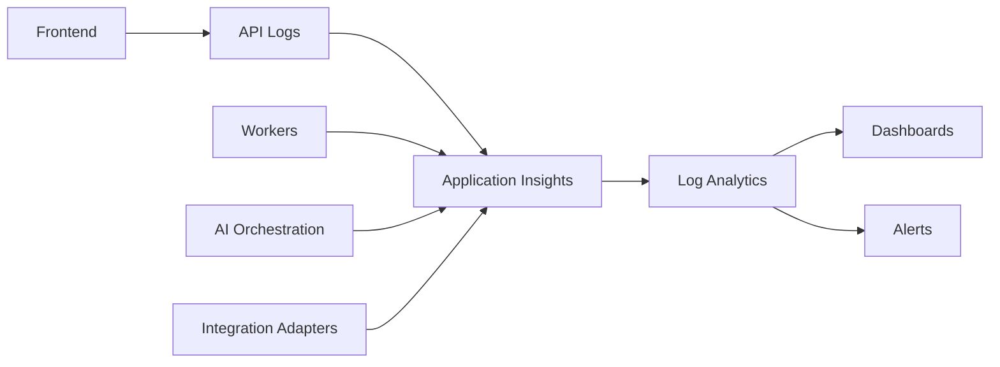

# Observability & Operations Architecture

## Common IIP Context Used

The Insurance Intelligence Platform (IIP) is an Azure-native, human-reviewed insurance operations platform for African insurers and related insurance organizations. It acts as an intelligent operational layer across staff, customers, core insurance systems, documents, channels, knowledge sources, and AI agents. The current MVP direction is Motor Claims & Document Intelligence for a mid-to-large insurer pilot.

Confirmed implementation direction:

- Frontend: Next.js, React, TypeScript, Tailwind CSS.
- Backend: .NET 8 / ASP.NET Core, EF Core, Azure SQL.
- Azure services: Azure SQL, Blob Storage, Key Vault, Azure AI Search, Azure OpenAI, Azure AI Document Intelligence, Service Bus or Event Grid, Functions or Durable Functions, API Management, Application Insights and Log Analytics.
- Identity: Microsoft Entra ID / MSAL / OAuth 2.0.
- Primary internal modules: Command Center, Claims, Documents, Channels, Customers, Sales & Leads, Knowledge Base, Approvals, Compliance & Audit, Reports & Analytics, Integrations, Admin Settings, Support & Health.
- Customer entry points: WhatsApp-first, with web chat, SMS, email, broker, call center, Teams, and website forms as planned or future channels.
- Governance rule: AI prepares insurance work; humans make consequential decisions.

Non-negotiable AI boundary:

- AI may summarize, classify, extract, flag, draft, route, and recommend.
- AI must not approve or reject claims, bind policies, set final premiums, accuse customers of fraud, release payments, promise settlement, or make final regulated decisions.

## Purpose

This document defines observability and operational diagnostics for IIP. It ensures the platform can be supported during development, pilot, and production without relying on guesswork.

## Observability Goals

| Goal | Description |
|---|---|
| Detect problems early | Health checks and alerts identify failures before clients report them. |
| Trace user workflows | Correlation IDs connect UI actions, API calls, queues, AI calls, and database changes. |
| Support safe AI operations | AI prompts, outputs, evidence references, confidence, and human review states are auditable. |
| Diagnose integrations | Webhook failures, retries, duplicate events, provider downtime, and malformed payloads are visible. |
| Prove controls | Audit events and logs support compliance and client assurance. |

## Logging Architecture

## Required Correlation Fields

| Field | Requirement |
|---|---|
| `correlationId` | Generated per request/workflow and propagated across services. |
| `tenantId` | Required for all application logs. |
| `workspaceId` | Required where workflow is workspace-specific. |
| `userId` | Required for authenticated user actions. |
| `role` | Useful for support and access review; do not use as only authorization source. |
| `claimId` | Required where claim workflow is involved. |
| `documentId` | Required where document workflow is involved. |
| `agentRunId` | Required for AI agent calls. |
| `integrationEventId` | Required for webhooks and async integrations. |

## Health Checks

| Health Check | Description | Failure Meaning |
|---|---|---|
| API liveness | API process is running. | App process or hosting issue. |
| API readiness | API can serve traffic. | Dependency or configuration issue. |
| Database health | SQL reachable and basic query works. | Database/network/secret issue. |
| Blob health | Storage reachable. | Storage/network/identity issue. |
| AI Search health | Index service reachable. | Search/RAG issue. |
| Azure OpenAI health | Model deployment/config reachable. | AI assistance degraded. |
| Document Intelligence health | OCR/extraction provider reachable. | Document processing degraded. |
| Queue health | Service Bus/Event Grid functioning. | Async backlog/failure risk. |
| Provider health | WhatsApp/email/core system provider configured and reachable. | Integration degraded or Not configured. |

## Dashboards

| Dashboard | Key Widgets |
|---|---|
| Executive operations | Open claims, SLA risk, document backlog, AI usage, escalations, provider health. |
| Claims operations | Queue age, assignments, missing documents, approvals, escalations, cycle time. |
| Document intelligence | Classification success, extraction confidence, review backlog, failed documents. |
| AI operations | Agent runs, failure rate, unsupported-answer blocks, red-team flags, human corrections. |
| Integrations | Webhook volume, retries, duplicate suppression, failed events, provider status. |
| Platform health | API latency, error rate, DB performance, queue depth, dependency status. |

## Alerting Rules

| Alert | Suggested Severity | Action |
|---|---|---|
| API 5xx spike | High | Triage API, logs, deployment, dependencies. |
| Database unavailable | Critical | Activate incident response. |
| Queue depth increasing | High | Check workers, provider failures, throttling. |
| AI provider unavailable | Medium/High | Show degraded state and disable AI-dependent actions safely. |
| Document extraction failure spike | Medium/High | Route documents to manual review and inspect provider. |
| Integration webhook failures | Medium/High | Retry, inspect provider credentials, check idempotency. |
| Unauthorized access attempts | High | Security review and possible incident handling. |

## Audit vs Diagnostic Logs

| Type | Purpose | Retention Consideration |
|---|---|---|
| Audit event | Business/compliance record of what happened. | Longer retention; client/compliance policy. |
| Diagnostic log | Engineering troubleshooting. | Retention based on environment and cost. |
| Security log | Access, auth, permission, suspicious activity. | Security policy and incident requirements. |
| AI log | Agent run, sources, confidence, blocked output, human correction. | Must balance auditability with privacy and data minimization. |

## Operational Acceptance Criteria

- Every request has a correlation ID.
- Provider health surfaces show OK, degraded, failed, or Not configured.
- AI and document workflows can be traced from UI action to final audit event.
- Support can identify whether a failure is frontend, API, database, AI provider, storage, queue, or integration related.
- Critical alerts are routed to an accountable owner.

## Open Questions

| ID | Open Question | Owner | Impact if Unresolved |
|---|---|---|---|
| OQ-01 | Which insurer will be the first signed pilot customer and what exact internal processes will be included? | Product / Commercial | Final configuration, training, and pilot timelines may change. |
| OQ-02 | Which claims/core system will be integrated first, and will MVP require read-only lookup, export, or direct write-back? | Product / Engineering / Client IT | Impacts integration complexity and deployment schedule. |
| OQ-03 | Which Azure deployment path is selected first: customer-tenant Managed Application or Otic-hosted SaaS pilot? | Leadership / Engineering | Impacts tenancy, support access, IaC, billing, and security review. |
| OQ-04 | Which WhatsApp Business provider will be used for the first pilot? | Product / Integrations | Impacts webhook schemas, retry behavior, and channel onboarding. |
| OQ-05 | What client-specific SLAs, roles, branches, claim categories, and document checklists must be configured? | Client Operations | Impacts workflow rules and acceptance testing. |
| OQ-06 | What final regulatory, legal, and data residency requirements must be signed off for the first pilot? | Legal / Compliance | Impacts production readiness and contractual commitments. |
