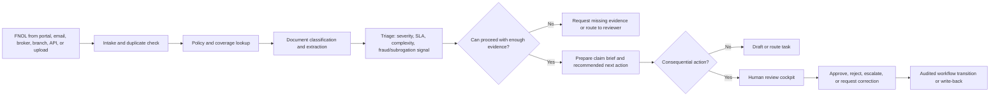
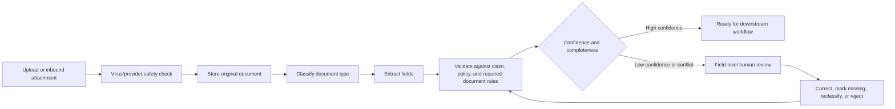
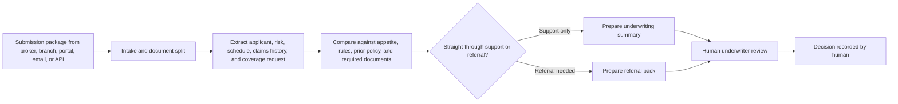
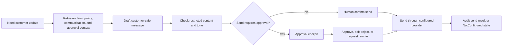
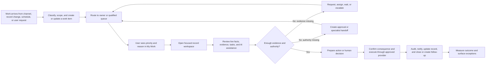
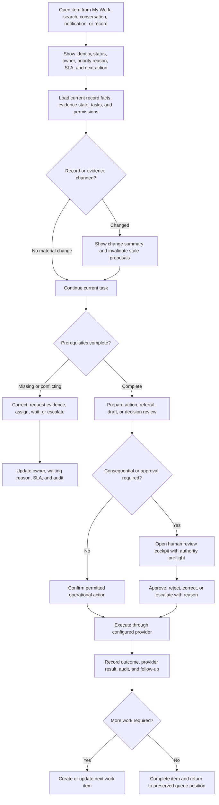

# IIP Platform UX Behavior Specification

**Status:** Extracted from `iip_enterprise_agentic_operating_design_system.md` on 2026-08-04 and research-aligned on 2026-08-05. Behavioral content is a proposed specification until target-role and workflow validation is recorded. Top-level section numbers (03A, 03B) are inherited for traceability. The self-contained "Recent Conversations and Session Continuity" specification has been moved to its own companion document and is linked below where it originally appeared.

**This document owns:** IIP domain interaction behavior — core actors, the Command Center experience model, primary insurance workflows (claims/FNOL, document intelligence, underwriting, customer communication), workflow decision rules, insurance forms/data entry, error prevention/recovery, and the platform operating model. The canonical object/findability model, sitemap, route labels, navigation layers, permission-derived visibility, and route-level screen/state inventory now live in `iip_information_architecture_navigation_and_screen_inventory.md`; where historical IA prose here differs, that companion wins.

**This document must not own:** generic cross-product token philosophy or visual grammar (see the Visual Design System and Design Tokens); reusable agentic AI patterns and governance components (see the Agentic AI Interface and Governance Patterns).

**Companion documents:**
- Foundation and governance — `iip_enterprise_agentic_operating_design_system.md`
- Visual design system and tokens — `iip_visual_design_system_and_tokens.md`
- Agentic AI interface and governance patterns — `iip_agentic_ai_interface_and_governance_patterns.md`
- Recent Conversations feature — `iip_recent_conversations_session_continuity_spec.md`
- Canonical information architecture, navigation, and screen inventory — `iip_information_architecture_navigation_and_screen_inventory.md`
- Release 1 role journeys — `iip_release_1_role_journey_maps.md`
- Release 1 intelligence-layer service blueprint — `iip_release_1_intelligence_layer_service_blueprint.md`
- Release 1 task-flow, exception, state, and coordinated-pattern catalog — `iip_release_1_task_flow_exception_state_catalog.md`
- Release 1 interaction authority, critical-action inventory, evidence/decision ledger, and design-to-runtime parity — `iip_release_1_interaction_authority_and_inventory.md`
- Release 1 action purpose, user intent, feedback, attention, and human/AI authority contracts — `iip_release_1_action_purpose_human_ai_authority_contracts.md`
- Release 1 surface and control interaction contracts — `iip_release_1_surface_control_interaction_contracts.md`
- Release 1 per-interaction accessibility and client/runtime parity — `iip_release_1_interaction_accessibility_and_runtime_parity.md`
- Release 1 interaction requirements, permission/audit, and validation traceability — `../01-strategy-requirements-roadmap/iip_release_1_interaction_requirements_traceability.md`
- Release 1 region-state, exception-prevention, and recovery contracts — `iip_release_1_state_exception_recovery_contracts.md`
- Research program — `../research/iip-user-business-market-research-program.md`
- Research evidence register — `../research/iip-research-evidence-register.csv`
- Release 1 requirements baseline — `../01-strategy-requirements-roadmap/iip_release_1_requirements_baseline.md`
- Release 1 acceptance gates — `../01-strategy-requirements-roadmap/iip_mvp_acceptance_criteria_register.md`

The Release 1 companion pack instantiates this platform behavior for the bounded motor-own-damage slice. It may reference these interaction principles but must not redefine platform routes, current permissions, or insurer policy. This document remains the owner of reusable behavior; the task-flow catalog owns stable Release 1 flow/exception/state IDs and records any current contract gap explicitly; the interaction authority and inventory owns critical-action coverage, evidence/assumption/decision classification, and dimensioned design-to-runtime parity.

---

# 03A. Insurance Intelligence Platform UX and Workflow Extension

## Purpose

This extension adapts the generic enterprise agentic design system for the Insurance Intelligence Platform (IIP). IIP is an enterprise, chat-first, human-reviewed insurance operations platform. The Command Center is the primary work surface, but it must not behave like a loose chatbot. It must behave like a governed operating cockpit where chat, evidence, records, workflows, approvals, agents, and audit trails stay visible together.

The extension is informed by:

- the generic enterprise agentic principles in this document;
- the Bevaya competitive benchmark, especially its document operations, workflow graph, human-review queue, source highlighting, confidence routing, and flow versioning patterns;
- public insurance workflow references showing common claims stages such as FNOL, triage, validation, investigation, decision, payment, closure, fraud review, subrogation, and adjuster handoff;
- IIP repository rules requiring Azure-native operation, `/api/v1` contracts, tenant/workspace scoping, auditability, no deployed-runtime simulation, and human accountability for consequential insurance decisions.

## UX Strategy

IIP exists to reduce operational drag in insurance work without removing human accountability. The experience must help claims handlers, underwriters, operations managers, compliance users, and service teams answer four questions quickly:

1. What needs attention?
2. What is the evidence?
3. What can the AI safely do?
4. What must a human decide next?

The product should optimize for:

- faster intake, review, routing, and evidence assembly;
- fewer missing-document loops;
- clearer SLA and exception visibility;
- consistent human review for approvals, settlement, repudiation, underwriting, payments, customer communications, and write-back;
- reliable audit export for internal, regulator, or partner review;
- Uganda-ready localization for product lines, branch operations, broker channels, mobile money/payment context, local document types, and regulatory review.

The product should not optimize for:

- autonomous final insurance decisions;
- decorative dashboard density without operational action;
- generic AI chat that cannot show source, scope, model/tool boundary, or next workflow state;
- importing US-specific insurance taxonomy without an explicit Uganda extension layer.

## Core Actors

The labels and responsibility boundaries below are **role hypotheses**, not validated personas or tenant RBAC authority. Research must capture each institution's actual titles, responsibilities, delegation, queue ownership, handoffs, device/network setting, language, accessibility needs, and system access. Product or RBAC changes require evidence IDs and owner approval; labels must not be generalized across insurers from one participant.

| Actor | Primary goal | Primary surface |
|---|---|---|
| Claims handler or adjuster | Review claim context, documents, SLA risk, customer updates, and recommended next action | Command Center, claim cockpit, document review |
| Underwriter | Review submission, policy data, risk signals, documents, broker history, and referral notes | Command Center, underwriting cockpit, evidence rail |
| Operations supervisor | Monitor queues, workloads, SLA risk, exceptions, approvals, and agent performance | Work queue, reports, governance center |
| Document reviewer | Correct extracted fields, approve classifications, identify missing evidence, and release downstream workflow | Document review split |
| Compliance or audit user | Inspect decision records, evidence, permissions, model/tool use, and export packs | Audit timeline, governance center, evidence package |
| Broker or channel operator | Submit or track requests, respond to missing information, and receive safe communications | Channel workspace or controlled external view |
| System administrator | Manage tenant/workspace settings, roles, integrations, agent capability policy, and provider status | Admin, agent registry, tool matrix |

## Insurance Object Model for UX

IIP screens, labels, search, filters, and agent context should use these objects consistently:

| IIP object | Meaning | Key relationships |
|---|---|---|
| Claim | A request for indemnity or benefit under a policy | Policy, customer, claimant, incident, documents, reserves, approvals, payments, timeline |
| Policy | Contract and coverage source | Customer, insured item, coverage, endorsements, exclusions, premium, claim history |
| Customer or party | Person or organization involved in insurance work | Policies, claims, communications, broker, branch |
| Evidence | Source material used to support AI output or human review | Documents, emails, images, forms, policy clauses, notes, system records |
| Document | Uploaded, ingested, or generated file with classification and extraction state | Claim, policy, required document rule, extracted fields, review status |
| Task | Unit of operational work | Queue, assignee, SLA, agent run, approval, dependency |
| Agent run | A bounded AI-assisted workflow execution | Agent, input context, retrieved evidence, tool calls, output, confidence, audit |
| Approval | Human decision checkpoint | Action proposal, evidence, decision reason, approver, audit record |
| Action proposal | AI-prepared next step that may require confirmation or approval | Draft message, workflow transition, write-back, escalation, report |
| Conversation | A user-owned Command Center work thread | Title, owner, workspace, focus references, turns, pending tasks, lifecycle state, last activity |
| Audit event | Immutable operational record | Actor, action, target, evidence, before/after, provider/model metadata, timestamp |

## Command Center Experience Model

The Command Center uses four coordinated regions, but only the top bar and primary navigation are persistently available. The conversation is primary. The evidence rail and recent-work panel appear when they support the current task and may collapse without losing state.

| Region | Purpose | Required behavior |
|---|---|---|
| Left navigation | Stable entry to work areas and recent work | Show role-prioritized destinations, New conversation, and recent work; group lower-frequency modules rather than presenting every module at equal weight |
| Central conversation workspace | Primary operating surface | Accept natural language, render structured response blocks, preserve turn context pointers, expose actions as proposals |
| Right evidence and context rail | Proof and scope | Open when evidence, comparison, or review is relevant; show current focus, citations, missing data, confidence, and role limits; preserve state when collapsed |
| Top bar | Essential operational status | Show workspace, environment when non-production, global search, notifications, and account; move provider and agent diagnostics to contextual status or Governance unless action is required |

Chat should be the entry point for operational questions, not the only UI. Every AI answer that affects insurance work must render structured blocks, not only prose:

- `text`
- `metric_pills`
- `claims_table`
- `document_gap_summary`
- `evidence_list`
- `action_proposal`
- `approval_queue`
- `draft_communication`
- `management_summary`
- `not_configured`
- `error`


> **Recent Conversations and Session Continuity** originally appeared here. It is now maintained as a standalone companion document: `iip_recent_conversations_session_continuity_spec.md`.

## Navigation Model

The canonical implemented hierarchy and labels are maintained in `iip_information_architecture_navigation_and_screen_inventory.md`. The table below defines navigation behavior only and must not be used as a competing route inventory.

Navigation must match how insurance staff work, not the internal org chart.

| Level | Destinations | Rules |
|---|---|---|
| Global | Command Center, My Work, Records, Oversight, Administration | Always stable; expand grouped destinations according to role and permission; explain restricted destinations only when relevant to a task |
| Local | Claim tabs, policy tabs, document tabs, approval tabs | Keep user inside the current record or workflow |
| Contextual | Related policy, related claim, customer 360, source document, audit event, approval request | Preserve return path to the originating chat turn or queue item |
| Utility | Search, notifications, environment, provider status, help, account | Available from every protected screen |
| Search | Claim number, policy number, customer, vehicle/property, document, email, approval, task | Results must show object type, status, workspace, permission state, and last updated date |

Restricted destinations should appear as disabled or permission-scoped states when their existence matters to the user's task. Do not make records disappear in a way that looks like data loss.

## Primary Insurance Workflows

### Claims: FNOL to Human-Reviewed Resolution



Required UX:

- show FNOL source and time received;
- show policy match confidence and effective-date coverage check;
- show required and missing documents;
- separate risk or fraud signal from fraud accusation;
- keep settlement, repudiation, payment, and final claim decision behind human review;
- allow the handler to correct extracted facts and rerun completeness before downstream routing;
- show every source used in the claim brief.

### Document Intelligence: Upload to Reviewed Extraction



Required UX:

- show original file, extracted fields, confidence, source location, and validation rule in one view;
- keep labels persistent and field errors inline;
- preserve reviewer corrections through failures, retries, and navigation;
- expose partial extraction honestly;
- never allow raw OCR or untrusted text to appear as trusted system instruction.

### Underwriting: Submission to Referral Note



Required UX:

- distinguish AI-prepared referral notes from underwriting decisions;
- show appetite/rule evidence and missing data;
- support side-by-side comparison for submissions, schedules, policy wording, endorsements, and loss runs;
- track broker/channel and branch context without treating it as authorization.

### Customer Communication: Draft to Approved Send



Required UX:

- show what the draft is based on;
- hide internal notes, fraud/risk flags, reserves, raw prompt data, and provider errors from customer-safe surfaces;
- make edit-before-send the default behavior;
- if the provider is absent, show `Not configured`, not fake success.

## Workflow Decision Rules

Every workflow branch must name:

- actor allowed to initiate;
- data required;
- policy or business rule used;
- AI agent involved;
- confidence threshold or exception trigger;
- human review requirement;
- audit event written;
- recovery path when provider, data, permission, or validation fails.

Do not use unlabeled yes/no branches in workflow diagrams. Name the condition.

## Forms and Data Entry Rules for Insurance

Forms should be rare, purposeful, and recoverable. IIP should derive or prefill data from policy, customer, claim, document, email, and prior workflow context where safe.

Required field inventory columns:

| Column | Purpose |
|---|---|
| Field | User-facing label |
| Object | Claim, policy, customer, document, approval, task |
| Data owner | Source system or IIP service |
| Reason collected | Business rule, workflow need, regulatory need, or communication need |
| Validation | Format, range, dependency, required state, cross-check |
| Sensitivity | Public, internal, restricted, customer-safe, audit-only |
| Retention | How long it remains and where |
| Error behavior | Inline message, preserved input, retry, escalation |

High-risk insurance fields include policy number, claim number, national ID or equivalent identity reference, phone number, bank or payment account, vehicle registration, incident date, loss amount, reserve amount, medical information, beneficiary details, and approval reason.

## Error Prevention and Recovery

IIP should treat errors as operational states, not interruptions.

| Error class | Prevention | Recovery |
|---|---|---|
| Missing evidence | Required-document rules, checklist, source hints | Request evidence, mark unavailable, route to reviewer |
| Policy mismatch | Effective-date and party matching before action | Select correct policy, create unresolved match task |
| Duplicate claim | Duplicate detection during intake | Merge proposal or keep separate with reason |
| Low extraction confidence | Field-level confidence and source preview | Correct field, reclassify, rerun validation |
| Unsafe AI action | Autonomy ceiling and permission checks | Convert to action proposal or deny with reason |
| Provider not configured | Startup/readiness validation and provider status | Show `Not configured`; block fake send/write-back |
| Permission denied | Role/workspace checks before load/action | Explain scope and request escalation path |
| Timeout or partial completion | Background task status and retry tokens | Resume, retry, cancel, or escalate |

Confirmation should be reserved for rare, high-consequence, hard-to-reverse actions. Frequent reversible actions should use undo or edit.

## Screen and State Inventory for Release Planning

Before implementation, enumerate these surfaces as independent state-bearing units:

| ID | Surface | Critical states |
|---|---|---|
| IIP-UX-001 | Command Center conversation | Empty, loading, answered, partial evidence, action proposed, provider not configured, permission denied, stale context |
| IIP-UX-002 | Evidence and context rail | No focus, claim focus, policy focus, document focus, missing evidence, restricted evidence, source unavailable |
| IIP-UX-003 | Work queue | Empty, high-volume, filtered, SLA risk, assigned to me, unassigned, permission-scoped |
| IIP-UX-004 | Claim cockpit | Loading, populated, incomplete, under review, escalated, closed, disputed, audit export ready |
| IIP-UX-005 | Document review split | Uploading, extracting, partial extraction, low confidence, corrected, approved, rejected, provider failure |
| IIP-UX-006 | Approval cockpit | Pending, approved, rejected, escalated, expired, two-person review required, read-only |
| IIP-UX-007 | Customer communication draft | Drafting, unsafe content blocked, editable draft, pending approval, sent, send failed, provider not configured |
| IIP-UX-008 | Agent task queue | Queued, running, waiting for user, waiting for provider, failed, canceled, completed, needs review |
| IIP-UX-009 | Governance center | Agent registry, tool matrix, eval dashboard, audit timeline, policy changes, restricted admin |
| IIP-UX-010 | Admin and integrations | Not configured, configured, unhealthy, permission denied, pending credential rotation |
| IIP-UX-011 | Recent conversations | Sidebar list, all conversations, search/filter, reopened transcript, change summary, archived, restricted, retention-controlled |

Each screen must define desktop, narrow, keyboard-only, zoomed, first-use, returning-user, interrupted, and resumed variants before release estimation.

## UX Writing Rules for IIP

Use calm, precise, insurance-specific language.

| Situation | Use | Avoid |
|---|---|---|
| AI answer | "Based on 4 retrieved sources..." | "I think..." |
| Missing provider | "Email sending is not configured for this workspace." | "Something went wrong." |
| Restricted action | "You can draft this message, but approval is required before sending." | "You cannot do this." |
| Fraud signal | "Potential fraud indicator for review." | "Fraud detected." |
| Low confidence | "This field needs review. The source is unclear." | "Extraction failed." |
| Approval | "Approve settlement draft" | "OK" |
| Write-back | "Submit approved update to core system" | "Save" |

Every error must state what happened, whether work was preserved, and what the user can do next.

## UX Research Plan

Research should inform concrete decisions, not produce generic personas.

The governing protocol is [the user, business, and market research program](../research/iip-user-business-market-research-program.md). Raw recordings, transcripts, identifiable participant notes, credentials, and customer evidence stay in approved restricted storage; only de-identified findings and provenance enter this repository.

| Decision | Method | Participants |
|---|---|---|
| Which workflow should Release 1 optimize first? | Contextual inquiry and journey mapping | Claims handlers, document reviewers, operations supervisors |
| Can staff complete claim review from chat plus evidence rail? | Moderated usability test | Claims handlers and supervisors |
| Do users trust AI outputs when evidence and limits are visible? | Task-based usability test with debrief | Claims, underwriting, compliance |
| Which labels match Uganda insurance operations? | Tree test and terminology interviews | Claims, underwriting, brokers, branch staff |
| Where do handoffs fail today? | Contextual inquiry and artifact walkthrough | Claims, document, approval, customer service teams |
| Can users find, reopen, and safely continue prior work? | Moderated usability test with stale-evidence scenarios | Claims, underwriting, document review, compliance, supervisors |
| Which role labels and authority boundaries are valid? | Recent-case interviews, org-chart/artifact review, and permission walkthrough | Practitioners, supervisors, administrators, compliance |
| Which device, connectivity, location, and interruption conditions shape work? | Contextual inquiry and throttled task tests | Branch, office, field, remote, and shared-device participants where applicable |
| Which language, document-language, literacy, and accessibility needs affect critical work? | Artifact sampling, interviews, assistive-technology and comprehension tests | Representative staff and communication recipients; include disabled participants where feasible |
| Which cross-team handoffs lose context, ownership, or evidence? | Service blueprint and handoff observation using recent cases | Claims, assessors, customer service, supervisors, brokers/third parties where approved |

Recruit to behavior: people who currently handle FNOL, claims review, policy lookup, document correction, approval, customer updates, or audit preparation.

No persona, label, channel priority, device assumption, language scope, or accessibility conclusion is “validated” until the evidence register records geography, institution, role, method, sample, confidence, limits, and affected decision. Findings from one institution remain institution-specific until replicated.

## UX Acceptance Criteria

- Users can start in chat, inspect evidence, and complete or route the next workflow step without losing context.
- Every AI output shows source, scope, confidence or uncertainty, and current human-review boundary.
- Every consequential insurance action reaches a human review checkpoint.
- Every restricted or unavailable provider state is visible as `Not configured`, permission denied, unavailable, timeout, or retryable failure.
- Every table supports quick scanning, filtering, status recognition, and deep-linking to the relevant record.
- Every document extraction screen supports field-level source review, correction, preserved input, and rerun validation.
- Every approval includes evidence, proposed action, risk, approver identity, decision reason, and audit record.
- Every major workflow has empty, loading, partial, error, timeout, permission, and recovery states defined before implementation.
- Users can find and reopen an authorized prior conversation from Recent Conversations or All Conversations.
- Reopened conversations distinguish historical responses from current evidence and disable stale consequential actions.
- Conversation search, lifecycle actions, and deep links preserve tenant/workspace isolation and expose no restricted metadata.

---

# 03B. Platform-Wide UX Audit and Improved Insurance Operating Model

## Status, Scope, and Evidence Limit

This section is an expert review and proposed behavioral redesign of the documented IIP experience. It covers the Command Center, My Work, claims, policies, documents, approvals, customers, channels, reports, governance, administration, agent-assisted work, and Recent Conversations.

Evidence used:

- current IIP repository authority and UX documentation;
- the IIP workflows and behavior specified in this document;
- the Bevaya benchmark and public insurance workflow research;
- public Insurance Regulatory Authority of Uganda claims guidance;
- current public ServiceNow insurance workspace documentation showing persona-specific landing pages, unified claim workspaces, tasks, SLAs, document verification, interactions, assignments, and manager approvals.

No participant sessions or production analytics were supplied. Findings below are expert-review findings and design hypotheses, not proof of issue frequency or user preference. The proposed model must be validated with representative Uganda insurance staff.

## Documentation Architecture Recommendation

The generic design language and the IIP behavioral specification should remain related but become separate governed artifacts.

Recommended authority model:

| Artifact | Owns | Must not own |
|---|---|---|
| Enterprise Agentic Operating Design System | Reusable principles, tokens, generic patterns, autonomy language, accessibility baseline, governance components | IIP routes, Uganda insurance workflows, product-specific navigation, detailed screen behavior |
| IIP Platform UX Behavior Specification | Roles, operating model, navigation, flows, states, content, permissions, responsive behavior, acceptance criteria | Generic cross-product token philosophy |
| Frontend implementation guide | Routes, component contracts, DTO mappings, loading/error implementation, testing | Product strategy or unresolved business rules |

For this revision, the audit and improved behavior remain here so decisions are not lost. The next documentation cleanup should extract sections 03A and 03B into `docs/03-design-architecture/iip_platform_ux_behavior_specification.md`, leave a concise extension summary and link in this master document, and update the UI authority list in `AGENTS.md` only through an approved repository-authority change.

## What the Existing UX Gets Right

- Chat is treated as an operational entry point rather than an ungoverned chatbot.
- Evidence, confidence, permissions, provider state, human review, and audit are first-class concepts.
- Claims, document review, underwriting support, and customer communication have recognizable domain flows.
- Consequential insurance actions remain human-owned.
- Empty, partial, error, timeout, permission, and `Not configured` states are acknowledged.
- Recent Conversations now distinguishes historical interactions from current evidence.
- The generic system has strong foundations for status language, tables, forms, accessibility, AI governance, and action preview.

These strengths must survive the redesign.

## Heuristic and Cognitive UX Audit

Severity uses `1 Minor`, `2 Moderate`, `3 Major`, and `4 Critical`. Ratings reflect potential impact and recovery cost; they do not claim observed frequency.

| ID | Location/task | Finding and violated principle | Consequence | Severity | Required improvement |
|---|---|---|---|---:|---|
| UX-AUD-001 | Whole platform | The product is described module-first, but users work task-first. The model does not consistently connect incoming work, ownership, evidence, decision, action, and closure. Real-world match and task continuity are weak. | Users may bounce between chat, queue, claim, document, and approval surfaces while reconstructing state. | 4 | Establish one universal insurance work-item model and end-to-end operating loop. |
| UX-AUD-002 | Command Center | Four “persistent” regions compete for attention. Provider health, active agent status, navigation, conversation, and evidence can all demand simultaneous processing. Minimalism and attention hierarchy are weak. | Reduced working area, scanning fatigue, and missed evidence or actions. | 3 | Use an adaptive two-pane baseline; reveal evidence and diagnostics contextually while preserving state. |
| UX-AUD-003 | Global navigation | Nine or more destinations appear at equal hierarchy, mixing daily work, records, oversight, and administration. Recognition exists, but prioritization and role fit are under-specified. | Infrequent modules compete with urgent work; novice and narrow-screen navigation becomes difficult. | 3 | Group into Command Center, My Work, Records, Oversight, and Administration with role-prioritized children. |
| UX-AUD-004 | User entry/landing | The primary authenticated landing experience does not define what each role sees first, what needs attention, or how “my work” differs from management oversight. | Users must ask the system or browse modules before knowing their workload. | 3 | Add role-based Today/My Work views with real tasks, SLA risk, approvals, exceptions, and resume cues. |
| UX-AUD-005 | Chat-to-workflow handoff | Structured response blocks are listed, but the transition from answer to owned task, record cockpit, review, approval, or write-back lacks a universal behavioral contract. | Users may not know whether an AI response merely informs, created work, or changed operational state. | 4 | Every actionable block must show status, owner, consequence, next valid action, and audit outcome. |
| UX-AUD-006 | Claims and underwriting | Workflow diagrams are primarily linear happy paths. Real insurance work includes asynchronous requests, parallel investigations, reassignment, waiting, escalation, reopening, dependency failure, and concurrent updates. | Exceptions become ad hoc; users lose track of blockers and accountability. | 4 | Model work as stateful tasks and dependencies with waiting reason, owner, due/SLA, and re-entry path. |
| UX-AUD-007 | Work queues | Queue behavior does not define triage order, claim/assign rules, capacity, saved views, bulk operations, conflict handling, or why an item is prioritized. | High-volume teams cannot efficiently distribute work or trust ordering. | 3 | Specify transparent prioritization, Assign to me, reassignment, saved views, safe bulk operations, and concurrency feedback. |
| UX-AUD-008 | Record cockpits | Claim, policy, customer, document, and approval surfaces are named, but their shared anatomy and primary scan order are not consistently defined. | Each module can evolve into a different mental model and interaction pattern. | 3 | Adopt one record-workspace anatomy: identity/state, next action, key facts, tasks, evidence, timeline, related records, audit. |
| UX-AUD-009 | Interruptions | Resumption is detailed for conversations but not for queues, forms, document review, approval comparison, or long-running agent work. | Staff handling interruptions must remember filters, scroll position, selected evidence, and unsaved corrections. | 3 | Persist safe workspace state, show “since you left,” preserve drafts, and provide explicit resume points platform-wide. |
| UX-AUD-010 | Notifications | Notifications appear as a utility, but urgency, deduplication, ownership, acknowledgment, snooze, escalation, and relationship to My Work are undefined. | Alert fatigue or missed SLA/approval events. | 3 | Separate informational notifications from actionable work; action-required events create or update a work item. |
| UX-AUD-011 | Search | Global search objects are named, but ranking, result previews, recent queries, no-access behavior, and move from result to current task are incomplete. | Users may open wrong records or infer restricted data. | 3 | Use permission-filtered federated search with object-specific identifiers, safe snippets, freshness, and preserved return context. |
| UX-AUD-012 | AI state language | Confidence, provider state, agent status, evidence freshness, workflow status, and approval state can all appear together without a defined priority. | Users must interpret too many status systems and may mistake AI confidence for business certainty. | 4 | Define a status hierarchy and never use confidence as the sole routing or decision cue. |
| UX-AUD-013 | Permissions | The rule to show restricted destinations when existence matters lacks a decision test and could either leak information or clutter navigation. | Sensitive record existence may leak, or users may interpret missing items as data loss. | 4 | Reveal restriction only when the user has a legitimate contextual reason to expect the object; otherwise disclose nothing. |
| UX-AUD-014 | Forms and evidence correction | General form principles are strong, but autosave, draft ownership, field provenance, concurrent correction, and downstream invalidation are not unified across modules. | Corrections can be lost or downstream AI outputs may remain stale. | 4 | Use provenance-aware fields, version checks, saved drafts, correction history, and automatic invalidation/re-evaluation of dependent outputs. |
| UX-AUD-015 | Approval cockpit | Evidence and decision reason are required, but authority limit, separation of duties, delegated approval, unavailable approver, withdrawal, expiry, and conflicting decisions need clearer behavior. | Unsafe or blocked approvals and unclear accountability. | 4 | Add authority and policy preflight, explicit approver eligibility, expiry, delegation rules, and immutable decision outcomes. |
| UX-AUD-016 | Customer/channel work | Customer communication drafting is specified separately from channel conversations, consent, language, delivery preference, failed delivery, complaint state, and contact verification. | A safe draft may still be sent through an inappropriate or unverified channel. | 4 | WhatsApp source baseline now enforces recipient/thread, consent/legal basis, language, template-window, exact approval and delivery states; insurer policy and protected-staging validation remain required. See `iip_whatsapp_thread_outbound_delivery_spec.md`. |
| UX-AUD-017 | Onboarding/help | The platform does not define first-run role orientation, progressive disclosure, sandbox-safe training, inline policy help, or support escalation. | New or infrequent users may misuse AI controls or avoid the Command Center. | 2 | Add role-based first value, guided examples using authorized data, contextual help, and safe practice/training outside deployed operational records. |
| UX-AUD-018 | Low bandwidth/responsive | Narrow layouts are noted, but platform-wide behavior under low bandwidth, intermittent connectivity, data-heavy tables, document previews, uploads, and background processing is incomplete. | Uganda branch and field users may lose work or see misleading completion states. | 4 | Define low-bandwidth mode, progressive loading, resumable operations where supported, preserved drafts, explicit sync state, and no false offline success. |
| UX-AUD-019 | Management UX | Reports and management summaries exist, but drill-down, metric definition, freshness, exception ownership, and path from insight to assigned work are not unified. | Dashboards become passive reporting rather than operational control. | 3 | Every management exception should expose definition, scope, freshness, affected items, owner, and assignable follow-up. |
| UX-AUD-020 | Governance UX | Governance is comprehensive but risks becoming detached from live operational behavior. | Policy owners may see metrics without the underlying failed tasks, overrides, or evidence. | 3 | Deep-link governance signals to scoped runs, policies, audits, incidents, and remediation tasks with sensitive data controls. |

## Systemic Themes

The findings cluster into five systemic problems:

1. **No universal work spine.** Modules exist, but work ownership and lifecycle do not bind them together.
2. **Too much simultaneous context.** The design exposes many valuable signals without deciding which one deserves attention now.
3. **Happy-path bias.** Waiting, reassignment, concurrency, interruption, and recovery need the same design rigor as completion.
4. **Status-language overload.** Business state, task state, AI state, evidence state, and provider state are not sufficiently separated.
5. **Insufficient role and environment adaptation.** Daily adjuster work, supervisor oversight, compliance review, and administration need different entry emphasis while sharing the same object model.

## Cognitive Task Map

| User work | Must notice | Must compare or decide | Should not have to remember | External memory IIP should provide |
|---|---|---|---|---|
| Start the day | New work, SLA risk, returned items, approvals, failed tasks | What to do first | Where each item originated | Prioritized My Work list with reason and owner |
| Investigate a claim | Current stage, coverage, missing evidence, contradictions, tasks | Whether evidence is sufficient and what to investigate next | Which documents or conversations changed | Claim cockpit with change summary, checklist, timeline, evidence map |
| Review extraction | Low-confidence fields, source location, validation conflicts | Correct, reclassify, defer, or reject | Prior value and downstream dependencies | Side-by-side source, field history, dependency warning |
| Approve an action | Proposed action, evidence, authority, consequence, alternatives | Approve, reject, escalate, or request correction | Approval threshold and separation-of-duty rule | Policy preflight and decision record preview |
| Draft/send communication | Recipient, purpose, claim state, consent/channel, restricted content | Edit, approve, select channel, send | Latest contact preference or disclosure rule | Communication preflight and delivery history |
| Resume after interruption | What changed, unfinished input, current owner, current validity | Continue, refresh, discard, or hand off | Previous filters, selected evidence, scroll position | Resume card, preserved draft, change summary |
| Manage a team | Capacity, bottlenecks, overdue work, unassigned items, quality exceptions | Reassign, escalate, coach, or change policy | Why an item is prioritized | Explainable queue ordering and drill-through |

## Improved Platform Experience Architecture

### The IIP Operating Loop

The entire staff experience should support one observable loop:



Every module is a view into this loop. None creates an independent work model.

### Universal Work Item

The proposed UX requires a shared work-item contract. It is a design requirement, not a claim that the backend already implements it.

| Field | User meaning |
|---|---|
| Work item type | Claim review, document verification, approval, customer update, underwriting referral, audit remediation, integration failure, or other approved task |
| Primary record | Claim, policy, document, customer, approval, report, or integration |
| Status | New, ready, in progress, waiting, blocked, review required, completed, canceled |
| Owner and queue | Person and/or qualified team accountable now |
| Priority and reason | Urgency plus explainable business reason; never an unexplained AI score |
| SLA/due state | Due time, business time remaining, breach state, pause reason |
| Required outcome | Observable completion condition |
| Evidence readiness | Complete, missing, conflicting, changed, restricted, provider unavailable |
| Human-review boundary | Who must decide or approve and why |
| Dependencies | Predecessor, parallel, waiting-on, and downstream tasks |
| Origin | Channel, workflow, record change, scheduled rule, agent proposal, or human creation |
| Audit link | Creation, assignment, state changes, decisions, and completion evidence |

### Three Primary Work Modes

IIP should use three predictable modes rather than forcing all work through chat or dashboards:

| Mode | User question | Primary surface | Exit |
|---|---|---|---|
| Orient | What needs my attention and why? | My Work or role-based Today view | Open work item, ask Command Center, assign, filter, or defer where permitted |
| Investigate | What is true, missing, changed, and relevant? | Focused record workspace with optional Command Center and evidence rail | Prepare action, request evidence, create task, hand off, or return to queue |
| Decide/execute | What action is proposed, allowed, and consequential? | Review cockpit or action preview | Approve, reject, correct, escalate, execute, or cancel with audit result |

Chat may enter or support all three modes, but it does not replace the specialized surface when comparison, correction, high-volume triage, or consequential review requires structured interaction.

### Role-Based Entry and My Work

The default post-login destination should be configurable by role and tenant policy while retaining Command Center prominence.

| Role | Default emphasis | First actionable content |
|---|---|---|
| Claims handler/adjuster | My Work | Assigned claims/tasks, SLA risk, returned items, missing evidence, customer follow-ups |
| Document reviewer | My Work filtered to document tasks | Low-confidence extractions, conflicts, overdue verification, failed processing |
| Underwriter | My Work filtered to submissions/referrals | New submissions, missing requirements, renewals, referrals, expiring quotes |
| Supervisor | Team Work | Unassigned work, SLA risk, blocked tasks, capacity, approval backlog, quality exceptions |
| Compliance/audit | Oversight | Review requests, policy exceptions, selected audit events, overdue remediation |
| Administrator | Administration | Provider/configuration health requiring action, access requests, policy changes, failed jobs |

The Today view must contain real operational items only. Empty data remains empty. Suggested prompts may teach capabilities but must not fabricate claims, metrics, or connected providers.

### Global Navigation

The following tree is retained as design history. The canonical code-reconciled sitemap and labels are maintained in `iip_information_architecture_navigation_and_screen_inventory.md`.

Use a stable grouped hierarchy:

```text
Command Center
My Work
Records
  Claims
  Policies
  Customers
  Documents
  Channels
Oversight
  Approvals
  Reports
  Audit
  Governance
Administration
  Integrations
  Access and workspaces
  Agent capability policy
```

Rules:

- show only groups relevant to the user's role;
- keep destination names stable across roles even when ordering differs;
- distinguish navigation from actions such as New conversation, New FNOL, Assign, Approve, or Send;
- preserve current location, parent context, and return path from deep links;
- on narrow layouts, retain the same hierarchy in a drawer rather than flattening destinations;
- do not expose restricted object existence without a legitimate contextual expectation.

### Adaptive Command Center

Default wide layout:

```text
+------------------+------------------------------------+------------------------+
| Product nav      | Conversation / structured blocks   | Evidence and context   |
| + recent work    | Primary task area                  | Open when relevant     |
+------------------+------------------------------------+------------------------+
```

Behavior:

- conversation owns primary width;
- evidence rail opens automatically only when the user selects a citation, asks for comparison, or enters review; otherwise its state is discoverable and collapsed;
- Recent Conversations is a compact recent-work region or drawer, not a permanently expanded second navigation tree;
- provider/agent diagnostics surface only when they affect the current task; persistent diagnostics belong in Governance/Admin;
- structured blocks can be promoted into a record workspace or review cockpit without losing the originating turn;
- returning from a record preserves the conversation turn, composer draft, selected block, and evidence selection.

### Shared Record Workspace Anatomy

Claims, policies, customers, documents, approvals, and underwriting records should use a common scan order:

1. **Identity and current state:** number/reference, type, stage, owner, SLA, last update.
2. **Next required action:** one primary next action or explicit waiting reason.
3. **Critical facts:** task-specific facts only, with conflicts and missing values visible.
4. **Tasks and dependencies:** current, waiting, blocked, completed, and parallel work.
5. **Evidence:** source list, freshness, provenance, restrictions, and changes.
6. **Timeline and communications:** chronological operational history with filters.
7. **Related records:** policy, customer, claim, document, approval, payment, report.
8. **Audit and technical detail:** progressively disclosed according to role.

The layout may vary by object, but this information hierarchy and terminology should remain stable.

### Focused Claim Workspace

The claim workspace should avoid one giant 360-degree page. Use progressive disclosure around the current task:

| Region | Default content | Expanded content |
|---|---|---|
| Claim header | Claim number, stage, owner, SLA, policy match, last material change | Full identifiers and assignment history |
| Next action | Current task, missing prerequisite, or waiting reason | Dependencies, escalation, handoff |
| Claim brief | Incident, claimant, coverage summary, key financial state, open issues | Full facts with source provenance |
| Evidence readiness | Required, received, missing, conflicting, restricted | Document review and source comparison |
| Work tabs | Tasks, documents, coverage, communications, timeline | Role-specific specialist tools |
| AI assistance | Contextual summarize, explain, compare, draft, or prepare | Grounding and agent-run detail |

Risk/fraud signals must remain a separate review aid, never the page's dominant identity or a definitive label on the claimant.

### Queue, Assignment, and Handoff Behavior

Every work list must support:

- visible ownership and queue;
- priority with human-readable reason;
- SLA/due state and waiting pause rules;
- Assign to me, assign/reassign where permitted, and handoff with reason;
- saved personal/team views where policy permits;
- safe multi-select only for low-risk homogeneous actions;
- concurrency feedback when another user claims or changes an item;
- return-to-position after opening and closing an item;
- empty, high-volume, partial, stale, restricted, and service-error states.

Handoff requires: target person/team, reason, expected outcome, due/SLA effect, attached record/evidence references, and notification result. AI may recommend routing, but the UI must identify whether assignment was rule-based, AI-recommended, or human-selected.

### Status Hierarchy

Never compress all state into one badge or color. Present status in this order:

1. **Business record state** — claim/policy/document/approval stage.
2. **Current work state** — ready, in progress, waiting, blocked, completed.
3. **Human decision boundary** — review or approval required.
4. **Evidence state** — complete, missing, conflicting, changed, restricted.
5. **System/provider state** — healthy, delayed, unavailable, not configured.
6. **AI state** — proposed, running, needs review, failed, confidence/uncertainty.

AI confidence describes an output or extraction, not claim validity, fraud likelihood, coverage certainty, or approval authority. Pair confidence with source quality, validation result, and required human review.

### Attention and Notification Model

| Type | Destination | Behavior |
|---|---|---|
| Action required | My Work | Creates or updates a work item; includes owner, due state, and next action |
| Material change | Related work item/conversation | Shows change summary and marks prior proposals stale |
| Background completion | Notification plus originating surface | Opens result; does not create duplicate work if no action is required |
| Failure requiring operator action | My Work and provider/admin context | Gives retry/escalation path and affected records |
| Informational | Notification center | Bundled and dismissible; never competes visually with SLA or approval work |

Deduplicate repeated events by underlying work item. A notification is not proof that work was assigned, acknowledged, or completed.

### Global Search Behavior

- Search across authorized object indexes only.
- Group results by object type and show stable identifier, safe label, status, workspace, and last material update.
- Explain match source, such as claim number, policy number, document reference, or authorized text field.
- Do not reveal restricted snippets, names, or record existence.
- Opening a result preserves the query and result position for return navigation.
- Support recent authorized queries without persisting sensitive query content beyond approved policy.
- On slow networks, show incremental object-group results and honest partial state.

### Communication Preflight

Before any customer-facing send, the review surface must show:

1. verified recipient and relationship to the record;
2. purpose and communication type;
3. approved channel and delivery address/number;
4. consent, preference, or other approved legal/policy basis where applicable;
5. language and template/version;
6. source facts and last record update;
7. content restrictions and redaction result;
8. required human approval and eligible approver;
9. send provider status;
10. post-send delivery, failure, retry, and audit behavior.

The primary button names the consequence: `Send approved claim update`, not `Send` or `Submit`.

### Interruption, Draft, and Resume Behavior

All high-effort surfaces must preserve safe work through navigation, timeout, latency, and recoverable failure:

- composer drafts;
- form and FNOL drafts;
- document corrections;
- selected evidence and comparison state;
- queue search, filters, sort, and scroll position;
- review comments and decision rationale before final submission;
- upload progress and resumable state where technically supported.

On return, show a concise resume card containing saved state, current owner, last saved time, and material changes. Never silently submit, approve, send, or execute on resume.

### Low-Bandwidth and Intermittent-Connectivity Mode

- Load text, identifiers, state, and task metadata before thumbnails, charts, or document previews.
- Allow users to request previews rather than loading all documents automatically.
- Paginate or virtualize high-volume lists while preserving keyboard and screen-reader access.
- Preserve local drafts securely only under an approved threat model; otherwise use server drafts and clearly state save status.
- Distinguish queued locally, uploading, received by IIP, processing, completed, and failed.
- Never claim offline completion for approvals, sends, write-backs, or other server-authoritative actions.
- Provide retry that is idempotent and does not duplicate claims, documents, messages, or decisions.

### Onboarding and In-Product Help

First-run UX should be role-specific and action-oriented:

- identify the active insurer/workspace and role;
- explain Command Center, My Work, record workspaces, evidence, and human-review boundaries;
- show two or three safe example questions based on configured capabilities, not fabricated records;
- teach how to inspect sources and recognize historical or unverified output;
- explain `Not configured`, access restriction, and escalation paths;
- allow dismissal and later reopening from Help;
- use non-production training environments for practice where available, never seeded fake business records in protected runtime.

## Improved Cross-Platform Flow

### Work Item to Human-Reviewed Outcome



### Cross-Surface Handoff Contract

Every move from chat to record, record to review, queue to record, notification to work, or report to exception must preserve:

- originating surface and return path;
- tenant/workspace and current user scope;
- primary record and task reference;
- selected evidence references, not copied evidence authority;
- current draft or correction state where permitted;
- action status and whether it is historical, proposed, current, or completed;
- audit correlation reference;
- current authorization and re-grounding checks.

## Platform-Wide Behavioral Requirements

| ID | Requirement | Priority | Acceptance criterion | Dependency |
|---|---|---:|---|---|
| PUX-REQ-001 | IIP shall represent actionable operational work through one tenant/workspace-scoped work-item model across chat, queues, records, approvals, and agents. | Must | The same item preserves identity, owner, status, priority reason, SLA, evidence state, and audit link across surfaces. | Domain/API design |
| PUX-REQ-002 | IIP shall provide a role-relevant My Work entry that shows only real authorized work and explains priority. | Must | Users can identify their next owned task and why it needs attention without opening multiple modules. | Query/service contract |
| PUX-REQ-003 | IIP shall preserve context and return position across all major cross-surface handoffs. | Must | Queue filters, source conversation/turn, selected record, and safe drafts survive round trips. | Routing/state architecture |
| PUX-REQ-004 | IIP shall distinguish business, work, human-review, evidence, provider, and AI states. | Must | No single status label or confidence value is used as a substitute for another state category. | DTO/content contract |
| PUX-REQ-005 | IIP shall invalidate stale action proposals when a relevant record, evidence source, permission, policy, or provider state changes. | Must | Old actions cannot execute; the user can create a newly grounded proposal. | Version/freshness contract |
| PUX-REQ-006 | IIP shall support assignment, reassignment, waiting, escalation, interruption, resumption, concurrency, and reopening for critical workflows. | Must | Each nonterminal state has an owner, reason, next action, and exit. | Workflow model |
| PUX-REQ-007 | IIP shall show a communication preflight before customer-facing sends. | Must | Recipient, channel, source facts, restrictions, approval, provider state, and consequence are reviewable before send. | Communication policy/API |
| PUX-REQ-008 | IIP shall progressively load critical task information under constrained connectivity and preserve safe user work through recoverable failure. | Must | Text/task state appears before heavy media; no duplicate or false-success action occurs on retry. | Performance/offline threat model |
| PUX-REQ-009 | IIP shall provide shared record-workspace anatomy across core insurance objects while allowing role/task-specific detail. | Should | Representative users can predict where to find state, next action, evidence, tasks, timeline, related records, and audit. | Component architecture |
| PUX-REQ-010 | IIP shall connect management and governance exceptions to scoped records, owners, and remediating work. | Should | Every actionable exception can be inspected, assigned, tracked, and closed. | Reporting/governance services |

## Prioritized Remediation Backlog

### P0 — Safety and Operating Coherence

1. Define the universal work-item domain and API contract.
2. Define cross-surface handoff, current-versus-historical action state, and freshness invalidation.
3. Define approval authority, separation-of-duty, expiry, delegation, and concurrency behavior.
4. Define customer communication preflight and delivery lifecycle.
5. Define permission-safe restricted-result and deep-link behavior.
6. Define low-bandwidth save, retry, idempotency, and false-success prevention.

### P1 — Daily Operational Effectiveness

1. Implement role-based My Work and Team Work information architecture.
2. Group navigation into daily work, records, oversight, and administration.
3. Standardize record workspace anatomy and focused claim cockpit.
4. Specify queue assignment, prioritization reasons, saved views, and handoffs.
5. Unify notification and action-required work behavior.
6. Extend interruption/resume behavior beyond conversations.

### P2 — Adoption, Optimization, and Governance

1. Add role-based onboarding and contextual help.
2. Add safe search refinements and authorized recent queries.
3. Add management exception-to-work flows and governance remediation.
4. Validate responsive, assistive-technology, and low-bandwidth variants.
5. Add UX outcome telemetry after privacy review.

## Validation Plan and Quality Gates

| Gate | Evidence required | Pass condition |
|---|---|---|
| Conceptual model | Interviews/contextual inquiry with users who perform the target work | Users distinguish record, work item, conversation, evidence, proposal, and approval without coaching |
| Findability | Tree test and task walkthrough | Users find My Work, claims, documents, approvals, audit, and admin destinations with acceptable error and backtracking |
| End-to-end flow | Moderated prototype tests | Users complete orient → investigate → decide/route tasks, including missing evidence and interruption |
| Safety comprehension | Changed-evidence and expired-proposal scenarios | Users identify what is historical, current, proposed, approved, and executed |
| High-volume operation | Representative queue dataset | Users triage, claim, reassign, filter, return, and recover from concurrency without losing context |
| Low bandwidth | Throttled network and interrupted-upload tests | Critical metadata remains usable; work is preserved; retries do not duplicate outcomes |
| Accessibility | Manual keyboard, screen-reader, zoom/reflow, focus, status-announcement tests | Critical tasks meet the approved WCAG target; unresolved barriers block release |
| Implementation parity | Design/API/component contract review | UI renders real camelCase DTOs, honest empty/NotConfigured states, current permissions, and no frontend-only business authority |

## Decision Log

| Decision | Status | Rationale |
|---|---|---|
| Keep chat-first, not chat-only | Retained | Insurance work needs conversation plus structured queue, record, document, and review surfaces. |
| Replace four always-visible regions with adaptive regions | Proposed | Reduces competing signals and preserves task focus. |
| Add universal work item as platform spine | Proposed; backend contract required | Connects ownership, SLA, evidence, handoffs, AI tasks, and audit across modules. |
| Add role-based My Work/Today entry | Proposed | Makes daily operational priority visible without requiring a prompt. |
| Group global navigation | Proposed | Separates daily work, records, oversight, and administration. |
| Separate generic and IIP-specific UX documents | Recommended | Prevents authority ambiguity and makes implementation behavior maintainable. |

## Unresolved Questions

- Which role and workflow form the first validated Release 1 operating loop: Motor Claims handler, document reviewer, or supervisor?
- What is the canonical work-item entity/API, and which existing Task/Approval/AgentRun entities map to it?
- Which SLA pause, escalation, reassignment, and reopening rules are insurer-configurable?
- What approval authority, delegation, two-person control, and separation-of-duty rules apply by product line?
- Which customer channels, consent/legal bases, languages, and templates apply to Release 1 in Uganda?
- What low-bandwidth draft storage and upload-resume behavior passes the security threat model?
- What conversation, search-query, notification, and workspace-state retention policy is approved?
- Which current UI authority document will become canonical after extracting sections 03A and 03B?

---
