# IIP Recent Conversations and Session Continuity Specification

**Status:** Release 1 route/persistence baseline implemented locally on 2026-08-07; privacy/retention approval, advanced findability, accessibility, usability, and protected-staging validation remain open.

> **Release 1 boundary:** Conversation/session state is not evidence, permission or audit. It may retain bounded work pointers and supported user-authored draft state, but not raw claim/policy/document/OCR/email evidence, prompts, provider payloads or long model responses. Resume must re-resolve authority and re-retrieve current evidence under R1-FUN-016 and R1-DAT-005.

**This document owns:** the Recent Conversations and session-continuity experience — its goal and boundary, strategy and non-goals, conversation ontology and metadata, information architecture and findability, navigation and wayfinding, the find/reopen/continue flow, secondary flows and lifecycle, permissions/privacy/regulatory controls, stale-context and re-grounding rules, cognitive UX rules, forms and data entry, the error-prevention and recovery matrix, the screen and state inventory, accessibility requirements, the microcopy deck, testable UX requirements, the research and validation plan, and open product and governance decisions.

**This document must not own:** the broader IIP object model, sitemap, route labels, navigation layers, or route-level screen inventory (see `iip_information_architecture_navigation_and_screen_inventory.md`); primary insurance workflows or Command Center experience model (see the IIP Platform UX Behavior Specification); visual tokens (see the Visual Design System and Design Tokens); or generic agentic governance components (see the Agentic AI Interface and Governance Patterns).

**Companion documents:**
- IIP platform UX behavior — `iip_platform_ux_behavior_specification.md`
- Canonical information architecture and navigation — `iip_information_architecture_navigation_and_screen_inventory.md`
- Foundation and governance — `iip_enterprise_agentic_operating_design_system.md`
- Visual design system and tokens — `iip_visual_design_system_and_tokens.md`
- Agentic AI interface and governance patterns — `iip_agentic_ai_interface_and_governance_patterns.md`

---

## Recent Conversations and Session Continuity

### Experience Goal and Boundary

Recent Conversations lets an authorized user find, reopen, understand, and continue prior Command Center work without reconstructing the task from memory. It is operational continuity, not a global AI memory feature and not an evidentiary source.

The experience must distinguish three layers:

| Layer | Purpose | Authority |
|---|---|---|
| Conversation history | User-visible prompts, structured responses, status, and links required to revisit prior work | Historical interaction record subject to retention, security, and audit policy |
| Bounded session state | Current focus references, filters, pending task references, unresolved questions, and compact turn pointers | Operational continuity only |
| Live evidence | Current claim, policy, document, approval, customer, and knowledge records retrieved when the conversation is opened or continued | Authoritative source for every consequential turn |

Reopening a conversation must never silently reuse an old answer as current insurance truth. IIP must revalidate the user's current tenant, workspace, permissions, linked-record access, provider state, and live evidence before enabling continuation or action.

The implemented baseline uses an owner-, tenant-, and workspace-scoped SQL conversation repository, structured displayable turns, current-permission checks on every route, safe lifecycle audit metadata, and optimistic version conflicts. It does not make conversation history evidence or authority. Retention, legal hold, deletion, export, sharing, sensitive transcript indexing, supervisor access, and automatic change summaries remain unapproved and unimplemented.

### Implemented Release 1 route contract

| Method | Route | Current behavior |
|---|---|---|
| `POST` | `/api/v1/command-center/query` | Runs the existing live grounded query; optional `conversationId` continues an owned active conversation; response adds server-issued `conversationId` and `turnId`. |
| `GET` | `/api/v1/command-center/conversations?archived={bool}&limit={1..100}` | Lists safe metadata for the authenticated owner in the current tenant/workspace; empty conversations are not listed. |
| `GET` | `/api/v1/command-center/conversations/{conversationId}` | Returns owned history and `groundingStatus=required_before_next_turn`; inaccessible identifiers return no transcript metadata. |
| `PATCH` | `/api/v1/command-center/conversations/{conversationId}` | Renames with `expectedVersion`; title is trimmed, required, control-character-free, and limited to 120 characters. |
| `POST` | `/api/v1/command-center/conversations/{conversationId}/archive` | Archives with `expectedVersion`; archive is not deletion. |
| `POST` | `/api/v1/command-center/conversations/{conversationId}/restore` | Restores with `expectedVersion`; the next turn still runs current authorization and grounding. |

The portal mounts `/app/conversations` and `/app/conversations/[id]`, adds a bounded sidebar recent list, exposes active/archived views, and labels reopened answers as historical. No automatic turn expiry or deletion is applied before an approved records policy exists.

Local synthetic browser verification on 2026-08-07 covered the identity-failure recovery state, populated list/sidebar, deep-link reopen, historical labeling, archive row removal, and `expectedVersion` request body. Historical `action_proposal` blocks render without an active review link. This is implementation evidence only: it is not protected-staging, WCAG conformance, usability, insurer-policy, retention/privacy, or practitioner-validation evidence.

### Strategy, User Needs, and Non-Goals

Recent Conversations should help users:

- recognize prior work from title, linked insurance object, status, and last activity;
- resume a task after interruption without remembering its exact wording;
- identify conversations with unfinished approvals, missing evidence, or completed background work;
- verify whether linked evidence or permissions changed since the previous visit;
- reduce duplicate investigations and repeated AI requests;
- clean up their own workspace without destroying regulated operational records accidentally.

This capability should not:

- create cross-conversation personalization or infer user preferences by default;
- treat old responses, compacted context, or model memory as current evidence;
- expose conversations across users, workspaces, or tenants because a link or identifier is known;
- allow casual sharing of claims, policy, customer, fraud/risk, medical, payment, or internal-note content;
- use deletion language when policy permits only hiding, archiving, or submitting a deletion request;
- show customer-channel conversations and staff Command Center conversations as the same object.

### Conversation Ontology and Metadata

Each conversation needs a stable identity and the minimum metadata required for recognition, retrieval, permission enforcement, and lifecycle management.

| Attribute | UX purpose | Rule |
|---|---|---|
| Conversation ID | Stable deep link and retrieval key | Never displayed as the primary label; never treated as authorization |
| Title | Recognition in history | Generated from safe task language; editable; must avoid unnecessary PII and sensitive labels |
| Owner | Personal-history boundary | Derived server-side from authenticated identity |
| Tenant and workspace | Isolation and scope | Derived and enforced server-side; workspace switch never leaks another workspace's history |
| Primary focus | Recognition and re-grounding | Reference only: claim, policy, customer, document, approval, report, or no focus |
| Secondary references | Cross-links | Show only currently authorized objects |
| Last activity | Ordering and recency | Use tenant locale and absolute timestamp on demand |
| Created date | Provenance | Immutable |
| Conversation status | Lifecycle | Active, waiting, completed, archived, access changed, retention hold, or deletion pending |
| Pending-work summary | Resumption cue | Count and label unresolved questions, running tasks, failed tasks, and human approvals |
| Evidence freshness | Safety cue | Current, changed since last visit, unavailable, restricted, or not yet checked |
| Title source | Transparency | System-generated or user-renamed |

Conversation titles should follow this priority:

1. user-defined title;
2. safe task plus primary record identifier, for example `Review missing documents · CLM-10482`;
3. safe task summary without customer name or sensitive medical/fraud detail;
4. `Untitled conversation` until a safe title is available.

### Information Architecture and Findability

Recent Conversations has two coordinated surfaces:

| Surface | Purpose | Content |
|---|---|---|
| Sidebar recent list | Fast return to the user's most recent active work | New conversation, search trigger, limited recent items, status indicator, All conversations link |
| All conversations view | Search, filter, lifecycle management, and high-volume history | Search, filters, grouped result list, archived view, metadata, bulk selection only where policy permits |

Use time as the default organization scheme, with operational metadata layered on top:

- Today;
- Yesterday;
- Previous 7 days;
- Previous 30 days;
- Older;
- Archived as a separate view, not mixed silently into active history.

Search should match authorized conversation titles, user prompt previews where policy allows, safe structured-response text where indexed, claim number, policy number, document reference, approval reference, and task type. Search results must show why they matched without exposing restricted snippets.

Filters should include workspace, date range, primary object type, status, agent/capability, pending work, and archived state. Customer name, national ID, medical information, payment details, fraud/risk indicators, and unrestricted transcript text must not become broadly searchable without an explicit privacy and security decision.

### Navigation and Wayfinding

| Entry | Behavior | Return path |
|---|---|---|
| New conversation | Opens a clean Command Center thread in the active workspace | Recent list updates after the first persisted turn |
| Sidebar recent item | Opens the conversation and restores its bounded operational focus | Browser back returns to prior route; originating queue/record remains available as a breadcrumb |
| All conversations | Opens the searchable history view | Return to Command Center preserves current draft and filters |
| Global search result | Opens the matched conversation at the relevant turn when authorized | Search query and result position are preserved |
| Claim/policy/customer context | Shows related conversations the current user may access | Back returns to the originating record and tab |
| Notification | Opens the conversation and highlights the completed, failed, or review-required task | Notification state changes only after the target is available |

The active conversation must have a clear selected state in the sidebar. On narrow layouts, Recent Conversations becomes a drawer or full-height sheet with the same labels and hierarchy. Closing it returns focus to the control that opened it. Browser back behavior must remain conventional.

### Primary Flow: Find, Reopen, and Continue

```mermaid
flowchart LR
    A["User opens Recent conversations"] --> B["Load tenant, workspace, and user-scoped metadata"]
    B --> C{"Conversation found?"}
    C -->|"No matching item"| D["Show empty or no-results recovery"]
    C -->|"Matching item"| E["User selects conversation"]
    E --> F["Revalidate identity, workspace, permissions, retention, and linked records"]
    F --> G{"Current access valid?"}
    G -->|"No"| H["Open restricted metadata state without sensitive transcript"]
    G -->|"Yes"| I["Open historical turns and bounded session pointers"]
    I --> J["Re-retrieve current evidence and task status"]
    J --> K{"Evidence or state changed?"}
    K -->|"No material change"| L["Ready to continue"]
    K -->|"Changed, missing, or restricted"| M["Show change summary and require acknowledgement before consequential action"]
    M --> L
    L --> N["User asks next question or opens linked workflow"]
    N --> O["Run current permission, grounding, guardrail, and audit checks"]
```

Success means the user reaches a truthful current state, not merely that the historical transcript renders.

### Secondary Flows and Lifecycle

| Action | Who may act | Behavior | Recovery or safeguard |
|---|---|---|---|
| Rename | Conversation owner with access | Inline edit; preserve existing title until save succeeds | Escape cancels; failed save preserves old title and entered text |
| Pin | Product decision required | If adopted, keep a small owner-specific pinned section | Limit count and provide clear unpin action |
| Archive | Conversation owner where retention permits | Remove from active list without deleting record | Undo immediately; archived view supports restore |
| Restore | Conversation owner with current access | Return archived item to active history | Revalidate linked records before continuation |
| Delete or request deletion | Policy-dependent authorized user | Use actual data-governance semantics, not cosmetic removal | Explain retained audit/legal-hold data; require confirmation for irreversible outcomes |
| Export | Explicit permission only | Export a governed, redacted artifact with audit event | Block restricted content; show generation and expiry status |
| Share | Disabled by default | Requires a separate approved collaboration model | Never create public or bearer-link access to insurance conversations |
| Duplicate/fork | Product decision required | If adopted, create a new conversation with references, not copied authority | Re-ground all evidence and remove inherited pending approvals/actions |

Archiving and deleting are not synonyms. Archiving changes findability. Deletion changes data lifecycle and may be restricted by insurance retention, legal hold, audit, security, or regulatory obligations. The final behavior requires product, legal, compliance, privacy, and records-management approval.

### Permissions, Privacy, and Regulatory Controls

- History queries must scope by authenticated user, tenant, and workspace on the server.
- A user who changes workspace sees only that workspace's authorized history.
- Opening an old deep link triggers current authorization; prior access does not grant continuing access.
- Restricted conversations must not reveal titles, snippets, linked parties, or counts that leak sensitive information.
- Supervisors, auditors, and administrators do not automatically receive transcript access merely because of their role; explicit permissions and purpose are required.
- Conversation views, searches, exports, lifecycle changes, and access-denied events must be auditable where policy requires.
- Retention, legal hold, subject-access, correction, and deletion-request behavior must be configured through approved records policy, not inferred by the model.
- Titles and previews should minimize PII. Sensitive conversation categories may require neutral generated titles.
- Cross-conversation AI memory is off by default. If ever proposed, it requires a separate consent, privacy, security, evaluation, and governance decision.

### Stale Context and Re-Grounding Rules

When reopening a conversation, compare current state with the last recorded pointers. Show a change summary when any of the following occurred:

- claim, policy, document, approval, task, or workflow status changed;
- evidence was added, corrected, superseded, removed, or access-restricted;
- an AI-prepared action expired, was completed elsewhere, or is no longer valid;
- user permissions, workspace membership, agent capability policy, or provider health changed;
- a background task completed, failed, timed out, or was canceled;
- the conversation exceeded the approved retention or inactive-session limit.

Historical AI responses remain visibly time-stamped and labeled as historical. Consequential action controls attach only to current, revalidated action proposals. Never leave an old `Approve`, `Send`, `Execute`, or write-back control active inside a historical turn.

### Cognitive UX Rules

- Favor recognition over recall: show safe title, object type/reference, last activity, status, and pending-work cue.
- Preserve the user's reading position when navigating to evidence and back.
- On resume, place a compact `Since you last opened this` block before the composer when material changes exist.
- Do not automatically jump to the latest message if the user followed a deep link to an earlier turn.
- Distinguish unread activity, material operational change, and mere timestamp recency visually and semantically.
- Limit sidebar status signals to those that change the user's next action: waiting for you, running, failed, completed, or changed evidence.
- Never require users to remember whether an answer came from the current or a prior evidence state.

### Forms and Data Entry

Recent Conversations should require minimal input. The only baseline form is Rename conversation.

| Field | Control | Validation | Persistence and recovery |
|---|---|---|---|
| Conversation title | Single-line text input with persistent label | Required after trimming; approved length limit; reject control characters; warn on sensitive content where feasible | Preserve entered text on network failure; save on explicit action; Escape cancels |

Search and filters are retrieval controls, not data-entry forms. Search must support paste, clear, keyboard submit, IME input, and retained query on navigation. Filter changes should apply predictably and offer `Clear filters`; they must not silently reset when the user opens a result and returns.

### Error Prevention and Recovery Matrix

| Situation | Prevention | Message requirement | Recovery |
|---|---|---|---|
| Conversation no longer accessible | Revalidate before transcript load | State that access changed without exposing content | Return to history; request access through approved process |
| Linked record deleted or restricted | Resolve links independently | Identify unavailable object type safely | Continue with accessible history in read-only mode or start new conversation |
| Evidence changed | Compare current source versions | Summarize what changed and when | Review changes; regenerate answer; continue with current evidence |
| Old action proposal selected | Expire action controls with source state | State that the proposal is historical | Create a new grounded proposal |
| Rename fails | Keep prior value until server confirms | State that title was not changed and input is preserved | Retry or cancel |
| Archive fails | Do not remove item optimistically without recoverable state | State that conversation remains active | Retry |
| Delete blocked by retention or hold | Check policy before confirmation | Explain what can and cannot be removed | Archive, submit governed request, or cancel |
| History load times out | Paginated retrieval and retry-safe request | State that conversations could not be loaded | Retry; preserve search and filters |
| Search returns restricted match | Permission-filter before result rendering | Do not reveal restricted snippet or object | Show no authorized match or a policy-approved restricted result |
| Concurrent update | Version conversation metadata | State that another change occurred | Refresh and reapply safe user edit |
| Provider or evidence service unavailable | Separate transcript availability from live grounding | State that history is available but current evidence could not be verified | Read history; disable consequential continuation; retry grounding |

### Screen and State Inventory

| ID | Surface or region | Required states |
|---|---|---|
| IIP-CONV-001 | Sidebar recent list | Loading, empty, populated, selected, collapsed, high-volume truncation, error, restricted workspace |
| IIP-CONV-002 | All conversations view | Loading, empty, populated, grouped, filtered, no results, partial results, pagination, error, archived view |
| IIP-CONV-003 | Conversation list item | Default, hover, keyboard focus, selected, unread activity, waiting for user, running, failed, completed, archived, access changed |
| IIP-CONV-004 | Conversation header | Generated title, renamed title, renaming, save error, archived, read-only, retention hold, access changed |
| IIP-CONV-005 | Reopened transcript | Loading, populated, long history, partial history, historical response, unavailable turn, deep-linked turn, permission restricted |
| IIP-CONV-006 | Resume/change summary | No changes, changed evidence, changed record status, completed background task, failed task, expired action, permission change |
| IIP-CONV-007 | Search and filters | Idle, typing, loading, results, no results, restricted results policy, invalid date range, service error, filters applied |
| IIP-CONV-008 | Archive interaction | Available, processing, archived, undo available, undo expired, failed, restored |
| IIP-CONV-009 | Delete/request-deletion interaction | Not permitted, confirmation, policy explanation, processing, deletion pending, blocked by hold, failed, completed where permitted |
| IIP-CONV-010 | Empty and first-use experience | No conversations yet, no conversations in workspace, all archived, history unavailable, permission denied |

Each item requires wide, narrow, touch, keyboard-only, 200% and 400% zoom, screen-reader, text-expansion, interrupted, resumed, expired-authentication, and localized variants where applicable.

### Accessibility Requirements

- Recent Conversations uses semantic navigation with an accessible name; the active conversation exposes its selected/current state programmatically.
- Conversation list items and their overflow actions are separately keyboard reachable without nested interactive-control conflicts.
- Opening, closing, archiving, restoring, renaming, loading, and background-status changes provide appropriate status announcements without stealing focus.
- Search results expose result count and filter state; loading updates do not repeatedly announce every item.
- Time grouping is conveyed in text and structure, not color alone.
- Unread, changed, failed, and waiting states have text equivalents and meet contrast requirements.
- Drawer focus is trapped only while modal, Escape closes it, and focus returns to its trigger.
- Destructive dialogs identify the conversation safely, explain consequences, provide a non-destructive default, and support zoom/reflow without losing actions.
- Virtualized or paginated lists must preserve logical reading order, focus, and access to every item.
- Design review alone cannot establish WCAG conformance; implementation requires keyboard, screen-reader, zoom/reflow, contrast, and status-announcement testing against the repository's approved WCAG baseline.

### UX Microcopy Deck

| Surface/state | Recommended copy |
|---|---|
| New action | `New conversation` |
| Sidebar heading | `Recent conversations` |
| Full-history destination | `All conversations` |
| First use | `No conversations yet. Start in the Command Center to investigate or prepare insurance work.` |
| No search results | `No authorized conversations match your search.` |
| Reopened with no material change | `Current records checked. No material changes found since your last visit.` |
| Reopened with change | `Information changed since you last opened this conversation.` |
| Current evidence unavailable | `Conversation history is available, but current evidence could not be verified. Actions are disabled until verification succeeds.` |
| Access changed | `You no longer have access to this conversation in the current workspace.` |
| Historical response label | `Historical response · based on sources retrieved {dateTime}` |
| Expired proposal | `This proposal is no longer current. Create a new proposal using the latest records.` |
| Rename action | `Rename conversation` |
| Rename failure | `Title not changed. Your text is preserved—try again.` |
| Archive action | `Archive conversation` |
| Archive success | `Conversation archived.` with `Undo` |
| Restore action | `Restore conversation` |
| Delete policy action | `Request deletion` when direct deletion is not permitted |
| Retention block | `This conversation cannot be deleted because an approved retention rule or legal hold applies.` |

Avoid `Memory`, `AI remembers`, `Delete forever`, `Shared with everyone`, or `Up to date` unless the underlying behavior and policy make those claims exactly true.

### Testable UX Requirements

| ID | Requirement | Priority | Acceptance criteria | Dependency/status |
|---|---|---:|---|---|
| CONV-REQ-001 | When an authenticated user opens Recent Conversations, IIP shall return only conversations authorized for the current tenant, workspace, and user. | Must | Cross-tenant/workspace/user tests return no metadata leakage; deep links recheck authorization. | Implemented locally; protected multi-role proof pending |
| CONV-REQ-002 | When a user returns to prior work, IIP shall show enough safe metadata to recognize the task without opening each conversation. | Must | Item shows safe title, last activity, focus reference where authorized, and actionable status. | Partial: safe title/time/status/turn count implemented; focus/pending-work metadata pending |
| CONV-REQ-003 | When a conversation is reopened, IIP shall re-retrieve or revalidate live evidence before enabling consequential actions. | Must | Stale action controls remain disabled; changed evidence produces a change summary. | Partial: next turn reauthorizes and reloads live data; automatic linked-evidence comparison/change summary pending |
| CONV-REQ-004 | When access changed, IIP shall withhold restricted transcript content and explain the available recovery path. | Must | Permission-revocation tests expose no title, snippet, linked party, or evidence. | Implemented owner/scope non-disclosure locally; revoked-membership staging test pending |
| CONV-REQ-005 | When history is large, users shall be able to find an authorized conversation through search, filters, and predictable time grouping. | Should | Representative users find target conversations without scanning the full list; query/filter state survives return navigation. | Search/index decision required |
| CONV-REQ-006 | When a conversation is archived, IIP shall remove it from active history without representing it as deleted. | Should | Archive, undo, archived view, and restore states are distinguishable and auditable. | Archive/archived view/restore/audit implemented; timed undo pending |
| CONV-REQ-007 | When deletion is requested, IIP shall accurately apply retention, hold, audit, and privacy policy. | Must | UI wording matches actual lifecycle; blocked and pending outcomes are visible; no false immediate-deletion claim. | Legal/compliance decision required |
| CONV-REQ-008 | When users operate Recent Conversations without a pointer device or with assistive technology, all critical tasks shall remain perceivable and operable. | Must | Keyboard, screen-reader, zoom/reflow, focus, and announcement tests pass approved criteria. | Semantic snapshots/local controls reviewed; keyboard, screen-reader, zoom/reflow and named accessibility evidence pending |
| CONV-REQ-009 | When current grounding is unavailable, IIP shall preserve read access where permitted while blocking actions that depend on current evidence. | Must | History remains readable; composer/action state explains verification failure and supports retry. | Capability-state contract required |
| CONV-REQ-010 | When conversation metadata changes concurrently, IIP shall preserve safe user work and resolve conflicts visibly. | Should | Rename/archive tests do not silently overwrite newer state. | SQL concurrency token and `409` contract implemented locally; rename UI conflict recovery pending |

### Research and Validation Plan

The immediate product decision is whether the proposed structure lets insurance staff reliably resume work without mistaking historical AI output for current evidence. The product/design owner makes the decision using these studies:

| Decision | Method | Participants and behavior |
|---|---|---|
| Which cues help staff recognize prior work? | Contextual inquiry plus artifact walkthrough | Staff who resumed interrupted claim, document, underwriting, or approval work during the previous month |
| Can users find and reopen a target conversation? | Moderated usability test | Claims handlers, document reviewers, underwriters, supervisors; five per materially different workflow segment where feasible |
| Do users understand historical versus current evidence? | Task-based usability test with changed-record scenarios | Claims, underwriting, compliance |
| Does grouping and vocabulary match local practice? | Tree test and terminology interview | Uganda branch, broker, claims, underwriting, and operations staff |
| What should archive, deletion, and retention mean? | Policy workshop plus user comprehension test | Legal, compliance, records management, security, operations, staff users |
| Does the experience support interrupted and low-bandwidth work? | Field observation and constrained-network usability test | Branch and field staff using representative devices and connectivity |

Core usability tasks:

1. Find the conversation where you reviewed missing documents for a specified claim last week.
2. Reopen it and determine what changed since you last viewed it.
3. Continue safely when one linked document is now restricted.
4. Rename and archive a non-sensitive conversation, then restore it.
5. Explain whether an old customer-update proposal can still be sent.

Measure task completion, time to target conversation, wrong-conversation opens, search reformulation, stale-answer misinterpretation, recovery success, accessibility blockers, and confidence in explaining what is historical versus current. Research findings must be recorded as insight plus implication; unvalidated design assumptions remain labeled as assumptions.

### Open Product and Governance Decisions

- Transcript storage model and whether full prompts/responses may be retained.
- Retention periods by insurer, workspace, conversation type, and legal hold.
- Whether owners may archive, request deletion, or directly delete.
- Whether pinning, export, duplication/forking, or governed collaboration belongs in Release 1.
- Searchable fields, snippet policy, encryption/index design, and treatment of sensitive terms.
- Supervisor, audit, legal, and support access model.
- Whether completed conversations remain continuable or require a new linked conversation.
- Inactivity/session-expiry behavior and maximum history available in the UI.
- Uganda-specific privacy, insurance-record, and regulatory obligations requiring legal confirmation.
