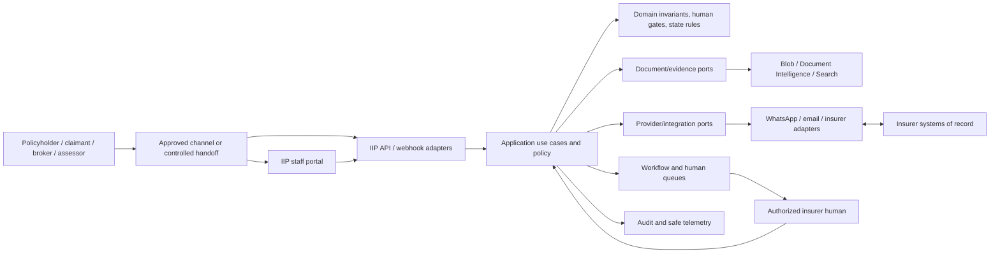
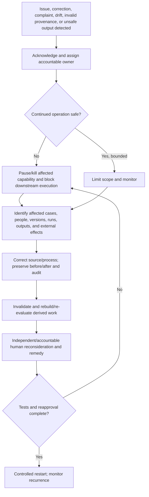

# IIP Release 1 Intelligence-Layer Service Blueprint

| Field | Value |
|---|---|
| Version | 0.2 |
| Date | 2026-08-10 |
| Status | Proposed architecture/data baseline reconciled to current source; protected-runtime and client integration validation pending |
| Scope | Release 1 motor own-damage evidence review, approval preparation, WhatsApp, audit/export, controlled manual assessor exchange, and optional tenant-configured Graph assessor email |
| Architecture ceiling | IIP is an intelligence/operations layer; insurer systems retain policy, payment, accounting, and final decision authority |

## 1. Authority and classification

This document owns service-blueprint boundaries, fact ownership, remote-operation contracts, evidence lineage, human/AI authority, reconciliation, and recovery. It does not create routes, enums, permissions, providers, retry values, or client policy.

| ID | Class | Statement | Authority/status |
|---|---|---|---|
| `BLP-CON-01` | Constraint | Every request/background action resolves tenant/workspace and permission server-side. | `AGENTS.md`, current Application/API contracts |
| `BLP-CON-02` | Constraint | AI/rules may prepare work but never finally decide consequential insurance outcomes. | `AGENTS.md`, R1-AI-001 |
| `BLP-CON-03` | Constraint | Protected runtimes use real configured providers or honest `Not configured`; no fallback-to-mock. | `AGENTS.md`, R1-SEC-004 |
| `BLP-DEC-01` | Decision | WhatsApp is mandatory; other channels and core write-back are conditional adapters. | DEC-017, Release 1 baseline |
| `BLP-DEC-02` | Decision | Controlled manual assessor export/import is the Release 1 baseline; Graph email is an optional tenant-configured enhancement; external assessor portal and insurer-system integration/write-back are deferred. | DEC-018 and assessor-channel ADR; accepted specification scope |
| `BLP-EVD-01` | Evidence | Current code separates cases, documents, tasks, approvals, communications, executions, provider health, audit, and workflow runs. | API/data map and source review; high |
| `BLP-ASM-01` | Assumption | The target insurer can approve a recipient directory, minimum disclosure policy, due/expiry values, retention, and named manual handoff owners. | Target-insurer configuration; unvalidated |

## 2. Context, boundaries, and dependency direction

Dependency direction remains `Domain <- Application <- Infrastructure <- API/Functions`; the portal consumes versioned HTTP contracts. Provider schemas are translated at adapters. External content is untrusted data and cannot grant tool, tenant, permission, or workflow authority.

## 3. Release 1 service blueprint

| Stage | External/channel | Staff-visible experience | API/Application/domain | Provider/insurer boundary | Human queue | Audit/operations |
|---|---|---|---|---|---|---|
| Receive | WhatsApp message/document; staff-mediated broker/manual input; optional configured Graph assessor return | Thread/manual-review item or FNOL/referral form shows received/pending state | Verify request, resolve server channel mapping/scope, validate, deduplicate, assign correlation | Provider signature/message ID and manual referral token are match inputs, not authority | Unmatched/ambiguous content enters owned manual review | Intake/security/dedup outcome; no raw content in telemetry |
| Persist | Sender receives honest acknowledgement only where confirmed | Case/document reference appears after durable association | Store source and tenant metadata before downstream processing | Blob/SQL are IIP operational stores; source provenance retained | Failed association remains recoverable | Durability/correlation/version recorded |
| Extract | No derived result exposed as claimant truth | Original beside extraction, source location, confidence/limitation | Call configured document port; persist derived fields and review status | Document provider is replaceable adapter; absence is `Not configured` | Low/empty/conflict routes to reviewer | Provider/model/version, duration, safe failure |
| Review | May be asked for missing/replacement evidence | Reviewer accepts/corrects/rejects/returns/escalates | Enforce permission/state/version; preserve before/after; invalidate descendants | No write to core policy/payment truth | Claims/document queue owns resolution | Correction, evidence IDs, actor, reason, invalidation |
| Prepare | Receives no final decision from AI | Current evidence, gaps, limitations, proposed action | Re-retrieve approved current evidence and exact versions | AI/search output is derived, not authoritative | Claims Officer prepares; Supervisor queue for consequence | Run/model/rule/workflow versions and evidence coverage |
| Decide | Receives reviewed communication later | Approval cockpit names exact action/evidence/authority | Approval guard enforces unavoidable authorized-human outcome | Provider cannot turn recommendation into decision | Supervisor/authorized approver decides/returns/escalates | Durable actor/reason/before-after/approval ID |
| Execute/handoff | May receive customer-safe update | Pending, succeeded, failed, unknown remain distinct | Revalidate permission, evidence, approval, policy/workflow version and target immediately before attempt | Provider/core system confirms external effect; reconcile unknown before retry | Manual intervention when ambiguity/compensation requires it | Attempt, external ref, idempotency, reconciliation, safe diagnostics |
| Contest/recover | Submits correction/review request | Request/incident remains owned and traceable | Acknowledge, assign, correct source, invalidate derived work, re-evaluate | Propagate correction to approved downstream stores/interfaces | Independent/accountable human reconsideration | Pause/kill, affected work, remedy, restart approval |

## 4. Fact and state ownership

| Fact/state | Authoritative owner | Writer/durability point | Derived readers | Freshness/version | Correction/invalidation | Recovery/retention |
|---|---|---|---|---|---|---|
| Membership/permission | IIP membership/permission store | Authorized administration; committed store state | Request-scoped `TenantContext`, UI visibility | Re-resolved per request/background action | Joiner/mover/leaver change invalidates prior authority | Fail closed; approved access/audit schedule |
| Policy/coverage/payment/accounting truth | Insurer core system and accountable insurer process | Insurer-owned transaction | Approved IIP read/import snapshot | Source timestamp/version required | Correct at owner; refresh/invalidate IIP derivatives | Insurer recovery/retention; IIP retains approved references only |
| Case operational record | IIP Cases context | Application use case/SQL commit | Queue, detail, metrics, audit | Current entity/version; optimistic conflict where used | Authorized case correction and dependent re-evaluation | Transaction/audit; client-approved claim schedule |
| Channel message/delivery | IIP communication history for intent; provider for acceptance/delivery/read | Verified webhook or reviewed outbound history commit | Thread, case timeline, reconciliation | Provider message ID/callback order; unknown is valid state | Idempotent callback/reconciliation | Approved communication/claim schedule |
| Source document | Original approved intake source | Blob plus SQL association | Review, extraction, evidence pack | Source ID/hash/received date/language/version | New version supersedes; original not silently overwritten | Quarantine/delete/hold per approved lifecycle |
| Extracted field | IIP Documents context; derived from source/provider | Processing/reviewer commit | Case view, checklist, proposal | Provider/model, source location, confidence, review/version | Correction preserves before/after and invalidates descendants | Reprocess/review; derived lifecycle |
| Evidence status | IIP evidence/review policy over source facts | Authorized review/rule result | Summary, approval, export | `Current`, `Superseded`, `Historical snapshot`, `Unverified`, `Contradicted` design meanings | Reviewer/rule change creates new state/version | Reconstruct from sources/audit; no silent overwrite |
| Completeness gap | Current approved tenant rules plus received evidence | Completeness evaluation result | Work queue, follow-up draft | Rule/version and evaluation time | Evidence/rule change re-evaluates gap | Recompute; no rule means no invented gap |
| Workflow task/work item | Owning workflow/task context | Authorized use case/worker commit | My Work projection and alerts | Source-owned state/version | Return/reassign/escalate under policy | Retry/DLQ/manual replay for system work |
| Proposed action/summary | Derived artifact | Grounded application/provider result | Review/approval surfaces | Evidence/model/rule/workflow versions and freshness | Source correction marks stale and blocks reliance | Regenerate; retention per derived-artifact policy |
| Approval/human decision | Approval context and authorized human | Durable decision commit | Case, execution guard, audit/export | Exact action/evidence/version/expiry | No destructive edit; new review/decision under approved policy | Reconstruct; retain under decision/audit schedule |
| External execution | IIP integration history for attempt; target provider/system for effect | Pending history before call; final after confirmed/reconciled result | Case timeline, operations, evidence pack | Correlation/idempotency/external ref | Compensation is a new approved action, not generic undo | Reconcile before retry; runbook/manual intervention |
| Audit event | IIP audit context | Application audit writer/append-oriented store | Compliance/export/incident investigation | Immutable event/correlation/version metadata | Correction adds events; does not rewrite history | Legal hold/retention/access policy |
| Search/My Work projections | No independent authority | Request-time projection or rebuildable derived store | Portal lists/search | Source freshness and permission at query/handoff | Rebuild/repair after source change | No dual write; derived lifecycle |
| Conversation/session | IIP conversation repository; never evidence/permission | Owner-scoped bounded pointers/drafts | Recent work/re-entry | Current permission on every reopen/turn | Archive/restore or governed lifecycle | Restore bounded state after reauth; no raw evidence memory |
| Assessor referral | IIP referral context; appointment authority remains insurer-owned | Authorized commit before export/send | Case workspace, queue, audit, reconciliation | Immutable referral/pack version, due/expiry, recipient snapshot | Cancel/expire/supersede/reissue as new state/version | Claims Operations owns business recovery; retention is insurer-approved |
| Assessor evidence pack | IIP Blob plus SQL manifest | Immutable bytes/hash and exact source evidence versions before release | Authorized export/send and later review | Pack version/hash/correlation | Corrected source creates a new pack version; no overwrite | Re-export same version is idempotent; approved evidence lifecycle |
| Assessor report | Original external source in Blob plus SQL association | Durable quarantine/intake before processing | Match queue, evidence review, extraction | Source hash, received channel/time, referral/revision relation | Duplicate links/no-ops; revision supersedes, never erases | Unmatched/late/unsafe return enters owned review; approved lifecycle |

## 5. State-domain separation

The following meanings must not collapse into one generic status:

| Domain | Current/required meaning | Forbidden inference |
|---|---|---|
| Case | Operational case progression | Case state alone proves approval, payment, delivery, or evidence currency |
| Document processing | Upload/classification/extraction lifecycle | Processed means reviewed/correct/current |
| Field review | Accepted/needs review/corrected/rejected | Confidence means truth or claim merit |
| Evidence lineage | Current/superseded/historical/unverified/contradicted | Older source disappears or remains equally current |
| Work item | Ownership/next operational outcome | Notification or list row owns domain truth |
| Approval | Pending/decided/expired exact human outcome | Approved means external action succeeded |
| Communication | Draft/review/attempt/delivery states | Attempted/provider-accepted means delivered/read |
| Execution | Pending/succeeded/failed/unknown/reconciled | Timeout means failed with no external effect |
| Provider health | Configured/healthy/degraded/unavailable/not configured | Missing provider becomes empty or simulated success |
| Assessor exchange | Draft/ready/exported/staff-attested/Graph-accepted/unknown/acknowledged/report-received/late/reviewed | Export, staff attestation, provider acceptance, assessor acknowledgement, report receipt, evidence acceptance, and claim outcome are equivalent |

## 6. Remote-operation and integration contracts

Values such as timeout, retry count, backoff, expiry, and DLQ retention remain conditional; every activated adapter must fill them before protected use.

| Boundary | Preconditions | Idempotency/ordering | Failure/unknown | Reconciliation/manual owner | Current posture |
|---|---|---|---|---|---|
| WhatsApp inbound | Valid provider verification/signature; server business-number mapping | Provider message ID; duplicate/reordered callback safe | Invalid mapping/signature fails or holds without case authority | Channel/technical owner resolves mapping/manual match | Required; local source/tests, live proof pending |
| WhatsApp outbound | Current permission, exact recipient/purpose/basis/language/template, reviewed draft | Stable message/idempotency identity; one controlled attempt | Timeout remains unknown; never auto-repeat | Provider status lookup/callback; Customer Service + operations | Required; policy/provider/live proof pending |
| Document Intelligence | Stored authorized source; configured provider/model | Stable document/run/version identity; results tied to exact source | `Not configured`, timeout, empty, unsupported language are distinct | Reviewer or operator retry after cause fixed | Conditional provider activation |
| Manual assessor exchange | Authorized Claims Officer; insurer-approved recipient/channel/disclosure; immutable pack | Logical referral plus pack version/hash; repeated export does not create a referral | Export or staff attestation cannot prove delivery; late/mismatched return is held | Claims Operations resolves send/receipt/match; Integration Operations assists | Release 1 baseline; permission/audit/configuration gaps block activation |
| Graph assessor email | Dedicated mailbox, approved consent and mailbox scope, recipient/disclosure policy, configured adapter | Persist attempt before call; provider message/attachment identity; dedupe by mailbox/message/hash | `202 Accepted` is not delivery; timeout/response loss is `Unknown`, never blind retry | Reconcile Sent Items/mailbox/correlation before retry; Claims Ops + Integration Ops + insurer IT | Optional enhancement; `Not configured` until tenant activation evidence exists |
| Broker/manual intake | Broker authority verified through insurer process; staff-mediated entry | Intake source/correlation plus document hashes | Ambiguous representation or duplicate stays in manual review | Claims queue | Staff-mediated Release 1 path; no broker portal/direct IIP seat approved |
| Core-system read | Approved interface, identifiers, purpose, scope | Request/correlation and source version | Stale/unavailable must be visible | Insurer IT/data owner | Deferred for assessor flow under DEC-018; separate read-only use requires approval |
| Export | Current permission, purpose, scope, current evidence/versions | Export ID/version; repeated request creates traceable artifact | Partial/failed export is not complete | Compliance/operations owner | Release 1 permitted where configured |
| Core write-back | Separately approved action, current human decision and target | Stable idempotency identity; target-specific ordering | Response loss/timeout enters unknown | Reconcile target before retry; client IT + IIP operations | Deferred under DEC-018; no assessor-path write-back |
| Queue/worker | Valid bounded workflow version and tenant scope | Message/run/node identity; idempotent consumer | Bounded retry then DLQ/failed work | Authorized operator replay after remediation | Current control-plane contract; live proof varies |

### 6.1 Assessor exchange lifecycle contract

1. Claims Officer commits referral purpose, approved recipient reference, questions, minimum evidence manifest, exact source versions, due/expiry, and channel.
2. IIP durably creates the immutable referral and pack version before export or provider call.
3. Manual baseline records `Exported` and, if performed, a named `StaffAttestedSent`. Graph records a durable attempt before the call and `GraphAccepted`, `Failed`, or `Unknown` after the result.
4. `GraphAccepted` means only that Graph accepted processing. `Unknown` requires mailbox/provider reconciliation before any retry. Switching to manual is an explicit new audited attempt, never silent fallback.
5. An assessor acknowledgement must identify the exact referral/pack version. It remains distinct from report receipt.
6. Returned sources are quarantined, validated, deduplicated, and matched using tenant mailbox/channel, referral token/version, reply/provider identity, and attachment/source hash. Ambiguity enters an owned Claims queue.
7. Due/expiry values are insurer-owned configuration. Expiry blocks automatic currentness; it cannot revoke an already transmitted email attachment. Late returns are stored and reviewed, not discarded or silently accepted.
8. Authorized human review makes a report version current, requests revision, marks it superseded/contradicted, or escalates. No report state changes core-system truth.

Graph notifications are an accelerator, not the sole recovery path: subscription renewal plus bounded mailbox reconciliation is required before activation. Retention, legal hold, deletion propagation, timeout, backoff, retry count, and reconciliation cadence remain approved tenant/provider values rather than invented defaults.

## 7. Human/AI decision boundary

| Activity | IIP/AI/rule may do | Required human authority | Stop/escalate condition |
|---|---|---|---|
| Intake/matching | Validate, suggest/link deterministic high-certainty match under approved rule | Reviewer resolves ambiguous match | Unresolved tenant/case/party authority |
| Extraction | Classify/extract with source/confidence/limitations | Accept, correct, reject, or return | Unsupported/unsafe/low-quality source |
| Completeness | Apply current configured rules and show basis | Reviewer resolves exception/alternative evidence | No approved rule or conflicting evidence |
| Summary/proposal | Retrieve, summarize, flag gaps, prepare options | Claims worker verifies; approver decides consequence | Missing/currentness/version/provenance failure |
| Prioritization | Apply approved operational SLA/queue rules | Supervisor owns workload/escalation | Proxy/adverse/risk use outside approved purpose |
| Customer draft | Prepare customer-safe draft | Authorized reviewer approves send/content | Wrong recipient, missing basis/template/language, stale facts |
| Claim/settlement/payment/fraud/complaint/regulatory outcome | Prohibited | Authorized accountable insurer human/process | Any attempted alternate-path automation |

Meaningful oversight requires evidence, real authority, time/workload, correction, return, escalation, independent review where needed, and monitored override/bulk-approval patterns.

## 8. Contestability, incident, and safe-failure loop

High-risk stop conditions remain those in the Release 1 AIA: illegitimate objective, unacceptable provenance/privacy/proxy risk, severe unmeasurable error, nominal oversight, absent recourse, failed correction propagation, human-gate bypass, or a safer simpler baseline with comparable value.

## 9. Audit, telemetry, and notification contract

Audit proves who/what acted and on which scoped/versioned evidence. Telemetry diagnoses outcomes/performance using safe metadata. Notifications only direct attention and never become workflow truth.

| Flow area | Existing `ActionName` examples | Required core fields | Gap/status |
|---|---|---|---|
| Intake/case | `case.created`, `email.received`, `email.case_linked`, `email.case_created`, `whatsapp.inbound.received` | Scope, actor/source, case/message, correlation, result | Current examples; complete route audit still requires validation |
| Assignment/escalation | `case.assigned`, `case.escalated`, `workflow.task.assigned` | Actor, before/after, reason, task/case, correlation | Existing |
| Document/review | `document.uploaded`, `document.processed`, `document.reclassified`, `document.extraction.approved`, `document.extraction.field_corrected`, `case.completeness.updated` | Document/case, evidence IDs, actor/provider/confidence, before/after, reason | Existing; unsafe/quarantine event coverage is `AUD-GAP-01` |
| Workflow/approval | `workflow.evaluated`, `workflow.task.created`, `workflow.task.completed`, `approval.created`, `approval.approved`, `approval.rejected`, `approval.escalated`, `approval.next_step.executed` | Exact approval/action, actor, evidence/version references, before/after, reason, correlation | Existing; expiry/return naming coverage `AUD-GAP-02` |
| Communication | customer-update audit factories; `whatsapp.outbound.attempted`, `whatsapp.delivery.reconciled` | Recipient reference, purpose, approval, provider ref/state, correlation; no raw content | Existing seams; policy/live sampling pending |
| Assessor handoff | No approved `ActionName` yet (`AUD-GAP-04`) | Referral/pack/version, recipient reference, channel/attempt, actor, before/after, acknowledgement/return relation, reason, correlation; no raw report/email body | DEC-018 resolves channel scope only; runtime audit contract separately required |
| Contestability | `claim.review_requested`, `claim.review_acknowledged`, `claim.review_resolved` | Request/case, owner, reason, result, correction references | Existing |
| Search/session | safe search audit; `conversation.viewed`, `conversation.renamed`, `conversation.archived`, `conversation.restored` | Scope/actor/outcome/correlation; raw query/evidence excluded | Existing local contracts |

`AuditEvent` currently carries event ID, scope, optional case/document/user, actor type, action name, timestamp, before/after, evidence IDs, provider, confidence, validation result, approval ID, reason, and correlation. Proposed requirements must reuse this contract or record an explicit gap; documentation does not invent an event.

## 10. Quality-attribute scenarios and tracer slice

| Scenario | Observable requirement/evidence |
|---|---|
| Revoked permission mid-review | Next request fails closed; committed work remains; re-entry reauthorizes; no restricted payload |
| Provider processes but response is lost | Execution remains unknown/pending; target is reconciled before retry; at most one confirmed effect |
| Assessor pack manually exported | Exact version/hash is durable; staff attestation is attributable; neither state is rendered as delivery/read/acknowledgement |
| Graph assessor send returns accepted or loses response | Acceptance is transport processing only; lost response becomes `Unknown`; mailbox/provider reconciliation precedes any retry or explicit manual attempt |
| Assessor report is late, duplicate, or unmatched | Original is preserved safely; duplicate links/no-ops; late/unmatched enters an owned queue; only authorized review establishes current evidence |
| Evidence corrected after proposal | Every dependent Release 1 artifact becomes stale/invalid before execution and is re-evaluated |
| Queue poison | Bounded attempts, DLQ/manual owner, safe diagnostics, authorized replay after remediation |
| Low bandwidth/interruption | Committed work survives; metadata/status remains honest; upload resumes or explains safe restart |
| Restore/rebuild | SQL/Blob/config restore and derived projection rebuild preserve scope, lineage, and approved RPO/RTO evidence |

Recommended tracer slice: verified WhatsApp document → manual/authorized case correlation → stored source → real extraction or honest `Not configured` → human correction → downstream invalidation/completeness → immutable assessor referral/pack → manual export/attestation or configured Graph attempt → exact-version acknowledgement → matched returned report → human evidence review → grounded proposal → human return/approve/escalate → reviewed outbound attempt → delivery reconciliation → audit/evidence pack. Validate every boundary with one correlation ID without logging raw evidence.

## 11. Architecture gaps and decisions

| ID | Gap/decision | Required owner/evidence | Activation impact |
|---|---|---|---|
| `ARCH-GAP-01` | Assessor-path external portal and insurer-system integration/write-back are deferred; no target schema/action contract exists. | Reopen only at ADR review trigger with named owner, exact contract, idempotency, reconciliation, compensation and tests | No portal or core integration may be implied or activated |
| `ARCH-GAP-02` | Per-provider timeout/retry/backoff/DLQ/replay/reconciliation values unapproved. | Architecture/Operations/Security runbook and failure tests | Affected provider cannot pass protected gate |
| `ARCH-GAP-03` | Role delegation/separation/two-person/expiry policy unapproved. | Product/Insurance/Security/client governance | Consequential UAT/pilot blocked |
| `ARCH-GAP-04` | Retention/legal hold/deletion propagation and support-access model unapproved. | Privacy/Legal/Security/client decision and rehearsal | Real-data pilot blocked |
| `AUD-GAP-01` | No verified canonical audit action for unsafe/quarantined document intake across all paths. | Domain/API audit inventory and test | Source-complete audit claim remains partial |
| `AUD-GAP-02` | Approval return/expiry coverage is not established by the current listed audit factories. | Approval contract review and tests | Exact decision reconstruction remains partial |
| `ARCH-GAP-05` | Protected staging/provider/callback/telemetry/restore evidence absent. | Environment-matched execution record | G2/G3 remain blocked |
| `ARCH-GAP-06` | Manual recipient directory/disclosure, due/expiry, retention, permissions and audit actions are not approved; Graph mailbox/consent/RBAC/renewal/reconciliation are additionally unapproved. | Claims Operations, Security/Privacy and insurer IT approve exact configuration; negative/failure/UAT evidence | Manual or Graph assessor exchange cannot be activated in protected runtime |

No gap authorizes a fallback. Missing capability remains `Not configured`, blocked, held, returned, or escalated with an owner and next action.
