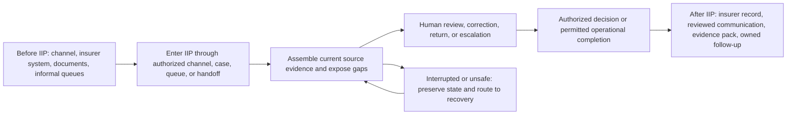

# IIP Release 1 Role Journey Maps

| Field | Value |
|---|---|
| Version | 0.1 |
| Date | 2026-08-07 |
| Status | Proposed, source-complete behavioral baseline; target-insurer and practitioner validation pending |
| Scope | Release 1 non-injury motor own-damage evidence review, approval preparation, WhatsApp intake/follow-up, audit and controlled handoff |
| Owner | Product and Design; business authority remains with named insurer owners |

## 1. Authority and model contract

This document owns Release 1 behavioral archetypes, jobs, before/within/after journeys, and human handoffs. It does not own routes, permissions, workflow enums, insurer policy, or implementation status.

- `iip_end_to_end_user_flow_architecture.md` owns the canonical lifecycle and artifact index.
- `iip_release_1_intelligence_layer_service_blueprint.md` owns system/data/provider boundaries.
- `iip_release_1_task_flow_exception_state_catalog.md` owns task transitions, exceptions, recovery, and UI-state IDs.
- `iip_information_architecture_navigation_and_screen_inventory.md` owns route and screen IDs.
- Current code owns `PlatformRole`, `Permission`, and `RolePermissionMap`; this document never widens them.

These are behavioral archetypes, not fictional personas. No biography, quote, demographic, emotion, or insurer-specific practice is inferred.

## 2. Evidence, assumptions, constraints, and decisions

| ID | Class | Statement | Source/confidence |
|---|---|---|---|
| `JRN-EVD-01` | Evidence | Release 1 should optimize evidence-complete review of non-injury motor own-damage work. | `../research/uganda-release-1-claims-workflow-desk-research.md`; medium, desk research |
| `JRN-EVD-02` | Evidence | Core operational roles are Claims Officer, Claims Supervisor/Authorized Approver, Loss Assessor/Adjuster, and Customer Service/Complaints Officer. | Same research note; medium, local titles unvalidated |
| `JRN-EVD-03` | Evidence | Visible sources, contradictions, missing evidence, and correction paths support calibrated reliance better than one confidence score. | Uganda and conversation-continuity research; medium-high |
| `JRN-EVD-04` | Evidence | Interrupted work should restore the claim/task, evidence position, draft, and pending action after reauthorization. | `../research/generic-conversation-continuity-ux-research.md`; medium-high, not usability-tested |
| `JRN-CON-01` | Constraint | AI prepares work; an authorized human owns every consequential insurance decision. | `../../AGENTS.md`; high |
| `JRN-CON-02` | Constraint | Runtime authority is server-resolved tenant/workspace membership, permission, object state, and action policy. | Code, Release 1 baseline, API/data contract; high |
| `JRN-CON-03` | Constraint | WhatsApp is mandatory for Release 1; other customer channels and core-system write-back are conditional. | DEC-017 and Release 1 baseline; high |
| `JRN-DEC-01` | Decision | Deep maps cover claim-flow actors; supporting platform actors receive boundary maps. | Approved segment plan |
| `JRN-ASM-01` | Assumption | Target insurers can map local titles and delegation to these archetypes without changing the platform ceiling. | OQ-009; low until insurer validation |

Refresh this model when OQ-009 is decided, a target insurer changes the operating model, a critical flow changes, or practitioner/runtime evidence contradicts a journey.

## 3. Shared journey frame

Shared success means the actor can identify the case, owner, current evidence, unresolved condition, permitted next action, human authority, and confirmed outcome without relying on chat memory or an untracked side channel.

## 4. Full role journeys

### `JRN-R1-CLAIMS-OFFICER` — Claims Officer

**Job:** When motor claim work arrives, assemble a current, reviewable file and prepare the next justified action without becoming the final decision-maker.

| Stage | Goal and action | Touchpoints/evidence | Authority and handoff | Breakdown/recovery |
|---|---|---|---|---|
| Before IIP | Find notifications, attachments, policy facts, prior contact, and outstanding work across insurer systems/channels. | Email/WhatsApp, call notes, insurer claim/policy system, shared documents. | May initiate/follow up under insurer policy; source systems retain policy/payment truth. | Missing identifiers or fragmented records require manual reconciliation; do not infer a match. |
| Enter | Open assigned work or create permitted FNOL after server authorization. | `/app/claims`, My Work, Channels; claim reference and correlation ID. | Current contract uses `CreateClaim`, `ViewAssignedClaims`, `UploadDocument`; API rechecks scope. | No membership, wrong workspace, revoked permission, duplicate request, or unmatched message exits to denial/manual review. |
| Assemble | Validate uploads, inspect originals/extractions, identify missing or contradictory evidence, and initiate assessor/follow-up handoffs. | Case workspace, extraction review, evidence rail, checklist, communication draft. | May accept/correct/reject extraction within action permission; cannot approve claim outcome. | Corrupt/unsafe/unsupported document is rejected/quarantined; provider absence is `Not configured`; committed work remains reachable. |
| Prepare | Re-retrieve current evidence, review limitations, and prepare a grounded proposed next action. | Current/superseded evidence, rule/workflow/model versions, timeline. | Routes consequential work to `JRN-R1-CLAIMS-SUPERVISOR`; customer draft to reviewed communication flow. | New/corrected evidence invalidates stale preparation; reviewer reloads and re-evaluates. |
| After IIP | Track returned work, approved/non-approved outcome, evidence pack, and customer-safe next step. | My Work, case timeline, approval and communication states. | No execution is inferred from approval; external truth requires provider/core-system confirmation. | Unknown external outcome enters reconciliation; no blind retry. |

**Known pain points:** fragmented evidence, repeated requests, uncertain ownership, assessor delay, and reconstruction after interruption (`JRN-EVD-01`, `JRN-EVD-04`). **Success:** evidence-complete handoff with zero unsupported consequential action. **Validation:** documentation/current-contract review only; practitioner result pending.

### `JRN-R1-CLAIMS-SUPERVISOR` — Claims Supervisor / Authorized Approver

**Job:** When prepared or exceptional work reaches the queue, make or route an accountable human decision using current evidence and exact authority.

| Stage | Goal and action | Touchpoints/evidence | Authority and handoff | Breakdown/recovery |
|---|---|---|---|---|
| Before IIP | Reconstruct file, authority, prior recommendations, exceptions, and workload from operational systems/queues. | Insurer system, email/referral, approval records. | Insurer delegation and separation of duty remain conditional. | Unclear authority blocks decision; client governance resolves mapping. |
| Enter | Open consequential approval or escalation from My Work. | Approval ID, exact action, subject, evidence/version, expiry, reason. | Current contract includes `ApproveSettlementWorkflowStep` for this platform role; server state remains authoritative. | Stale/mismatched/expired approval is blocked, retained, and returned for re-evaluation. |
| Review | Compare sources, contradictions, exclusions, AI/rule limitations, correction history, and workload implications. | Approval cockpit, original evidence, timeline/audit. | May approve, reject, return/correct, or escalate only in assigned authority. | Missing/currentness conflict exits to return/escalation, never routine approval. |
| Decide | Record actor, reason, evidence/version, and exact outcome. | Approval service and append-oriented audit. | Consequential authority is human; bulk/rubber-stamp patterns are prohibited and monitored. | Concurrent decision uses first valid committed outcome; later stale action fails safely. |
| After IIP | Confirm controlled execution/non-execution and assign any remedy/follow-up. | Execution/reconciliation state, evidence pack, queue. | Approval is not provider success or payment truth. | Ambiguous external outcome routes to technical reconciliation; claimant remedy routes to owned review. |

**Success:** complete, reasoned, non-bypassable decision with valid next state. **Validation:** invariant/local contract evidence exists; target authority, workload, and protected multi-role UAT pending.

### `JRN-R1-CUSTOMER-SERVICE` — Customer Service / Complaints Officer

**Job:** When a claimant needs an update or correction, communicate the confirmed customer-safe state and preserve a route to accountable review.

| Stage | Goal and action | Touchpoints/evidence | Authority and handoff | Breakdown/recovery |
|---|---|---|---|---|
| Before IIP | Find latest status, prior promises, received documents, complaint, and safe response basis. | Phone, WhatsApp/email, insurer CRM/claim system. | May not expose internal notes, reserves, fraud signals, prompts, or restricted audit detail. | Conflicting/unconfirmed status is not communicated as fact. |
| Enter | Open case-linked channel thread or communication work item. | Channels, customer record, case reference, delivery history. | Current contract uses `ViewChannels`, `ManageCustomerCommunications`, `SendCustomerUpdate`; object/action checks still apply. | Unmatched sender/case routes to manual link review; unauthorized record remains undisclosed. |
| Prepare | Verify recipient, purpose, consent/legal basis, language/template, current evidence, and promised next action. | Communication preflight and customer-safe draft. | AI may draft; authorized human reviews before send unless a separately approved low-risk policy exists. | Missing/stale precondition blocks send and preserves draft with specific next action. |
| Send/handoff | Submit one controlled provider attempt after approval. | Provider state/reference and audit correlation. | Provider confirms acceptance/delivery; UI intent is not delivery truth. | Timeout/unknown enters reconciliation; duplicate callback is idempotent. |
| After IIP | Track delivered/failed/unknown state, complaint/review request, and next owned contact. | Thread, case timeline, contestability queue. | Final complaint response remains an accountable human outcome. | Failed notification does not change claim truth; retry follows approved policy. |

**Success:** correct recipient receives reviewed, source-grounded content with honest delivery state and recourse. **Validation:** local WhatsApp contracts exist; live provider/policy/UAT pending.

### `JRN-R1-COMPLIANCE` — Compliance Officer

**Job:** When a claim, decision, communication, or review request is challenged or sampled, reconstruct authority, evidence, versions, actions, and remedy without altering history.

| Stage | Goal and action | Touchpoints/evidence | Authority and handoff | Breakdown/recovery |
|---|---|---|---|---|
| Before IIP | Gather files, logs, communications, approvals, and policy versions from several owners. | Claim system, document store, email, audit exports. | Compliance review is distinct from operational claim authority unless separately granted. | Missing lineage becomes an evidence gap, not reconstructed certainty. |
| Enter | Open permitted audit/case evidence or contestability item. | Audit, approval, evidence pack, review request. | `ViewAuditLog` and object scope required; current `Compliance` role also has approval permissions, recorded below as `PERM-GAP-01`. | Restricted/cross-tenant query fails safely without existence leakage. |
| Review | Trace source, derived artifact, human outcome, execution, correction, and versions. | Append-oriented audit, evidence IDs, correlation, before/after states. | May inspect/export within purpose; must not mutate audit history. | Unsafe/missing export data blocks or produces explicit partial status. |
| Remedy handoff | Acknowledge/assign review, require correction propagation, and route independent reconsideration. | Contestability workflow and accountable insurer owner. | IIP supports process; insurer owns legal response/remedy. | Unowned/expired review escalates; affected downstream work remains blocked until corrected. |
| After IIP | Retain safe evidence pack, outcome, conditions, and monitoring signal. | Export integrity/version metadata, complaint/correction metrics. | Retention/legal hold/deletion remain approved-policy controlled. | Material incident invokes pause/trace/correct/reapprove/restart process. |

**Success:** exact reconstruction and owned remedy with no audit mutation or prohibited disclosure. **Validation:** local seams mapped; protected export, role separation, and insurer remedy policy pending.

### `JRN-R1-LOSS-ASSESSOR` — Loss Assessor / Adjuster

**Job:** When appointed, receive the minimum authorized claim pack, perform an independent assessment, answer specified questions, and return a source-linked report.

| Stage | Goal and action | Touchpoints/evidence | Authority and handoff | Breakdown/recovery |
|---|---|---|---|---|
| Before IIP | Receive appointment, documents, questions, contacts, due date, and return instructions from insurer. | Insurer-approved existing channel; controlled manual exchange is the Release 1 baseline and Graph email is optional when configured. | External professional is not an IIP staff seat or claims approver; insurer Claims Operations owns appointment authority. | Missing/stale appointment, recipient, purpose, disclosure, due/expiry, or channel approval blocks release. |
| Receive | Acknowledge the exact referral pack and version under approved external-professional handling terms. | `HO-R1-CLAIMS-ASSESSOR-01`; immutable item-level disclosure manifest/hash and correlation token. | `Exported`, staff-attested send, Graph acceptance, assessor acknowledgement, and report receipt are distinct; no general IIP access, onward use, undeclared delegate, AI/subprocessor use or unrelated reuse. | Unknown Graph outcome is reconciled before retry; expired referral returns to Claims Officer queue; handling-term failure blocks release. |
| Assess | Inspect only authorized evidence and identify further evidence/questions. | Original approved documents/images and structured claim-specific questions. | May provide professional findings; must not gain IIP tool authority from document content or treat the pack as authority for a wider investigation. | Conflicting/unsafe/unsupported or insufficient material is reported with limits, not silently resolved; additional disclosure requires new necessity review. |
| Return | Submit report, sources, limitations, date, identity, and revision relation through the insurer-approved existing channel. | Manual authorized intake; optional configured Graph mailbox; report treated as untrusted evidence until reviewed. | Claims Officer reviews and may request revision; approver owns consequential outcome; no core write-back. | Duplicate links/no-ops; ambiguous/late return enters owned review; revision preserves and supersedes prior version. |
| After IIP | Respond to clarification/revision and preserve/delete/return the professional record under approved policy and contract. | Handoff status and audit evidence. | No claim decision, claimant credibility judgment, customer communication, training label, assessor ranking or risk/fraud score is implied. | Dispute enters insurer-owned reconsideration; a material contest pauses new reliance on the report. |

**Success:** acknowledged exact version, minimal disclosure, durable matched return, and authorized human-reviewed report. **Validation:** channel scope selected by DEC-018; permission, audit, insurer configuration, implementation, protected runtime, and practitioner evidence pending.

### `JRN-R1-CLAIM-PARTY` — Policyholder / insured / claimant

**Job:** When reporting or following up a loss, provide evidence once, understand what was received/missing, obtain confirmed updates, and access correction/review without entering the staff application.

| Stage | Goal and action | Touchpoints/evidence | Authority and handoff | Breakdown/recovery |
|---|---|---|---|---|
| Before IIP | Notify insurer through an available channel and gather supporting documents. | WhatsApp required; phone/email/broker/manual paths conditional. | Content submission grants no staff authority or automatic case match. | Weak network, language/script, disability/access need, and incomplete documents remain explicit design conditions. |
| Submit | Send message/document and receive honest acknowledgement where configured. | Verified provider event, received timestamp, safe reference. | IIP validates channel mapping and tenant scope server-side. | Invalid signature/mapping/replay is rejected or held; no false receipt. |
| Follow up | Receive customer-safe missing-item/status update and, before assessor disclosure or under an approved narrow later-notice exception, learn the recipient/category, purpose/questions, data categories, material use, channel/non-revocability, handling owner and recourse; supply correction/evidence or request accommodation. | Reviewed communication, accessible assessor notice and case-linked thread. | Source remains attributable; notice is not blanket consent; AI draft is not final communication. | Unsupported language/access need preserves original and routes to human assistance; excessive/unexplained disclosure can be challenged. |
| Review/recourse | Request correction, privacy review, accommodation, explanation, or human reconsideration of the exact assessor disclosure/report and its proposed reliance without an internal-app account or proving a system defect. | WhatsApp, Customer Service/Complaints or another approved mediated contestability path. | Insurer owns substantive decision and remedy; material dispute marks the report `Contested` and blocks new reliance until authorized review. | Request receives acknowledgement, owner, exact-version link, accessible participation, outcome reason, correction propagation/remedy and escalation; independent reviewer or another assessment is available where required. |
| After IIP | Retain confirmed communication/outcome and provide any required next evidence. | Channel history and insurer record. | Delivery/approval/payment are distinct states. | Unknown/failed delivery is not represented as received. |

**Success:** minimal repeated burden, confirmed receipt/state, understandable next action, and accessible recourse. **Validation:** no claimant study completed.

### `JRN-R1-BROKER-CHANNEL` — Broker / agent / channel submitter

**Job:** When acting within authority, submit a complete notification/evidence pack, track insurer requests, and relay confirmed information without becoming insurer decision authority.

| Stage | Goal and action | Touchpoints/evidence | Authority and handoff | Breakdown/recovery |
|---|---|---|---|---|
| Before IIP | Assemble client notification, policy/claim identifiers, documents, and contact/authority context. | Broker system, email/WhatsApp, insurer portal/process. | Identity and represented party must be verified under insurer policy. | Ambiguous representation blocks sensitive disclosure. |
| Submit | Send structured or unstructured intake through the insurer's approved existing process for staff-mediated entry. | Manual intake/handoff; no broker portal or direct Release 1 IIP seat approved. | Current `Broker` platform role is a code contract, not approved Release 1 authority. | Duplicate/missing match routes to deterministic link/no-op or manual review. |
| Coordinate | Respond to missing evidence and assessor/customer handoffs. | Case-safe updates, document checklist, communication history. | Cannot see restricted insurer-only material or make final decisions. | Permission change/expiry requires reauthorization; submitted evidence remains durable. |
| After IIP | Receive confirmed next action/outcome allowed for the relationship. | Reviewed communication/export. | Provider/core system confirms external state. | Dispute/correction routes to insurer-owned review. |

**Success:** authorized, traceable staff-mediated handoff with no duplicate claim, data overexposure, or implied decision authority. **Validation:** channel boundary selected; target-insurer representation policy and runtime evidence pending.

## 5. Boundary journeys

| ID | Actor | Before → within → after | Authority boundary | Success/recovery |
|---|---|---|---|---|
| `JRN-R1-ADMIN-BOUNDARY` | Workspace Admin | Approved tenant policy → configure memberships/settings inside platform ceiling → audited configuration | Cannot bypass human, tenant, provider, or protected-runtime ceilings | Invalid widening rejected; previous valid config retained |
| `JRN-R1-ITSEC-BOUNDARY` | IT/Security Admin | Identity/provider/network requirement → configure/inspect health → operate incident/recovery | Technical access is not claim authority | `Not configured`/degraded remains honest; escalation has owner/runbook |
| `JRN-R1-KNOWLEDGE-BOUNDARY` | Knowledge Manager | Approved source intake → review/version/publish → retrieval-ready source | Unapproved content is not authoritative evidence | Correction/archive invalidates derived use as required |
| `JRN-R1-PUBLISHER-BOUNDARY` | Publisher Support | Deployment/support signal → tenant-safe diagnostics → owned remediation | No insurer decision or unrestricted customer evidence access | Correlation/safe metadata enables support without cross-tenant leak |
| `JRN-R1-IDENTITY-BOUNDARY` | Entra/Azure admin | Consent/subscription setup → coarse identity/control-plane action → IIP internal authorization/deployment | Token, `tid`, role, group, or subscription is not business authority | Missing internal membership fails closed |
| `JRN-R1-PROVIDER-BOUNDARY` | Provider operator/service | Configured request → provider processing/acknowledgement → callback/reconciliation | Provider output is external/derived truth only for its contract | Timeout/duplicate/out-of-order response remains reconcilable |
| `JRN-R1-CORE-SYSTEM-BOUNDARY` | Insurer-system owner | Authoritative policy/claim/payment state → Release 1 receives no assessor-path write-back → future interface requires separate approval | Core system retains authoritative business record | External portal and insurer-system integration/write-back are deferred under DEC-018 |
| `JRN-R1-IIP-SYSTEM-BOUNDARY` | IIP system/AI | Receive authorized task/evidence → extract/retrieve/summarize/route/record → expose assistive output | Never makes consequential decision or treats content as tool authority | Pause/kill, trace, invalidate, repair, reapprove, controlled restart |

## 6. Handoff registry

| ID | From → to | Required payload/context | Receiver check | Return/recovery |
|---|---|---|---|---|
| `HO-R1-CHANNEL-CLAIMS-01` | Channel/manual review → Claims Officer | Provider/source ID, sender context, match reason, received evidence, correlation | Current tenant/case authority and duplicate check | Unmatched/unsafe stays in owned manual-review queue |
| `HO-R1-CLAIMS-ASSESSOR-01` | Claims Officer → Assessor | Appointment reference, approved questions, item-level purpose/necessity manifest, pack version/hash, exclusions/redactions, due/expiry, return instructions, handling terms, correlation and claimant notice/exception record | Verify insurer-approved identity, purpose, terms and exact version; acknowledgement distinct from send/provider acceptance | Excessive/unapproved disclosure blocks; unknown outcome reconciles; expired/failed attempt returns to Claims Officer; reissue creates a linked version |
| `HO-R1-ASSESSOR-CLAIMS-01` | Assessor → Claims Officer | Report, source references, limits, date, referral/version token, revision relation | Quarantine/validate/deduplicate/match, then human review as untrusted evidence | Ambiguous/late return enters owned queue; clarification/revision preserves versions |
| `HO-R1-CLAIMS-APPROVER-01` | Claims Officer → Supervisor | Exact proposed action, current evidence/version, gaps, limitations, authority required | Permission, assignment, expiry, evidence currency | Return/reject/escalate with reason |
| `HO-R1-APPROVER-EXECUTION-01` | Human approver → controlled execution | Durable exact decision, actor, reason, evidence/policy/workflow versions | Revalidate all prerequisites immediately before attempt | Block stale mismatch; reconcile unknown effect |
| `HO-R1-CLAIMS-CUSTOMER-SERVICE-01` | Claims → Customer Service | Customer-safe confirmed facts, recipient/purpose/basis/language/template, next action | Current permission and communication policy | Return unsafe/stale draft; no send |
| `HO-R1-COMPLIANCE-OWNER-01` | Compliance/review queue → accountable insurer owner | Review request, evidence/version, issue, affected work, response target | Independence/authority and completeness | Escalate overdue/unowned review |

## 7. Gaps and validation status

| ID | Gap | Consequence | Owner/next evidence |
|---|---|---|---|
| `PERM-GAP-01` | Current `Compliance` role includes `ApproveSettlementWorkflowStep` and `OverrideAiRecommendation`; separation from compliance review is not approved. | Journey cannot claim independent review or separation of duty from role label alone. | Product/Insurance/Security: decide OQ-009; add negative/SoD tests before activation. |
| `PERM-GAP-02` | Current `ClaimsOfficer` and `CustomerService` permissions include broad workflow/run review capabilities. | UI visibility may exceed the narrow Release 1 job model even when backend object checks remain. | Product/Security: route/action inventory and target role mapping. |
| `JRN-GAP-01` | DEC-018 selects staff-mediated/manual handoff and optional configured Graph; recipient/disclosure, due/expiry, retention, permission, audit and Graph activation inputs remain unapproved. | No live assessor exchange or broker direct access can be claimed. | Claims Operations/Security/Privacy/Client IT: approve configuration and execute negative, expiry, failure and reconciliation tests. |
| `JRN-GAP-02` | Target-insurer titles, delegation, workload, SLA, document list, and communication policy are unknown. | Maps remain hypotheses and conditional configuration inputs. | Target-insurer interviews/configuration approval; outside this segment. |
| `JRN-GAP-03` | No representative practitioner or claimant validation exists. | No usability, comprehension, trust, or preference claim. | Separate research/usability program. |

Documentation consistency and runtime contract checks may advance this artifact to source-complete. Only target-insurer and practitioner evidence may advance the behavioral claims to validated.
