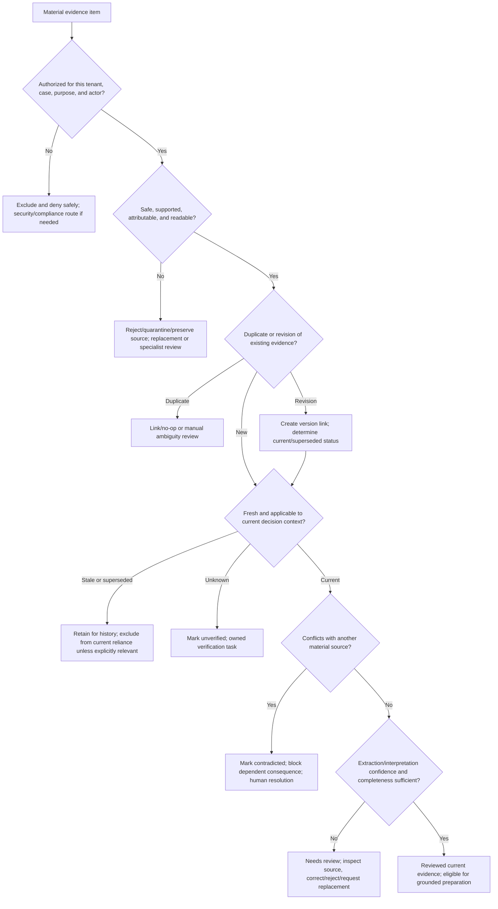

# IIP Release 1 Task Flow, Exception, and State Catalog

| Field | Value |
|---|---|
| Version | 0.2 |
| Date | 2026-08-10 |
| Status | Proposed implementation-ready behavior baseline; local/protected execution evidence recorded separately |
| Scope | Release 1 motor own-damage evidence review and approval preparation |
| Owners | Product/Design own observable behavior; Domain/Application own policy/state/permissions; QA owns evidence |

## 1. Contract and identifiers

This catalog owns task transitions, decisions, safe exits, exception/recovery behavior, and coordinated UI-state contracts. It does not create routes, enums, permissions, or audit events.

The companion `iip_release_1_interaction_authority_and_inventory.md` owns the critical-action registry, evidence/assumption/decision ledger, and design-to-runtime parity dimensions. This catalog remains the owner of detailed transitions and state IDs; neither artifact duplicates the other's concern.

The companion `iip_release_1_state_exception_recovery_contracts.md` applies these stable state/exception IDs to independently changing regions and owns shared prevention, confirmation, cancellation, idempotency, interruption, stale/conflict, session-expiry, succession, and recovery behavior. It cannot create a competing domain state.

| Artifact | Stable form |
|---|---|
| Journey | `JRN-R1-{ACTOR}` |
| Flow | `FLW-R1-{DOMAIN}-{NN}` |
| Step/decision | Flow ID plus `-SNN` / `-DNN` |
| Handoff | `HO-R1-{SOURCE}-{TARGET}-{NN}` |
| Exception | `EX-R1-{FLOW-CODE}-{NN}` |
| UI state | `ST-R1-{SURFACE}-{STATE}` |
| Missing permission/audit coverage | `PERM-GAP-{NN}` / `AUD-GAP-{NN}` |

Every step specifies an existing permission or `Public verified provider callback`, existing audit action/seam or explicit gap, durable state owner, feedback, and exit. Browser visibility is never authority.

## 2. Canonical flow registry

| Flow | Goal | Primary actors | Entry | Success exit | Safe non-success exits |
|---|---|---|---|---|---|
| `FLW-R1-AUTH-01` | Enter/resume only the current authorized workspace | All workforce roles | Login, deep link, resumed task | Authorized route with current scope and state | Reauthenticate, deny, select assigned workspace, contact admin |
| `FLW-R1-WA-01` | Retain and correlate verified WhatsApp intake once | Claim party, Customer Service, Claims Officer | Signed provider webhook | Linked case/thread or owned manual-review item | Reject signature/mapping, dedup no-op, quarantine/hold |
| `FLW-R1-INTAKE-01` | Create/link one scoped case from approved input paths | Claims Officer; staff-mediated broker/manual input; optional configured adapters | Form, upload, staff handoff, configured adapter | One case/reference with correlation | Validation error, deterministic duplicate, manual match, `Not configured` |
| `FLW-R1-QUEUE-01` | Make work ownership and next action explicit | Claims Officer, Supervisor, support roles | My Work/case handoff | Assigned/returned/escalated owned work | Conflict, permission denial, expiry, unassigned owned queue |
| `FLW-R1-DOC-01` | Store and process authorized evidence safely | Claims/document reviewer, system | Case upload/channel document | Durable source plus extraction/review state | Reject, quarantine, `Not configured`, retryable failure, manual review |
| `FLW-R1-EVIDENCE-01` | Resolve evidence status and completeness without hiding lineage | Claims Officer, reviewer, system | Extraction/source review | Current reviewed evidence or explicit owned gap | Return, escalate, await source, invalidated downstream work |
| `FLW-R1-ASSESSOR-01` | Exchange a minimal versioned assessor referral/report | Claims Officer, Loss Assessor | Appointment/referral | Reviewed current report or explicit exception | Failed/expired handoff, clarification, revision, escalation |
| `FLW-R1-DECISION-01` | Prepare and record an exact accountable human outcome | Claims Officer, Supervisor/Approver, Compliance | Grounded proposal/review request | Approve/reject/return/escalate with valid next state | Stale/expired/mismatched/unauthorized block, contestability |
| `FLW-R1-COMMS-01` | Send one reviewed customer-safe update and reconcile delivery | Customer Service, approver, provider | Communication need/thread | Confirmed state: provider-accepted/delivered/read/failed as supported | Draft retained, rejected, `Not configured`, unknown/reconciliation |
| `FLW-R1-HANDOFF-01` | Export or conditionally write back without moving authority | Claims/Compliance, system/operator, insurer system | Authorized export/approved action | Versioned export or confirmed external effect | Partial/failed export, unknown effect, manual intervention, compensation |

## 3. Detailed task transitions

### `FLW-R1-AUTH-01` — authentication, authority change, and resume

**Preconditions:** organizational identity configuration; protected runtime auth; internal membership for operational access. **Postcondition:** each business action uses a server-resolved current `TenantContext`.

| Step | Actor/action and rule | Permission/enforcement | State/data/audit | Feedback and exit |
|---|---|---|---|---|
| `FLW-R1-AUTH-01-S01` | User opens login/deep link; portal starts organizational sign-in. | Public login; Entra validates identity only. | No business authority created. | Progress, cancel/back, specific identity error. |
| `FLW-R1-AUTH-01-S02` | API validates token and resolves `tid`/`oid` hint through internal membership/workspace. | `AuthenticatedTenantResolver` + permission repository. | Request scope established; security telemetry. | Authorized context or safe 401/403 without data. |
| `FLW-R1-AUTH-01-D01` | Is current membership/workspace valid for the requested action? | Exact action permission plus object/state guard. | No client header/body/query value widens scope. | Yes → destination; no → assigned workspace/access-denied path. |
| `FLW-R1-AUTH-01-S03` | Reopen interrupted work using durable case/work-item pointer. | Recheck permission, assignment, current version/evidence. | Draft only where supported; conversation is not evidence. | Restore exact safe context plus material-change warning. |
| `FLW-R1-AUTH-01-S04` | Permission changes or session expires mid-task. | Next request resolves current authority. | Committed work retained; uncommitted state handled by surface contract. | Reauthenticate/refresh; restricted content removed; no stale action. |

Cancellation exits before a business write. Reauthentication never repeats a prior submit automatically. `EX-R1-AUTH-01` covers no membership; `EX-R1-AUTH-02` wrong workspace; `EX-R1-AUTH-03` revoked permission; `EX-R1-AUTH-04` expired session with interrupted work.

### `FLW-R1-WA-01` — WhatsApp intake and correlation

| Step | Actor/action and rule | Permission/enforcement | State/data/audit | Feedback and exit |
|---|---|---|---|---|
| `FLW-R1-WA-01-S01` | Provider posts message/document/status. | Public callback only after provider verification/signature. | Provider event ID and server-configured business-number mapping. | Invalid verification/mapping fails safely. |
| `FLW-R1-WA-01-D01` | Is event new and ordering-compatible? | Stable provider message/status identity. | Duplicate is no-op/link; later valid delivery state is monotonic. | Accepted/deduplicated; no duplicate case/message. |
| `FLW-R1-WA-01-S02` | Retain authorized message/document and correlation before processing. | Server scope; content grants no authority. | `whatsapp.inbound.received`; durable thread/source reference. | Thread state available to permitted staff. |
| `FLW-R1-WA-01-D02` | Is case/party match authorized and unambiguous? | Object/party matching policy; manual review on uncertainty. | Match reason/version; no invented case authority. | Link case or create owned manual-review item. |
| `FLW-R1-WA-01-S03` | Authorized staff review unmatched/restricted content. | `ViewChannels`; case action needs relevant case permission. | Before/after link and reason require audit coverage (`AUD-GAP-03` if absent). | Link, reject/quarantine, request clarification, or retain held. |

Replay remains deterministic. Unsupported/unsafe files enter `FLW-R1-DOC-01`; unmatched content never disappears from its authorized owner queue.

### `FLW-R1-INTAKE-01` — conditional adapters and FNOL

| Step | Actor/action and rule | Permission/enforcement | State/data/audit | Feedback and exit |
|---|---|---|---|---|
| `FLW-R1-INTAKE-01-S01` | Claims worker opens FNOL or adapter presents approved input. | `CreateClaim`; provider callback/config where external. | Draft/input source and correlation. | Loading/form or `Not configured`; no fake adapter. |
| `FLW-R1-INTAKE-01-D01` | Are source, schema, identifiers, tenant/workspace, and required minimum fields valid? | Server validation and scope. | Invalid input changes no case state. | Field/safe adapter error; preserve correctable input. |
| `FLW-R1-INTAKE-01-D02` | Is request/event duplicate or an ambiguous existing-case match? | Stable idempotency and matching rule. | Deterministic existing result/no-op or manual review. | Existing reference or owned conflict; never two silent claims. |
| `FLW-R1-INTAKE-01-S02` | Create one scoped case and initial work/evidence links. | `CreateClaim`; Application use case. | `case.created`; transactional case commit. | Confirm exact reference and next action. |
| `FLW-R1-INTAKE-01-S03` | Route initial document/follow-up work. | `UploadDocument`/workflow permission as action requires. | Source-owned tasks; My Work remains projection. | Case workspace/queue; no dead-end success page. |

Email, broker, portal/manual, and insurer adapters are conditional. Missing provider/configuration exits to owned configuration/manual path; it never changes WhatsApp's mandatory posture.

### `FLW-R1-QUEUE-01` — assignment, return, escalation, and SLA handoff

| Step | Actor/action and rule | Permission/enforcement | State/data/audit | Feedback and exit |
|---|---|---|---|---|
| `FLW-R1-QUEUE-01-S01` | User opens My Work/record task list. | Source-specific permissions; `ViewAssignedClaims`/`ViewAllClaims` and action permissions. | Request-time projection; safe read audit. | Loading, empty, partial, stale, filtered, paginated, restricted states. |
| `FLW-R1-QUEUE-01-S02` | Open item; target rechecks current object access/state. | API source guard, not row visibility. | Queue/filter/order return context retained. | Target opens or safe restricted/material-change state. |
| `FLW-R1-QUEUE-01-D01` | Can actor assign/reassign/claim this source object? | Existing source action; current broad permission semantics require review (`PERM-GAP-03`). | Optimistic version; `case.assigned`/`workflow.task.assigned` where applicable. | Committed owner or conflict/reload. |
| `FLW-R1-QUEUE-01-S03` | Return/escalate with required reason and destination. | Source action and current permission. | `case.escalated` or source event; owner/queue/due state. | Recipient can open context; sender sees returned/escalated state. |
| `FLW-R1-QUEUE-01-S04` | SLA risk/breach generates attention signal. | Configured tenant rule only. | Notification separate from task/case truth. | Deduplicated alert with route to owned work. |

Unassigned work must still have an accountable queue owner. Notification failure does not roll back assignment/escalation.

### `FLW-R1-DOC-01` — document validation, storage, extraction, and provider failure

| Step | Actor/action and rule | Permission/enforcement | State/data/audit | Feedback and exit |
|---|---|---|---|---|
| `FLW-R1-DOC-01-S01` | User/channel submits document to exact case/thread. | `UploadDocument` or verified provider intake plus case association authority. | Upload attempt/source identity. | Progress/cancel before commit; no false stored state. |
| `FLW-R1-DOC-01-D01` | Is file supported, within limits, safe, and non-duplicate? | Server validation/security service; scanning service remains conditional. | Reject/quarantine/dedup record; unsafe audit gap `AUD-GAP-01`. | Specific safe reason, replacement/manual route. |
| `FLW-R1-DOC-01-S02` | Persist original source and metadata before extraction. | Scoped storage/Application use case. | `document.uploaded`; Blob + SQL durability point. | Stored state with source/version; storage failure remains failed. |
| `FLW-R1-DOC-01-D02` | Is provider configured/healthy and language/type supported? | Provider registry/health; no fallback. | Provider/model/source version. | Continue, `Not configured`, unavailable/timeout, or human review. |
| `FLW-R1-DOC-01-S03` | Extract/classify with source coordinates/confidence where available. | System under bounded workflow; content is untrusted. | `document.processed`; derived fields/review states. | Honest empty/partial/needs-review result. |
| `FLW-R1-DOC-01-S04` | Bounded retry only from retryable failed state using same run identity. | Authorized system/operator policy. | Attempts, failure code, DLQ/manual state. | Retrying/failed/manual intervention; no duplicate source. |

Cancellation after durable upload cancels queued processing only where the approved contract permits; it does not delete the source or audit history.

### `FLW-R1-EVIDENCE-01` — review, lineage, correction, and completeness

| Step | Actor/action and rule | Permission/enforcement | State/data/audit | Feedback and exit |
|---|---|---|---|---|
| `FLW-R1-EVIDENCE-01-S01` | Reviewer opens original beside extracted/derived values. | Current document/case read and action permission. | Source/version/freshness/status shown. | Loading/partial/stale/restricted states do not hide original status. |
| `FLW-R1-EVIDENCE-01-D01` | What is each material evidence condition? | Decision tree in section 4; human resolves ambiguity. | Current/superseded/historical/unverified/contradicted semantics. | Accept, correct, reject, return, escalate, or await evidence. |
| `FLW-R1-EVIDENCE-01-S02` | Commit review/correction with reason and expected version. | `UploadDocument` under current contract; `PERM-GAP-04` records overly coarse edit authority. | `document.extraction.approved`, `document.extraction.field_corrected`, or reclassification event; before/after. | Saved/new version or conflict/reload; no destructive overwrite. |
| `FLW-R1-EVIDENCE-01-S03` | Invalidate every dependent Release 1 artifact and re-evaluate affected steps. | System invariant independent of reviewer workflow permission. | Workflow descendant lineage/invalidation; audit/test evidence. | Stale proposals/tasks cannot execute; visible re-evaluation. |
| `FLW-R1-EVIDENCE-01-D02` | Do current approved tenant rules and evidence show a gap? | Configured rule/version only. | `case.completeness.updated`; gap basis/version. | Ready for preparation or owned evidence-follow-up work. |

Undo is a new reviewed correction restoring a prior value with reason; history remains. Concurrent correction uses optimistic conflict and intentional reapply.

### `FLW-R1-ASSESSOR-01` — assessor referral and report revision

| Step | Actor/action and rule | Permission/enforcement | State/data/audit | Feedback and exit |
|---|---|---|---|---|
| `FLW-R1-ASSESSOR-01-S01` | Claims Officer prepares appointment reference, approved recipient, approved claim-specific questions, a default-deny per-item evidence manifest with necessity/exclusion/redaction reasons, due/expiry, purpose, return instructions, channel, external handling terms, and accessible claimant notice or approved narrow exception. | Current case permission plus proposed referral/disclosure permission `PERM-GAP-05`; server validates tenant, case, recipient, purpose, item necessity, state, exact evidence versions, notice/exception and handling gates. | Draft referral/disclosure manifest/notice record; no external effect; `AUD-GAP-04`; `ETH-GAP-ASR-01`. | Preview names target, exact bytes/categories, purpose, effect, non-revocability, claimant recourse and audit; missing or excessive disclosure/authority/configuration blocks release. |
| `FLW-R1-ASSESSOR-01-S02` | IIP commits immutable referral and evidence pack before release. | Same guard rechecked; correction after pack creation requires a new version. | Referral ID/version, manifest, source versions, pack hash, due/expiry, correlation become durable. | `Ready`; failure preserves draft and identifies recovery owner. |
| `FLW-R1-ASSESSOR-01-D01` | Which approved channel applies? | Manual baseline is explicit; Graph only when tenant-configured and scoped. External portal/core integration are unavailable. | Channel selection and configuration version. | Manual → S03A; Graph → S03B; otherwise `Not configured`. |
| `FLW-R1-ASSESSOR-01-S03A` | Authorized staff exports exact pack and may attest transmission through the approved existing channel. | Referral/disclosure permission and current recipient/version; staff attestation requires named actor. | `Exported`, then optional `StaffAttestedSent`; export/attempt IDs; `AUD-GAP-04`. | UI states neither action proves delivery/read; cancellation before transmission leaves pack durable. |
| `FLW-R1-ASSESSOR-01-S03B` | IIP persists attempt identity, calls configured Graph adapter once, and records response. | Dedicated mailbox/consent/RBAC/configuration plus same referral guard. | `GraphAccepted`, `Failed`, or `Unknown`; provider reference/correlation; `AUD-GAP-04`. | Acceptance is not delivery; unknown routes to reconciliation, never blind retry. |
| `FLW-R1-ASSESSOR-01-D02` | Did correct assessor acknowledge exact referral/pack version before expiry? | Verified reply/manual acknowledgement and recipient/version match. | `AssessorAcknowledged` remains distinct from transmission and report receipt. | Acknowledged; wait with owner; clarify; expire/reissue; or escalate. |
| `FLW-R1-ASSESSOR-01-S04` | Returned report is quarantined, validated, deduplicated, and matched to tenant/referral/version. | Authorized document intake; external content grants no authority. | Immutable source/hash/time/channel/revision relation; `ReportReceived`, `LateReceived`, duplicate, unsafe, or unmatched queue. | Matched source proceeds; ambiguous/late/unsafe remains owned and recoverable. |
| `FLW-R1-ASSESSOR-01-D03` | Is report current, complete for approved questions, non-conflicting and uncontested for the proposed reliance? | Claims reviewer using the evidence decision tree; claimant dispute/accommodation/privacy request routes to authorized reconsideration; no external assessor decision authority. | Human review status; prior report superseded, not erased; materially disputed report is `Contested` and blocks new reliance under `ETH-GAP-ASR-02`. | Mark current for bounded evidence use, request clarification/revision, start independent review/remedy, or escalate; no core write-back. |

DEC-018 fixes the channel scope but authorizes no runtime route, permission, audit event, provider activation, or external access. No live assessor flow is claimed until the remaining configuration/contracts are approved and verified.

### `FLW-R1-DECISION-01` — proposal, human decision, expiry, and contestability

| Step | Actor/action and rule | Permission/enforcement | State/data/audit | Feedback and exit |
|---|---|---|---|---|
| `FLW-R1-DECISION-01-S01` | Claims worker re-retrieves current evidence and prepares proposed action/limits. | Case/evidence read; `ViewAiOutputs` where AI output appears. | `workflow.evaluated`; exact evidence/model/rule/workflow versions. | Prepared or blocked by evidence/configuration gap. |
| `FLW-R1-DECISION-01-D01` | Is action consequential or externally sensitive? | Platform action classification; unknown defaults to human gate. | Classification/version. | Consequential → exact approval; non-consequential → permitted operational path. |
| `FLW-R1-DECISION-01-S02` | Create review item naming action, subject, evidence, risk, authority, expiry/version conditions. | Existing approval creation guard; current API uses `ApproveSettlementWorkflowStep`. | `approval.created`. | Pending approver queue; no implied decision. |
| `FLW-R1-DECISION-01-D02` | Does actor have current exact authority and is approval current/matched? | `ApproveSettlementWorkflowStep`, assignment/state/policy/evidence version. | No decision on mismatch. | Approve/reject/return/escalate or block stale/expired/unauthorized. |
| `FLW-R1-DECISION-01-S03` | Human commits reasoned outcome. | Authorized human only. | `approval.approved`, `.rejected`, `.escalated`; return/expiry audit gap `AUD-GAP-02`. | Durable outcome and valid next state. |
| `FLW-R1-DECISION-01-S04` | Claim party/staff requests correction/reconsideration. | Authorized contestability intake/review. | `claim.review_requested`, `.acknowledged`, `.resolved`. | Owned remedy, correction propagation, closure/escalation. |

First valid committed decision wins unless an approved multi-person policy says otherwise. Approval never means external execution success.

### `FLW-R1-COMMS-01` — reviewed communication and delivery reconciliation

| Step | Actor/action and rule | Permission/enforcement | State/data/audit | Feedback and exit |
|---|---|---|---|---|
| `FLW-R1-COMMS-01-S01` | Prepare customer-safe draft from confirmed current facts. | `ManageCustomerCommunications`; case/thread scope. | Customer-update draft audit seam; content stored under communication policy. | Draft/saving/saved; never sent automatically. |
| `FLW-R1-COMMS-01-D01` | Are recipient, purpose, basis/consent, language/template, evidence, and reviewer approval current? | `SendCustomerUpdate` plus action/state policy. | Exact preflight/approval references. | Ready or blocked with preserved draft and specific owner. |
| `FLW-R1-COMMS-01-S02` | Make one controlled provider attempt. | Revalidate permission and provider state immediately before call. | `whatsapp.outbound.attempted`; pending/provider reference/idempotency. | Attempting/provider-accepted or explicit failure/unknown. |
| `FLW-R1-COMMS-01-S03` | Process signed callbacks/status in monotonic idempotent order. | Verified provider callback. | `whatsapp.delivery.reconciled`; delivered/read/failed/unknown as supported. | Honest final/current provider state. |
| `FLW-R1-COMMS-01-D02` | Can failed/unknown attempt retry? | Approved retry policy; unknown requires reconciliation first. | Same idempotency intent; new attempt history where allowed. | Retry, redraft/reapprove, or manual intervention. |

Wrong-recipient or stale-content prevention has greater priority than throughput. Notification failure never mutates claim/approval truth.

### `FLW-R1-HANDOFF-01` — export, write-back, ambiguity, and compensation

| Step | Actor/action and rule | Permission/enforcement | State/data/audit | Feedback and exit |
|---|---|---|---|---|
| `FLW-R1-HANDOFF-01-S01` | Authorized user requests evidence pack or approved action reaches execution. | `ViewAuditLog`/case permission for export; exact execution guard for action. | Scope/filter/version/purpose. | Preview/processing or safe denial. |
| `FLW-R1-HANDOFF-01-D01` | Are current permission, evidence, approval, workflow/policy version, target, and provider valid? | Server/Application guard. | Failed precondition changes no external state. | Continue or block/return/reapprove. |
| `FLW-R1-HANDOFF-01-S02` | Persist pending attempt/export identity before external effect. | Controlled adapter/export service. | Correlation/idempotency/export version; audit event. | Pending/progress with route back to work. |
| `FLW-R1-HANDOFF-01-D02` | Is external result confirmed, failed before effect, or unknown? | Provider/target response plus reconciliation. | `approval.next_step.executed` only for confirmed contract result; unknown remains distinct. | Succeeded, failed/retryable, unknown/manual. |
| `FLW-R1-HANDOFF-01-S03` | Reconcile target before any retry after ambiguity. | Technical operator plus client IT where needed. | External reference/result and reconciliation audit requirement `AUD-GAP-05`. | Final state or manual intervention. |
| `FLW-R1-HANDOFF-01-S04` | If confirmed effect needs reversal, create explicit compensation. | New permission, human approval, provider support, reason. | New linked action/audit; never delete original. | Compensated/failed/manual state. |

Core write-back remains conditional. Release 1 can stop at approved preparation/export without inventing insurer-system execution.

## 4. Evidence decision tree

| Condition | Required system state | Human action/owner | Downstream rule | Success exit |
|---|---|---|---|---|
| Missing | Explicit gap with rule/evidence basis | Claims Officer requests/records allowed exception | No invented fact; affected preparation blocked | Received/reviewed or approved exception |
| Unverified | Source retained with attribution, not treated current | Authorized reviewer verifies/rejects | Derived output discloses exclusion | Verified current or rejected |
| Low-confidence | Field/item `needs_review` with source location/limit | Reviewer corrects/accepts/rejects | Confidence never equals truth/merit | Reviewed version |
| Conflicting/contradicted | Both sources visible with dates/provenance | Reviewer seeks resolution/escalates | Consequential path blocked | Reasoned current-source decision |
| Stale | Freshness/version warning | Refresh/retrieve/confirm relevance | Stale approval/proposal cannot execute | Current evidence or explicit historical use |
| Superseded | Version chain; older source retained historical | Reviewer selects/validates current revision | Default grounding excludes superseded source | Current revision linked |
| Unauthorized | Omit/deny without sensitive existence leak | Admin/compliance route only if policy permits | Never retrieve/render/export | Authorized access or closed denial |
| Unsupported language | Preserve original/language `undetermined` and limitation | Qualified human review/approved translation | No fabricated extraction | Reviewed original/translation provenance |
| Duplicate | Stable identity/hash/provider reference | Resolve only ambiguous near-match | No duplicate case/document/effect | Link/no-op or distinct justified source |
| Corrupt/unsafe | Rejected/quarantined restricted state | Replace/security runbook | No downstream processing | Safe replacement or terminal rejection |

## 5. Exception and recovery catalog

| ID | Trigger/consequence | Prevention/detection | Preserved state/message | User/system recovery | Retry/rollback/audit |
|---|---|---|---|---|---|
| `EX-R1-AUTH-01` | Valid identity, no membership | Internal membership lookup | No business payload; “Access not assigned” | Contact tenant admin | No automatic retry; security telemetry |
| `EX-R1-AUTH-02` | Wrong/unassigned workspace | Server workspace check | Current allowed workspace list only | Select assigned workspace/request access | Re-resolve; no leaked counts |
| `EX-R1-AUTH-03` | Permission revoked mid-session | Per-request resolution | Committed work; restricted region removed | Reauthenticate/return to permitted route | Stale submit denied/audited |
| `EX-R1-AUTH-04` | Session expires during work | Expiry detection before submit | Supported draft and durable pointer | Sign in, reload latest, compare changes | Never replay prior submit |
| `EX-R1-WA-01` | Invalid webhook/signature/mapping | Verify before content processing | Minimal security metadata only | Provider/config owner fixes | Replay after verified fix; no case created |
| `EX-R1-WA-02` | Duplicate/reordered event | Provider ID/monotonic state | Existing message/delivery state | Deterministic no-op/reconcile | No duplicate; integration audit |
| `EX-R1-INTAKE-01` | Duplicate/ambiguous case | Idempotency and match reason | Submitted input/reference | Link existing or manual decision | No silent second case |
| `EX-R1-QUEUE-01` | Concurrent assignment/reassignment | Expected version/source owner | Winning assignment and user context | Reload and intentionally reassign if allowed | Before/after audit |
| `EX-R1-DOC-01` | Unsupported/corrupt/unsafe file | Early validation/quarantine | Safe metadata; source restricted as policy allows | Replace or security runbook | No extraction; `AUD-GAP-01` |
| `EX-R1-DOC-02` | Provider absent/unavailable/timeout | Health/config and bounded timeout | Source, run ID, failure state | Configure/restore; authorized retry | Same run identity; bounded attempts/DLQ |
| `EX-R1-EVIDENCE-01` | Concurrent correction | Expected version | Winning source/version, entered value where safe | Reload/reapply intentionally | New correction event, no overwrite |
| `EX-R1-EVIDENCE-02` | Correction after proposal/approval | Lineage dependency tracking | Old derived artifacts marked stale | Invalidate/re-evaluate/reapprove | No execution until current |
| `EX-R1-ASSESSOR-01` | Referral due/expiry passes or report arrives late | Due/expiry and exact-version tracking | Referral/pack/report history and owner | Review late return or reissue under current authority | New linked version/event; transmitted email cannot be remotely revoked |
| `EX-R1-ASSESSOR-02` | Graph times out or response is lost after possible effect | Durable attempt before call; `Unknown` is explicit | Referral, pack, attempt, recipient and correlation | Reconcile mailbox/provider before retry; explicitly select manual path if authorized | No blind repeat; retry is a new linked attempt only after no-effect proof |
| `EX-R1-ASSESSOR-03` | Returned report is duplicate, reordered, unmatched, corrupt, or unsafe | Provider/message identity, referral token/version, source hash, validation/quarantine | Original source where safe plus match/failure metadata | Link/no-op, manual match, replacement request, or security runbook | No automatic currentness; owned queue and `AUD-GAP-04` |
| `EX-R1-ASSESSOR-04` | Recipient/sender is unknown, stale, changed, spoofed, forwarded, unauthorized delegate, or wrong tenant | Insurer-owned directory/appointment plus exact recipient/version revalidation; sender/token is data only | Draft/pack remain undisclosed; safe reason without identity/existence leak | Correct/reverify appointment and recipient; new preflight required | No release/match; denied attempt audited under `AUD-GAP-04` |
| `EX-R1-ASSESSOR-05` | Attachment is oversized/mismatched/polyglot/malformed/malicious, scanner unavailable, or quarantine bypass attempted | Bounded size/type/signature, malware and parser controls before downstream release | Tenant-scoped quarantine and safe validation metadata | Replace source, restore scanner, security incident/runbook, authorized reprocess | No extraction/preview/search/AI/export/currentness; `SEC-GAP-ASR-01` |
| `EX-R1-ASSESSOR-06` | Claimant/representative disputes disclosure, report fact/limitation/reliance, requests privacy review or needs an accommodation | Mediated intake with current authority, exact-version linkage and materiality triage; no internal-app account or proof of system defect required | Preserve original, claimant context and request; acknowledge/assign; mark material evidence `Contested` | Accessible participation, correction/clarification, independent review or another assessment, useful reason, remedy/escalation | Block new reliance until authorized reconsideration; propagate correction/invalidation without erasing history; `ETH-GAP-ASR-02` |
| `EX-R1-DECISION-01` | Approval stale/expired/mismatched | Pre-decision and pre-execution checks | Old approval/history | Return and create current review | Never mutate old decision; `AUD-GAP-02` |
| `EX-R1-DECISION-02` | Concurrent approval | Atomic expected state | First valid outcome | Reload; later actor may escalate separately if policy permits | Later stale action rejected |
| `EX-R1-COMMS-01` | Draft fails preflight | Validate recipient/purpose/basis/language/template/evidence | Draft and failed conditions | Correct/reapprove | No send attempt |
| `EX-R1-COMMS-02` | Provider response lost/unknown | Pending history before call | Draft, approval, idempotency, external ref if any | Reconcile provider before retry | No blind repeat; delivery audit |
| `EX-R1-HANDOFF-01` | Core write-back unknown | Pending attempt/idempotency/external ref | Original approval and attempt | Client IT/IIP operator reconcile | Retry only after no-effect proof |
| `EX-R1-HANDOFF-02` | Confirmed effect must reverse | No generic undo after external effect | Original immutable action | New compensating action/approval | Linked compensation audit |
| `EX-R1-SYSTEM-01` | Queue poison/retry exhausted | Bounded attempts and safe failure classification | Work/run/failure code | Operator fixes cause and replays | DLQ/manual authorization/audit |
| `EX-R1-SYSTEM-02` | Harm/invalid provenance/human bypass | Monitoring/stop conditions | Versions, affected work, evidence | Pause, trace, correct, invalidate, remedy, reapprove | Controlled restart only |

Error messages identify what happened, what was preserved, and the next safe action. They never expose raw provider errors, secrets, restricted evidence, or another tenant's existence.

## 6. Coordinated UI patterns

| Pattern | Purpose/anatomy | State owner and persistence | Critical interaction rules | Accessibility/adaptation |
|---|---|---|---|---|
| `PAT-R1-MYWORK` | Source-typed rows, owner, required outcome, evidence readiness, SLA, filters, queue return context | Source systems own state; My Work is request-time projection; URL/session may hold safe filters | No bulk consequential decision; row open rechecks access; stale/vanished item explains safe reason where permitted | Keyboard table/list, focus return, high-volume pagination, narrow summary preserves next action |
| `PAT-R1-CASE` | Identity/current state, next action, facts, tasks, evidence, communications, timeline | Case/source contexts; tabs/selection are UI state only | Never collapse evidence/approval/execution; material-change banner on resume | Logical regions/headings, evidence comparison remains usable at zoom/reflow |
| `PAT-R1-EVIDENCE` | Original preview, source coordinates, extracted values, status/version, correction form | Source/blob and document review contract; edits draft locally until commit | Save with expected version/reason; correction invalidates descendants; no color-only confidence | Keyboard source/value navigation, screen-reader status, alternative to spatial coordinates |
| `PAT-R1-APPROVAL` | Exact proposed action, consequence, evidence/limits, authority, expiry, controls | Approval service owns decision; UI selection is not outcome | Approve/reject/return/escalate distinct; proportionate confirmation; no bulk/routine click | Focus on heading/reason, persistent outcome feedback, no hidden evidence on narrow view |
| `PAT-R1-CHANNEL` | Case-linked thread, source/provider/delivery state, recipient/content preflight | Communication history/provider status; draft separately persisted where supported | Wrong-case/recipient prevention; review before send; unknown delivery visible | Message authorship/status announced; keyboard thread and preflight; low-bandwidth metadata first |
| `PAT-R1-PROVIDER` | Configured/health, current operation, attempts, correlation, safe diagnostics, manual action | Provider registry/integration history | `Not configured` distinct from unavailable/failed; reconcile before retry | Status not color-only; progress announced; diagnostics progressively disclosed |

## 7. UI state registry and applicability

State codes produce stable IDs as `ST-R1-{SURFACE}-{CODE}`.

| Code | Meaning and required behavior |
|---|---|
| `LOADING` | Initial data unresolved; skeleton/progress, no fake rows/actions |
| `EMPTY` | Valid zero-data state with relevant next action |
| `POPULATED` | Current permitted data and actions rendered |
| `PARTIAL` | Some regions/dependencies failed; identify available/missing parts |
| `STALE` | Data/version changed or freshness exceeded; block unsafe action and refresh |
| `CONFLICT` | Concurrent/contradictory state; preserve input and compare/reapply |
| `UNAUTHORIZED` | No permitted access; no sensitive existence/content leak |
| `RESTRICTED` | Contextual existence may be shown under policy, but protected content/actions omitted |
| `NOT-CONFIGURED` | Capability/provider absent; owner/configuration route, no simulation |
| `UNAVAILABLE` | Configured dependency currently unavailable/degraded |
| `TIMEOUT` | Operation did not confirm in time; state remains honest/owned |
| `RETRYING` | Bounded retry in progress with attempt/status; no duplicate action |
| `FAILED` | Recoverable or terminal failure labeled with preserved work/next action |
| `SUCCESS` | Confirmed owner-system outcome, not optimistic UI intent |
| `INTERRUPTED` | User/network/session left before completion; durable state retained |
| `REAUTHENTICATED` | Authority re-resolved and current data compared before resume |
| `RECOVERY` | Explicit retry, repair, replay, compensation, or escalation in progress |
| `HIGH-VOLUME` | Pagination/virtualization/filtering preserves comparison and action scope |

| Surface code | Regions covered | Required state IDs |
|---|---|---|
| `MYWORK` | Shell, filters, list, row handoff | All codes except `NOT-CONFIGURED` unless a source capability is absent |
| `CASE` | Header, next action, facts, tasks, evidence, communications, timeline | All codes; `HIGH-VOLUME` for timeline/documents |
| `EVIDENCE` | Preview, extraction, status/version, correction form | All codes; `NOT-CONFIGURED`/`UNAVAILABLE` apply to extraction |
| `APPROVAL` | Proposal, evidence, authority, reason/actions, execution status | All codes except `EMPTY` only where no pending item; `STALE`/`CONFLICT` mandatory |
| `CHANNEL` | Thread, linkage, draft/preflight, provider/delivery | All codes |
| `PROVIDER` | Capability, health, operation, attempts, reconciliation | All codes except `EMPTY` means no configured records, not healthy |

Every applicable state also covers wide/narrow, keyboard/touch, screen reader, 200% text, 400%/320 CSS-pixel reflow, text expansion/localization, low bandwidth, and reduced motion. `SUCCESS` requires a confirmed domain/provider state and a route to the resulting record/work.

## 8. Permission and audit gap register

| ID | Verified conflict/gap | Required treatment | Owner/test |
|---|---|---|---|
| `PERM-GAP-01` | `Compliance` currently has settlement-approval/override permissions despite the journey's independent-review boundary. | Do not claim separation of duty; decide target role mapping before protected consequential UAT. | Product/Insurance/Security; negative/SoD tests |
| `PERM-GAP-02` | Claims Officer/Customer Service current workflow/run permissions are broader than narrow journey language. | Inventory route/object actions; preserve server object/state checks; approve or narrow separately. | Product/Security/API route matrix |
| `PERM-GAP-03` | Assignment/reassignment authority is source-specific and not represented by one exact permission. | Each source flow must cite its current endpoint guard; propose a new permission only through an approved contract change. | Domain/API review and tests |
| `PERM-GAP-04` | `UploadDocument` currently gates extraction approval/correction/reclassification, combining upload and review semantics. | Record as coarse current contract; do not infer least-privilege completion. | Security/Domain decision and negative tests |
| `PERM-GAP-05` | DEC-018 selects the channel boundary, but no approved permission/delegation contract exists for referral creation, minimum disclosure, export/send attestation, acknowledgement, reissue, expiry, matching, or revision review. | Define exact existing/new permission semantics, server enforcement, recipient/object scope, delegation and safe denial before implementation; do not reuse broad upload/export authority silently. | Product/Insurance/Security/Client IT; disclosure, revoked, cross-role and cross-tenant tests |
| `AUD-GAP-01` | Canonical unsafe/quarantine intake audit coverage is not verified across paths. | Complete action inventory/test before source-complete audit claim. | API/Security |
| `AUD-GAP-02` | Approval return and expiry event coverage is not established by listed factories. | Define/verify explicit durable state and audit before activating those paths. | Domain/API/QA |
| `AUD-GAP-03` | WhatsApp manual case-link/reject/quarantine audit action is not verified. | Trace current service/repository path; add approved event only if absent. | Integrations/QA |
| `AUD-GAP-04` | No approved action names/factories cover assessor referral/pack release, manual attestation, Graph attempt/unknown/reconciliation, acknowledgement, expiry/reissue, report match/late/duplicate, or revision relation. | Define events and safe fields against DEC-018 before runtime implementation; audit must distinguish each lifecycle fact. | Product/Architecture/Security/Client IT |
| `AUD-GAP-05` | Generic core write-back reconciliation/compensation event contract is conditional. | Do not claim write-back completeness; bind events to selected adapter/action. | Architecture/Integrations/Client IT |
| `SEC-GAP-ASR-01` | Current Graph attachment processing buffers provider bytes, does not invoke shared size/extension validation, and has no verified content-signature, malware, parser-isolation, quarantine-release, or resource-limit contract. | Do not reuse for assessor reports until R1-SEC-007 and AC-ASR-01 pass; scanner absence holds the source rather than treating it as clean. | Security/Architecture/Engineering; hostile corpus and protected scanner evidence |
| `SEC-GAP-ASR-02` | No assessor link exists, but stale/reusable bearer evidence links or SAS could be introduced as an unsafe workaround. | Prohibit in Release 1; any future access link requires a separately approved authenticated recipient/tenant/purpose/revocation threat model and tests. | Security/Privacy/Architecture; source/config/browser inspection |
| `SEC-GAP-ASR-03` | Current adjacent Graph sender maps HTTP acceptance to `Sent` and returns a locally generated timestamp reference, so it cannot establish assessor delivery or a stable provider identity for reconciliation. | Assessor transport must persist attempt identity before call, represent acceptance/unknown honestly, capture or reconcile a real mailbox/provider reference, and never infer delivery/read. | Architecture/Integrations/QA; lost-response, Sent Items and duplicate-retry tests |
| `ETH-GAP-ASR-01` | No approved purpose/question taxonomy, item-level necessity contract, claimant notice/exception record, or external-professional handling terms exist for assessor disclosure. | Default deny external release until R1-PRI-005–007 and AC-ETH-01 are approved, implemented and tested; notice is not blanket consent. | Privacy/Claims/Legal/Accessibility; disclosure sampling and claimant comprehension |
| `ETH-GAP-ASR-02` | No assessor-specific `Contested` evidence state, reliance pause, independent reconsideration, remedy, or correction-propagation contract exists. | Implement mediated request, exact-version linkage and unavoidable reliance block before any assessor report may influence a new consequential action. | Complaints/Claims/Product/Architecture; UAT-ASSESSORETH-001 and bypass tests |
| `ETH-GAP-ASR-03` | No assessor-specific procedural-parity/burden monitoring or enforceable evidence that referral/report/outcome data is excluded from training, ranking, retrieval authority and risk/fraud/credibility scoring. | Approve measures/strata/stop thresholds and verify source/config/dataset/model/analytics inventories before activation; separately assess any future reuse. | Responsible AI/Privacy/Data Governance; AC-ETH-01 |

## 9. Flow-to-requirement and validation coverage

| Flow | Primary requirements | Acceptance | UAT/runtime evidence target | Current readiness |
|---|---|---|---|---|
| `FLW-R1-AUTH-01` | R1-FUN-001, R1-FUN-016, R1-SEC-001–002 | AC-AUTH-01, AC-REC-01 | UAT-AUTH-001/002 plus revoked/session scenarios | Local patterns; protected multi-role pending |
| `FLW-R1-WA-01` | R1-WA-001–002, R1-DAT-002/006 | AC-WA-01 | Signature/mapping/replay/match tests and provider UAT | Local source/tests; protected provider pending |
| `FLW-R1-INTAKE-01` | R1-FUN-002, R1-DAT-006 | AC-UAT-01 | UAT-FNOL-001 plus duplicate/adapter cases | Local tests; representative UAT pending |
| `FLW-R1-QUEUE-01` | R1-FUN-003–004 | AC-UAT-01, AC-AUTH-01 | Queue/source handoff, conflict, escalation | Local baseline; role/scale/UAT pending |
| `FLW-R1-DOC-01` | R1-FUN-005–007, R1-L10N-003 | AC-GRD-01, AC-L10N-01 | UAT-DOCS-001 plus corrupt/unsafe/provider/language | Local partial; real provider pending |
| `FLW-R1-EVIDENCE-01` | R1-FUN-007–010, R1-DAT-003 | AC-COR-01, AC-GRD-01 | Correction/invalidation/conflict/completeness tests | Local invariant evidence; corpus/UAT pending |
| `FLW-R1-ASSESSOR-01` | R1-FUN-004/005/010/019/020; R1-AI-008; R1-DAT-002/003/006/009/011; R1-SEC-005–009; R1-PRI-005–007 | AC-ASR-01, AC-ETH-01, AC-UAT-01, AC-PRE-01, AC-ACT-01, AC-CON-01, AC-REC-01, AC-AUD-01 | Identity/disclosure, minimum-pack necessity, claimant notice/accommodation/contest, manual/Graph channel, malicious/quarantined attachment, forwarding/non-revocation, stale access, cross-tenant, acknowledgement, expiry, unknown/reconciliation, return matching, revision, independent reconsideration and no-unapproved-reuse inventory | Scope accepted; ethical/security/permission/audit/configuration/implementation/practitioner/protected UAT blocked |
| `FLW-R1-DECISION-01` | R1-BUS-002, R1-FUN-011–013/017, R1-AI-001–003 | AC-HUM-01, AC-REC-01 | UAT-WF-001 plus bypass/stale/expiry/contestability | Local guards; authority/protected UAT pending |
| `FLW-R1-COMMS-01` | R1-FUN-014, R1-WA-003–004, R1-PRI-003 | AC-WA-01, AC-DATA-01 | UAT-COMMS-001 plus preflight/unknown/callback | Local source/tests; policy/live provider pending |
| `FLW-R1-HANDOFF-01` | R1-FUN-013/015, R1-DAT-006, R1-OPS-002 | AC-OPS-01, AC-UAT-01 | UAT-COMPLIANCE-001; export/unknown/compensation | Export partial; core write-back conditional |

## 10. Completion and validation rules

- Every flow step has an actor, rule, permission/enforcement seam, state owner, feedback, audit/gap, and exit.
- Every nonterminal exception exits to retry, correction, return, escalation, reconciliation, compensation, or an explicitly owned wait/terminal denial.
- Every consequential branch reaches `FLW-R1-DECISION-01` and an authorized human outcome; unknown classification defaults to that gate.
- Documentation validation may establish source completeness only. Protected runtime/UAT needs environment-matched identities, providers or honest `Not configured`, correlation, audit/telemetry, expected/actual results, defects, and retests.
- Practitioner comprehension, workload, usability, trust, and preference remain unvalidated and outside this segment.
