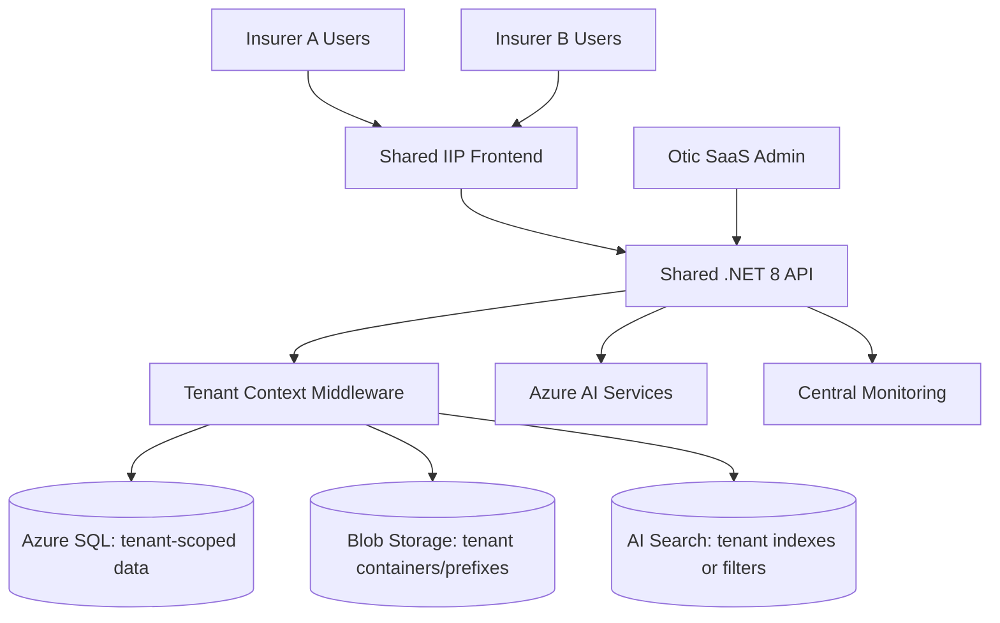

# SaaS Tenant Architecture Guide

## Common IIP Context Used

The Insurance Intelligence Platform (IIP) is an Azure-native, human-reviewed insurance operations platform for African insurers and related insurance organizations. It acts as an intelligent operational layer across staff, customers, core insurance systems, documents, channels, knowledge sources, and AI agents. The current MVP direction is Motor Claims & Document Intelligence for a mid-to-large insurer pilot.

Confirmed implementation direction:

- Frontend: Next.js, React, TypeScript, Tailwind CSS.
- Backend: .NET 8 / ASP.NET Core, EF Core, Azure SQL.
- Azure services: Azure SQL, Blob Storage, Key Vault, Azure AI Search, Azure OpenAI, Azure AI Document Intelligence, Service Bus or Event Grid, Functions or Durable Functions, API Management, Application Insights and Log Analytics.
- Identity: Microsoft Entra ID / MSAL / OAuth 2.0.
- Primary internal modules: Command Center, Claims, Documents, Channels, Customers, Sales & Leads, Knowledge Base, Approvals, Compliance & Audit, Reports & Analytics, Integrations, Admin Settings, Support & Health.
- Customer entry points: WhatsApp-first, with web chat, SMS, email, broker, call center, Teams, and website forms as planned or future channels.
- Governance rule: AI prepares insurance work; humans make consequential decisions.

Non-negotiable AI boundary:

- AI may summarize, classify, extract, flag, draft, route, and recommend.
- AI must not approve or reject claims, bind policies, set final premiums, accuse customers of fraud, release payments, promise settlement, or make final regulated decisions.

## Purpose

This document defines the architecture guide for an Otic-hosted SaaS version of IIP. It complements the Managed Application guide and describes how IIP can support multiple insurer tenants while maintaining data isolation, operational clarity, and controlled support.

## SaaS Deployment Intent

The SaaS path is useful for fast demonstrations, smaller clients, pilot acceleration, and situations where the client does not require a full customer-tenant deployment at the start.

## SaaS Architecture Principles

| Principle | Requirement |
|---|---|
| Tenant isolation | Every record, file, index, AI interaction, and audit event must be tenant-scoped. |
| Shared platform, controlled data | Platform services may be shared, but tenant data access must be isolated by design and enforcement. |
| Centralized operations | Otic can monitor platform health and provision tenants centrally. |
| Configurable onboarding | New tenants can be provisioned through repeatable setup steps. |
| Upgradeable platform | Releases can be rolled out safely without breaking tenant-specific configuration. |

## Reference Architecture

## Tenant Isolation Model

| Layer | Isolation Requirement |
|---|---|
| Authentication | User identity maps to allowed tenant/workspace roles. |
| API | Tenant context enforced before all business operations. |
| Database | Every tenant-owned table includes tenant ID; queries must be tenant-scoped. |
| Blob storage | Tenant-specific containers or prefixes; access mediated by backend. |
| AI Search | Tenant-specific index or strict tenant filter. |
| AI prompts | Tenant data must not be mixed across prompts, context, or logs. |
| Audit | Audit records include tenant ID, workspace ID, actor, and correlation ID. |

## Tenant Provisioning Workflow

1. Create tenant record.
2. Create default workspace.
3. Create admin role and initial admin user.
4. Configure modules enabled for tenant.
5. Configure claim types, document checklists, SLAs, and workflows.
6. Configure provider health defaults as Not configured until credentials are supplied.
7. Configure storage/search namespace.
8. Load seed configuration and approved sample data if applicable.
9. Run post-provisioning validation.
10. Handover to onboarding/training.

## Shared vs Tenant-Specific Services

| Capability | Shared | Tenant-Specific |
|---|---|---|
| Frontend hosting | Yes | No, unless custom branding required. |
| Backend API | Yes | Tenant-scoped execution. |
| SQL | Shared possible | Tenant-scoped schema/data policies required. |
| Blob | Shared account possible | Separate containers/prefixes recommended. |
| AI Search | Shared service possible | Separate indexes or tenant filters required. |
| AI model deployment | Shared possible | Prompt/context isolation mandatory. |
| Monitoring | Shared | Tenant filters and dashboards. |

## SaaS Security Requirements

- No frontend-only authorization.
- Tenant ID from headers must not be blindly trusted in production; it must derive from authenticated identity/claims or trusted server-side context.
- Support users must have explicit support roles and audit logging.
- Tenant admin actions must be audited.
- Cross-tenant data access tests are mandatory before pilot/production.

## Billing and Usage Hooks

The architecture should allow future tracking of:

- Active users/seats.
- Documents processed.
- AI agent runs.
- Channel messages.
- Claims created/reviewed.
- Storage/search usage.
- Enabled modules.

## Acceptance Criteria

- New tenants can be provisioned repeatably.
- Tenant data cannot be accessed by another tenant.
- Provider health and Not configured states are tenant-specific.
- Tenant-specific settings do not require code changes.
- Support access is role-based and audited.
- Usage metrics can support future pricing and packaging.

## Open Questions

| ID | Open Question | Owner | Impact if Unresolved |
|---|---|---|---|
| OQ-01 | Which insurer will be the first signed pilot customer and what exact internal processes will be included? | Product / Commercial | Final configuration, training, and pilot timelines may change. |
| OQ-02 | Which claims/core system will be integrated first, and will MVP require read-only lookup, export, or direct write-back? | Product / Engineering / Client IT | Impacts integration complexity and deployment schedule. |
| OQ-03 | Which Azure deployment path is selected first: customer-tenant Managed Application or Otic-hosted SaaS pilot? | Leadership / Engineering | Impacts tenancy, support access, IaC, billing, and security review. |
| OQ-04 | Which WhatsApp Business provider will be used for the first pilot? | Product / Integrations | Impacts webhook schemas, retry behavior, and channel onboarding. |
| OQ-05 | What client-specific SLAs, roles, branches, claim categories, and document checklists must be configured? | Client Operations | Impacts workflow rules and acceptance testing. |
| OQ-06 | What final regulatory, legal, and data residency requirements must be signed off for the first pilot? | Legal / Compliance | Impacts production readiness and contractual commitments. |
