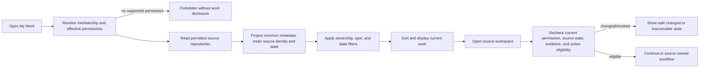

# IIP Universal My Work Aggregation

| Field | Value |
|---|---|
| Version | 1.0 implementation baseline |
| Date | 2026-08-07 |
| Status | Source-complete; locally verified; protected validation and practitioner approval pending |
| Requirement | R1-FUN-003 |
| Owners | Product, Operations, Architecture, Security/Privacy, Delivery |

## Purpose and boundary

`My Work` answers “what authorized operational outcome needs my attention now?” It is a request-time, permission-filtered projection over source-owned objects. It is not a new system of record, aggregate lifecycle, assignment authority, notification, approval, or execution service.

Canonical `Work item` meaning remains in root `CONTEXT.md`. The implementation does not require a new domain term or glossary change.

## Source projections

| Projection type | Source owner | Source identity/state retained | Owner basis | Handoff |
|---|---|---|---|---|
| `WorkflowTask` | Workflow/Case | task ID and workflow-task status | explicit task assignment | case workspace |
| `Approval` | Approval | approval ID and approval status | explicit reviewer; no case-owner inference | consequential approval workspace |
| `DocumentReview` | Documents | document ID and `ReviewRequired` | current case assignment | extraction review |
| `CommunicationReview` | Customer communications | update ID and draft/approval status | case assignment, then draft creator when unassigned | communications workspace |
| `AgentWorkItem` | Agent workflow control plane | agent work-item ID and decision status | explicit agent work-item assignment | prepared-work workspace |

The projection adds only common findability metadata: required action, normalized view state, owner provenance, priority, case SLA/due state, evidence readiness, approval-needed flag, current handoff, and update time. Source services remain authoritative for actions and recheck permission/state when opened.

## API contract

`GET /api/v1/my-work?ownership={mine|unassigned|all}&sourceType={type}&state={state}&limit={1..100}`

- Defaults: `ownership=mine`, no type/state filter, `limit=50`.
- `mine` compares source-derived owner to the server-resolved current user.
- `unassigned` and `all` require `ViewAllClaims` in this baseline.
- Claim-owned sources require assigned/all claim visibility; approval, communications, and agent-review sources additionally require their owning permissions.
- Tenant/workspace scope comes only from server membership context.
- Response is `Cache-Control: no-store`; a safe `my-work.viewed` audit omits source content.
- Sorting: overdue → due soon → on track → no due date; then escalation/action state, priority, due time, recency, stable projection ID.
- No SQL table, replicated assignment, or background synchronization is introduced.

## User flow

## Required states and recovery

| Condition | Presentation | Recovery |
|---|---|---|
| Loading | Current-work loading state; no stale success | Wait or leave safely |
| Empty/filter-empty | “No matching work”; no fabricated rows | Change filters or refresh |
| Unauthorized | No row/count/source existence disclosure | Resolve membership/permission |
| Service failure | Explicit unavailable state | Retry |
| Partial/high volume | `hasMore=true`; current 100-item client ceiling | Server pagination remains follow-up |
| Source changed after list | Source workspace rejects or renders current state | Refresh My Work/current source |
| Unassigned/all requested without supervisor visibility | `403` | Return to Mine or obtain authorized role |

## Acceptance and evidence

- Application-service tests cover heterogeneous aggregation, source-state preservation, tenant/owner filtering, permission omission, supervisor boundary, and safe audit.
- Endpoint tests cover validation, safe defaults, and no-store response behavior.
- Portal covers loading, populated, empty, error, filter, selection, source-type visibility, summary, refresh, and source handoff.
- Visual fixture covers a mixed workflow-task, approval, and document-review queue.

## Remaining gates

- Protected-staging multi-role proof for assigned, revoked, unassigned, supervisor, approver, communications, and agent-review access.
- Practitioner validation of label, grouping, ranking, SLA meaning, owner fallbacks, and source handoffs.
- Accessibility validation for keyboard, screen reader, focus, zoom/reflow, and high-volume navigation.
- Performance measurement and a database-native/paginated read path if protected data volume exceeds the bounded request-time projection.
- Policy decisions for team queues, delegation, snooze/defer, bulk assignment, notifications, and return-position preservation.
- Named Product, Operations, Architecture, Security/Privacy, and Delivery approval.
