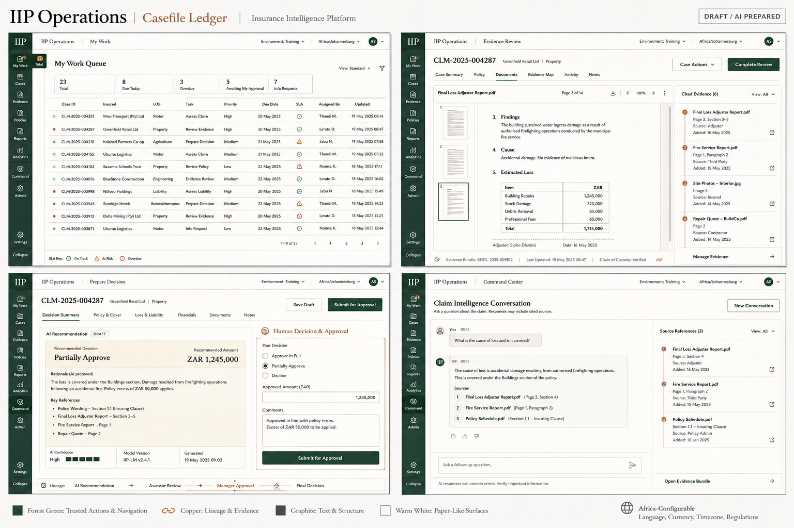
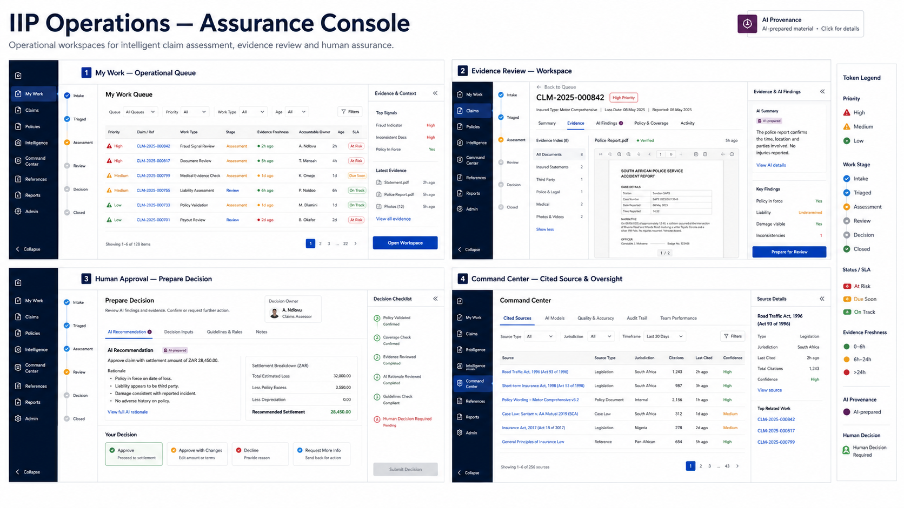
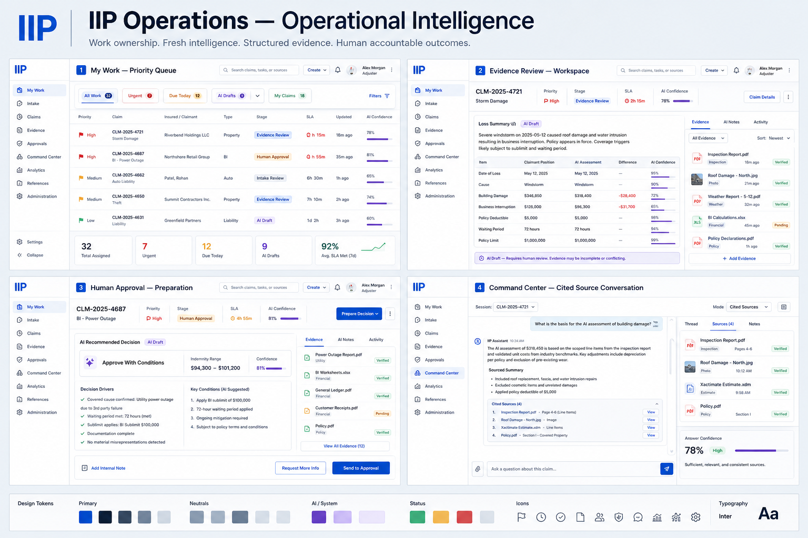

# IIP Visual Direction Exploration

> **CLOSED — 2026-09-08.** The direction question this document opened has been decided. None of the three concepts below was selected; the approved direction is recorded in [`iip_design_language_v2.md`](iip_design_language_v2.md), a calm border-led operations console derived from the Bevaya reference in [`reference/`](reference/). The accessibility and evidence-traceability criteria in this exploration and in `iip_visual_direction_review.md` are carried forward into the new language and still apply. Retained for history only — do not implement from it.

**Status:** concept exploration — no visual direction approved or production implementation implied.
**Decision needed:** select one complete visual world; do not combine fragments of the three.

## Purpose and fixed boundary

This exploration tests the IIP Operations staff portal for Release 1 non-injury motor own-damage evidence review and approval preparation. It may replace the current portal shell, palette, typography, component treatment and token values. It may not change canonical destinations, server-side authority, evidence lineage, human-decision boundaries, or required loading, empty, error, permission, partial and recovery behaviour.

The primary users are claims officers, authorised approvers, supervisors and compliance staff. Their primary progress is: identify the next accountable task, inspect source evidence, prepare an AI-assisted recommendation, then make or route a human decision without losing context.

## Evaluation rubric

Score each direction 1–5 before preference. A direction must score at least 4 for evidence traceability, human/AI distinction and accessibility feasibility to proceed.

| Criterion | What a high score means |
|---|---|
| Operational clarity | Task, owner, SLA, next action and workspace location are visible on first scan. |
| Evidence traceability | Source, freshness, confidence and conflict remain adjacent to material claims. |
| Human accountability | AI preparation and the authorised human decision are visibly and structurally separate. |
| Long-duration comfort | Dense comparison remains calm, legible and non-fatiguing. |
| Distinctive identity | The product is recognisable without looking consumer, futuristic or generic. |
| Responsive feasibility | Shell and panels preserve context at tablet and 320px/mobile anchors. |
| Accessibility feasibility | AA contrast, text/icon state cues, focus and readable reflow are practical. |
| Implementation coherence | Can map to semantic tokens and reusable portal components without changing contracts. |

## Direction A — Casefile Ledger

**Thesis:** the case file is the interface. Evidence lineage reads like a precise, modern operational ledger.

| Area | Direction |
|---|---|
| Shell | Deep forest labelled sidebar, thin utility top bar, document canvas and persistent cited-evidence rail. |
| Palette | `canvas #F7F5F0`, `surface #FFFFFF`, `ink #232323`, `action #174B38`, `lineage #B96834`, `review #A65C14`. |
| Type | Restrained editorial display for page/case titles; neutral sans for controls and tables; tabular figures for amounts/IDs. |
| Signature | A restrained chain-of-custody line and numbered source markers make evidence lineage scannable. |
| Density | High table density; document preview is primary. |
| Risk | Editorial type and warm surface must not reduce data scanning or feel like a document-management system. |

## Direction B — Assurance Console

**Thesis:** IIP is the accountable operating stage between evidence and a human outcome.

| Area | Direction |
|---|---|
| Shell | Ink navigation rail; contextual work-stage strip; light central workspace; collapsible evidence/decision rail. |
| Palette | `canvas #F6F8FC`, `ink #081A35`, `action #175BC7`, `ai #6B2D74`, `review #B66900`, `confirmed #187141`. |
| Type | Clear humanist sans hierarchy; tabular numeric utility style for tables and audit metadata. |
| Signature | A visible work-stage spine: intake → triage → assessment → review → decision → closed. |
| Density | Strong split-pane comparison; status rail stays compact and explicit. |
| Risk | The stage spine must remain contextual, not falsely imply a single linear claims process. |

## Direction C — Operational Intelligence

**Thesis:** a calm, light-first intelligence workspace that puts structured evidence and accountable work ahead of visual theatre.

| Area | Direction |
|---|---|
| Shell | Collapsible labelled sidebar, strong contextual header, flexible split workspace and evidence rail. |
| Palette | `canvas #F2F6FA`, `surface #FFFFFF`, `ink #101C2B`, `action #1556D1`, `ai #6341C8`, `review #C67A11`. |
| Type | Modern sans for all UI roles with a disciplined compact scale and tabular figures. |
| Signature | Evidence and AI provenance are inline work objects, not separate assistant theatre. |
| Density | Balanced queue/table and workspace density; more familiar enterprise shell. |
| Risk | Its familiarity could become generic unless the evidence rail and provenance treatment are carried through consistently. |

## Token and shell rules for the selected direction

- Values above are **candidate primitive values**, not approved production tokens.
- Retain semantic categories (`surface`, `text`, `action`, `focus`, `status`, `priority`, `approval`, `risk`, `confidence`, `AI provenance`, `evidence`) but allow their values, aliases and component bindings to change after selection.
- Every status uses text and/or icon in addition to colour. AI provenance may use a restrained hue but never a full-page colour mode. Human approval uses a separately titled, consequence-aware panel.
- Desktop shell supports persistent orientation, focus mode and a collapsible evidence rail. Tablet uses one retained context rail at a time; mobile exposes task content first and restores context through labelled drawers, never hidden state-only icon navigation.
- The portal must provide visible keyboard focus, 44px high-impact targets, 200% text support, 400%/320px reflow, reduced-motion equivalents and localisation expansion allowance.

## Generated-board boundary

The boards are brainstorming references generated with synthetic data. They are not pixel-perfect specs, source assets for portal UI, accessibility evidence, or permission/workflow truth. Generated text must not be copied without validation.
