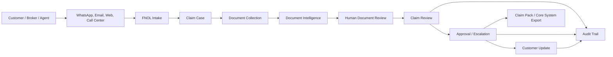
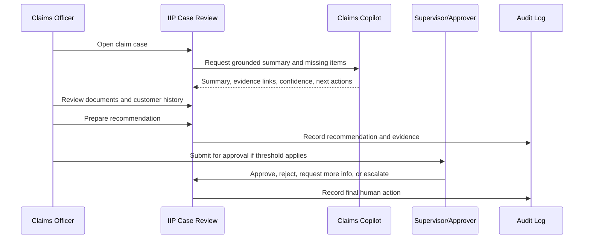

# Workflow Architecture Document

## Common IIP Context Used

The Insurance Intelligence Platform (IIP) is an Azure-native, human-reviewed insurance operations platform for African insurers and related insurance organizations. It acts as an intelligent operational layer across staff, customers, core insurance systems, documents, channels, knowledge sources, and AI agents. The current MVP direction is Motor Claims & Document Intelligence for a mid-to-large insurer pilot.

Confirmed implementation direction:

- Frontend: Next.js, React, TypeScript, Tailwind CSS.
- Backend: .NET 8 / ASP.NET Core, EF Core, Azure SQL.
- Azure services: Azure SQL, Blob Storage, Key Vault, Azure AI Search, Azure OpenAI, Azure AI Document Intelligence, Service Bus or Event Grid, Functions or Durable Functions, API Management, Application Insights and Log Analytics.
- Identity: Microsoft Entra ID / MSAL / OAuth 2.0.
- Primary internal modules: Command Center, Claims, Documents, Channels, Customers, Sales & Leads, Knowledge Base, Approvals, Compliance & Audit, Reports & Analytics, Integrations, Admin Settings, Support & Health.
- Customer entry points: WhatsApp-first, with web chat, SMS, email, broker, call center, Teams, and website forms as planned or future channels.
- Governance rule: AI prepares insurance work; humans make consequential decisions.

Non-negotiable AI boundary:

- AI may summarize, classify, extract, flag, draft, route, and recommend.
- AI must not approve or reject claims, bind policies, set final premiums, accuse customers of fraud, release payments, promise settlement, or make final regulated decisions.

## Purpose

This document defines the end-to-end workflow architecture for IIP. It describes how customer interactions, internal insurance operations, documents, AI assistance, approvals, audit trails, and exports connect into controlled operational flows.

## Workflow Architecture Principles

| Principle | Requirement |
|---|---|
| Event-driven where practical | Channel messages, document uploads, AI extraction, approvals, and notifications should create auditable events. |
| Human-controlled decisions | AI can prepare evidence and recommendations; humans own final decisions. |
| Idempotent integration | Replayed webhooks or retry events must not duplicate claims, documents, or customer updates. |
| Evidence-first review | Claim actions should reference documents, policy rules, communication history, and audit events. |
| Configurable workflow rules | SLAs, document requirements, escalation rules, and approval routes vary by insurer and must be configurable. |

## Core Workflow Map

## FNOL Workflow

| Step | Actor | System Behavior | AI Role | Human Gate |
|---|---|---|---|---|
| 1 | Customer or staff | Receives incident details from WhatsApp, email, web form, broker, or call center. | Classify intent and extract preliminary incident fields. | Staff verifies before formal registration if required. |
| 2 | IIP | Matches customer, policy, and possible duplicate claim. | Suggest possible existing records and missing fields. | Staff confirms match or creates new record. |
| 3 | IIP | Creates or updates claim case with source channel and correlation IDs. | Draft summary and next action. | Human owns claim acceptance into workflow. |

## Document Review Workflow

| Step | System Behavior | Required Controls |
|---|---|---|
| Upload / ingestion | Store document in Blob Storage and create metadata record. | Virus/malware scanning assumption; Open Question until final service selected. |
| Classification | Identify document type such as police report, claim form, ID, driving permit, vehicle photos, quotation, assessor report. | Low-confidence classification routes to human review. |
| Extraction | Extract fields using Azure AI Document Intelligence or configured model. | Store field-level confidence and source page/reference. |
| Validation | Compare extracted values across claim, policy, customer, and other documents. | Flag mismatches; do not reject automatically. |
| Human review | Reviewer accepts, corrects, or rejects extraction fields. | Every correction is audited. |

## Claim Review Workflow

## Customer Update Workflow

| Trigger | Draft Source | Required Review |
|---|---|---|
| Missing document | AI-generated draft using configured template. | Staff review before sending. |
| Claim received | Template plus claim number and next step. | May be automated only if approved by policy and no claim decision is implied. |
| Status update | Workflow event. | Human review required for sensitive claim status. |
| Decline/settlement/regulated decision | Human-authored or approved final communication. | Mandatory human approval. |

## Approval and Escalation Workflow

| Escalation Trigger | Example | Route |
|---|---|---|
| SLA at risk | Claim not reviewed within configured time. | Supervisor queue. |
| High risk signal | Mismatch, repeat pattern, unusual provider/garage, policy inconsistency. | Senior claims/special investigation review. |
| Large reserve/settlement | Amount exceeds threshold. | Approver or manager. |
| Compliance sensitivity | Complaint, regulatory request, vulnerable customer. | Compliance officer. |

## Audit and Export Workflow

IIP must maintain an audit trail for claim creation, document upload, AI extraction, AI summary, human edits, approvals, customer messages, exports, and configuration changes. Claim packs should be exportable with evidence, timestamps, human approvals, and AI assistance records clearly separated.

## Workflow Acceptance Criteria

- Every claim has a unique ID, tenant ID, workspace ID, source channel, status, owner, and audit trail.
- Every document has classification, storage reference, status, confidence, reviewer state, and audit events.
- Every AI output used in a workflow is linked to its source context and recorded as AI-assisted, not human decision.
- Human approval is mandatory for consequential decisions.
- Escalations are visible in Command Center and relevant work queues.
- Workflows support loading, empty, error, unauthorized, and Not configured states.

## Open Questions

| ID | Open Question | Owner | Impact if Unresolved |
|---|---|---|---|
| OQ-01 | Which insurer will be the first signed pilot customer and what exact internal processes will be included? | Product / Commercial | Final configuration, training, and pilot timelines may change. |
| OQ-02 | Which claims/core system will be integrated first, and will MVP require read-only lookup, export, or direct write-back? | Product / Engineering / Client IT | Impacts integration complexity and deployment schedule. |
| OQ-03 | Which Azure deployment path is selected first: customer-tenant Managed Application or Otic-hosted SaaS pilot? | Leadership / Engineering | Impacts tenancy, support access, IaC, billing, and security review. |
| OQ-04 | Which WhatsApp Business provider will be used for the first pilot? | Product / Integrations | Impacts webhook schemas, retry behavior, and channel onboarding. |
| OQ-05 | What client-specific SLAs, roles, branches, claim categories, and document checklists must be configured? | Client Operations | Impacts workflow rules and acceptance testing. |
| OQ-06 | What final regulatory, legal, and data residency requirements must be signed off for the first pilot? | Legal / Compliance | Impacts production readiness and contractual commitments. |
