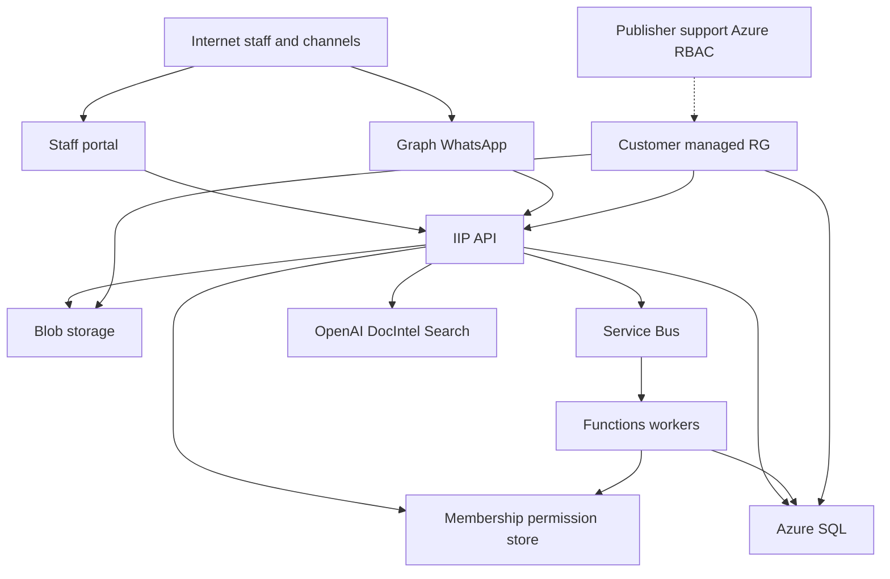

# IIP Customer-Tenant Deployment Threat Model

| Field | Value |
|---|---|
| Version | 0.1 |
| Date | 2026-08-14 |
| Status | Repo-grounded AppSec threat model; Azure MCP / azqr unavailable — IaC and code evidence only |
| Scope | Customer-tenant Managed Application path; Entra roles; managed identities; storage/queues/documents/exports; publisher support access; AI/tool boundaries |
| Related | `iip_release_1_assessor_handoff_threat_assessment.md` (assessor channel only; not duplicated here) |
| Security authority | Root `AGENTS.md`; current code/tests/Bicep; owning deployment and identity docs under `docs/` |

## Executive summary

The highest customer-tenant risks are **cross-tenant or confused-deputy access** (client-supplied tenant IDs, queue envelope hints, Graph mailbox over-scope), **consequential disclosure via evidence-pack export and document intake**, **secretful or over-privileged Azure identities** (blob connection strings, public network access, incomplete RBAC automation), and **AI/tool authority creep** (LLM/OCR/document content treated as instructions). Existing controls already reject browser tenant headers outside Development, resolve membership server-side (ADR-0005), and fail closed on mock providers in protected runtimes. This model prioritizes residual gaps that remain operational (Managed Application deny assignments, Entra admin, Key Vault grants) versus code-enforceable seams hardened alongside this document.

## Scope and assumptions

### In scope

- Runtime: `src/InsuranceIntelligence.Api`, `Application`, `Domain`, `Infrastructure`, `Functions`
- IaC: `infra/bicep/phase3-dev-foundation.bicep`, `infra/bicep/phase6-functions-runtime.bicep`
- Identity/RBAC contracts: Entra app roles + IIP `Permission` / `RolePermissionMap` / membership store
- Surfaces: document upload, evidence-pack export, admin/tenant settings, Service Bus workers, AI/Document Intelligence/Search adapters, WhatsApp/Graph edges
- Docs used as context (not re-authored): Managed Application architecture guide; multi-tenant identity onboarding; production data residency control; assessor handoff threat assessment

### Out of scope

- Assessor-channel activation (blocked separately; see assessor handoff threat assessment)
- Live Azure role assignment / azqr / marketplace republish
- Portal XSS deep dive beyond API contract boundaries
- Partner Center packaging ceremony

### Explicit assumptions (user context supplied; remaining marked)

1. **Deployment model:** Customer-tenant Azure Managed Application (or equivalent private deploy) with data in the customer subscription/resource boundary.
2. **Identity:** Workforce Entra; IIP multitenant app registration; **membership store is business authority** (token `tid` is hint only per identity onboarding doc).
3. **Support access:** Contractual modes `none` / `read_only` / `delegated` / `jit` are **operator/Azure governance** concerns; application code currently exposes `PublisherSupport` as a coarse platform role without JIT break-glass.
4. **Internet exposure:** Staff portal + API authenticated; WhatsApp/Graph webhooks are untrusted ingress; no public anonymous claim portal as authority.
5. **Data sensitivity:** Claimant PII, documents, fraud/risk signals, audit, reserves/internal notes — treat as high sensitivity.
6. **Single customer RG ≈ one IIP tenant** for Managed Application path; multi-insurer SaaS in one RG would raise ranking of deployment-scope fallback threats.

### Open questions that would materially change ranking

- Whether production Managed Application packages enforce deny assignments / publisher lockbox (not present in current phase3/phase6 Bicep).
- Whether Graph application access is independently scoped to approved mailboxes (startup only asserts `MailboxAccessScoped=true`).
- Whether customer requires private endpoints (Bicep currently sets `publicNetworkAccess: Enabled` on Key Vault, Storage, etc.).

## System model

### Primary components

| Component | Role | Evidence |
|---|---|---|
| Portal (Next.js) | Staff UI; bearer token to API | `web/portal` |
| API (.NET 8) | Authn/authz, tenant context, documents, compliance export, admin | `src/InsuranceIntelligence.Api/Program.cs` |
| Membership/permission store | Server authority for tenant/workspace/permissions | `IPermissionReadRepository`, ADR-0005 comments in `Program.cs` |
| Azure SQL | Durable tenant data | Bicep SQL + `StorageProvider=SqlServer` |
| Blob Storage | Documents, knowledge, audit exports | containers in phase3 Bicep |
| Service Bus + Functions | Async workers (agent workflow, notifications) | `InsuranceIntelligence.Functions` |
| Key Vault | Secret references via MI | `Azure__KeyVaultUri` app setting |
| Azure OpenAI / Document Intelligence / AI Search | AI and extraction | provider adapters under `Api/Azure`, Infrastructure |
| Graph / WhatsApp | Email and channel ingress/egress | GraphMail, WhatsApp providers |

### Data flows and trust boundaries

- Internet → Portal → API (HTTPS, Entra JWT): identity claims + user content; **membership resolves tenant**; `RuntimeHeaderGuard` rejects `X-Tenant-Id` / query scope outside Development.
- API → SQL/Blob/Service Bus (MI preferred): scoped keys and queries; protected startup rejects mock/seed and (now) blob connection-string auth.
- Webhooks (WhatsApp/Graph) → API/Functions: untrusted payloads; must not grant tool authority.
- Queue envelope → Functions worker: tenant/workspace/correlation as dispatch metadata; membership must match envelope scope.
- API → OpenAI / Document Intelligence / Search: prompts and document bytes are untrusted data; consequential claim outcomes remain human-gated (`ClaimAuthorityPolicy`).
- Publisher/support → Managed RG (Azure RBAC / Managed Application): operational boundary; not implemented as in-app JIT.

#### Diagram

## Assets and security objectives

| Asset | Why it matters | Security objective (C/I/A) |
|---|---|---|
| Claimant/policyholder PII and documents | Regulatory and customer harm | C, I |
| Evidence packs / audit exports | Consequential disclosure | C, I |
| Tenant membership and permissions | Isolation boundary | I, C |
| Fraud/risk/reserve/internal notes | Must not leak to unauthorized surfaces | C |
| Managed identities and Key Vault secrets | Credential theft → full tenant compromise | C, I |
| Queue messages with tenant scope | Confused deputy / cross-tenant replay | I, C |
| AI prompts, tools, model outputs | Instruction injection / unsafe automation | I |
| Audit correlation metadata | Investigation and non-repudiation | I, A |

## Attacker model

### Capabilities

- Compromised or malicious insurer staff with valid Entra tokens
- Cross-tenant probing via headers, query, body IDs, blob keys, case IDs
- Malicious documents / email / WhatsApp content (malware, polyglots, prompt injection)
- Replay or tamper of queue messages if SB auth weak
- Over-privileged publisher identity if Managed Application support is misconfigured
- Misconfiguration: connection strings, Development auth, mock providers in protected profiles

### Non-capabilities (unless separately in scope)

- Breaking Entra token cryptography
- Physical access to Azure datacenter
- Compromising Microsoft control plane without customer misconfiguration
- Turning AI into final claim authority when `ClaimAuthorityPolicy` and human gates hold

## Entry points and attack surfaces

| Surface | How reached | Trust boundary | Notes | Evidence |
|---|---|---|---|---|
| Staff API `/api/v1/*` | Entra JWT | Internet → API | Membership required outside Development | `Program.cs` middleware |
| Browser scope headers | Spoofed `X-Tenant-Id` | Client → API | Rejected outside Development | `RuntimeHeaderGuard` |
| Document upload | Multipart | Client → Blob/SQL | Permission `UploadDocument`; actor must be membership user | `DocumentEndpoints` |
| Evidence pack export | POST audit-pack/export | Client → Blob + audit | Requires `ExportEvidencePack` + human + ReadyForExport | `ComplianceEndpoints`, `ClaimAuthorityPolicy` |
| Admin tenant config | `/api/v1/admin/*` | Client → SQL | `ManageTenantSettings`; membership scope | `AdminEndpoints` |
| WhatsApp / Graph | Webhooks / pull | Provider → API | Untrusted content | Integration endpoints / GraphMail |
| Service Bus workers | Queue trigger | SB → Functions | Envelope + membership equality | `AgentWorkflowExecutionWorker` |
| AI providers | Server-side calls | API → AI | Outputs untrusted | Azure OpenAI / DocIntel adapters |
| Bicep / Managed App | Deploy time | Operator → Azure | Role IDs in template; public network enabled | phase3/phase6 Bicep |

## Top abuse paths

1. **Cross-tenant case read/export:** Authenticated user spoofs tenant header/query or foreign case ID → expect 403/404 from membership scope; impact is critical if scope falls back to wrong deployment tenant.
2. **PublisherSupport export:** Support role with `ViewAuditLog` attempts evidence-pack export → must be denied without `ExportEvidencePack`.
3. **Document actor spoof:** Attacker sets form `uploadedByUserId` to impersonate another officer in audit → protected mode ignores form actor.
4. **Queue confused deputy:** Message carries tenant A; worker principal membership resolves to tenant B → reject before execution.
5. **Blob shared-key in production:** Operator sets connection string / disables MI → protected startup fails closed.
6. **Prompt injection via document/OCR:** Malicious PDF instructs model to approve claim or call tools → human gates + untrusted-content rule; residual if tools honor model text.
7. **Graph mailbox over-scope:** App permission reads unintended mailboxes → startup flag is assertion only; operational verification required.
8. **Support standing access:** Broad Contributor on managed RG without JIT/audit → operational Managed Application control gap.
9. **Safe-error leak:** Provider `Exception.Message` returned to client reveals config/secrets → mapped to generic SafeError / fixed compliance message.
10. **AI final decision:** Agent/system actor advances settlement/export → `ClaimAuthorityPolicy` blocks non-human consequential actions.

## Threat model table

| Threat ID | Threat source | Prerequisites | Threat action | Impact | Impacted assets | Existing controls (evidence) | Gaps | Recommended mitigations | Detection ideas | Likelihood | Impact severity | Priority |
|---|---|---|---|---|---|---|---|---|---|---|---|---|
| TM-001 | Authenticated staff / attacker token | Valid Entra user | Spoof tenant headers or foreign case IDs to access another tenant | Cross-tenant disclosure | PII, documents, audit | `RuntimeHeaderGuard`; membership middleware; compliance fail-closed tests | Some endpoints historically fell back to deployment scope when membership missing | Prefer membership-only scope (Admin/Documents hardened); keep negative tests | Alert on 403 spikes + spoof header presence in logs (metadata only) | Medium | High | **high** |
| TM-002 | PublisherSupport / delegated support | Support role granted | Export evidence packs or mutate tenant config | Unauthorized disclosure / integrity | Evidence packs, config | `PublisherSupport` lacks `ExportEvidencePack` and `ManageTenantSettings` | Azure-level standing access outside app RBAC | Keep export permission least-privilege; Azure JIT + deny assignments | Audit `evidence_pack.exported` by support principals | Medium | High | **high** |
| TM-003 | Misconfigured protected runtime | Operator error | Boot with blob connection string or MI disabled | Credential theft / lateral movement | Storage, all blobs | Bicep sets `UseManagedIdentity=true`; startup now rejects connection string / MI off | Storage `allowSharedKeyAccess: true` still in Bicep | Disable shared key when customer-ready; rotate if ever used | Startup failure alerts; policy deny on connection strings | Medium | High | **high** |
| TM-004 | Queue attacker / buggy publisher | Write access to SB or poisoned producer | Dispatch worker with mismatched tenant envelope | Cross-tenant workflow side effects | Cases, AI actions | Worker requires membership; **envelope==membership assert** | Incomplete document/email consumers | Finish workers with same assert; SB auth MI only | Dead-letter + alert on scope mismatch | Medium | High | **high** |
| TM-005 | Malicious document/email | Upload or inbound channel | Malware / polyglot / prompt injection | Integrity, possible RCE in parsers, AI misuse | Documents, AI tools | Upload size/extension validation; AI human gates; private blobs | Assessor/Graph quarantine gaps (separate doc) | Quarantine, malware scan, never tool-execute on model text | Quarantine reject metrics; parser crash alerts | High | High | **critical** (parser/RCE) / **high** (injection) |
| TM-006 | Insider Claims Officer | Legitimate export permission | Over-broad evidence pack / wrong case | Privacy harm | Evidence pack | Human + ReadyForExport + audit reason + correlation | No dual-control export; assessor channel blocked | Dual control where policy requires; minimize pack fields | Audit reason sampling | Medium | High | **medium** |
| TM-007 | Graph application | Broad Exchange app role | Read unintended mailboxes | Cross-mailbox/tenant email | Email content | `MailboxAccessScoped` startup assertion | Not cryptographic proof of Exchange restriction | Independent Exchange ApplicationAccessPolicy evidence | Mailbox access audit logs | Medium | Critical | **high** |
| TM-008 | AI / tool runtime | Live OpenAI + tools | Model output triggers consequential action | Wrong claim outcome | Claim integrity | `ClaimAuthorityPolicy`, human review nodes | Tool registry must stay non-authoritative | Continuous tests that agent actors cannot export/settle | Audit actorType != Human on consequential paths | Low–Medium | Critical | **high** |
| TM-009 | API error paths | Provider failure | Leak raw provider/exception text | Info disclosure (config/secrets) | Secrets, internals | `UseExceptionHandler`; `AzureProviderSupport.SafeError`; Graph/compliance safe messages hardened | Other endpoints may still return domain `ex.Message` (usually safe) | Centralize client-safe error mapper for provider faults | Log correlation of 5xx without body secrets | Medium | Medium | **medium** |
| TM-010 | Azure network posture | Public endpoints | Exfiltrate via public KV/Storage if identity stolen | Data exfil | Secrets, blobs | Private containers; no anonymous blob access | `publicNetworkAccess: Enabled` widely | Private endpoints / firewall for customer prod | Unusual public access metrics | Medium | High | **medium** |
| TM-011 | Managed Application publisher | Standing Owner/Contributor | Silent support access without customer JIT | Cross-customer ops risk | Entire RG | Architecture guide requires limited support | Not encoded in phase3/phase6 | Deny assignments + JIT + activity logs | Alert on publisher principal elevation | Medium | High | **high** (ops) |
| TM-012 | Incomplete API MI RBAC | Manual grants skipped | API cannot use KV/Blob or uses secrets instead | Availability or secret sprawl | Secrets, storage | Bicep outputs manual grant checklist; Function RBAC automated | API Key Vault Secrets User / Blob Contributor not automated | Automate least-privilege assignments in customer package | Deployment verification checklist | Medium | Medium | **medium** |

## Criticality calibration

- **Critical:** Cross-tenant evidence access; credential theft enabling broad data access; parser RCE; AI or worker completing final insurance decisions; Graph reading unapproved mailboxes.
- **High:** Unauthorized evidence-pack export; support overreach; production secretful storage auth; prompt injection causing unsafe tool calls without final decision; standing publisher Contributor.
- **Medium:** Safe-error gaps; public network without compensating identity controls; audit correlation omissions that delay investigation; single-tenant DoS.
- **Low:** Cosmetic status mismatches with no access or authority change.

Examples: Critical — foreign tenant blob prefix read succeeds. High — PublisherSupport exports pack. Medium — provider exception text in 400 body. Low — checklist label inconsistency.

## Focus paths for security review

| Path | Why it matters | Related Threat IDs |
|---|---|---|
| `src/InsuranceIntelligence.Api/Program.cs` | Auth middleware, membership authority, route filters | TM-001, TM-008 |
| `src/InsuranceIntelligence.Api/Common/TenantScopeReader.cs` | Protected fallback to deployment scope | TM-001 |
| `src/InsuranceIntelligence.Api/Auth/RuntimeHeaderGuard.cs` | Client authority rejection | TM-001 |
| `src/InsuranceIntelligence.Api/Documents/DocumentEndpoints.cs` | Upload scope/actor | TM-001, TM-005 |
| `src/InsuranceIntelligence.Application/Compliance/ComplianceQueryService.cs` | Export permission, storage, audit | TM-002, TM-006, TM-009 |
| `src/InsuranceIntelligence.Domain/Cases/ClaimAuthorityPolicy.cs` | Human gates / AI boundary | TM-008 |
| `src/InsuranceIntelligence.Functions/AgentWorkflowExecutionWorker.cs` | Queue tenant binding | TM-004 |
| `src/InsuranceIntelligence.Api/Azure/AzureProviderStartupValidator.cs` | Protected/secretless fail-closed | TM-003 |
| `src/InsuranceIntelligence.Infrastructure/Graph/GraphMailProvider.cs` | Email send/safe errors | TM-007, TM-009 |
| `infra/bicep/phase3-dev-foundation.bicep` | MI, RBAC IDs, public network, shared key | TM-003, TM-010, TM-011, TM-012 |
| `infra/bicep/phase6-functions-runtime.bicep` | Function MI role assignments | TM-003, TM-004, TM-012 |
| `src/InsuranceIntelligence.Domain/Administration/RolePermissionMap.cs` | Least-privilege role matrix | TM-002 |
| `docs/02-development-engineering/iip_multi_tenant_identity_onboarding_app_roles_scim_provisioning.md` | tid-as-hint contract | TM-001 |
| `docs/05-deployment-release-enablement/iip_managed_application_architecture_guide.md` | Support access intent | TM-011 |

## STRIDE summary (trust boundaries)

| Boundary | S | T | R | I | D | E |
|---|---|---|---|---|---|---|
| Client → API | Token spoof mitigated by Entra; header spoof rejected | Body/ID tamper scoped by membership | Audit + correlation on export/admin | Safe errors; no other-tenant data | Upload size limits | Permission + role map |
| API → Blob/SQL/SB | MI identity | Scoped keys/queries | Audit events | Private containers | Queue backpressure (ops) | Least-privilege roles (partial automation) |
| Channel → API | Webhook auth (provider-specific) | Malicious content | Intake audit | Content untrusted | Size caps | No tool authority from content |
| Queue → Worker | MI receiver | Envelope tamper | Correlation required | Scope mismatch reject | DLQ | Membership authority |
| API → AI | MI/endpoint config | Prompt injection | Action logs | Output untrusted | Rate/cost (ops) | Human consequential gates |
| Publisher → RG | Entra/Azure RBAC | Resource tamper | Activity logs (ops) | Data access | — | Deny/JIT (ops gap) |

## Azure RBAC notes (repo evidence; verify IDs before live change)

Phase3/phase6 assign (do **not** treat as verified against live Azure docs without check):

| Built-in role (as labeled in Bicep) | Role definition GUID in template | Principal | Scope |
|---|---|---|---|
| Azure Service Bus Data Sender | `69a216fc-b8fb-44d8-bc22-1f3c2cd27a39` | API MI | Service Bus namespace |
| Azure Service Bus Data Receiver | `4f6d3b9b-027b-4f4c-9142-0e5a2a2247e0` | Function MI | Service Bus namespace |
| Storage Blob Data Owner | `b7e6dc6d-f1e8-4753-8033-0f276bb0955b` | Function MI | Storage account |

**Recommendation:** Prefer Storage Blob Data Contributor for API (least privilege vs Owner) once automated; verify GUIDs against current Microsoft docs before changing live assignments. Manual outputs still call for Key Vault Secrets User on API MI. **No live Azure RBAC changes executed in this work.**

## Code enforcement applied with this model

| Theme | Enforcement |
|---|---|
| Server tenant authority | Admin/Documents refuse deployment-scope fallback outside Development; document actor ignores form/header outside Development |
| RBAC | New `Permission.ExportEvidencePack`; PublisherSupport can view audit but not export |
| Secretless | Protected startup rejects Azure Blob connection strings and MI=false for Blob/Search/Service Bus |
| Audit correlation | Export path already writes correlation; worker requires envelope correlation |
| Safe errors | Graph mail SafeError generic; compliance export configuration errors fixed client message |

## Residual operational controls (not code)

- Managed Application publisher deny assignments / JIT / lockbox
- Exchange ApplicationAccessPolicy proof for Graph
- Private endpoints / disable shared key on storage for customer prod
- Automate API Key Vault + Blob RBAC in customer package
- Entra admin consent and app role assignment hygiene
- Malware scanning / quarantine for inbound Graph attachments (assessor doc)

## Quality check

- Entry points covered: API, uploads, export, admin, webhooks, queues, AI, IaC support path
- Trust boundaries represented in threats TM-001–TM-012
- Runtime vs CI/dev separated (Development header auth excluded from protected profiles)
- User questionnaire skipped per request; assumptions explicit above
- Azure MCP / azqr: **unavailable** — continued from repo evidence only

## Notes on use

This document is the owning customer-tenant threat model under `docs/04-testing-security-quality/`. Assessor-specific threats remain in `iip_release_1_assessor_handoff_threat_assessment.md`.
