# IIP Release 1 Assessor Handoff Threat Assessment

| Field | Value |
|---|---|
| Version | 0.1 |
| Date | 2026-08-10 |
| Status | Focused design/runtime assessment; assessor route not implemented; mitigations and protected validation pending |
| Scope | Assessor identity, unauthorized disclosure, malicious attachments, forwarding, stale links/access, and cross-tenant exposure |
| Governing decision | DEC-018 and `ADR-2026-08-10-release-1-assessor-handoff-channel-scope.md` |
| Security authority | Root `AGENTS.md`; Release 1 requirements; security/compliance document; current code/tests/configuration |

## 1. Assessment boundary and conclusion

Release 1 uses controlled manual assessor export/import as the baseline. Microsoft Graph email is an optional tenant-configured enhancement. External assessor portal and insurer-system integration/write-back are deferred.

The assessor domain/API/UI route, dedicated permission, audit events, recipient directory, and protected runtime are not implemented. Therefore this assessment does not claim a currently reachable assessor-specific vulnerability or a security pass. It evaluates the proposed boundary and the adjacent reusable email/document controls.

**Decision:** do not activate either assessor channel until `THR-R1-ASR-01`–`08` have named owners and `AC-ASR-01` passes. Do not reuse the existing Graph attachment processor unchanged: it currently downloads attachment content into memory, does not invoke the shared size/extension validator, trusts provider name/content-type/size metadata, stores the source before any verified malware-clearance gate, and has no demonstrated quarantine-release contract. Do not reuse the existing Graph send result unchanged: provider acceptance is currently mapped to `Sent` with a locally generated timestamp reference rather than a reconciled provider message identity. `GraphMail:MailboxAccessScoped=true` is an operator assertion checked at startup, not proof that Exchange application access is actually restricted.

## 2. Assets, actors, and trust boundaries

### Assets

- Minimum evidence pack bytes, manifest, source evidence IDs/versions, hashes, and referral questions.
- Claimant/policyholder identity, contact, vehicle, incident, financial, location, image, and potentially special-category evidence.
- Assessor appointment, recipient identity, purpose, due/expiry, acknowledgement, report, revision, and review state.
- Tenant/workspace/case membership, permissions, audit history, provider credentials, mailbox configuration, and correlations.
- Insurer claim outcome and core-system truth, which remain outside IIP authority.

### Actors and capabilities

| Actor | Legitimate capability | Attacker story |
|---|---|---|
| Authorized Claims Officer | Prepare/release minimum pack and review return | Compromised account, malicious insider, wrong recipient, excessive disclosure, false manual attestation |
| Assessor | Receive exact referral and return independent report | Impersonated mailbox, compromised mailbox/device, unauthorized delegate, malicious report/attachment |
| Claims Operations | Own appointment/directory/disclosure policy | Stale or poisoned directory entry; unsafe exception pressure |
| Insurer IT/Security | Own mailbox, consent, Exchange scope, DLP/retention | Over-broad Graph application access or configuration assertion without enforcement |
| External sender/forward recipient | No IIP authority | Spoof sender/reply, replay correlation token, forward evidence, send attachment bomb/malware/prompt injection |
| IIP/AI/provider adapter | Validate, store, derive, correlate, expose review state | Confused-deputy action, cross-tenant match, unsafe parsing, false provider/delivery inference |

### Trust boundaries

```mermaid
flowchart LR
    U["Authorized insurer staff"] -->|"current tenant, permission, case, recipient"| IIP["IIP referral boundary"]
    IIP -->|"immutable minimum pack"| EXP["Manual export"]
    IIP -->|"configured adapter"| GRAPH["Microsoft Graph / dedicated mailbox"]
    EXP --> CH["Insurer-approved external channel"]
    GRAPH --> CH
    CH --> ASR["External assessor mailbox/device"]
    ASR --> RET["Untrusted report/attachment"]
    RET --> Q["Quarantine, validation, malware/type/size checks"]
    Q --> MATCH["Tenant/referral/version matching"]
    MATCH --> HUMAN["Authorized human evidence review"]
    HUMAN -. "No assessor-path write-back" .-> CORE["Insurer system of record"]
```

Each arrow is a trust boundary. Email sender fields, reply chains, correlation tokens, filenames, MIME types, document text, OCR, model output, Graph acceptance, and manual attestations are data—not identity, permission, delivery proof, or claim authority.

## 3. Threat register

| ID | Threat/attack path | Impact | Current controls/evidence | Gap and required control | Pre-activation disposition |
|---|---|---|---|---|---|
| `THR-R1-ASR-01` | **Assessor impersonation:** attacker or stale contact receives pack or submits a report using spoofed sender/display name, compromised mailbox, forwarded thread, or leaked correlation token. | High: unauthorized disclosure; false evidence may influence a consequential claim. | Recipient snapshot/version is specified; human review remains mandatory; email content grants no authority. Current email model stores sender as text only. | Insurer-owned assessor directory and appointment reference; recipient selected from approved current entry; revalidate before release; high-risk/new/changed recipient requires independent verification; acknowledgement/report matching uses multiple signals; token never authenticates. | Blocked |
| `THR-R1-ASR-02` | **Unauthorized or excessive disclosure:** wrong address, autocomplete, unauthorized staff, broad pack, internal notes/risk/reserve data, stale pack, or recipient changed after preflight. | Critical where cross-tenant or highly sensitive evidence is disclosed; otherwise High. | Minimum-pack design, immutable manifest/version, exact preflight, server tenant checks, private Blob storage, no portal. | Dedicated referral/disclosure permission and object-state guard; approved field/document allow-list; recipient and manifest revalidated immediately before export/send; no BCC/additional recipient; confirmation invalidates on change; dual control where insurer policy requires it. | Blocked (`PERM-GAP-05`) |
| `THR-R1-ASR-03` | **Malicious attachment/content:** report contains executable/malformed/polyglot file, decompression/resource bomb, parser exploit, unsafe HTML, prompt injection, or filename/MIME deception. | High; Critical if it achieves code execution, credential theft, cross-tenant access, or autonomous tool action. | Blob is private; filename path components are removed/sanitized; external content is specified as untrusted; shared manual upload validation limits extension/size; AI tool authority is prohibited. | Existing Graph processor does not use shared validation, content sniffing, malware scan, quarantine-release, or bounded streaming. Require size before/after decode, magic/type match, supported format, safe filename, malware scanning, parser isolation/resource limits, quarantine state/container, no inline rendering, safe download headers, and human clearance. | Blocked (`SEC-GAP-ASR-01`) |
| `THR-R1-ASR-04` | **Forwarding/copying:** legitimate recipient forwards attachment/link or retains it after cancellation/expiry. | High privacy/confidentiality impact; technical prevention is incomplete once bytes leave IIP. | ADR states email expiry cannot revoke transmitted attachment; evidence minimization and audit required. | Treat manual/email release as non-revocable disclosure; show warning before release; minimize pack; recipient/version watermark or manifest where approved; insurer DLP/IRM/encryption policy; contractual recipient controls; incident/notification/reissue path. Never claim cancellation deleted remote copies. | Conditional insurer risk acceptance required |
| `THR-R1-ASR-05` | **Stale/replayed link or token:** expired URL, reusable SAS, copied correlation token, old pack, or superseded report is used as current authority. | High; Critical if bearer material enables cross-tenant evidence access. | External portal/link is deferred; no assessor route exists; Blob reads verify tenant/workspace prefix; expiry/currentness are separate. | Release 1 must not email a public/reusable object URL or SAS. Referral token is match-only. Any future link requires server-side authenticated tenant/recipient/purpose binding, short expiry, revocation, single-purpose use, no secret logging/referrer leakage, and current-version check. Attachment expiry remains workflow state only. | Prohibited for Release 1 (`SEC-GAP-ASR-02`) |
| `THR-R1-ASR-06` | **Cross-tenant exposure/confused deputy:** attacker supplies another tenant's case/message/blob ID; mailbox mapped to wrong workspace; background worker loses scope; Graph app reads unintended mailboxes; report matches a foreign case. | Critical. | Server-resolved `TenantContext`; scoped email/mailbox repositories; matched case scope check; scoped Blob key/read prefix; private containers; startup requires mailbox-scope assertion; existing tenant tests cover adjacent paths. | Every referral/attempt/report/queue/audit row carries tenant/workspace; no request/provider field establishes scope; mailbox-to-workspace mapping is server-owned; Graph application-access policy must be independently verified, not trusted from a boolean; negative tests cover route, worker, blob, export, match, retry, audit and enumeration. | Blocked pending complete contract and protected proof |
| `THR-R1-ASR-07` | **Duplicate/reordered/ambiguous evidence:** replayed email, forwarded copy, renamed attachment, collision in weak matching, or late revision becomes current. | High because wrong or stale evidence may influence the human decision. | Existing Graph intake deduplicates by mailbox + external message ID; proposed flow adds referral/version and hash; human review required. | Deduplicate by tenant mailbox/channel + provider/internet message identity + attachment/source hash; preserve duplicates as links/no-ops; never auto-current; ambiguous, late, conflicting, or superseded evidence enters owned review; reconciliation before retry. | Design complete; implementation blocked |
| `THR-R1-ASR-08` | **Repudiation/false state:** manual sender falsely attests transmission; Graph acceptance is rendered as delivery; acknowledgement applies to wrong version; audit omits recipient/change/reason. | High for disclosure investigation and consequential reliance. | ADR separates export, attestation, Graph acceptance, acknowledgement, receipt, review, and claim outcome; audit gap is explicit. Current adjacent Graph sender instead returns `Sent` plus a locally generated timestamp reference after HTTP acceptance. | Persist an attempt before call; capture/reconcile a real provider/mailbox reference; use `GraphAccepted` or `Unknown`, never delivery; append exact actor/scope/referral/pack/recipient/channel/before-after/reason/correlation events without raw body. | Blocked (`AUD-GAP-04`, `SEC-GAP-ASR-03`) |

## 4. Severity calibration

- **Critical:** cross-tenant evidence access or disclosure; code execution or credential theft from an attachment parser; Graph application access to unapproved tenant mailboxes; bearer link/SAS exposing evidence without current authorization.
- **High:** disclosure to a wrong or impersonated assessor; malicious file reaching extraction/preview/AI before clearance; forwarded pack causing material privacy harm; spoofed/late report influencing review; false `Sent`/acknowledgement state causing unsafe reliance.
- **Medium:** bounded single-tenant availability loss from oversized/malformed input with no disclosure or execution; safe-metadata audit gap that delays investigation but does not alter authority; rejected impersonation that creates operational workload.
- **Low:** cosmetic filename/status inconsistency with no change to access, evidence eligibility, audit reconstruction, or external state. Low severity does not apply merely because the assessor route is not yet implemented; missing controls remain activation blockers.

## 5. Required security contracts

### Identity and disclosure

1. Claims Operations owns the approved assessor directory and appointment authority. A mailbox address or platform role alone is insufficient.
2. Recipient, appointment reference, purpose, minimum manifest, pack version/hash, due/expiry, channel, and disclosure authority are committed and revalidated server-side immediately before release.
3. A changed recipient, manifest, evidence version, appointment, permission, tenant/workspace, due/expiry, or channel configuration invalidates preflight/confirmation.
4. The release action has a dedicated least-privilege permission and safe denial. `ConfigureIntegrations`, `UploadDocument`, or generic export permission cannot silently become assessor-disclosure authority.
5. Broker/assessor correlation tokens, sender fields, and reply chains assist matching only; they never grant access or establish identity.

### Attachments and content

1. Validate declared size before download where possible and actual decoded/streamed size during intake; reject mismatch, zero length, and over-limit payloads.
2. Normalize filename; reject unsupported extension; inspect file signature/content; require allowed type/extension/signature agreement; ignore active HTML/script and archive formats unless separately approved.
3. Store new external bytes in a tenant/workspace/case-scoped quarantine state/location. They cannot reach extraction, preview, search, AI, export, or current evidence before required scanning/validation succeeds.
4. Use approved malware scanning and isolated, patched parsers with CPU/memory/page/pixel/decompression limits. A scanner outage is `Unavailable`/held, not clean.
5. Render/download with safe content type and disposition; never execute macros/scripts or render unsafe HTML. Embedded instructions remain data.
6. Record source identity, size, cryptographic hash, validation/scanner result/version, quarantine/release actor, and correlation using safe metadata.

### Forwarding, expiry, and recovery

1. Manual/email transmission is an external disclosure with irreversible-copy risk. UI and audit must not imply remote revocation.
2. Cancellation before release leaves the pack durable but undisclosed. Cancellation after release stops future IIP use and starts insurer incident/recovery policy; it cannot delete external copies.
3. `dueAt` and `expiresAt` govern workflow/currentness. Late evidence remains stored/held for review and never becomes current automatically.
4. No Release 1 assessor access uses public URLs, reusable bearer links, SAS URLs, or a token as authority.
5. Provider outage never silently falls back. Manual selection is a new authorized, audited attempt after unknown-effect reconciliation.

### Tenant and provider boundary

1. Scope is derived from current membership/server configuration on every request and background action. Repository/object/provider identifiers are always looked up within that scope.
2. Blob object keys are generated server-side, private, scope-prefixed, and rechecked on read. No user-provided object key or SAS is returned.
3. The dedicated Graph mailbox maps to exactly one approved tenant/workspace and purpose. Cross-workspace reuse is prohibited unless separately modeled and tested.
4. Protected activation requires evidence that Exchange application access is restricted to approved mailbox resources. A configuration flag alone does not satisfy the gate.
5. Reconciliation, DLQ/manual replay, audit queries, telemetry, and exports preserve the original tenant/workspace and cannot be widened by an operator-supplied identifier.

## 6. Verification and release gate

`AC-ASR-01` passes only when all applicable tests succeed in source and protected runtime:

- Identity: valid/current assessor; unknown, stale, changed, spoofed, forwarded, compromised, look-alike, and unauthorized delegate.
- Disclosure: exact minimum pack; wrong/cross-tenant case; excessive/restricted field; recipient or evidence changed after preflight; revoked permission; duplicate submit.
- Attachments: valid files plus extension/MIME/signature mismatch, empty, oversized declared/actual, truncated, polyglot, archive/decompression bomb, malformed parser input, malware test file, unsafe HTML/script, prompt injection, scanner unavailable, and quarantine bypass.
- Forwarding/expiry: forwarded attachment/token, cancelled/expired referral, late report, superseded pack, stale/replayed token, attempted reusable URL/SAS, and accurate non-revocation messaging.
- Tenant/provider: spoofed tenant/workspace/header/body IDs, foreign mailbox/message/attachment/case/blob/referral IDs, cross-tenant match, worker replay/DLQ, audit/export enumeration, and independently verified mailbox application scope.
- Audit/UX: every state transition reconstructs exact safe metadata; unauthorized responses leak no existence/content; `Exported`, `StaffAttestedSent`, `GraphAccepted`, `Unknown`, `AssessorAcknowledged`, `ReportReceived`, `LateReceived`, and `ReviewedCurrent` remain distinct and accessible.

Required evidence: code/contract review, automated negative tests, malware/scanner and parser-isolation evidence, protected multi-role browser/API journeys, Graph/Exchange scope evidence where enabled, audit sampling, incident/recovery drill, named Security/Privacy and Claims Operations approval, and residual-risk acceptance for email forwarding.

## 7. Readiness and traceability

| Area | Current readiness | Trace |
|---|---|---|
| Assessor identity/disclosure | Specified; no permission/runtime | R1-SEC-005/006; `PERM-GAP-05`; `THR-R1-ASR-01/02` |
| Attachment safety | Adjacent manual upload has size/extension checks; Graph path lacks equivalent and quarantine/malware proof | R1-SEC-007; `SEC-GAP-ASR-01`; `THR-R1-ASR-03` |
| Forwarding/stale access | Non-revocable email boundary specified; residual policy unapproved; links prohibited | R1-SEC-008; `THR-R1-ASR-04/05` |
| Tenant/provider isolation | Adjacent scoped repositories/Blob controls exist; full assessor and actual Graph mailbox-scope proof absent | R1-SEC-009; R1-DAT-002; `THR-R1-ASR-06` |
| Duplicate/currentness | Design contract exists; no assessor implementation | R1-DAT-006/009; `THR-R1-ASR-07` |
| Audit/state integrity | Required fields/states specified; event factories absent | R1-DAT-011; `AUD-GAP-04`; `THR-R1-ASR-08` |

Source-complete documentation will not establish deployment, protected-runtime, penetration-test, malware-control, insurer-policy, or UAT readiness.
