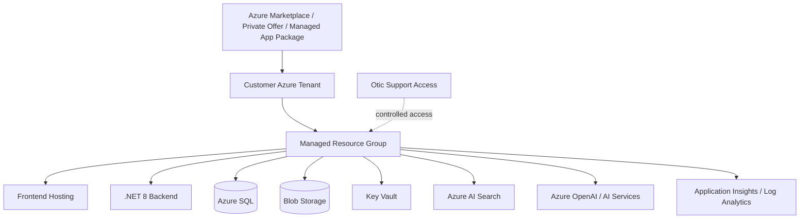

# Managed Application Architecture Guide

## Common IIP Context Used

The Insurance Intelligence Platform (IIP) is an Azure-native, human-reviewed insurance operations platform for African insurers and related insurance organizations. It acts as an intelligent operational layer across staff, customers, core insurance systems, documents, channels, knowledge sources, and AI agents. The current MVP direction is Motor Claims & Document Intelligence for a mid-to-large insurer pilot.

Confirmed implementation direction:

- Frontend: Next.js, React, TypeScript, Tailwind CSS.
- Backend: .NET 8 / ASP.NET Core, EF Core, Azure SQL.
- Azure services: Azure SQL, Blob Storage, Key Vault, Azure AI Search, Azure OpenAI, Azure AI Document Intelligence, Service Bus or Event Grid, Functions or Durable Functions, API Management, Application Insights and Log Analytics.
- Identity: Microsoft Entra ID / MSAL / OAuth 2.0.
- Primary internal modules: Command Center, Claims, Documents, Channels, Customers, Sales & Leads, Knowledge Base, Approvals, Compliance & Audit, Reports & Analytics, Integrations, Admin Settings, Support & Health.
- Customer entry points: WhatsApp-first, with web chat, SMS, email, broker, call center, Teams, and website forms as planned or future channels.
- Governance rule: AI prepares insurance work; humans make consequential decisions.

Non-negotiable AI boundary:

- AI may summarize, classify, extract, flag, draft, route, and recommend.
- AI must not approve or reject claims, bind policies, set final premiums, accuse customers of fraud, release payments, promise settlement, or make final regulated decisions.

## Purpose

This document defines the architecture guide for deploying IIP as a customer-tenant Azure Managed Application or equivalent private deployment. This is the preferred enterprise direction for insurers that require stronger data boundary, procurement, and Azure governance alignment.

## Deployment Intent

The Managed Application path enables IIP to be packaged and deployed into a client-controlled Azure tenant while allowing controlled publisher support under agreed conditions.

## Architectural Principles

| Principle | Requirement |
|---|---|
| Customer data boundary | Client data should reside in the client-approved Azure tenant/resource boundary. |
| Publisher support control | Otic support access must be explicit, limited, auditable, and revocable. |
| Repeatable packaging | Deployment should be repeatable using IaC and parameterized configuration. |
| Tenant-specific configuration | Each insurer configures roles, SLAs, claim types, channels, integrations, and documents. |
| Operational observability | Client and/or Otic support teams must see health, logs, and alerts according to agreement. |

## Reference Architecture

## Resource Ownership Model

| Resource | Ownership / Control Consideration |
|---|---|
| Application resources | Deployed into customer-approved Azure boundary. |
| Customer data | Belongs to the client; access governed by contract and RBAC. |
| Configuration | Client-specific but implemented through IIP admin workflows and secure settings. |
| Support access | Granted to Otic only as contractually approved. |
| Logs | Shared/available according to security and support model. |

## Managed Application Configuration Areas

| Area | Required Configuration |
|---|---|
| Identity | Entra ID tenant/app registration, allowed users/groups, roles. |
| Tenant/workspace | Tenant ID, workspace ID, branches, departments, environments. |
| Claims | Claim types, statuses, SLAs, assignments, approvals. |
| Documents | Required document checklists, extraction models, confidence rules. |
| Channels | WhatsApp/email/web provider credentials and routing rules. |
| AI | Model deployment, safety settings, grounding sources, usage limits. |
| Monitoring | Alert contacts, dashboard access, escalation rules. |

## Security Responsibilities

| Area | Client Responsibility | Otic Responsibility |
|---|---|---|
| Azure subscription governance | Provide subscription/resource policies. | Package compatible deployment. |
| Identity and access | Approve users, groups, app registrations. | Implement Entra/MSAL integration. |
| Secrets | Approve secret storage and rotation process. | Store secrets in Key Vault; never hardcode. |
| Support access | Approve and monitor access. | Use least privilege and audit actions. |
| Data handling | Confirm retention and residency. | Implement configured data handling controls. |

## Deployment Lifecycle

1. Marketplace/private offer or package approval.
2. Customer tenant readiness and prerequisites.
3. Parameter collection and validation.
4. Resource deployment.
5. Application configuration.
6. Identity and role setup.
7. Integration setup.
8. Test data validation.
9. UAT.
10. Pilot go-live.
11. Support handover.

## Acceptance Criteria

- IIP deploys repeatably into a customer-approved environment.
- All secrets are stored securely.
- Tenant/workspace isolation is enforced.
- Support access is controlled and auditable.
- Monitoring and provider health are active.
- Client-specific configuration can be completed without code changes where possible.

## Open Questions

| ID | Open Question | Owner | Impact if Unresolved |
|---|---|---|---|
| OQ-01 | Which insurer will be the first signed pilot customer and what exact internal processes will be included? | Product / Commercial | Final configuration, training, and pilot timelines may change. |
| OQ-02 | Which claims/core system will be integrated first, and will MVP require read-only lookup, export, or direct write-back? | Product / Engineering / Client IT | Impacts integration complexity and deployment schedule. |
| OQ-03 | Which Azure deployment path is selected first: customer-tenant Managed Application or Otic-hosted SaaS pilot? | Leadership / Engineering | Impacts tenancy, support access, IaC, billing, and security review. |
| OQ-04 | Which WhatsApp Business provider will be used for the first pilot? | Product / Integrations | Impacts webhook schemas, retry behavior, and channel onboarding. |
| OQ-05 | What client-specific SLAs, roles, branches, claim categories, and document checklists must be configured? | Client Operations | Impacts workflow rules and acceptance testing. |
| OQ-06 | What final regulatory, legal, and data residency requirements must be signed off for the first pilot? | Legal / Compliance | Impacts production readiness and contractual commitments. |
