# ADR: Release 1 assessor handoff channel scope

| Field | Value |
|---|---|
| Status | Accepted for specification; runtime implementation separately approved |
| Date | 2026-08-10 |
| Decision | Controlled manual exchange is the Release 1 baseline; Microsoft Graph email is a tenant-configured enhancement; external assessor portal and insurer-system integration/write-back are deferred |
| Owners | Product; Claims Operations; Architecture; Security/Privacy; target-insurer IT for activation |

## Context

Release 1 needs a traceable loss-assessor referral/report loop without making IIP the insurer system of record or granting an external actor claim-decision authority. The channel comparison scored controlled manual handoff highest for Release 1 necessity, effort, risk, and reversibility. Graph email adds useful automation but requires tenant consent, mailbox scope, operating ownership, and honest handling of ambiguous transport outcomes. A new external portal and direct insurer-system integration add identity, access, support, schema, reconciliation, and rollout obligations that are not necessary for the first safe slice.

## Decision drivers

- Preserve insurer ownership of assessor appointment, policy, claim outcome, payment, and accounting facts.
- Minimize external identity, disclosure, integration, and support risk.
- Preserve immutable evidence versions, provenance, acknowledgement distinctions, and human review.
- Make timeout, response loss, duplicate input, expiry, and late return recoverable.
- Keep the first slice reversible and useful before provider or core-system activation.
- Never represent manual attestation or provider acceptance as delivery, read, evidence acceptance, or claim decision.

## Options considered

| Option | Release 1 decision | Reason |
|---|---|---|
| Controlled manual export/import | Baseline | Lowest integration dependency; supports versioned disclosure, return intake, review, and audit if staff attestations remain explicitly human assertions. |
| Microsoft Graph email | Conditional enhancement | Valuable for a dedicated insurer mailbox, but activation requires mailbox-scoped access, consent, correlation, subscription renewal/polling, and ambiguous-outcome reconciliation. |
| External assessor portal | Deferred | Adds external identity, access expiry, support, responsive/accessibility, and security operating burden before demand is validated. |
| Insurer-system integration/write-back | Deferred | Target schema, action authority, idempotency, reconciliation, and compensation contracts are not approved; core systems remain authoritative. |

## Selected architecture

```mermaid
flowchart LR
    CO["Authorized Claims Officer"] --> REF["IIP referral intent and immutable pack version"]
    REF --> CH{"Configured channel?"}
    CH -- "Manual baseline" --> EXP["Versioned export"]
    EXP --> EXT["Insurer-approved existing channel"]
    CH -- "Graph enabled" --> G["Dedicated mailbox adapter"]
    G --> EXT
    EXT --> AS["Insurer-appointed assessor"]
    AS --> RET["Returned report"]
    RET --> Q["Quarantine, validate, deduplicate, match"]
    Q --> HR["Authorized human evidence review"]
    HR --> CUR["Current, revision requested, superseded, or escalated"]
    CUR -. "No Release 1 write-back" .-> CORE["Insurer system of record"]
```

### Channel ownership

| Boundary | Owner | IIP responsibility | Prohibited inference |
|---|---|---|---|
| Assessor appointment/directory | Insurer Claims Operations | Reference the approved recipient identity and appointment basis | IIP selecting a contact proves appointment authority |
| Manual transmission | Authorized insurer staff using an insurer-approved existing channel | Create an immutable export and record staff attestation/correlation | Export or attestation proves remote delivery/read |
| Graph mailbox and consent | Target-insurer IT/Security | Use the approved dedicated mailbox through a scoped adapter only when configured | Tenant consent grants claim or disclosure authority |
| Business correspondence | Insurer Claims Operations | Preserve purpose, recipient, referral version, attempt, acknowledgement, and return lineage | Provider status determines claim merit |
| External portal | Deferred | None in Release 1 | A hidden or mock portal may satisfy the handoff |
| Core integration/write-back | Insurer-system owner; deferred | Export only where already authorized; no assessor-path write-back | IIP referral/report state changes policy, claim, payment, or accounting truth |

### Evidence and truth ownership

| Fact/artifact | Authoritative owner | Durability/version rule | Correction/recovery |
|---|---|---|---|
| Referral intent, questions, manifest, due/expiry, channel selection | IIP referral context after authorized commit | Immutable referral version; new disclosure or questions create a new version | Cancel/expire/supersede with reason; never erase history |
| Exported evidence pack | IIP Blob plus SQL manifest | Immutable bytes, hash, evidence IDs/versions, generated timestamp | Re-export same version/hash is the same logical referral; corrected evidence creates a new pack version |
| Assessor identity and appointment authority | Insurer directory/process | Record approved external reference and snapshot used | Claims Operations corrects/reappoints; IIP blocks use of stale/revoked recipient |
| Graph message existence/transport acceptance | Microsoft Graph/mailbox | Provider message/reference and attempt state | Reconcile mailbox/provider before retry after unknown outcome |
| Manual send assertion | Named insurer staff member | Audited attestation with channel, time, recipient reference, and pack version | Correction is a new attestation/event; it never becomes provider delivery evidence |
| Returned report bytes | Original external source, stored by IIP Blob plus SQL association | Immutable source/hash/received time/channel and referral-version relation | Duplicate is linked/no-op; revision supersedes but does not delete prior report |
| Report evidentiary status | Authorized IIP human review under insurer policy | Current review status and reviewer/version | Accept for review, request revision, mark superseded/contradicted, or escalate |
| Claim/policy/payment/accounting outcome | Insurer core system/accountable insurer process | Insurer-owned transaction | Correct at insurer owner; Release 1 does not write back |

### Acknowledgement and lifecycle states

The following states are separate facts and must not collapse:

| State | Meaning | Does not mean |
|---|---|---|
| `Draft` | Referral is editable and not released | Approved or sent |
| `Ready` | Preconditions pass for the selected channel | Sent |
| `Exported` | Exact pack version is durable and available to authorized staff | Transmitted, delivered, or read |
| `StaffAttestedSent` | A named staff member asserts transmission through the approved manual channel | Provider-confirmed delivery/read |
| `GraphAccepted` | Graph accepted the send request for processing | Delivered, read, or acknowledged by assessor |
| `Unknown` | An external effect may have occurred but confirmation is absent | Safe to resend |
| `AssessorAcknowledged` | Verified assessor reply/manual acknowledgement identifies the exact referral/pack version | Report received or accepted as evidence |
| `ReportReceived` | Returned source is durably stored and associated or queued for matching | Current, complete, or accepted evidence |
| `LateReceived` | Report arrived after due/expiry | Automatically rejected or current |
| `ReviewedCurrent` | Authorized reviewer accepted this version for current evidence use | Claim approved or core system updated |

### Expiry, retry, and reconciliation

- Each referral version records insurer-owned `dueAt` and `expiresAt` values. Missing approved values block protected activation; this ADR invents no duration.
- Expiry prevents the version being treated as current and prevents automatic acceptance of a late response. It cannot revoke an email attachment already transmitted.
- A late return is stored as `LateReceived` and routed to Claims Operations for accept/reissue/revision/escalation. Reissue creates a new linked referral and pack version.
- Before any remote call, IIP durably records logical referral ID, pack version/hash, recipient reference, channel, correlation, and attempt identity.
- A confirmed Graph acceptance is terminal for that attempt. Timeout or response loss becomes `Unknown`; IIP reconciles the dedicated mailbox/provider record before any retry.
- Retry is allowed only when policy and reconciliation establish that repeating the effect is safe. A retry is a new linked attempt for the same logical referral, not a duplicate referral.
- Inbound Graph messages deduplicate using tenant mailbox plus provider message identity and attachment hash. Manual returns use referral token/version plus source hash; uncertain matches enter an owned manual-review queue.
- Graph notifications accelerate processing but are not the sole recovery mechanism. Subscription renewal and bounded mailbox reconciliation are required before activation.
- Provider outage never activates a mock or silently switches channel. An authorized staff member may explicitly choose the manual path and create a separately audited attempt.
- Reconciliation owns `Unknown`, unmatched return, duplicate, reordered response, expired referral, subscription gap, and poison work. Claims Operations owns business resolution; Integration Operations owns provider diagnosis; target-insurer IT owns mailbox/consent recovery.

Retention, legal hold, and deletion propagation remain target-insurer Privacy/Legal decisions. Audit history is append-oriented; correction creates a new event/version.

## Consequences

### Positive

- Release 1 can validate the complete referral/report evidence loop without a new external identity surface or core write contract.
- Provider transport, human acknowledgement, source receipt, evidence acceptance, and claim outcome stay distinguishable.
- Graph can be added without replacing the domain contract or changing evidence ownership.

### Costs and limitations

- Manual handoff adds staff work and cannot independently prove delivery or read state.
- Graph activation still needs tenant-specific consent, dedicated mailbox scope, operating runbooks, notification renewal, polling/reconciliation, and protected-runtime evidence.
- No external self-service status or direct core synchronization is promised.

## Migration, rollback, and review triggers

1. Specify and test the referral domain contract, immutable pack, manual attestation, report intake/matching, expiry, and reconciliation queue.
2. Activate the manual path only after recipient/disclosure policy, permissions, audit actions, retention, and UAT identities are approved.
3. Add Graph behind a tenant configuration boundary using the same logical referral and attempt model.
4. Roll back Graph by disabling the adapter and explicitly selecting the manual path for new attempts; preserve all prior attempt/provider history.
5. Reconsider the external portal only when validated volume, access-revocation need, or assessor usability evidence outweighs its operating burden.
6. Reconsider insurer-system integration only after a named system owner approves exact read/write actions, schemas, authority, idempotency, reconciliation, compensation, and rollback.

## Validation required

- Security gate: `iip_release_1_assessor_handoff_threat_assessment.md` and `AC-ASR-01` cover identity, disclosure, malicious attachments/quarantine, forwarding/non-revocation, stale links/tokens and tenant/provider isolation. Any failed or unimplemented control blocks activation.
- Ethical gate: `iip_release_1_assessor_handoff_ethical_review.md` and `AC-ETH-01` cover purpose-bound minimum disclosure, accessible claimant notice, external-professional handling, contested-evidence reliance pause, procedural parity and prohibited feedback reuse. Any failed or unimplemented control blocks activation.
- Permission: authorized, revoked, wrong-workspace, cross-tenant, recipient-change, and disclosure-minimization cases.
- Evidence: exact manifest/hash/version, correction-induced supersession, late return, duplicate, mismatch, corrupt/unsafe report, and revision lineage.
- Remote failure: failure before effect, failure after effect, lost response, duplicate/reordered inbound, expired subscription, provider outage, bounded retry, and poison work.
- Human boundary: no returned report becomes current evidence or claim outcome without authorized review.
- Operations: trace referral, pack, attempt, provider/manual state, return, review, and audit using one safe correlation identity.
- Accessibility: every action/state/recovery control follows the Release 1 interaction accessibility contracts.

Source-complete documentation does not prove implementation, protected-runtime activation, or UAT completion.
