**OTIC TECHNOLOGIES**

UNIVERSAL INTELLIGENCE  
ARCHITECTURE

Premium Engineering Reference · Specification-Driven, Agentic & Composable Enterprise AI

One global enterprise shell · Nine industry intelligence packs · Configurable departmental Workspaces · Reusable data integrations · Agentic Automations · Verifiable and proactive Intelligence with Intent.

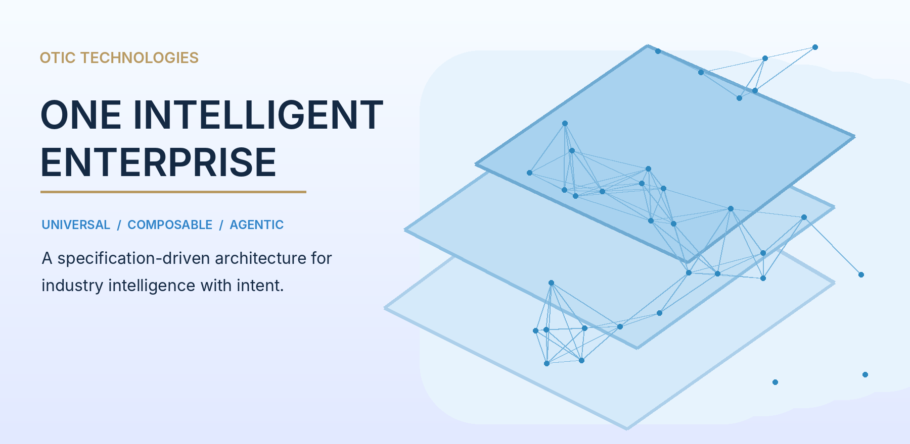

A single adaptive intelligence foundation for sector-specific enterprise operating environments.

> **DOCUMENT STATUS**
>
> Proposed target-state engineering design for architecture review, technical scoping and implementation planning. Illustrative examples are not claims of existing deployed functionality.

Prepared for: Otic Technologies · Executive Leadership · Product, Design, Engineering, Information Security & Delivery

Version: 2.0 \| Date: 12 November 2026 \| Classification: Internal / Architecture & Engineering

# Document control and reading guide

| **Field**        | **Value**                                                                                                |
|------------------|----------------------------------------------------------------------------------------------------------|
| Document owner   | Otic Technologies — Product & Platform Engineering                                                       |
| Scope            | Universal platform and nine product configurations                                                       |
| Version / status | 1.0 — Proposed engineering reference                                                                     |
| Primary audience | Architects, frontend and backend engineers, AI engineers, product managers, QA, delivery and IT security |
| Authority        | Design proposal. Final implementation decisions require formal architecture and customer approvals.      |

## Executive decisions to ratify

1.  Preserve one universal UI: New Conversation, Workspaces, Automations, Reports and Previous Conversations; Capabilities stays inside the chat composer.

2.  Make department-first Workspaces the default, particularly for MIP and Pulse, while supporting project, matter, branch and cross-functional scopes.

3.  Treat BRD, FSD and TSD as inputs to a versioned, traceable configuration specification—not as instructions to rebuild the application.

4.  Keep Reports primarily a repository of already generated outputs; natural language in conversation is the primary report creation path.

5.  Separate Intent, Insight, Automation, Notification, Report and Decision Outcome as distinct backend objects.

6.  Use shared tools, integration plugins, policies and approval workflows, with industry and customer-specific configurations.

7.  Mandate testing, privacy, security, provenance and approval gates before any production activation.

## How to use this document

Sections 1–14 define the reusable platform; Sections 15–23 describe the nine Industry Intelligence Packs; Sections 24–30 give contracts, deployment methodology, testing, governance and implementation handover. Feature lists describe recommended target configurations unless explicitly identified as present capability.

# Contents

**PART A — Vision, invariants and architecture**

1\. Operating thesis and product identity

2\. Universal shell and conversation UX

3\. Reference architecture and shared engines

4\. Specification-driven engineering workflow

**PART B — Runtime configuration and intelligence services**

5\. Workspace Engine and templates

6\. Universal Capabilities and specialised tools

7\. Automation Engine and agentic execution

8\. Proactive Intelligence with Intent

9\. Reports as an artifact repository

10\. Integration plugins and data architecture

11\. Semantic intelligence, graph and institutional knowledge

12\. Security, governance and cost control

13\. Cross-product user journeys

14\. Common delivery and configuration principles

**PART C — Nine industry intelligence packs**

15\. MIP — Manufacturing

16\. CIP — Credit

17\. IIP — Insurance

18\. LIP — Legal

19\. Logistics Intelligence

20\. Culinary Intelligence

21\. Architectural Intelligence

22\. Customer & Marketing Intelligence

23\. Otic Pulse

**PART D — Engineering contracts and implementation**

24\. Canonical objects and reference schemas

25\. APIs, events and connector contracts

26\. Testing and acceptance framework

27\. Configuration deployment and release management

28\. Delivery roadmap and engineering workstreams

29\. Risk register, metrics and operational model

30\. Handover checklist, glossary and appendices

PART E — Premium expansion: integrations, composability and verifiable intelligence

31\. Integration Studio 2.0 and connector lifecycle

32\. Composable Industry Intelligence Packs

33\. Verifiable, temporal and evidence-linked intelligence

34\. AI Business Discovery Consultant and specifications

35\. Generative Intelligence Interfaces

36\. Continuous process discovery and optimisation

37\. Collaborative agents and cross-Workspace orchestration

38\. Adaptive Workspaces, Intent Registry and Outcome Intelligence

39\. Shadow Intelligence and progressive releases

40\. Industry Pack SDK, Connector SDK and certification

41\. Enterprise entitlements, pricing and Otic Credits

42\. Resilience, offline/edge and customer migration

43\. Contextual authority and agentic security

PART F — Implementation-ready specifications and operating model

44\. Reference implementation: MIP and Pulse

45\. Cross-product configuration and integration matrix

46\. Canonical contracts and acceptance tests

47\. Technical delivery sequence and decision gates

48\. Engineering handover and final doctrine

# 1 Operating thesis and product identity

Otic should operate one extensible enterprise intelligence platform. The BRD, FSD, TSD and associated artifacts specify the context and business logic that give each customer deployment its identity. The interface and shared execution services remain stable.

> **CORE RULE**
>
> Different product identity is created by governed business context, Workspace templates, specialist tools, automations, data integrations and report definitions—not by rebuilding the application shell.

## What is invariant

| **Invariant**        | **Engineering implication**                                                                                  |
|----------------------|--------------------------------------------------------------------------------------------------------------|
| Navigation and UX    | New Conversation, Workspaces, Automations, Reports, Previous Conversations; no permanent right-hand sidebar. |
| Conversation         | Same composer, attachment handling, response renderer, voice support and compact Capabilities toggle.        |
| Workspace Engine     | One configuration/runtime model with department-first defaults, templates, access controls and lifecycle.    |
| Automation Engine    | One trigger, rule, approval, execution and history infrastructure.                                           |
| Report repository    | One save/search/view/export/refresh infrastructure for generated artifacts.                                  |
| Capabilities         | Shared user-facing catalogue; tool implementation depends on context and authority.                          |
| Frontend and backend | Shared component library, APIs, orchestration, logging, configuration and release discipline.                |
| Data integration     | Reusable connector contracts; separate tenant credentials and schema mappings.                               |

## What specifications change

- Organisation hierarchy, departments, branches, companies, matter types and Workspace configurations.

- Industry ontology, KPIs, operational context, rules, modelling assumptions and specialised tools.

- Automation triggers, conditions, actions, channel policies, recipients and approval limits.

- Report definitions, existing Excel recreation rules, generated outputs and reporting periods.

- Database/plugin instances, field mappings, integration requirements, access controls and quality checks.

## Business outcomes

The platform should reduce duplicated development, accelerate customer onboarding, standardise governance and generate measurable value. It must support both inbound conversational requests and outbound, proactive insight delivery—without confusing an AI recommendation with a completed business action.

# 2 Universal shell and conversation UX

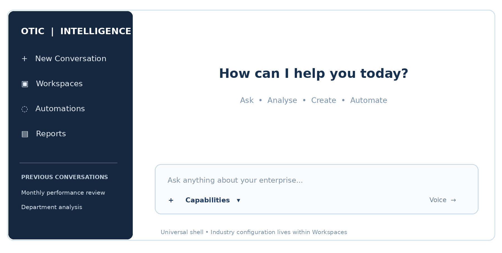

Concept interface: same sidebar, clean conversational canvas and composer-level Capabilities toggle.

## Sidebar semantics

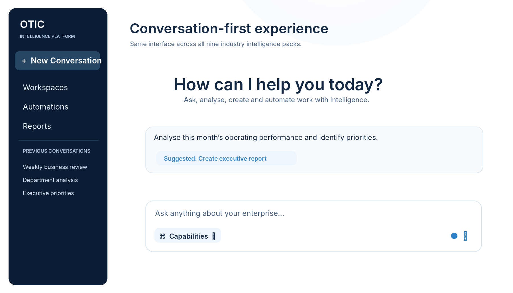

Interface mockup — invariant sidebar and in-composer Capabilities toggle.

| **Item**               | **Primary user action**                                                  | **Key constraint**                                  |
|------------------------|--------------------------------------------------------------------------|-----------------------------------------------------|
| New Conversation       | Begin new general or Workspace-context chat.                             | No industry-specific navigation variant.            |
| Workspaces             | Browse, search, create and enter authorised departments or other scopes. | Suggested templates adapt to product and customer.  |
| Automations            | Create, test, approve, monitor and manage workflows.                     | Can also be initiated from chat or a report.        |
| Reports                | Open already generated and saved report artifacts.                       | Do not default to a complex report-designer screen. |
| Previous Conversations | Resume interactions and relevant Workspace context.                      | Permissions and retention remain enforced.          |

## Capabilities composer behavior

A compact Capabilities toggle sits inside the chat composer, not as a grid of large cards. The user may select a tool explicitly or simply express a business objective; the orchestrator selects permitted capabilities automatically. Advanced tools are collapsed behind a secondary “More capabilities” section.

## Contextual UI objects

- In-chat response blocks: tables, charts, spreadsheets, document previews, maps, images, BIM viewers, visual comparisons, approval cards and saved-report links.

- Intent cards: detected condition, evidence, business objective, urgency, proposed next steps and contextual actions.

- Nonintrusive notifications: in-app indicator, grouped insight feed or modal only where severity and policy justify interruption.

- No permanent right sidebar; expanded artifacts open on demand in an appropriate viewer or canvas.

## Supported experience states

Empty conversation; Workspace onboarding; loading/retrieval; analysis in progress; evidence required; awaiting approval; generated report ready; Automation draft; Automation active; proactive insight; insufficient or stale data; tool error; human handover.

# 3 Reference architecture and shared engines

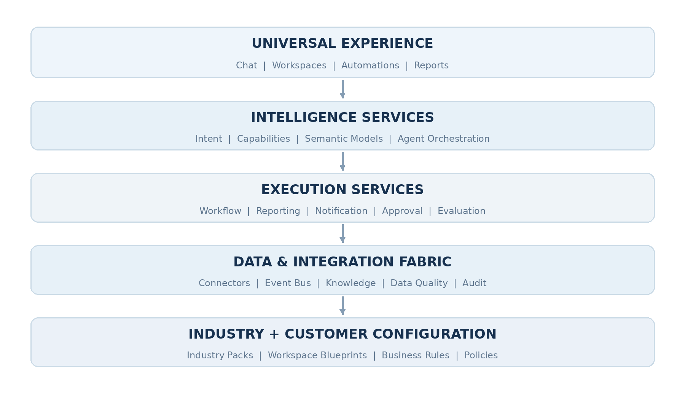

Layered reference architecture; logical modules do not imply mandatory microservice boundaries.

| **Shared logical engine**         | **Responsibility**                                                                         |
|-----------------------------------|--------------------------------------------------------------------------------------------|
| Specification Intelligence        | Ingest BRD/FSD/TSD, extract requirements, trace, classify, propose and validate manifests. |
| Template & Configuration Registry | Version industry packs, customer blueprints, report/automation definitions and overrides.  |
| Workspace Runtime                 | Load tenant/company/department context, knowledge, permissions, sources and active tools.  |
| Intent & Capability Orchestrator  | Interpret business goals; select, authorise and coordinate specialist tools.               |
| Semantic & Graph Services         | Apply approved business definitions and represent relationships across data/Workspaces.    |
| Automation & Event Fabric         | Durable scheduled/event-driven execution, rules, approvals, error handling and audit.      |
| Proactive Intelligence            | Investigate significance, prioritise Insights and connect them to persistent Intents.      |
| Notification & Engagement         | In-app/mobile/email/approved messaging with consent, policy, grouping and escalation.      |
| Reporting & Artifact              | Generate, reconcile, version, store, search, view, export and schedule reports.            |
| Integration Plugins               | Read/write adapters, discovery, data mapping, auth, monitoring and rate limits.            |
| Policy, Identity & Security       | Tenant isolation, roles, attributes, consent, tool permissions and human control.          |
| Model Gateway / Otic Credits      | Model routing, limits, caching, usage metering, budgets and audit.                         |
| Observability & Evaluation        | Traces, costs, prompt/tool quality tests, incident telemetry and feedback.                 |

Deployment may begin as a modular monolith with background workers and evolve to independently deployed services based on load, failure isolation and compliance needs. Shared interfaces and contracts matter more than the number of deployments.

# 4 Specification-driven engineering workflow

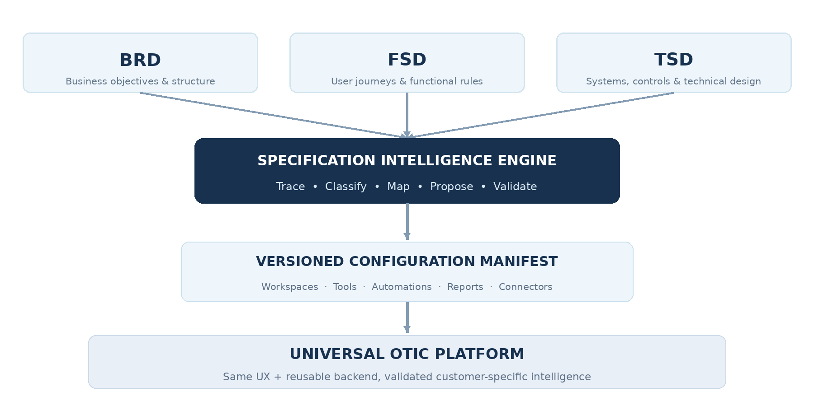

Business, functional and technical specifications compile into a validated configuration—not a new codebase.

## Distinct authority of source documents

| **Source**                     | **Primary contribution**                             | **Illustrative contents**                                                          |
|--------------------------------|------------------------------------------------------|------------------------------------------------------------------------------------|
| BRD — Business Requirements    | Why, business objectives and organisational context. | Department structures; problems; target outcomes; business rules; reporting needs. |
| FSD — Functional Specification | What users and workflows must do.                    | Journeys; screens/interactions; triggers; report fields; error cases; approvals.   |
| TSD — Technical Specification  | How the approved solution integrates and operates.   | APIs; schemas; security; system constraints; infrastructure; SLAs; performance.    |
| Supporting evidence            | Ground truth for configuration and testing.          | Existing Excel files; policies; process maps; sample data; organisational charts.  |

## End-to-end engineering sequence

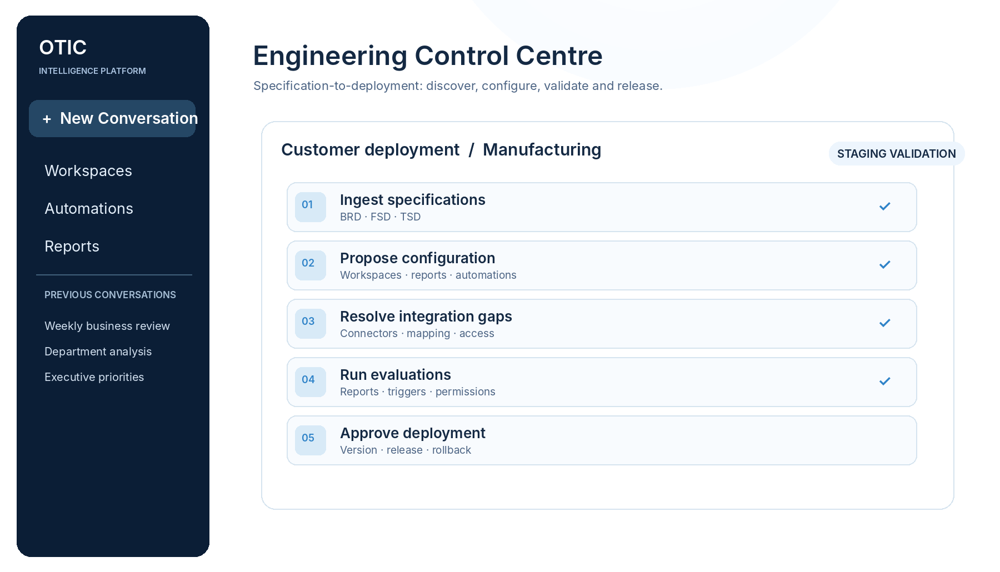

Engineering Control Centre — source specifications through test and release.

| **Stage**                       | **Output / engineering task**                                                                                                 |
|---------------------------------|-------------------------------------------------------------------------------------------------------------------------------|
| 1\. Intake and version          | Import BRD/FSD/TSD and supporting artifacts; identify document versions, owners and access controls.                          |
| 2\. Parse and trace             | Extract requirement IDs with source location, priority, acceptance basis and ambiguity flags.                                 |
| 3\. Discover structure          | Infer proposed companies, departments, facilities, branches, practice areas or projects; validate against organisation chart. |
| 4\. Match industry pack         | Select MIP, CIP, IIP, LIP, Logistics, Culinary, Architecture, Customer & Marketing or Pulse, plus needed domain templates.    |
| 5\. Reuse analysis              | Map requirements to existing UI components, services, tools, data connectors and report/workflow templates.                   |
| 6\. Generate Workspace proposal | Define business objectives, data sources, KPIs, members, policies and template inheritance per Workspace.                     |
| 7\. Generate specialist mapping | Register tools and domain calculation services behind shared Capabilities.                                                    |
| 8\. Generate reports            | Map existing accepted reports and requested new outputs to reusable templates and artifact definitions.                       |
| 9\. Generate automations        | Extract triggers, schedules, conditions, analyses, approvals, channels, error and retry behavior.                             |
| 10\. Generate proactive intents | Propose standing business objectives, event subscriptions, severity rules and notification policy.                            |
| 11\. Gap analysis               | Classify each requirement: reuse, configure, shared extension, exceptional custom code or unresolved.                         |
| 12\. Sandbox preview            | Provision non-production blueprints with synthetic/protected data; simulate workflows and inspect UX.                         |
| 13\. Approval and acceptance    | Secure engineering, security, product and authorised customer approval; preserve sign-off and unresolved items.               |
| 14\. Deploy and observe         | Version manifest, promote through environments, enable permitted integrations, monitor usage/quality.                         |
| 15\. Operate and evolve         | Capture changes, evaluate outcomes, refine shared components and version customer-specific overrides.                         |

## Decision logic for a newly requested feature

| **Classification**       | **Engineering response**                                                         |
|--------------------------|----------------------------------------------------------------------------------|
| Already reusable         | Enable existing component; configure permissions and sources.                    |
| Industry configurable    | Apply Industry Intelligence Pack and appropriate template.                       |
| Customer configurable    | Create Workspace-specific mappings, metrics, report/workflow definitions.        |
| New shared extension     | Design once with registry contracts and cross-product validation.                |
| Exceptional bespoke      | Require explicit architecture/commercial approval and plan to minimise coupling. |
| Unclear or contradictory | Record open decision; do not invent customer policies.                           |

# 5 Workspace Engine and template methodology

Workspaces are the principal business configuration unit. They are not merely folders: each has governed identity, knowledge, sources, metrics, tools, Reports, Automations, Intents, permissions and contextual conversation.

## Canonical hierarchy and scope

Organisation → Company/Business Unit → Department Workspace → Conversations + Reports + Automations + Knowledge. Additionally support project, branch, facility, customer account, legal matter, architectural model/project and executive cross-functional scopes. A Workspace can be group-wide if its information access and legal boundaries are explicit.

## Template recommendation layers

| **Template source**  | **Purpose**                                             | **Example**                                  |
|----------------------|---------------------------------------------------------|----------------------------------------------|
| Otic standard        | Reusable common departmental or practice-area pattern.  | MIP Production; CIP Portfolio Monitoring.    |
| Industry pack        | Domain knowledge, entities, KPIs and specialised tools. | BIM coordination; insurance renewal.         |
| Customer template    | Approved organisation-specific operating model.         | Group-wide Procurement across JESA/NICE/UBL. |
| BRD/FSD/TSD proposal | AI-suggested configuration grounded in requirements.    | Suggested department or approval workflow.   |
| Blank/custom         | Admin-defined environment for novel activities.         | New research programme Workspace.            |

## Exact Workspace creation user journey

8.  Open Workspaces → Create Workspace.

9.  Select organisation, company and scope; default to Department unless the user chooses otherwise.

10. Choose from searchable “Suggested for you” templates, a customer template, or “Create with AI / From Scratch”.

11. Provide name, purpose, owning department, success measures and any organisational dependencies.

12. Review business terms, semantic entities, KPIs, prompts, available specialised tools and knowledge documents.

13. Select connectors and permitted tables, documents, APIs and field mappings; run tests and data-quality checks.

14. Review proposed report templates and default saved-report library behavior.

15. Review Automation and Intent suggestions; keep all actions in Draft until approved.

16. Assign members, access boundaries, approvers, notification settings, retention and cost budgets.

17. Preview, validate, confirm requirements mapping and activate the Workspace; open its conversation.

## Suggested template dropdown design

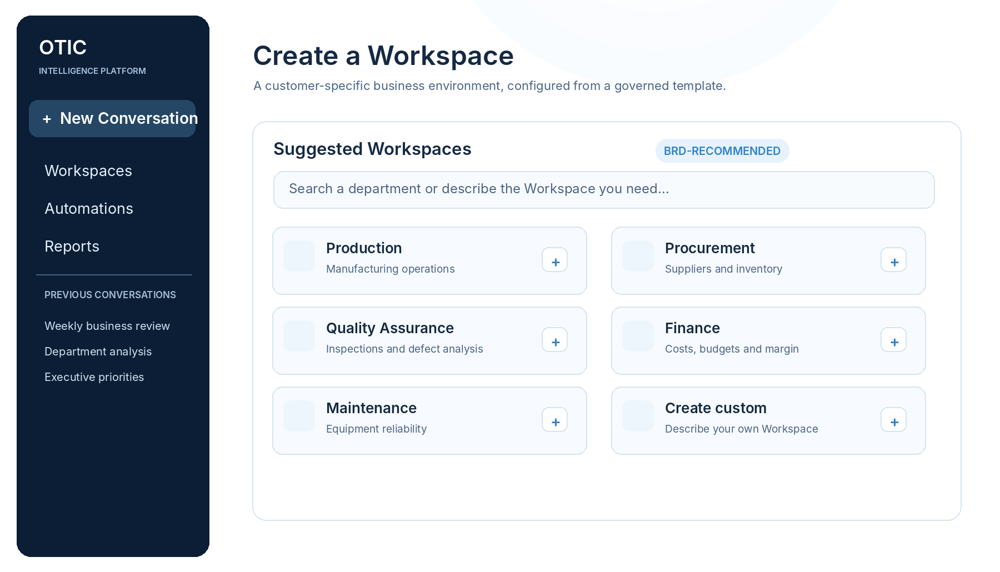

Workspace Builder — industry, company and BRD-recommended departmental templates.

Searchable grouped options: “Recommended from BRD”, “Your Company Templates”, “Otic Industry Templates”, “Recently Used” and “Create Custom”. Each suggestion shows its objective, expected data connectors, example reports, typical Automations and required permissions. Suggestions must be explainable, editable and clearly marked as unapproved until reviewed.

## Workspace runtime resolution

On entry, resolve tenant → company → Workspace → user permissions → Industry Pack version → customer overrides → approved source scopes → semantic model → tool permissions → active monitoring policies. Runtime context must use enforced service policy, not only textual instructions in a prompt.

## Cross-Workspace orchestration

A manager may request a cross-department investigation. The orchestrator creates authorised sub-queries to each Workspace and combines only the results permitted to that user. It must not carry a privileged result from one Workspace into another with weaker access. Retain source lineage and clearly distinguish facts from hypotheses.

> **EXAMPLE — GROUP MANUFACTURING**
>
> A Mulwana Group Procurement Workspace can analyse permitted procurement activity across JESA, Nice House of Plastics and Uganda Batteries. Local company-specific Workspaces remain separate where required. The MIP shell and creation flow stay identical.

# 6 Universal Capabilities and specialised tool architecture

Capabilities are standard UI verbs. The catalog should be stable across products. Industry-specific tools, skills and calculations plug into each verb through a permission-aware registry. The model may choose capabilities automatically; users can also select through the composer toggle.

## Foundational catalogue — eight prominent items

| **Capability**      | **Standard purpose**                                                                       |
|---------------------|--------------------------------------------------------------------------------------------|
| Explore Data        | Find approved records, inspect source availability and answer source-grounded queries.     |
| Analyse & Visualise | Calculate trends/variance and render charts, dashboards, tables and comparisons.           |
| Excel Intelligence  | Understand, validate, recreate and generate workbooks, formulas and formatting.            |
| Create Reports      | Generate and save validated outputs as persistent report artifacts.                        |
| Forecast & Simulate | Run approved models and documented assumptions for scenarios, sensitivity and forecasting. |
| Execute Actions     | Prepare or perform permitted operations with guardrails and human approval when required.  |
| Schedule & Automate | Convert a request or report into a durable, testable automation definition.                |
| Deep Intelligence   | Coordinate multi-source investigations with evidence, uncertainty and recommendations.     |

## Advanced expandable catalogue

| **Advanced capability**           | **Purpose**                                                                       |
|-----------------------------------|-----------------------------------------------------------------------------------|
| Knowledge & Policy Intelligence   | Retrieve authorised policies, manuals and business guidance with source evidence. |
| Document Intelligence             | Parse and compare contracts, PDF/Word files and structured/unstructured content.  |
| Data Preparation & Reconciliation | Clean, join, map and validate source data before use.                             |
| Compare & Benchmark               | Compare departments, periods, entities and approved external benchmarks.          |
| Monitor & Alert                   | Define or inspect monitoring conditions, thresholds and alerts.                   |
| Proactive Intelligence            | Register business objectives and prioritised insights for ongoing observation.    |
| Spatial Intelligence              | Use routes, location or GIS information through supported tools and data.         |
| Voice & Visual Intelligence       | Interpret authorised audio, image and live camera inputs when supported.          |
| Generate & Compose                | Create documents, summaries, presentations and media via suitable tools.          |
| Intent & Workflow Orchestration   | Translate business goals into approved multi-step plans and governed actions.     |

## Tool registry contract

Each registered specialist tool must declare a stable identifier, version, owner, description, input/output schema, domain pack, required data scopes, permissions, cost class, side-effect classification, rate limits, timeout/retry policy, environment, health status and audit requirements. No capability selection can bypass backend checks.

## Routing example

“Why did production fall?” invokes MIP production and maintenance analysis; “Why did loan arrears rise?” invokes CIP portfolio and repayment tools. Both enter through Analyse & Visualise / Deep Intelligence and share the same composer, traces and response components.

# 7 Automation Engine: design and user methodology

An Automation is a persistent executable workflow definition. It may be scheduled, event-driven, threshold-based, manually initiated or composed of multiple stages. A conversational instruction is not an Automation until translated, validated, approved and activated.

## Four creation entry points

- Automations → Create Automation (main interface).

- Workspace conversation: “Every morning review yesterday’s production and prepare a report.”

- Saved Report → Schedule / Automate (create a recurring generation or review workflow).

- Suggested template within Workspace setup or industry catalogue.

## Precise creation wizard

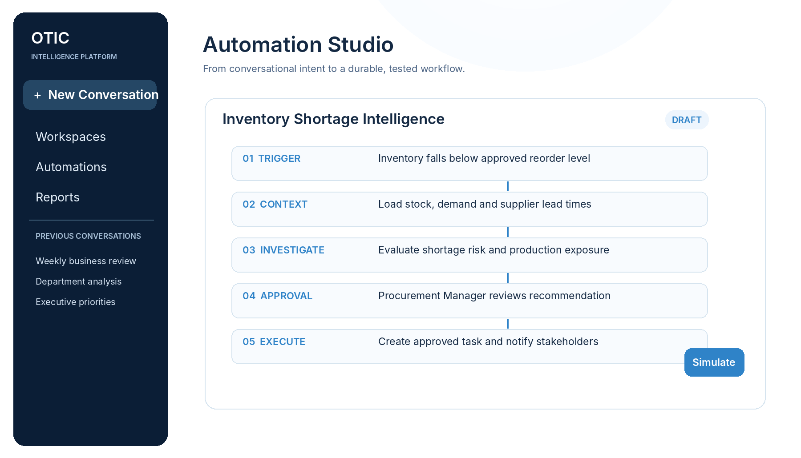

Automation Studio — natural-language intent translated into a governed execution flow.

18. Define objective, Automation name, owner and associated Workspace.

19. Select a trigger: schedule, source event, threshold, condition or manual invocation.

20. Select source data and run identity/access checks.

21. Set business logic, threshold definitions, expected data freshness and decision criteria.

22. Add analytical steps, deterministic calculations and optional model reasoning tools.

23. Specify outputs: save Report, create task, prepare action, send notification or update a permitted record.

24. Define communication channel, recipients, consent, deduplication and quiet-hours policies.

25. Apply approvals and human review gates for consequential actions.

26. Set durable execution policy: retries, idempotency key, timeouts, escalation and failure handling.

27. Simulate with test events; review evidence, outcomes and error pathways.

28. Authorised activation; display Active status and execution history.

29. Monitor, pause, edit, version, retire or clone the Automation under relevant permissions.

## Backend modules to implement

| **Component**                | **Responsibility**                                                            |
|------------------------------|-------------------------------------------------------------------------------|
| Trigger registry             | Schedules, webhooks, event subscriptions, thresholds, manual triggers.        |
| Event ingestion              | Validate source, schema and freshness; reject or quarantine malformed events. |
| Workflow definition registry | Immutable approved versions, draft state and change diffs.                    |
| Rule / decision engine       | Deterministic policy and business condition evaluation.                       |
| Agentic step executor        | Invoke approved tools and reasoning within time, cost and permission limits.  |
| Durable workflow engine      | Persist state across waits, failures, approvals and retries.                  |
| Approval service             | Human decision points, escalation, expiry, full audit trail.                  |
| Action connector executor    | Perform least-privileged write operations; idempotency and compensations.     |
| Notification service         | Recipient selection, delivery policy, suppression, escalation.                |
| Observability and control    | Run history, retries, latency, costs, cancellation and kill switches.         |

## Automation lifecycle

Draft → Test → Awaiting Approval → Approved → Active → Paused / Failed / Retired. A previous approved version should remain inspectable. Material changes require revalidation and, when policy requires, reapproval.

## Inbound vs outbound execution

Inbound: user message, customer enquiry, ERP event, document upload, telematics signal or application update triggers a permitted interpretation/workflow. Outbound: monitored condition creates a proposed or authorised notification, message or task. External messaging must observe approved templates, consent, contact rules and channel restrictions.

## Safety and failure semantics

Use at-least-once event delivery with idempotent actions and deduplication; do not imply exactly-once side effects without specific transactional guarantees. Require compensating actions or reconciliation for partially completed operations. Tools must be allowlisted, scoped and auditable. Financial/legal/regulated actions should be human-governed unless approved policy explicitly permits limited automation.

# 8 Proactive Intelligence with Intent and notification architecture

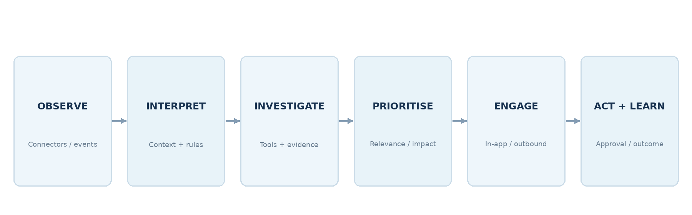

Proactive intelligence loop: the system detects and investigates before engaging, acting and measuring outcomes.

## Six separate first-class objects

| **Object**                 | **Definition**                                      | **Example**                                          |
|----------------------------|-----------------------------------------------------|------------------------------------------------------|
| Intent                     | Approved persistent business objective.             | Avoid production downtime.                           |
| Signal / Event             | An observed change or external interaction.         | ERP reports stock below a threshold.                 |
| Insight                    | Evidence-based finding or hypothesis from analysis. | Forecast stockout risk.                              |
| Automation                 | Workflow that monitors, prepares, acts and records. | Refresh inventory and raise review task.             |
| Notification               | Delivery of a specific Insight/action request.      | In-app card to Procurement Manager.                  |
| Outcome / Decision Journal | What was approved, executed and measured.           | Replenishment approved; stock availability improved. |

## Intent Registry record

Include objective, Workspace owner, linked sources, entities, monitored KPIs, success condition, policy thresholds, severity rules, evidence expectations, permitted response options, recipients, review/expiry date and active status. Multiple Automations may support one Intent.

## Proactive engine stages

30. Observe permitted data/events and source freshness.

31. Detect anomalies, time-sensitive obligations, thresholds or relevant changes.

32. Correlate related events into a business incident to suppress duplicates.

33. Load Workspace context, organisational policy and Enterprise Intelligence Graph relationships.

34. Investigate with relevant tools, distinguishing calculated results and AI interpretations.

35. Assess impact, urgency, confidence, actionability and responsible owner.

36. Create an Insight and optional proposed response workflow.

37. Route through Notification Policy Engine and user communication preferences.

38. Render contextual Intent card in the conversation, Workspace inbox or authorised external channel.

39. Record dismissal, acknowledgement, approval, action and measurable outcome.

## Where users configure proactive intelligence

Capabilities → Monitor & Alert / Proactive Intelligence proposes a standing Intent. Automations → Monitoring & Alerts stores the executable definition. Workspaces supply business ownership and permissions. Conversation presents contextual cards and approved actions. Keep the permanent left navigation unchanged.

## Intelligence Inbox / anti-noise design

A scoped Insight Inbox can be displayed as a view within Workspaces and Automations—not a new primary sidebar item. Suggested tabs: Needs Attention, Recommendations, Awaiting Approval, Monitoring, Resolved. Group related events; rate-limit notifications; suppress stale/unsupported claims; handle quiet hours and escalation. Severity is configurable and must be consistent with actual evidentiary support.

## Sample in-chat Intent card

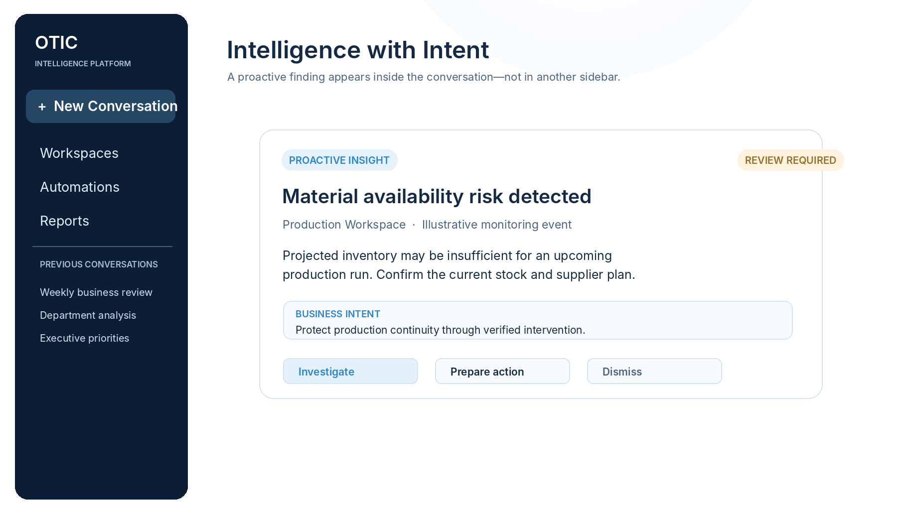

Intelligence with Intent — an actionable insight embedded directly in conversation.

> **PRODUCTION CONTINUITY • REVIEW RECOMMENDED**
>
> Potential critical material shortage. Evidence: source ERP movement and approved consumption schedule. Intent: Protect production continuity. Options: Investigate | View Evidence | Prepare Replenishment | Create Monitoring Automation | Dismiss. Do not execute a purchase without authorised approval.

## Notification channels

| **Channel**        | **Use**                                              | **Guardrail**                                      |
|--------------------|------------------------------------------------------|----------------------------------------------------|
| In-chat / in-app   | Contextual insights and approvals.                   | Workspace permission; relevance and deduplication. |
| Mobile push        | Timely high-value operational notifications.         | No sensitive data in lock-screen payload.          |
| Email              | Scheduled briefs, approved alerts, report links.     | Recipient policy, classification and retention.    |
| Approved messaging | CIP/IIP customer service, policy renewal, follow-up. | Consent, templates, verified customer identity.    |
| System-to-system   | Webhook, event or partner API.                       | Signed requests, scope, retries and audit.         |

## Outcome intelligence and continuous evaluation

Maintain a Decision Journal linking detected event → supporting evidence → recommended action → approval → actual execution → outcome and measurement. Use feedback to refine suggestions through controlled review; never let an agent silently change safety policies, customer entitlements or approved business rules.

# 9 Reports: persistent generated artifacts

> **UX RULE**
>
> Reports opens the repository of reports already generated and saved. Natural-language conversation remains the primary report creation mechanism.

## Three ways Reports are produced

40. Conversation: user asks “Generate our monthly management accounts in the existing Excel layout”; validated engine builds and saves an artifact.

41. Automation: a scheduled workflow executes the approved report definition, saves a version and optionally distributes it.

42. Report continuation: opening an existing report and asking for a refreshed period generates a new artifact without overwriting the historical snapshot.

## Report template versus generated report

| **Definition**                                                                                     | **Stored output**                                                                                                            |
|----------------------------------------------------------------------------------------------------|------------------------------------------------------------------------------------------------------------------------------|
| Template: query/mapping, calculations, layout, format, validation, ACL and schedule compatibility. | Artifact: exact report bytes or view for a specific period/run, source snapshot, creator, creation time, status and lineage. |

## Reports page fields and actions

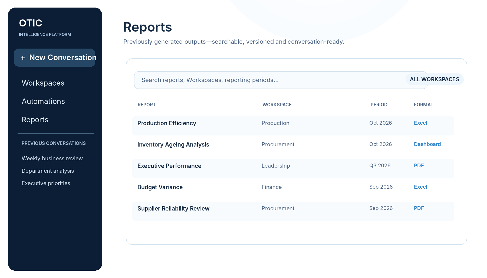

Reports library — already generated outputs, ready to reopen, interrogate or reuse.

Search by title, Workspace, type, period, creator, creation time or tagged subject. Display previous actual outputs with accessible preview. Actions: Open, Analyse in Chat, Export, Share (permissions), Refresh as New Version, Schedule and Inspect Provenance. Separate an internal “Template Management” function for administrators; do not clutter the primary user library.

## Saved-report lifecycle

Draft → Validated → Published → Superseded/Archived, with immutable historical snapshots where needed. Track report inputs, source data timestamps, calculations, template version, user/workflow identity, generated artifacts, failed runs, reconciliation and access logs.

## Format and viewers

Support validated XLSX with formula/format retention, PDF, structured data tables and interactive dashboards. Domain-specific viewers (maps, plans/BIM, contracts) may extend the reusable frontend component library while keeping the same Reports navigation.

# 10 Integration plugins, data fabric and connector governance

A connector is reusable implementation code; a connection is tenant/customer-specific configuration. Building one Business Central or PostgreSQL plugin should enable reuse across eligible products, with separate credentials, scopes and data mappings.

## Reference connector categories

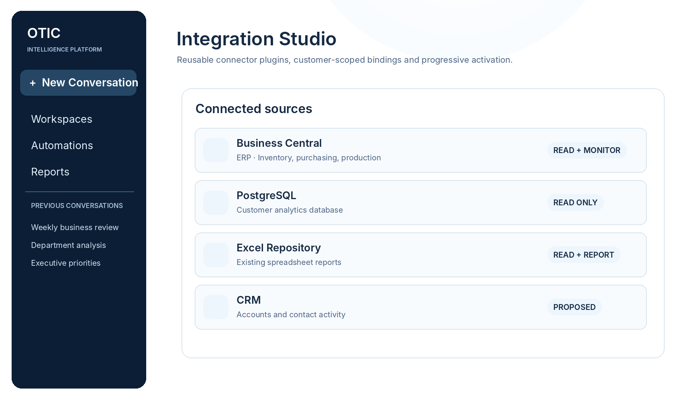

Integration Studio — shared connector catalogue with customer-scoped permissions.

| **Connector class**        | **Examples**                                       | **Common application**              |
|----------------------------|----------------------------------------------------|-------------------------------------|
| Relational / analytical DB | PostgreSQL, SQL Server, MySQL, Oracle, warehouses. | CIP, Pulse, MIP, finance/reporting. |
| ERP / finance              | Microsoft Business Central, other ERPs.            | MIP, Pulse, Logistics.              |
| CRM / customer             | Customer and lead management systems.              | Customer & Marketing, IIP, MIP.     |
| Insurance and banking      | Approved policy/core-banking/CRB APIs.             | CIP, IIP.                           |
| Documents / office         | Excel, PDF, Word, SharePoint and object storage.   | All products.                       |
| Location / telematics      | GPS, dispatch, fleet, mapping services.            | Logistics, MIP.                     |
| Architectural / design     | Revit/AutoCAD, BIM, IFC, project document systems. | Architectural Intelligence.         |
| Hospitality / POS          | Kitchen inventory, recipes, purchasing and POS.    | Culinary Intelligence.              |
| Communication              | Email, mobile push, authorised WhatsApp/messaging. | Inbound/outbound engagement.        |

## Connector registry minimum contract

- Identifier, version, owner, supported auth, secrets handling, tenant binding, source metadata and field types.

- Read/write operations with input/output schema and side-effect classification.

- Row/record scope enforcement, query validation, rate limits, concurrency and timeout policies.

- Schema discovery, mapping to domain entities and validation of calculation meanings.

- Connection health, data freshness, pagination, incremental sync and recovery semantics.

- Audit, event subscriptions, test harness, synthetic fixtures and cost observability.

## Zero-trust data retrieval

Do not give LLMs blanket SQL credentials. Use parameterised query services, safe query compilation, vetted views, row-level security or equivalently enforced scoping. Separate retrieval and write permissions. Enforce tenant boundaries both in application services and source integration. Redact or minimise sensitive information before model inference as appropriate.

## Proposed data stores and event architecture

Transactional metadata store for organisations, Workspaces, manifests, approvals and event states; object storage for reports and supplied files; semantic/index stores for authorised retrieval; relational/analytical data services for validated calculations; event bus for source signals; durable workflow backend for long-running processes; telemetry store for traces and audits. Specific vendors should be chosen by TSD constraints and cost/security evaluation.

# 11 Semantic intelligence, enterprise graph and knowledge

A shared semantic layer holds approved business entities, metrics and calculation definitions independently from the names used by individual databases. Each Industry Pack adds domain semantics; customer configurations map actual source fields to these definitions.

## Examples of domain knowledge

| **Industry**         | **Core entities / relationships**                                                                        |
|----------------------|----------------------------------------------------------------------------------------------------------|
| MIP                  | Items, BOMs, production orders, supplier delivery, quality lots, costs and plant availability.           |
| CIP                  | Borrower, loan, repayment, facility, collateral, arrears, portfolio segment, policy rule.                |
| IIP                  | Policyholder, policy, premium, claim, renewal, distribution channel, servicing case.                     |
| LIP                  | Client, legal matter, contract, clause, obligation, deadline, authority, professional review.            |
| Logistics            | Vehicle, driver, shipment, route, warehouse, order, delivery commitment, freight charge.                 |
| Culinary             | Recipe, ingredient, yield, portion, menu, supplier, food cost, allergen, demand.                         |
| Architecture         | Project, spatial element, drawing, model, revision, specification, cost quantity and coordination issue. |
| Customer & Marketing | Account, lead, campaign, interaction, opportunity, journey, consent, conversion.                         |
| Pulse                | Organisation, department, report metric, reporting period, spreadsheet cell and source lineage.          |

## Enterprise Intelligence Graph

Represent verified relationships between authorised business objects and departments to support cross-Workspace investigation. Use the graph for navigation and hypotheses, not as automatic proof of causation. Every edge must have a source, confidence or rule basis, access scope and version. Start with relational joins or graph projections; do not assume a separate graph database is mandatory.

## Institutional knowledge and memory

Separate current conversation state, Workspace-approved knowledge, enterprise policies, industry knowledge, operational records and validated decisions. A user message should not automatically become permanent institutional knowledge. Knowledge updates require source provenance, access controls, expiry/review and approvals where applicable.

## Data freshness and source confidence

All insights must consider last refresh, extraction scope, sample completeness, quality status and discrepancies. When source data is stale or inadequate, the engine should qualify or suppress proactive claims and instead notify data owners of the quality issue.

# 12 Security, governance and Otic Credits

## Mandatory shared controls

- Organisation/tenant isolation, company boundaries and Workspace-scoped access with role- and attribute-based policy.

- Least-privilege tool invocation, signed webhooks, secret vaults, output sanitisation and injection-resistant orchestration.

- Consent, channel permissions, regulatory requirements and secure outbound communications in CIP/IIP and customer engagement.

- Human approval for consequential financial, legal, customer-facing or operational write actions unless specific limits are formally approved.

- Complete traceability: what requested work, which versions/tools/data were used, what was recommended, approved, executed and recorded.

- Kill switches to suspend a connector, Automation, outbound channel or particular tool without shutting down the entire platform.

- Data residency/retention, DLP, encryption in transit/at rest, incident response and business continuity as approved by TSD.

## Otic Credits and usage governance

Meter usage by tenant, product, Workspace, user, tool, model, Automation and reporting job. Provide pooled budgets, alerts, quotas and permitted overage handling. Route simple deterministic work to conventional services rather than consuming expensive model calls. Maintain visibility into token/model costs, retrieval, tool latency, inference quality and GPU resource utilisation.

## Evaluation and observability

Every production-grade tool must have functional tests, scenario evaluations, security tests and telemetry. Monitor report accuracy, workflow success, stale data rate, duplicate/false notifications, user-approved actions and measurable business outcomes. Use trace correlation IDs across conversation, workflow, event, report and connector operations.

# 13 Cross-product user journeys

## Journey A — From BRD/FSD/TSD to a live Workspace

43. Engineer imports approved specifications and sample evidence.

44. Configuration Intelligence extracts traceable requirements and recommends industry and department templates.

45. Engineer compares reusable components and identifies missing connectors or specialist tools.

46. Product owner reviews Workspace and reporting/automation proposals with the customer.

47. Integration engineers connect and map the authorised data; domain owners validate KPIs.

48. QA simulates reports, rules, workflow failure paths and proactive notifications.

49. Authorised approver activates the Workspace and any separately approved Automations.

50. User enters Workspace, asks natural-language questions and retrieves already generated reports.

## Journey B — Natural-language report creation

51. User opens a department Workspace and requests an existing-format or new report.

52. Capability orchestrator resolves report definition, sources, periods and user permissions.

53. Reporting Engine executes validated queries/calculations and generates an artifact.

54. User inspects output, corrects ambiguities and saves the accepted Report.

55. Reports repository shows the actual saved output and source lineage.

56. User may ask to schedule its regeneration, which creates a draft Automation.

## Journey C — Proactive inbound-to-outbound loop

57. Customer, employee or connected system submits an inbound event/request.

58. Intent engine identifies business objective and relevant Workspace; verifies identity and data rights.

59. Tools investigate and generate a grounded Insight.

60. Notification Policy Engine decides whether, when and how to engage.

61. User sees an Intent card or approved recipient receives permitted outbound communication.

62. Human approves consequential action; durable workflow executes and records outcome.

63. Decision Journal measures resolution and surfaces further needed action.

# 14 Configuration principles for every industry

The nine product packs in the following section each supply suggested department/practice templates, specialist engines, Automation templates, saved-report examples and user journeys. They are not hardcoded lists. The customer’s actual organisation chart and specifications govern which templates exist in the deployment.

> **PRODUCT IDENTITY RULE**
>
> A CIP analyst, MIP Production Manager and Culinary chef all navigate the same shell. Their Workspaces provide different knowledge, access, tools, reports and intents. The standard Capability verbs and shared engines do not change.

# 15 MIP — Manufacturing Intelligence Platform

Enterprise-wide manufacturing intelligence for multi-company, multi-plant and single-site manufacturers, complementing rather than replacing ERP systems. Workspaces primarily represent actual departments; cross-company department Workspaces are supported.

> **INDUSTRY CONTEXT**
>
> Production orders, BOM, item ledger entries, purchase lines, stock, suppliers, QA lots, plant availability, machinery, workforce, sales and costs.

## 15.1 Suggested Workspace blueprints

The following are preconfigured suggestions in the searchable Create Workspace dropdown. They are not compulsory. The approved BRD/FSD/TSD and organisation chart determine which are instantiated, combined, renamed or expanded.

| **Suggested Workspace**                         | **Default intelligence context**                                                                  |
|-------------------------------------------------|---------------------------------------------------------------------------------------------------|
| Executive & Leadership                          | Consolidated operational performance, working capital, profitability and cross-company oversight. |
| Research & Development / Product Design         | Innovation pipeline, product specifications, trials and design costs.                             |
| Supply Chain & Procurement                      | Suppliers, purchase orders, inventory, lead times and working capital.                            |
| Production                                      | Output, production orders, yield, downtime, material usage and efficiency.                        |
| Quality Control & Assurance                     | Inspections, defects, rejection, traceability and corrective actions.                             |
| Maintenance & Plant Engineering                 | Assets, preventive work, failures, reliability and maintenance costs.                             |
| Waste Management & Recycling                    | Scrap, losses, recycling and resource recovery.                                                   |
| Environmental, Health & Safety / Sustainability | Incidents, obligations, environmental and safety performance.                                     |
| Logistics & Reverse Logistics                   | Dispatch, fleet, delivery, returns and reverse flows.                                             |
| IT & Digital                                    | System availability, technology operations, integration health and IT assets.                     |
| Sales & Marketing                               | Orders, CRM, demand, customers, revenue and margins.                                              |
| Compliance, Legal & Regulatory                  | Contracts, obligations and regulatory controls.                                                   |
| Finance & Administration                        | Budgets, production cost, expenditure, cash and financial performance.                            |
| Human Resources                                 | Workforce planning, attendance, training and productivity.                                        |

## 15.2 Domain engines and specialised tools

These tools are registered behind the universal Capabilities menu; they do not create a new menu or separate user experience. Tools are activated only when supported by integrations, validated models and permissions.

• Production Performance & Yield \| Inventory and Material Flow

• Supplier and Procurement Intelligence \| Manufacturing Costs and Margin

• Quality Defect and Traceability \| Equipment Reliability

• Demand / Capacity / Material Forecasting \| Waste and Resource Efficiency

• Mobile Live Voice and Camera Intelligence \| CRM and Customer Intelligence

## 15.3 Recommended Automation templates

A user can select these from a template, describe them in chat or derive them from a saved Report. Every workflow needs trigger, context, conditions, output, recipient, approvals, test and execution history.

| **Trigger / recommended template** | **Proposed workflow outcome**                                                   |
|------------------------------------|---------------------------------------------------------------------------------|
| Material below reorder level       | Investigate consumption and open orders; prepare an approved procurement alert. |
| Production output below target     | Explain variance, notify Production Manager and offer follow-up task.           |
| Repeated equipment downtime        | Generate maintenance investigation and escalate by agreed severity.             |
| Quality defect threshold crossed   | Compile batch/lot evidence and initiate QA review.                              |
| Supplier delivery delayed          | Forecast production exposure and notify relevant department.                    |
| Inventory ageing exceeds threshold | Generate slow-moving inventory review and working-capital insight.              |
| Daily reporting schedule           | Recreate accepted Excel/ERP reports and save artifacts.                         |
| Waste rate exceeds policy          | Analyse scrap, yield and relevant production context.                           |
| Sales margin deteriorates          | Compare costs, selling prices and product mix; prepare review.                  |

## 15.4 Reports library — example saved outputs

Reports below are illustrative titles of already generated artifacts a user might encounter. Production deployments show only actual saved outputs; templates are administered separately.

| **Generated report**               | **Originating Workspace · format** |
|------------------------------------|------------------------------------|
| Daily Production Efficiency        | Production · dashboard / Excel     |
| Inventory Ageing & Slow Movers     | Procurement · Excel                |
| Procurement / Supplier Performance | Procurement · PDF / dashboard      |
| Material Consumption Variance      | Production · Excel                 |
| Quality Defect and Reject Analysis | Quality Assurance · dashboard      |
| Equipment Reliability and Downtime | Maintenance · PDF                  |
| Manufacturing Cost & Margin        | Finance · Excel                    |
| Waste and Recovery Performance     | Waste · dashboard                  |
| Group Executive Operations Review  | Executive · PDF / dashboard        |

## 15.5 Inbound, outbound and proactive Intent

### Inbound signals

ERP events; uploaded Excel reports; authorised mobile voice/camera observations; product order changes; QA records.

### Outbound engagement

Approved internal production alerts, supplier follow-up tasks, management reports and mobile/web notifications.

### Proactive Intent illustration

> **Protect production continuity**
>
> A critical material is forecast to be insufficient for an upcoming run. Present evidence, affected production orders and proposed replenishment review.

## 15.6 End-to-end user journey

A Production Manager opens Production, asks why output fell, receives linked analysis across authorised Procurement, Maintenance and QA data, saves a Production Variance report, then approves a monitoring Automation. Later one contextual Intent card groups related stock and supplier-delay events.

## 15.7 BRD/FSD/TSD conversion example

Three-company group requiring department-by-department report recreation and conversational analytics. Generate group/company hierarchy, Procurement and Production Workspaces, Business Central mappings, accepted Excel templates, staged report validation and later self-service analysis.

## 15.8 Domain acceptance criteria

64. Existing agreed Excel reports reconcile against source/reference outputs.

65. Cross-company queries respect company and group access boundaries.

66. Material shortage alerts correlate ERP freshness, thresholds and production context.

MIP mobile extension: “MIP on the Go” can surface conversational, voice, proactive notification and validated visual tools on authorised Android/iOS devices. Camera observations do not independently establish inventory accuracy or QA compliance without appropriate validation.

# 16 CIP — Credit Intelligence Platform

Credit-lifecycle decision support, borrower assessment, portfolio intelligence, early-warning and governed collections; actual approval decisions remain within institutional authorities.

> **INDUSTRY CONTEXT**
>
> Borrowers, facilities, applications, loan accounts, repayment schedules, CRB attributes, collateral, credit policies, arrears, collections and portfolio segments.

## 16.1 Suggested Workspace blueprints

The following are preconfigured suggestions in the searchable Create Workspace dropdown. They are not compulsory. The approved BRD/FSD/TSD and organisation chart determine which are instantiated, combined, renamed or expanded.

| **Suggested Workspace**       | **Default intelligence context**                              |
|-------------------------------|---------------------------------------------------------------|
| Credit Origination            | Applications, intake and borrower onboarding.                 |
| Borrower Intelligence         | Identity, applicant profile and authorised financial context. |
| Credit Assessment             | Affordability, credit analysis and documentation.             |
| Credit Scoring Support        | Approved scoring methods and feature explanations.            |
| Credit Underwriting           | Underwriting analyses and recommendation preparation.         |
| Credit Approval               | Committee workflow, delegated limits and decision evidence.   |
| Credit Operations             | Documentation, disbursement support and servicing operations. |
| Credit Risk Management        | Risk appetite, concentrations and controls.                   |
| Portfolio Monitoring          | Performance, repayment behaviour and segmentation.            |
| Early Warning Intelligence    | Emerging deterioration and early intervention triage.         |
| Collections & Recovery        | Arrears, action planning and recovery tracking.               |
| Loan Restructuring            | Restructuring cases and post-change monitoring.               |
| Collateral & Securities       | Security information, valuations and review dates.            |
| Retail Credit                 | Consumer portfolio and product performance.                   |
| SME Credit                    | Small-business borrowers and credit performance.              |
| Corporate Credit              | Large borrower exposure and concentration.                    |
| Branch & Regional Credit      | Local portfolio quality and lending performance.              |
| Credit Policy & Compliance    | Policy rules, exceptions and compliance.                      |
| Credit Quality Assurance      | File review completeness and process quality.                 |
| Executive Credit Intelligence | Bank-wide performance and risk oversight.                     |

## 16.2 Domain engines and specialised tools

These tools are registered behind the universal Capabilities menu; they do not create a new menu or separate user experience. Tools are activated only when supported by integrations, validated models and permissions.

• Borrower Financial Assessment \| CRB Integration and Consent Controls

• Credit Policy and Rule Validation \| Affordability and Repayment Analysis

• Portfolio-at-Risk and Concentration \| Early Warning Investigation

• Collections Prioritisation \| Credit Memo and Report Generation

• Inbound Borrower Intent \| Regulated Workflow Controls

## 16.3 Recommended Automation templates

A user can select these from a template, describe them in chat or derive them from a saved Report. Every workflow needs trigger, context, conditions, output, recipient, approvals, test and execution history.

| **Trigger / recommended template** | **Proposed workflow outcome**                                           |
|------------------------------------|-------------------------------------------------------------------------|
| Application received               | Classify purpose, request permitted documents and route to origination. |
| Missing application items          | Prepare approved reminder or internal officer task.                     |
| Repayment deterioration signal     | Investigate trend and create early-warning insight.                     |
| Scheduled portfolio review         | Generate portfolio-at-risk and segment report.                          |
| Policy exception detected          | Escalate to authorised credit officer.                                  |
| Collections case due               | Prepare governed task, not autonomous coercive outreach.                |
| Collateral review date             | Alert responsible team and attach source records.                       |
| Exposure concentration threshold   | Compile relevant evidence and request risk review.                      |
| Branch review schedule             | Create branch credit performance artifact.                              |

## 16.4 Reports library — example saved outputs

Reports below are illustrative titles of already generated artifacts a user might encounter. Production deployments show only actual saved outputs; templates are administered separately.

| **Generated report**       | **Originating Workspace · format** |
|----------------------------|------------------------------------|
| Borrower Credit Assessment | Credit Assessment · PDF            |
| Credit Memo                | Underwriting · PDF                 |
| Portfolio at Risk          | Portfolio Monitoring · dashboard   |
| Early Warning Analysis     | Early Warning · PDF                |
| Collections Effectiveness  | Collections · Excel                |
| Credit Concentration       | Credit Risk · dashboard            |
| Collateral Review          | Collateral · PDF                   |
| Branch Credit Performance  | Branches · Excel                   |
| Executive Credit Review    | Executive · PDF                    |

## 16.5 Inbound, outbound and proactive Intent

### Inbound signals

Borrower WhatsApp/web enquiries, applications, updates, supporting documents and core-banking events; identify intent and route to authorised operations.

### Outbound engagement

Consented repayment reminders, permitted application completion follow-up, review scheduling, internal early-warning escalation and authorised collections communications.

### Proactive Intent illustration

> **Protect portfolio quality**
>
> A monitored segment exhibits potential deterioration. Explain drivers, uncertainty and available interventions for a Credit Risk Manager; do not autonomously decide credit outcomes.

## 16.6 End-to-end user journey

Credit Risk Manager opens Portfolio Monitoring, asks which segments are deteriorating, receives source-grounded analysis and a saved risk report, then approves a weekly monitoring definition. Later CIP surfaces a grouped risk Insight; the officer reviews evidence and actions.

## 16.7 BRD/FSD/TSD conversion example

A bank requests borrower analysis, early-warning and collections support. Propose Origination, Assessment, Portfolio, Early Warning and Collections Workspaces, map its core banking/CRB integrations, rules, roles, report definitions and approval gates.

## 16.8 Domain acceptance criteria

67. CRB usage follows permitted consent, licensing and institutional policy.

68. No lending outcome occurs without appropriate authorisation.

69. Risk calculations reconcile with bank-approved definitions and historical tests.

Specific CIP position: CIP is already integrated with a Credit Reference Bureau (CRB) service provider licensed by the Bank of Uganda, enabling financial institutions to incorporate credit reference information into borrower assessment and credit decision-support. It can also incorporate permitted alternative data, subject to consent and applicable regulatory requirements.

# 17 IIP — Insurance Intelligence Platform

Insurance distribution, bancassurance, policy and claims intelligence, renewal management and governed inbound/outbound engagement.

> **INDUSTRY CONTEXT**
>
> Policyholders, products, policies, coverages, premiums, claims, renewals, distribution partners, channels, documents and customer interactions.

## 17.1 Suggested Workspace blueprints

The following are preconfigured suggestions in the searchable Create Workspace dropdown. They are not compulsory. The approved BRD/FSD/TSD and organisation chart determine which are instantiated, combined, renamed or expanded.

| **Suggested Workspace**          | **Default intelligence context**                     |
|----------------------------------|------------------------------------------------------|
| Executive Insurance Intelligence | Portfolio and distribution oversight.                |
| Bancassurance                    | Insurance distribution through banks.                |
| Agency & Broker Distribution     | Intermediary productivity and servicing.             |
| Direct & Digital Sales           | Direct channel activity and conversion.              |
| Customer Acquisition             | Lead to policy issuance.                             |
| Insurance Product Management     | Coverage, product documents and performance.         |
| Underwriting                     | Underwriting support and review.                     |
| Policy Administration            | Issuance, records and policy servicing.              |
| Premium & Billing Operations     | Premiums, invoices and collections.                  |
| Claims Management                | Claims intake and case lifecycle.                    |
| Claims Review & Investigation    | Exception review and supporting evidence.            |
| Surveying & Loss Assessment      | Approved loss inspection and assessment information. |
| Renewals & Retention             | Expiry pipeline, lapse risk and retention.           |
| Customer Service                 | Enquiries, complaints and follow-up.                 |
| Actuarial & Pricing              | Pricing models and portfolio analysis support.       |
| Reinsurance                      | Reinsurance positions and reporting.                 |
| Corporate Accounts               | Institutional policies and partnerships.             |
| Risk & Compliance                | Insurance obligations and controls.                  |
| Finance & Accounting             | Premium production and financial performance.        |
| Insurance Operations & Quality   | Process efficiency, workload and QA.                 |

## 17.2 Domain engines and specialised tools

These tools are registered behind the universal Capabilities menu; they do not create a new menu or separate user experience. Tools are activated only when supported by integrations, validated models and permissions.

• Product and Coverage Intelligence \| Policy Lifecycle Orchestration

• Bancassurance Performance \| Claims Workflow Intelligence

• Renewal / Retention Intelligence \| Underwriting Decision Support

• Premium and Billing Analysis \| Customer Inbound/Outbound Intent

• Distribution Analytics \| Insurance Compliance

## 17.3 Recommended Automation templates

A user can select these from a template, describe them in chat or derive them from a saved Report. Every workflow needs trigger, context, conditions, output, recipient, approvals, test and execution history.

| **Trigger / recommended template** | **Proposed workflow outcome**                         |
|------------------------------------|-------------------------------------------------------|
| Policy approaching expiry          | Create renewal opportunity and authorised reminder.   |
| Customer asks about coverage       | Route product enquiry with approved policy content.   |
| Claim received                     | Classify, verify required documents and queue review. |
| Claim lacks documents              | Prepare permitted request and track response.         |
| Claim processing delay             | Escalate internally by SLA.                           |
| Premium payment due                | Use approved messaging and consent policy.            |
| Channel underperformance           | Generate bancassurance performance report.            |
| Customer complaint                 | Classify and assign service owner.                    |
| Scheduled regulatory report        | Assemble controlled report from approved definitions. |

## 17.4 Reports library — example saved outputs

Reports below are illustrative titles of already generated artifacts a user might encounter. Production deployments show only actual saved outputs; templates are administered separately.

| **Generated report**             | **Originating Workspace · format** |
|----------------------------------|------------------------------------|
| Renewal Pipeline                 | Renewals · dashboard               |
| Bancassurance Performance        | Bancassurance · PDF                |
| Premium Production               | Finance · Excel                    |
| Claims Processing                | Claims · dashboard                 |
| Retention / Lapse Analysis       | Renewals · PDF                     |
| Distribution Channel Performance | Sales · dashboard                  |
| Underwriting Portfolio Review    | Underwriting · PDF                 |
| Policy Servicing Exceptions      | Administration · Excel             |
| Executive Insurance Review       | Executive · PDF                    |

## 17.5 Inbound, outbound and proactive Intent

### Inbound signals

Customer policy questions, WhatsApp enquiries, document submissions, claims-status requests and insurer/partner events; route by identity and consent.

### Outbound engagement

Renewal notices, approved quotes follow-up, missing-document prompts, permitted claims updates and internal servicing escalations.

### Proactive Intent illustration

> **Improve policy renewal performance**
>
> Policies are nearing expiry. Present the branch/product pipeline, contact permissions and recommended follow-up for review.

## 17.6 End-to-end user journey

Bancassurance Manager asks for policies expiring in 30 days, reviews a saved Renewal Pipeline report and approves monitoring. A subsequent Insight proposes customer outreach through an approved channel; replies feed back into the same Workspace.

## 17.7 BRD/FSD/TSD conversion example

Bank requests bancassurance agent and policy renewals, not full insurer underwriting. Recommend Bancassurance, Customer Service, Renewals and Executive templates; do not deploy irrelevant actuarial/reinsurance modules.

## 17.8 Domain acceptance criteria

70. No unsupported claim of live coverage or eligibility.

71. Customer outbound communications meet channel, consent and insurer policy.

72. Claim or underwriting decisions requiring specialist judgement are routed appropriately.

# 18 LIP — Legal Intelligence Platform

Legal research, matter and contract intelligence for law firms and corporate legal teams, with strong professional confidentiality and mandatory human review for high-stakes outputs.

> **INDUSTRY CONTEXT**
>
> Clients, matters, contracts, clauses, obligations, filing deadlines, legal authorities, advisory work, litigation and legal operations.

## 18.1 Suggested Workspace blueprints

The following are preconfigured suggestions in the searchable Create Workspace dropdown. They are not compulsory. The approved BRD/FSD/TSD and organisation chart determine which are instantiated, combined, renamed or expanded.

| **Suggested Workspace**          | **Default intelligence context**                     |
|----------------------------------|------------------------------------------------------|
| Executive Legal Intelligence     | Legal portfolio, exposure and service performance.   |
| Legal Research & Knowledge       | Authority research and approved legal resources.     |
| Contract Intelligence            | Clause review and obligation extraction.             |
| Commercial & Corporate Advisory  | Corporate transactions and commercial advice.        |
| Litigation                       | Court matters and case preparation.                  |
| Dispute Resolution & Arbitration | Alternative dispute resolution workflows.            |
| Corporate Governance             | Board and corporate-secretarial matters.             |
| Regulatory Compliance            | Compliance obligations and controls.                 |
| Employment & Labour Law          | Employment legal matters.                            |
| Banking & Finance Law            | Financing documentation and finance regulation.      |
| Property & Conveyancing          | Property matters and transactions.                   |
| Intellectual Property            | IP rights, agreements and deadlines.                 |
| Tax Advisory & Disputes          | Tax matters and technical reviews.                   |
| Mergers & Acquisitions           | Transactions and due diligence.                      |
| Procurement & Projects           | Contracting and procurement matters.                 |
| Client Intake & Engagement       | Onboarding, engagement letters and initial requests. |
| Matter & Case Management         | Matter ownership, status and tasks.                  |
| Legal Operations & Billing       | Workload, fees and department operations.            |
| Document & Knowledge Management  | Controlled documents and precedents.                 |
| Legal Risk & Audit               | Legal exposure and issue management.                 |

## 18.2 Domain engines and specialised tools

These tools are registered behind the universal Capabilities menu; they do not create a new menu or separate user experience. Tools are activated only when supported by integrations, validated models and permissions.

• Legal Research and Citation Retrieval \| Contract Clause / Obligation Extraction

• Document Comparison and Redlining Support \| Matter Timeline Intelligence

• Due Diligence Extraction \| Regulatory Obligation Intelligence

• Client Intake and Classification \| Legal Drafting Support

• Legal Deadline Coordination \| Matter Risk Reporting

## 18.3 Recommended Automation templates

A user can select these from a template, describe them in chat or derive them from a saved Report. Every workflow needs trigger, context, conditions, output, recipient, approvals, test and execution history.

| **Trigger / recommended template** | **Proposed workflow outcome**                           |
|------------------------------------|---------------------------------------------------------|
| Contract expiry approaching        | Notify owner and prepare clause-linked review.          |
| Filing deadline approaching        | Create authorised task and acknowledgement requirement. |
| Client matter created              | Set owner and approved checklist.                       |
| Document requested                 | Track missing documents and permitted client reminders. |
| Contract revised                   | Compare versions and queue legal review.                |
| Regulatory update logged           | Create internal policy assessment task.                 |
| Matter status schedule             | Generate client or management status report.            |
| Due diligence checklist incomplete | Escalate outstanding items.                             |
| Time/billing review                | Notify team of approved period close.                   |

## 18.4 Reports library — example saved outputs

Reports below are illustrative titles of already generated artifacts a user might encounter. Production deployments show only actual saved outputs; templates are administered separately.

| **Generated report**           | **Originating Workspace · format** |
|--------------------------------|------------------------------------|
| Contract Risk Assessment       | Contracts · PDF                    |
| Contract Expiry Register       | Contracts · Excel                  |
| Litigation Portfolio           | Litigation · dashboard             |
| Matter Status                  | Client Matters · PDF               |
| Regulatory Obligation Register | Compliance · Excel                 |
| Due Diligence Review           | Corporate Advisory · PDF           |
| Legal Team Workload            | Operations · dashboard             |
| Executive Legal Risk           | Executive · PDF                    |

## 18.5 Inbound, outbound and proactive Intent

### Inbound signals

Client enquiry, new matter documents, contract upload, revised draft, deadline or authority update.

### Outbound engagement

Permitted client document requests, deadline notifications, legal review assignments and approved matter status correspondence.

### Proactive Intent illustration

> **Prevent missed legal obligations**
>
> A confirmed contractual deadline approaches; cite underlying clause, owner and source documents and prepare a legal review task.

## 18.6 End-to-end user journey

Associate opens a matter Workspace, reviews an agreement, saves an attorney-reviewed risk report and configures a confirmed obligation reminder. Later a contextual Intent card invites examination; no unauthorised filing or client advice is sent.

## 18.7 BRD/FSD/TSD conversion example

Corporate legal BRD asks contracts, compliance and litigation; generate those department Workspaces and avoid unnecessary specialist law-firm practice-area modules. For a law firm, add confidential client/matter-specific Workspaces.

## 18.8 Domain acceptance criteria

73. Matter-level confidentiality enforced in retrieval and report sharing.

74. Citation, statute and legal interpretation verified by professionals.

75. No filings, legal commitments or external advice without authorised human review.

# 19 LOG — Logistics Intelligence Platform

Intelligent transport, dispatch, fleet, warehouse, distribution and customer fulfilment operations across logistics and supply-chain organisations.

> **INDUSTRY CONTEXT**
>
> Orders, shipments, routes, vehicles, drivers, depots, warehouse stock, trip events, fuel, costs, proofs of delivery and commitments.

## 19.1 Suggested Workspace blueprints

The following are preconfigured suggestions in the searchable Create Workspace dropdown. They are not compulsory. The approved BRD/FSD/TSD and organisation chart determine which are instantiated, combined, renamed or expanded.

| **Suggested Workspace**          | **Default intelligence context**               |
|----------------------------------|------------------------------------------------|
| Executive Logistics Intelligence | Network-level operations and profitability.    |
| Transport Operations             | Trip fulfilment and on-road operations.        |
| Dispatch & Control Tower         | Real-time dispatch and exception coordination. |
| Fleet Management                 | Vehicle utilisation, availability and fuel.    |
| Fleet Maintenance & Engineering  | Servicing, repairs and equipment reliability.  |
| Route Planning & Optimisation    | Route constraints, costs and alternatives.     |
| Warehouse Operations             | Receiving, storage, picking and dispatch.      |
| Inventory Management             | Stock counts, accuracy and movements.          |
| Distribution & Fulfilment        | Order fulfilment and outbound operations.      |
| Last-Mile Delivery               | Final delivery windows and service.            |
| Freight Forwarding               | Freight documentation and shipment milestones. |
| Customs & Trade Compliance       | Trade documentation and clearance.             |
| Supply Chain Planning            | Demand, fleet capacity and network planning.   |
| Reverse Logistics                | Returns, recovery and damaged goods.           |
| Customer Service                 | Delivery enquiries and complaint resolution.   |
| Sales & Commercial               | Freight pricing, accounts and contracts.       |
| Finance & Costing                | Trip economics, fuel, spend and margin.        |
| Safety, Risk & Compliance        | Driver safety and regulatory controls.         |
| Human Resources                  | Driver and workforce operations.               |
| IT & Digital                     | Telematics, WMS, TMS and integration support.  |

## 19.2 Domain engines and specialised tools

These tools are registered behind the universal Capabilities menu; they do not create a new menu or separate user experience. Tools are activated only when supported by integrations, validated models and permissions.

• Shipment ETA and Exception Intelligence \| Fleet Capacity and Utilisation

• Route / Network Optimisation \| Fuel and Trip Cost Analytics

• Warehouse Throughput and Accuracy \| Freight Margin and Pricing

• Vehicle Reliability \| Geo-spatial and Telematics

• Customer Fulfilment and Proof of Delivery \| Customs and Compliance Workflow

## 19.3 Recommended Automation templates

A user can select these from a template, describe them in chat or derive them from a saved Report. Every workflow needs trigger, context, conditions, output, recipient, approvals, test and execution history.

| **Trigger / recommended template** | **Proposed workflow outcome**                               |
|------------------------------------|-------------------------------------------------------------|
| Delivery ETA at risk               | Investigate cause and prepare dispatch recovery plan.       |
| Vehicle maintenance threshold      | Create authorised service task.                             |
| Route deviation                    | Verify GPS quality, driver safety and escalation context.   |
| Fuel consumption anomaly           | Compare trip attributes; notify fleet manager.              |
| Warehouse discrepancy              | Investigate pick/receive movements and request cycle count. |
| Shipment milestone reached         | Send permitted update to relevant recipient.                |
| Customs document expiry            | Request review of required clearance docs.                  |
| Freight cost exceeds budget        | Create trip profitability analysis.                         |
| Daily dispatch closure             | Generate operations report and exceptions.                  |

## 19.4 Reports library — example saved outputs

Reports below are illustrative titles of already generated artifacts a user might encounter. Production deployments show only actual saved outputs; templates are administered separately.

| **Generated report**          | **Originating Workspace · format** |
|-------------------------------|------------------------------------|
| Fleet Utilisation             | Fleet · dashboard                  |
| Delivery Performance          | Transport · dashboard              |
| Route Cost Comparison         | Route Intelligence · Excel         |
| Fuel Efficiency               | Fleet · Excel                      |
| Warehouse Throughput          | Warehouse · dashboard              |
| Freight Profitability         | Finance & Costing · PDF            |
| Shipment Exception Register   | Control Tower · Excel              |
| Last-Mile Service Performance | Last-Mile · PDF                    |
| Executive Logistics Review    | Executive · PDF                    |

## 19.5 Inbound, outbound and proactive Intent

### Inbound signals

Order intake, shipment tracking updates, GPS/telematics, proof of delivery, customer enquiries, warehouse events.

### Outbound engagement

Delivery ETA notices, authorised customer updates, driver or dispatch tasks, internal alerts and performance briefs.

### Proactive Intent illustration

> **Protect delivery commitments**
>
> An important shipment may miss its window. Correlate dispatch/telemetry, quantify impact and propose alternatives for approval.

## 19.6 End-to-end user journey

Dispatch Lead enters Control Tower, asks which priority deliveries are threatened, receives an evidence-backed exception map and saved report, approves a monitoring workflow and later receives a consolidated delay Insight with recommended routing options.

## 19.7 BRD/FSD/TSD conversion example

A fleet operator may select Transport, Fleet, Maintenance, Route, Finance; a warehousing business uses Warehouse, Inventory, Fulfilment and Customer Service; a full logistics group can use the broad template catalogue.

## 19.8 Domain acceptance criteria

76. ETA and geolocation freshness are visible and qualified.

77. Route changes respect vehicle, safety, delivery and customer constraints.

78. External notices are approved and deduplicated.

# 20 CUL — Culinary Intelligence Platform

Enterprise and educational intelligence for professional kitchens, restaurants, catering, hotels and culinary schools, connecting recipes, costing, quality, visual presentation, operations and marketing.

> **INDUSTRY CONTEXT**
>
> Recipes, ingredients, purchase costs, yields, portions, allergens, menus, preparation schedules, demand, waste, food safety, customers and trainees.

## 20.1 Suggested Workspace blueprints

The following are preconfigured suggestions in the searchable Create Workspace dropdown. They are not compulsory. The approved BRD/FSD/TSD and organisation chart determine which are instantiated, combined, renamed or expanded.

| **Suggested Workspace**               | **Default intelligence context**                            |
|---------------------------------------|-------------------------------------------------------------|
| Executive Culinary Intelligence       | Kitchen, revenue, quality and profitability oversight.      |
| Recipe Research & Development         | Recipe concepts, tests, documentation and scaling.          |
| Menu Engineering                      | Dish mix, pricing and contribution margins.                 |
| Ingredient Procurement                | Suppliers, prices, orders and availability.                 |
| Inventory & Storage                   | Stock, shelf life, storage and counts.                      |
| Kitchen Production                    | Preparation operations, output and coordination.            |
| Food Preparation & Mise en Place      | Prep requirements, labour and kitchen readiness.            |
| Quality Assurance & Food Safety       | Inspections, food safety controls and records.              |
| Nutrition & Allergen Information      | Ingredient properties and verified allergen metadata.       |
| Costing & Profitability               | Recipe yields, per-portion costs and margins.               |
| Waste & Sustainability                | Spoilage, trim waste and resource efficiency.               |
| Food Presentation & Plating           | Plating ideas, visual style and consistency.                |
| Photography, Video & Content Creation | Approved culinary visual marketing and tutorials.           |
| Customer Acquisition & Marketing      | Content, campaign performance and retention.                |
| Customer Experience                   | Feedback and service intelligence.                          |
| Culinary Training & Assessment        | Courses, instructors, student progress and practical tasks. |
| Catering & Events                     | Event menus, portions, purchasing and timing.               |
| Finance & Administration              | Budgets, cash flow and restaurant financial controls.       |

## 20.2 Domain engines and specialised tools

These tools are registered behind the universal Capabilities menu; they do not create a new menu or separate user experience. Tools are activated only when supported by integrations, validated models and permissions.

• Recipe / Substitution Intelligence \| Ingredient Yield and Portion Cost

• Menu Margin and Demand Forecast \| Kitchen Preparation Planning

• Waste and Shelf-life Intelligence \| Food Safety / Allergen Validation

• Visual Plating and Media Tooling \| Customer Marketing Intelligence

• Training Assessment Support \| Catering Scenario Costing

## 20.3 Recommended Automation templates

A user can select these from a template, describe them in chat or derive them from a saved Report. Every workflow needs trigger, context, conditions, output, recipient, approvals, test and execution history.

| **Trigger / recommended template** | **Proposed workflow outcome**                                 |
|------------------------------------|---------------------------------------------------------------|
| Ingredient nearing expiry          | Notify kitchen owner and recommend approved stock use review. |
| Ingredient cost spike              | Recalculate affected dish margins and create insight.         |
| Demand forecast updated            | Prepare procurement/prep recommendation.                      |
| Food safety check due              | Request recorded human inspection.                            |
| Waste exceeds tolerance            | Compare recipe yields and prep logs.                          |
| Event menu confirmed               | Prepare ingredient and staffing planning task.                |
| Menu item margin falls             | Create menu engineering review.                               |
| Training milestone                 | Prepare student/instructor progress summary.                  |
| Content calendar date              | Create approved culinary marketing draft.                     |

## 20.4 Reports library — example saved outputs

Reports below are illustrative titles of already generated artifacts a user might encounter. Production deployments show only actual saved outputs; templates are administered separately.

| **Generated report**       | **Originating Workspace · format** |
|----------------------------|------------------------------------|
| Recipe Cost Analysis       | Recipe Development · Excel         |
| Menu Profitability         | Menu Engineering · dashboard       |
| Ingredient Consumption     | Inventory · Excel                  |
| Waste and Spoilage         | Waste · PDF                        |
| Kitchen Productivity       | Kitchen · dashboard                |
| Food Safety Register       | QA · PDF                           |
| Culinary Training Progress | Training · PDF                     |
| Catering Event Costing     | Events · Excel                     |
| Customer Engagement        | Marketing · dashboard              |

## 20.5 Inbound, outbound and proactive Intent

### Inbound signals

Chef recipe prompt, photos, approved kitchen video, supplier price change, POS order, food quality observation, customer feedback.

### Outbound engagement

Expiry alerts, approved production prep plans, margin insights, marketing drafts, food safety check reminders and training notifications.

### Proactive Intent illustration

> **Protect menu profitability**
>
> A key ingredient has increased in price. Calculate the affected recipes and portion margins and propose procurement/menu alternatives for chef approval.

## 20.6 End-to-end user journey

Chef opens Recipe Development, specifies a dish for 100 guests, checks scaled quantities and verified costs, requests plating references/content draft, saves a costing report and approves a future ingredient-cost monitoring Automation.

## 20.7 BRD/FSD/TSD conversion example

A culinary school may require Student Training, Recipe, Food Safety and Culinary Content Workspaces; a hotel adds procurement, cost, operations and service; a catering business prioritises Events, Recipes and Kitchen Production.

## 20.8 Domain acceptance criteria

79. Yields, ingredient prices and recipes are sourced or clearly estimated.

80. Allergen and food safety claims are validated; AI is not sole authority.

81. Media and camera access follow authorisation and retention policies.

# 21 AIP — Architectural Intelligence Platform

Architectural practice and built-environment intelligence from client brief and feasibility through design, BIM coordination, specifications, cost and delivery. It complements CAD/BIM and professional tools rather than replacing licensed technical judgement.

> **INDUSTRY CONTEXT**
>
> Client briefs, sites, drawings, BIM models, elements, spaces, materials, revisions, quantities, design conflicts, project budgets, programmes and statutory requirements.

## 21.1 Suggested Workspace blueprints

The following are preconfigured suggestions in the searchable Create Workspace dropdown. They are not compulsory. The approved BRD/FSD/TSD and organisation chart determine which are instantiated, combined, renamed or expanded.

| **Suggested Workspace**                        | **Default intelligence context**                           |
|------------------------------------------------|------------------------------------------------------------|
| Executive Architectural Intelligence           | Practice portfolio and design delivery oversight.          |
| Client Brief & Project Initiation              | Scope, programme and design objectives.                    |
| Site Analysis & Feasibility                    | Site constraints and feasibility inputs.                   |
| Concept Design                                 | Early design options and narratives.                       |
| Space Planning & Programming                   | Area schedules, adjacency and spatial requirements.        |
| Schematic Design                               | Early-stage layout and design development.                 |
| Architectural Design Development               | Developed designs, design rationale and changes.           |
| 3D Modelling & BIM Coordination                | Model metadata, coordination and issue tracking.           |
| Structural Coordination                        | Structural/architectural interface questions.              |
| MEP Coordination                               | Mechanical/electrical/plumbing coordination.               |
| Interior Architecture                          | Interior layouts, materials and presentations.             |
| Landscape & Site Design                        | Landscape context and site design.                         |
| Materials & Specifications                     | Materials, technical data and schedules.                   |
| Quantity Surveying & Cost Intelligence         | Quantities, estimates and value alternatives.              |
| Planning & Regulatory Compliance               | Planning documents and review workflows.                   |
| Technical Drawings & Documentation             | Drawing issues, registers and technical documents.         |
| Design Review & Quality Assurance              | Design checkpoints, QA and approvals.                      |
| Design Visualisation & Rendering               | Approved visual concepts and rendering workflow.           |
| Project Delivery & Construction Administration | Construction phase queries, observations and coordination. |
| Client Presentations & Approvals               | Client submissions, feedback and sign-off.                 |
| Project Change Management                      | Design changes and impacts.                                |
| Sustainability & Building Performance          | Environmental, energy and material performance inputs.     |

## 21.2 Domain engines and specialised tools

These tools are registered behind the universal Capabilities menu; they do not create a new menu or separate user experience. Tools are activated only when supported by integrations, validated models and permissions.

• Brief and Site Intelligence \| Spatial Programming and Concept Comparison

• CAD / BIM / IFC Data Extraction \| Design Coordination and Issue Detection

• Drawing and Revision Intelligence \| Material Specification Analysis

• Quantities and Cost Intelligence \| Project Change / Programme Analysis

• Visualisation and Presentation Tools \| Sustainability / Energy Modelling Integration

## 21.3 Recommended Automation templates

A user can select these from a template, describe them in chat or derive them from a saved Report. Every workflow needs trigger, context, conditions, output, recipient, approvals, test and execution history.

| **Trigger / recommended template** | **Proposed workflow outcome**                            |
|------------------------------------|----------------------------------------------------------|
| Drawing revision uploaded          | Compare revisions and notify affected disciplines.       |
| BIM issue detected                 | Create coordination review task with element references. |
| Submission milestone near          | Prepare package completeness review.                     |
| Design budget exceeded             | Compare quantities/cost versions and highlight variance. |
| Material specification altered     | Identify related affected drawings and estimates.        |
| Client approval overdue            | Prepare permitted follow-up.                             |
| RFI response due                   | Escalate to project lead.                                |
| Project progress review            | Generate approved stage report.                          |
| Design QA deadline                 | Request professional review sign-off.                    |

## 21.4 Reports library — example saved outputs

Reports below are illustrative titles of already generated artifacts a user might encounter. Production deployments show only actual saved outputs; templates are administered separately.

| **Generated report**          | **Originating Workspace · format** |
|-------------------------------|------------------------------------|
| Client Brief Review           | Brief · PDF                        |
| Site Feasibility              | Site · PDF                         |
| Space Programme Analysis      | Planning · Excel                   |
| BIM Coordination Issues       | BIM · dashboard                    |
| Drawing Revision Register     | Documents · Excel                  |
| Quantity and Cost Estimate    | Costing · Excel                    |
| Material Specification Review | Materials · PDF                    |
| Design Risk Register          | Design QA · PDF                    |
| Project Delivery Status       | Project · PDF                      |

## 21.5 Inbound, outbound and proactive Intent

### Inbound signals

Client briefs, drawings, CAD/BIM files, IFC models, revised specifications, site observations and project RFIs.

### Outbound engagement

Approved coordination tasks, drawing update notices, milestone reminders, design review notifications and client presentation requests.

### Proactive Intent illustration

> **Maintain design coordination**
>
> A revised model potentially conflicts with previously coordinated building-services information. Link exact elements and request professional review.

## 21.6 End-to-end user journey

Architect opens a project Workspace, provides brief and permitted BIM data, asks to compare design options and coordination issues, reviews a source-linked design report and proposes a drawing-revision monitoring Automation. Professional sign-off remains essential.

## 21.7 BRD/FSD/TSD conversion example

An architecture practice may require Project Initiation, Concept, Design Development, BIM, Costing, QA and Client Approvals; a specialist studio may use only a subset. The TSD must validate compatibility with actual CAD/BIM APIs, licences and model formats.

## 21.8 Domain acceptance criteria

82. BIM/IFC geometry and drawing version compatibility validated.

83. AI does not claim certified structural safety or statutory compliance.

84. Design issues cite exact models, versions, coordinates/elements where supported.

# 22 CMI — Customer & Marketing Intelligence Platform

Customer lifecycle intelligence, CRM operations, lead generation, sales execution, campaign analysis, retention and proactive relationship orchestration; reusable CRM tools can also enrich other Otic packs.

> **INDUSTRY CONTEXT**
>
> Accounts, contacts, leads, opportunities, sales stages, campaigns, communication preferences, interactions, conversions, service cases and revenue.

## 22.1 Suggested Workspace blueprints

The following are preconfigured suggestions in the searchable Create Workspace dropdown. They are not compulsory. The approved BRD/FSD/TSD and organisation chart determine which are instantiated, combined, renamed or expanded.

| **Suggested Workspace**           | **Default intelligence context**                   |
|-----------------------------------|----------------------------------------------------|
| Executive Commercial Intelligence | Revenue, growth and customer performance.          |
| Customer 360                      | Approved customer profile and interaction history. |
| Lead Generation & Qualification   | Lead sources, qualification and routing.           |
| Sales Pipeline                    | Deals, forecast stages and expected revenue.       |
| Account Management                | Key accounts, relationships and plans.             |
| Marketing Strategy                | Positioning, budgets and strategy.                 |
| Campaign Management               | Campaign workflows, reach and conversion.          |
| Customer Segmentation             | Audience group characteristics and value.          |
| Customer Retention & Loyalty      | Churn, loyalty and repeat engagement.              |
| Customer Experience               | Feedback and customer journey quality.             |
| Customer Support                  | Requests, tickets and service quality.             |
| Digital Marketing                 | Digital channel and content performance.           |
| Partnerships & Channels           | Partners and indirect relationships.               |
| Market & Competitor Intelligence  | Verified market evidence and trends.               |
| Product & Revenue Intelligence    | Product sales, customer value and margins.         |
| Commercial Operations             | CRM governance, process and reporting.             |

## 22.2 Domain engines and specialised tools

These tools are registered behind the universal Capabilities menu; they do not create a new menu or separate user experience. Tools are activated only when supported by integrations, validated models and permissions.

• Customer 360 / Identity Resolution \| Lead Qualification and Routing

• Sales Forecast and Funnel Intelligence \| Campaign Analytics

• Customer Segmentation \| Retention and Churn Modelling

• Content / Journey Planning \| Customer Intent and Inbound Triage

• Approved Outbound Engagement \| Revenue / Lifetime Value Analysis

## 22.3 Recommended Automation templates

A user can select these from a template, describe them in chat or derive them from a saved Report. Every workflow needs trigger, context, conditions, output, recipient, approvals, test and execution history.

| **Trigger / recommended template** | **Proposed workflow outcome**                       |
|------------------------------------|-----------------------------------------------------|
| New lead captured                  | Qualify and route under approved rules.             |
| High-value lead idle               | Propose sales follow-up task.                       |
| Opportunity stage changed          | Update forecast and related reporting.              |
| Campaign anomaly                   | Investigate performance and notify marketing owner. |
| Customer complaint raised          | Assign support workflow and escalate.               |
| Retention risk detected            | Prepare permitted re-engagement suggestion.         |
| Account review due                 | Generate account insights and schedule review.      |
| Marketing reporting schedule       | Publish campaign summary.                           |
| Consent changed                    | Update authorised outreach permissions.             |

## 22.4 Reports library — example saved outputs

Reports below are illustrative titles of already generated artifacts a user might encounter. Production deployments show only actual saved outputs; templates are administered separately.

| **Generated report**    | **Originating Workspace · format** |
|-------------------------|------------------------------------|
| Sales Pipeline Review   | Sales · dashboard                  |
| Lead Conversion         | Leads · Excel                      |
| Customer Acquisition    | Marketing · PDF                    |
| Campaign Performance    | Campaigns · dashboard              |
| Customer Retention      | Retention · dashboard              |
| Customer Lifetime Value | Customer 360 · Excel               |
| Account Performance     | Accounts · PDF                     |
| Revenue Forecast        | Executive · dashboard              |
| Customer Experience     | Service · PDF                      |

## 22.5 Inbound, outbound and proactive Intent

### Inbound signals

Lead enquiry, customer support question, email/web form, CRM event, campaign response and consent update.

### Outbound engagement

Approved lead follow-up, campaign content, customer renewal/re-engagement, service response and manager alerts, bounded by consent.

### Proactive Intent illustration

> **Improve qualified lead conversion**
>
> Important opportunities have no recent follow-up; show evidence and propose an approved CRM action.

## 22.6 End-to-end user journey

Sales Director opens Sales Pipeline, asks which opportunities are likely to close, saves a review report, approves idle-lead monitoring and receives an Insight card with follow-up suggestions; approved actions are recorded back to CRM.

## 22.7 BRD/FSD/TSD conversion example

Customer requests CRM plus sales marketing analytics. Map actual teams and funnel stages, configure Customer 360, Leads, Sales and Campaigns; connect its existing CRM and consent policies, rather than rebuilding CRM UI.

## 22.8 Domain acceptance criteria

85. Consent/opt-out rules enforced on external outreach.

86. Lead scoring methods are documented and monitored for quality.

87. No duplicate mass messaging on workflow retries.

# 23 PULSE — Otic Pulse — Enterprise Reporting & Decision Intelligence

Horizontal reporting intelligence for every department in the actual customer organisation. Pulse is deliberately holistic; it must not be limited to Finance or Executive Reporting.

> **INDUSTRY CONTEXT**
>
> Departmental reporting periods, workbooks, formulas, budgets, transactions, KPI definitions, source lineage, dashboards and management information.

## 23.1 Suggested Workspace blueprints

The following are preconfigured suggestions in the searchable Create Workspace dropdown. They are not compulsory. The approved BRD/FSD/TSD and organisation chart determine which are instantiated, combined, renamed or expanded.

| **Suggested Workspace**       | **Default intelligence context**                        |
|-------------------------------|---------------------------------------------------------|
| Executive & Leadership        | Cross-department strategic and operational performance. |
| Finance & Accounting          | Management accounts, budgets, variance and reporting.   |
| Procurement                   | Purchasing, contracts and spending.                     |
| Human Resources               | Workforce, payroll interfaces and staffing analytics.   |
| Operations                    | Department operating metrics and output.                |
| Sales                         | Pipeline, revenue and sales performance.                |
| Marketing                     | Campaign, spend and acquisition analytics.              |
| Customer Experience           | Service and feedback reporting.                         |
| Risk Management               | Risk indicators and management follow-up.               |
| Compliance                    | Obligations and compliance status.                      |
| Internal Audit                | Findings, reconciliations and audit actions.            |
| IT & Digital                  | Systems, tickets, service performance and spend.        |
| Legal                         | Contract and legal operational reporting.               |
| Supply Chain & Logistics      | Inventory, orders and delivery reporting.               |
| Strategy & Planning           | Plans, milestones and target monitoring.                |
| Research & Development        | Research or innovation activity reporting.              |
| Projects / PMO                | Portfolio milestones, spend and progress.               |
| Custom / Industry Departments | Any actual customer department absent from defaults.    |

## 23.2 Domain engines and specialised tools

These tools are registered behind the universal Capabilities menu; they do not create a new menu or separate user experience. Tools are activated only when supported by integrations, validated models and permissions.

• Excel Layout / Formula Reconstruction \| Workbook Dependency and Data Mapping

• Data Preparation / Reconciliation \| Enterprise Metric and KPI Semantic Layer

• Conversational Visual Analytics \| Variance and Driver Analysis

• Departmental Forecasting \| Scheduled Report Generation

• Report Quality Verification \| Cross-Department Executive Intelligence

## 23.3 Recommended Automation templates

A user can select these from a template, describe them in chat or derive them from a saved Report. Every workflow needs trigger, context, conditions, output, recipient, approvals, test and execution history.

| **Trigger / recommended template** | **Proposed workflow outcome**                           |
|------------------------------------|---------------------------------------------------------|
| Monthly period close               | Recreate accepted management accounts.                  |
| Daily source refresh               | Check freshness and regenerate eligible views.          |
| Budget variance threshold          | Generate exception report and Insight.                  |
| Workbook reconciliation failure    | Notify report owner and block publication.              |
| Executive briefing schedule        | Compile cross-department KPI summary.                   |
| Audit evidence requested           | Prepare authorised report artifact.                     |
| KPI target drift                   | Investigate change and deliver contextual notification. |
| Report distribution schedule       | Send permission-scoped links or attachments.            |
| Template changed                   | Revalidate formulas and affected outputs.               |

## 23.4 Reports library — example saved outputs

Reports below are illustrative titles of already generated artifacts a user might encounter. Production deployments show only actual saved outputs; templates are administered separately.

| **Generated report**        | **Originating Workspace · format** |
|-----------------------------|------------------------------------|
| Monthly Management Accounts | Finance · Excel                    |
| Budget vs Actual            | Finance · Excel / dashboard        |
| Executive KPI Review        | Executive · PDF                    |
| Sales Performance           | Sales · Excel                      |
| Operating Performance       | Operations · dashboard             |
| Workforce Analytics         | Human Resources · PDF              |
| Procurement Expenditure     | Procurement · Excel                |
| Audit Exception Register    | Audit · Excel                      |
| Strategic Plan Performance  | Strategy · PDF                     |

## 23.5 Inbound, outbound and proactive Intent

### Inbound signals

Existing Excel workbooks, departmental data uploads, ERP/database refresh, source documents and natural-language reporting requests.

### Outbound engagement

Scheduled report distribution, variance insights, reconciliation issues and authorised executive briefings.

### Proactive Intent illustration

> **Maintain financial reporting integrity**
>
> A material budget variance or reconciliation error is detected. Explain source context, preserve verified outputs and recommend review.

## 23.6 End-to-end user journey

An organisation uploads its chart and report inventory. Pulse proposes Workspaces for actual departments, reconstructs accepted Excel templates, lets a manager ask naturally for the monthly report, saves that artifact under Reports and schedules approved recurring generation.

## 23.7 BRD/FSD/TSD conversion example

If the organisation has 12 actual departments, propose those 12 plus an authorised Executive Workspace. Do not hardcode Finance/Sales-only scope. Existing approved Excel outputs define report acceptance criteria.

## 23.8 Domain acceptance criteria

88. Recreated Excel formulas and formatting meet approved fidelity tests.

89. Historical report snapshots remain reproducible or clearly versioned.

90. Departments enforce distinct access while permitted executives get consolidated results.

# 24 Canonical objects and machine-readable configuration

The platform should treat configuration and business intelligence outputs as explicit, versioned objects. Schemas must be contract-tested and documented. Examples in this section are illustrative target schemas, not existing production endpoints.

## 24.1 Minimum canonical object model

| **Object**                  | **Key fields / ownership**                                                                      |
|-----------------------------|-------------------------------------------------------------------------------------------------|
| Tenant / Organisation       | Org identifiers, groups, companies, residency policy, licensing.                                |
| Identity / Principal        | User, service account, role, attributes, membership, token and approval limits.                 |
| IndustryPack                | Domain code, version, ontology, tools, recommended templates and validators.                    |
| WorkspaceTemplate           | Default scope, metrics, sources, Reports, Automation suggestions and policy defaults.           |
| Workspace                   | Tenant, parent scope, owner, objective, config revision, member permissions and state.          |
| Connection / PluginInstance | Connector code/version, encrypted credentials ref, data scopes, mappings, health and freshness. |
| Capability / Tool           | Stable tool ID, contracts, permissions, side-effect class, tests and usage cost.                |
| ReportDefinition            | Query/mapping, format, semantic metrics, validation, template revision.                         |
| ReportArtifact              | Saved output URI, generation run, period, source lineage, access and status.                    |
| AutomationDefinition        | Workflow graph, trigger, conditions, steps, approval and execution policy.                      |
| AutomationRun               | Event/run ID, state, checkpoint, tool calls, approvals, outputs and errors.                     |
| Intent                      | Persistent objective, owner, monitored entities, KPI, policy, expiry.                           |
| Signal / Event              | Source, event type, occurred/received time, entity ID and correlation ID.                       |
| Insight                     | Evidence-based finding, severity, confidence, intent link, affected scope and status.           |
| Notification                | Insight, recipient, channel, dedup key, delivery state, acknowledgement.                        |
| DecisionJournalEntry        | Recommendation, human disposition, action, outcome and evaluation.                              |
| Audit / Trace               | Cross-service correlation, data/tool/model versions, policy decisions and cost.                 |

## 24.2 Configuration manifest — MIP procurement example

```yaml
schema_version: '1.0'
status: proposed
organisation: customer_tenant_id
industry_pack: mip@1.0
workspace:
  id: supply_chain_procurement
  type: department
  name: Supply Chain & Procurement
  parent_scope: group
  objective: Monitor stock, suppliers and purchasing
  template: mip.procurement@1.0
  member_policy: procurement_role_mapping
connections:
  - plugin: business_central
    instance: tenant_bc_connection
    permissions: [read_inventory, read_purchases]
    mapping: mip.procurement_erp_map@1.0
  - plugin: excel
    instance: approved_workbook_library
metrics:
  - inventory_aging@1.0
  - supplier_lead_time@1.0
capabilities:
  - explore_data
  - analyse_visualise
  - excel_intelligence
  - create_reports
  - forecast_simulate
reports:
  - template: mip.inventory_performance@1.0
  - template: mip.procurement_variance@1.0
automations:
  - template: mip.material_shortage@1.0
    status: draft
intent_policies:
  - template: protect_production_continuity@1.0
    status: proposed
governance:
  human_approval_for_write: true
  logging: enabled
validation:
  connection_test: required
  formula_reconciliation: required
  approval: required
```

## 24.3 Automation definition — approval-controlled shortage workflow

```yaml
automation_id: inventory-shortage-v1
workspace_id: supply_chain_procurement
status: draft
trigger:
  type: threshold_event
  event: inventory.threshold.crossed
  check: approved_reorder_policy
steps:
  - id: validate_source
    tool: inventory_data_validation
  - id: investigate
    tool: material_shortage_analysis
    depends_on: [validate_source]
  - id: create_insight
    tool: insight_registry
    depends_on: [investigate]
  - id: request_approval
    type: human_approval
    action: prepare_purchase_requisition
  - id: create_task
    tool: procurement_task_connector
    requires: approved(request_approval)
execution:
  idempotency: event_and_action_key
  retries: bounded
  timeout: configured
notifications:
  recipient_policy: procurement_managers
  deduplicate_by: material_and_incident
audit: enabled
```

## 24.4 Insight record and Intent linkage

```yaml
intent:
  id: production_continuity
  owner_workspace: production
  objective: Reduce material-related interruptions
  status: active
insight:
  id: insight_generated_identifier
  intent_id: production_continuity
  event_correlation_id: correlated_shortage
  severity: review
  evidence_refs: [stock_extract, planned_consumption]
  data_freshness: verified_at_runtime
  recommendation: Request procurement assessment
  actionable_by_role: procurement_manager
  status: awaiting_review
```

## 24.5 Template inheritance and overrides

Version chain: Global Defaults → IndustryPack Template → Customer Template → Workspace Config. Each change should be represented as an explicit versioned override. The compiler must validate that customer configuration does not grant greater permissions than the parent policy allows. Migrations should show before/after diffs and expected impact on active reports and automations.

# 25 APIs, events and connector contracts

## 25.1 Suggested domain service interfaces

| **Resource / endpoint family** | **Illustrative operations and responsibilities**                     |
|--------------------------------|----------------------------------------------------------------------|
| /v1/organisations              | Resolve hierarchy, companies, policy and access scope.               |
| /v1/industry-packs             | Browse supported packs, versions and blueprint catalogues.           |
| /v1/workspace-templates        | List suggested templates, inspect and preview.                       |
| /v1/workspaces                 | Create draft, validate, activate, list, update, version and archive. |
| /v1/conversations              | Send message; persist context and authorised tool/result references. |
| /v1/capabilities               | Discover permitted tools and their runtime contract.                 |
| /v1/connections                | List plugins, validate connection, view scopes, schema and health.   |
| /v1/report-definitions         | Register validated reusable report definitions.                      |
| /v1/report-artifacts           | List, search, retrieve, export and discuss saved outputs.            |
| /v1/automations                | Create draft, simulate, approve, activate, pause and version.        |
| /v1/automation-runs            | Inspect runs, approvals, errors, output and cancel.                  |
| /v1/intents                    | Create/review persistent objectives and monitored KPIs.              |
| /v1/insights                   | Search, acknowledge, dismiss, investigate and act.                   |
| /v1/notifications              | View routing/delivery state and user policy settings.                |
| /v1/approvals                  | Request, approve, reject, delegate and audit.                        |
| /v1/requirements               | Ingest specs, trace requirements and inspect proposed manifests.     |

All route names are illustrative. The TSD must define exact payload schemas, versioning, pagination, error codes, authentication and API contracts. Idempotency keys are mandatory on effectful operations.

## 25.2 Standard event envelope

```json
{
  "specversion": "1.0",
  "id": "source-event-id",
  "source": "urn:otic:connector:tenant-erp",
  "type": "inventory.threshold.crossed",
  "subject": "item/ITEM-001",
  "time": "2026-11-12T10:00:00Z",
  "datacontenttype": "application/json",
  "data": {
    "tenant_id": "tenant-reference",
    "workspace_id": "procurement",
    "entity_id": "ITEM-001",
    "observed_qty": 120,
    "reorder_qty": 150,
    "correlation_id": "shortage-incident-ref"
  }
}
```

A CloudEvents-style envelope is useful for source interoperability. The internal event layer must additionally validate tenant identity, event authorisation, duplicate delivery, schema version, event time and data classification.

## 25.3 Connector contract requirements

| **Aspect**     | **Required acceptance**                                                     |
|----------------|-----------------------------------------------------------------------------|
| Authentication | Per-tenant credentials; secure rotation; no secret leakage into prompts.    |
| Discovery      | Enumerate allowed entities, fields, operations and metadata.                |
| Reads          | Read-only tools by default, scoped queries, bounds and pagination.          |
| Writes         | Explicit action contract, permission checks, approval and idempotency.      |
| Events         | Event subscription/stream or polling with freshness, event ID and replay.   |
| Health         | Latency, availability, data freshness, failure/ratelimit metrics.           |
| Versioning     | Semver or explicit compatibility rules and migration testing.               |
| Auditing       | Source/target, actor, payload classification, approval and correlation IDs. |
| Testing        | Mock connector, synthetic data, negative cases and integration conformance. |

## 25.4 Interface design requirements

Frontend components must be contract-driven: same list, search, create, details and status patterns across products. Workspaces, reports and automations may render different domain data but should reuse typed view models. Use on-demand specialized viewers for XLSX/PDF/map/BIM; all require accessible keyboard/focus behavior and mobile-responsive layouts.

# 26 Testing, evaluation and acceptance framework

## 26.1 Quality gates

| **Gate**              | **Minimum evidence / acceptance**                                                                     |
|-----------------------|-------------------------------------------------------------------------------------------------------|
| G0 Requirements       | Every requirement has a source reference, owner, decision and acceptance definition.                  |
| G1 Architecture       | Pack/template, permission and data/connector design reviewed; critical gaps resolved.                 |
| G2 Connector          | Connections authenticate, scope correctly, handle failure, expose freshness and support traceability. |
| G3 Workspace          | Correct hierarchy, template inheritance, data permissions and recommended items.                      |
| G4 Capabilities       | Tool outputs meet schema; non-permitted tools blocked; domain metrics validated.                      |
| G5 Reports            | Outputs and Excel formulas/format reconcile to customer-approved references.                          |
| G6 Automations        | Trigger, rules, approvals, idempotency, retries, cancellation and audit tested.                       |
| G7 Proactive Insights | Source quality, relevance, noise control, routing and response policy tested.                         |
| G8 Security           | Tenant isolation, prompt injection, privilege abuse and outbound consent tests passed.                |
| G9 UAT                | Customer-accepted user journey, functional results and support ownership.                             |
| G10 Production        | Monitoring, rollback, runbooks, access and release approvals ready.                                   |

## 26.2 Multi-product validation scenarios

| **Product**          | **High-value regression test**                                                                         |
|----------------------|--------------------------------------------------------------------------------------------------------|
| MIP                  | Production variance agrees with ERP; group aggregation respects JESA/NICE/UBL scopes.                  |
| CIP                  | Portfolio ratio calculations and approvals match institutional policy; CRB fields properly restricted. |
| IIP                  | Renewal workflow respects policy status, consent and channel template authorization.                   |
| LIP                  | Legal matter confidentiality and cited clause extraction are accurate and source-linked.               |
| Logistics            | ETA and route optimization respect source freshness, capacity and stop constraints.                    |
| Culinary             | Recipe scaling, yield, allergen evidence and cost units reconcile.                                     |
| Architecture         | BIM/IFC version references and coordination findings are validated by technical review.                |
| Customer & Marketing | CRM segmentation, consent and duplicate-outreach safeguards operate.                                   |
| Pulse                | Excel formulas, formatting, period boundaries and resulting totals match accepted workbook.            |

## 26.3 Agentic and proactive evaluation suite

- Prompt/tool injection against retrieved documents, customer messages, source descriptions and file metadata.

- Unauthorized reads/writes, cross-tenant data exfiltration, hidden privilege escalation and misleading tool outputs.

- Adversarial workflow events, duplicate delivery, interrupted approvals, stale data and inconsistent thresholds.

- False-positive and false-negative alert rates by domain, notification overload and escalation appropriateness.

- Human reviewer accuracy, time-to-resolution, user dismissal feedback and measured operational outcomes.

- Cost and latency regressions for model/tool routing, retries and repeated tool chains.

## 26.4 Report validation details

For each accepted reference workbook/report, capture expected sheet names, formulas, presentation format, row/column structure, filters, rounding, period logic, source mapping, reconciliation totals and tolerances. Compare both formula semantics and calculated values; treat external data volatility explicitly. Preserve original artifacts for historical audit.

## 26.5 Nonfunctional requirements to specify

The TSD must supply measurable performance and availability goals, concurrency and throughput, maximum event lag, report-generation SLAs, RPO/RTO, storage retention, model execution budgets, API limits, observability, key rotation and disaster recovery. Do not invent numerical SLAs without commercial and infrastructure approval.

# 27 Release management and configuration deployment

## 27.1 Environment model

Development → Integration Test → Customer UAT/Staging → Production. Use isolated credentials, synthetic or properly governed test data and feature flags. Production data should not be copied into broad development environments without the required controls.

## 27.2 CI/CD and configuration lifecycle

91. Commit versioned platform modules, Industry Pack definitions, schema and generated manifest to approved repositories.

92. Validate schema, signatures, access policy, template compatibility and migration needs.

93. Run unit, contract, connector, reporting and Automation simulation tests.

94. Build release artifacts; produce reproducible versions and dependency inventories.

95. Deploy to test and run cross-product regression suite.

96. Conduct customer-specific UAT, confirm report reconciliation and approval authority.

97. Promote a signed, approved manifest to production using controlled rollout/feature flag.

98. Monitor telemetry; compare active vs approved configuration (drift detection).

99. Provide rollback of configuration and service release with safe handling of in-flight workflows.

## 27.3 Changes to live Workspaces

A change to a Workspace KPI, source mapping or Automation threshold must produce a diff and impact analysis of affected Reports, Intents and workflows. Material changes should not silently modify the behavior of existing published Reports or active regulated workflows. Maintain clear effective dates and migration records.

## 27.4 Shared component release policy

A change to a universal UI or backend service should be tested against all nine Industry Packs. A domain-pack change should be checked against every customer using the affected version. Customer templates must be isolated from another tenant’s data and intellectual property.

# 28 Delivery roadmap and engineering workstreams

The following sequence is dependency-based and does not imply fixed delivery dates. Workstreams may run in parallel once interfaces and acceptance criteria are stable.

| **Phase**                      | **Engineering focus**                                                                                                              | **Release exit criterion**                                                  |
|--------------------------------|------------------------------------------------------------------------------------------------------------------------------------|-----------------------------------------------------------------------------|
| 0 — Foundational contracts     | Domain objects, tenant/RBAC, template inheritance, UX shell, API/error and event standards.                                        | Architecture/contract review complete.                                      |
| 1 — Workspace & reporting      | Department-first Workspace Engine, searchable suggestions, conversation context, validated report/artifact store and Excel engine. | One real customer workflow from BRD to Workspace to saved report.           |
| 2 — Tool & connector framework | Capability registry, model gateway, Business Central/SQL/Excel and domain plugin SDK.                                              | Working integration with monitored quality/security.                        |
| 3 — Durable automations        | Event fabric, rule engine, workflow execution, approvals, simulation and history.                                                  | Approved workflow executes safely and is fully auditable.                   |
| 4 — Proactive intent           | Intent Registry, Insight lifecycle, intelligence inbox, channels, suppression, outcome journal.                                    | End-to-end source event to grounded in-chat Insight and approved follow-up. |
| 5 — Industry breadth           | Pack configs and specialist tool extensions across nine products.                                                                  | Product acceptance suites and validated customer templates.                 |
| 6 — Advanced intelligence      | Cross-Workspace graph, multimodal/BIM, digital twin, deeper outcome evaluation.                                                    | Demonstrable incremental value without core UX forks.                       |

## 28.1 Recommended functional ownership

| **Team / function**            | **Primary remit**                                                                        |
|--------------------------------|------------------------------------------------------------------------------------------|
| Platform Architect             | Contracts, boundaries, reliability strategy, architectural decisions.                    |
| Frontend Engineering           | Design system, chat, Workspaces, Reports, Automation Builder, viewers and accessibility. |
| Backend Platform Engineering   | Registries, Workspace runtime, orchestration, workflow, reports and API services.        |
| AI Engineering                 | Intent orchestration, tool schemas, evaluation, retrieval and model gateway.             |
| Data / Integration Engineering | Connector plugins, semantic mapping, source freshness and event fabric.                  |
| Industry Domain Leads          | Templates, KPIs, policy rules, examples and domain acceptance.                           |
| Security / Compliance          | Tenant/RBAC, approvals, consent, DLP, penetration testing and audit.                     |
| QA / Test Automation           | Cross-pack regression, Excel reconciliation, workflow simulations, security scenarios.   |
| Customer Delivery / Product    | BRD/FSD/TSD traceability, UAT, training, change management and sign-off.                 |
| SRE / Operations               | Deployment, monitoring, incident response, backup, metering and reliability.             |

## 28.2 Definition of done for an industry pack

- Pack manifest and template version published.

- Default Workspace template catalogue validated with relevant industry owners.

- Entity and metric definitions have source and correctness tests.

- Specialist tools have schemas, permissions, traces and negative tests.

- Reports have sample inputs, accepted outputs and reconciliation cases.

- Automations have trigger/action definitions, approval policy and simulation.

- Proactive Intent policies have significance, suppression and recipients defined.

- At least one end-to-end user journey passes UAT without creating a separate shell.

# 29 Risks, measurement and operational management

## 29.1 Key architecture risks and mitigations

| **Risk**                                | **Mitigation**                                                                  |
|-----------------------------------------|---------------------------------------------------------------------------------|
| Prompts substitute for executable rules | Semantic models, deterministic calculations, validation and approval.           |
| Tenant or Workspace data leaks          | Layered access enforcement and cross-scope security tests.                      |
| Notification overload                   | Deduplication, suppression, priorities, per-recipient policy and user feedback. |
| Autonomous high-impact actions          | Action classifications, human gates, short-lived permissions and kill switches. |
| Stale/inaccurate source data            | Freshness gates, lineage, source quality status and qualification.              |
| Repetitive customer-specific changes    | Typed manifests, component registry, templates and reusable extension review.   |
| Report reproduction defects             | Formula, layout, value and period reconciliation against accepted references.   |
| Long-running workflow failures          | Durability, checkpoints, idempotency, monitoring and compensating logic.        |
| Pack/template upgrade breaks customers  | Semantic versioning, impact diff, opt-in migration and rollback.                |
| Model cost escalation                   | Otic Credits, budget quotas, deterministic routing and usage visibility.        |
| Misleading AI analysis                  | Grounded evidence, confidence qualifiers, expert oversight and evaluation.      |
| Vendor/tool lock-in                     | Stable connector contracts, portable artifacts and modular implementation.      |

## 29.2 Success measures

| **KPI family**         | **Recommended measure**                                                                       |
|------------------------|-----------------------------------------------------------------------------------------------|
| Engineering reuse      | % requirements delivered through existing components/configuration; reusable extension ratio. |
| Provisioning           | Time from approved specification to validated Workspace; template adoption.                   |
| Data trust             | Source freshness adherence, reconciliation success and metric exceptions.                     |
| Reporting              | Saved report correctness, report-generation success, rework and report usage.                 |
| Automation             | Success/failure rate, duplicate side effects, approval latency and recovery.                  |
| Proactive intelligence | Useful Insight rate, false positives, time-to-acknowledge and resolution.                     |
| Business outcomes      | Measured approved intervention outcomes by Intent and Workspace.                              |
| Security               | Unauthorized access prevented, policy incidents, audit coverage and response time.            |
| Economics              | Otic Credits/model cost by task/tenant/Workspace; unit economics.                             |
| User experience        | Task completion, conversation-to-report completion and user effort.                           |

## 29.3 Operating governance

Establish architecture review, Industry Pack ownership, connector certification, security approval, change advisory policy for shared releases, incident response and controlled feedback loops. The customer owns its business rules and approvals; Otic owns platform tooling and the agreed managed service operations, subject to contract.

# 30 Handover, checklists, glossary and conclusion

## 30.1 Engineering intake checklist — BRD/FSD/TSD

100. Confirm document inventory, versions, business sponsor and technical owner.

101. Extract functional requirements and trace each to source text.

102. Map actual organisation hierarchy and desired Workspace boundaries.

103. Identify industry pack, template suggestions, specialist tools and missing reusable extensions.

104. Obtain data dictionary, API/DB access information, existing workbooks and sample source records.

105. Document metric definitions, periods, thresholds and approval policies.

106. Define Report templates versus previously generated artifacts.

107. Specify Automation triggers, event contracts, action limits, recipients and consent.

108. Define persistent Intents, proactive monitoring and suppression rules.

109. Publish machine-readable configuration and engineering gap analysis.

110. Test in sandbox, secure acceptance and deploy a versioned release.

## 30.2 Customer Workspace acceptance checklist

- Workspace scope and membership match customer organisation and policy.

- Suggested templates were reviewed, customised and approved.

- Required data connectors are healthy, least-privileged and fresh enough for use.

- Key metrics and domain calculations are validated.

- Report definitions and initial saved artifacts reconcile.

- Automations are tested; privileged actions are gated.

- Proactive insights have an approved owner, evidence policy and notification preference.

- Cross-Workspace queries observe required data boundaries.

- Support, user guidance and change ownership are documented.

## 30.3 Glossary

| **Term**                   | **Meaning**                                                                                        |
|----------------------------|----------------------------------------------------------------------------------------------------|
| BRD                        | Business Requirements Document: business goals, problems, operating context and expected outcomes. |
| FSD                        | Functional Specification Document: user journeys and required functional behaviour.                |
| TSD                        | Technical Specification Document: APIs, infrastructure, data, security and nonfunctional design.   |
| Universal Shell            | Shared interface and navigation common to all Otic products.                                       |
| Industry Intelligence Pack | Reusable domain knowledge, semantic models, tools, templates and validators.                       |
| Workspace                  | Governed context for a department, project, branch, matter or other permitted business unit.       |
| Workspace Blueprint        | Versioned template used to propose or instantiate a Workspace.                                     |
| Capability                 | Standard user-facing intelligence function in the chat composer.                                   |
| Specialised Tool           | Registered domain function with typed inputs/outputs and permissions.                              |
| Automation                 | Persistent approved workflow with trigger, rules, steps, actions and history.                      |
| Intent                     | Persisted business objective defining what the organisation seeks to maintain or improve.          |
| Insight                    | Evidence-based finding generated by investigation of data or an event.                             |
| Notification               | Policy-controlled communication about an insight, task or event.                                   |
| Report Definition          | Reusable report logic/layout/mapping and validation recipe.                                        |
| Report Artifact            | Previously generated and saved report for a reporting period or run.                               |
| Semantic Model             | Approved meaning, relationships and calculation definitions for business data.                     |
| Event Fabric               | Shared transport/processing of validated business events and signals.                              |
| Decision Journal           | Record connecting evidence, recommendation, approval, action and measured outcome.                 |
| Otic Credits               | Platform-defined usage metering and allocation mechanism.                                          |
| Configuration Manifest     | Versioned machine-readable representation of approved customer/product settings.                   |

## 30.4 Final engineering doctrine

> **OTIC SPECIFICATION-DRIVEN PRODUCT IDENTITY**
>
> One universal frontend. One reusable backend. One integration framework. One intelligence orchestration and execution architecture. Multiple Industry Intelligence Packs. Customer-specific Workspaces, Automations, Report definitions and Intents derived from approved BRD/FSD/TSD requirements.

The product must not simply respond to questions or reproduce manual processes. It should understand authorised organisational objectives, generate verifiable intelligence, detect meaningful changes, propose interventions, execute approved workflows and measure outcomes—while preserving a clean, consistent conversational user experience.

Configuration should be the default implementation path. New engineering should be justified by a validated gap and designed as a reusable extension whenever feasible. This is how Otic can expand the product portfolio without expanding the number of independent applications.

# PART E \| Advanced platform innovations and integration architecture

> **EDITORIAL PRINCIPLE**
>
> The enhancements in this section extend the approved architecture. They do not replace the universal shell, the eight primary Capabilities, department-first Workspaces or the existing report library. Every addition must be implementable as a reusable service, tool, configuration or trusted component.

# 31 Integration Studio 2.0 and connector lifecycle

The Integration Studio shall be the common administrative experience for connecting enterprise systems to all Otic intelligence products. A reusable Connector Plugin defines how a system can be accessed; a Customer Connection defines the tenant-specific endpoint and credentials; a Workspace Binding defines the datasets and operations exposed to a particular Workspace. These objects must remain separate.


Figure 31.1 — Integration Studio: plug-in reuse with Workspace-scoped access.

## 31.1 Supported integration patterns

| **Pattern**             | **Typical sources**                            | **Required engineering controls**                                        |
|-------------------------|------------------------------------------------|--------------------------------------------------------------------------|
| API / service           | ERP, CRM, core banking, policy administration  | OAuth/service identities, versioning, rate limits, bounded queries       |
| Database / read replica | SQL Server, PostgreSQL, Oracle, MySQL          | Read-only first, query guards, network isolation, row/column policies    |
| File / object storage   | Excel, CSV, PDF, SharePoint, secure buckets    | Virus scanning, parsing, lineage, refresh and ownership                  |
| Event / streaming       | ERP webhooks, telematics, application events   | Signature validation, correlation IDs, idempotency and replay protection |
| On-premises agent       | Banking core, factory systems, private servers | Outbound-secure tunnel, device identity, key rotation and supervision    |
| Industry-specific       | BIM, MES, TMS, WMS, POS, CRB                   | Vendor permissions, domain-specific mapping, conformance tests           |

## 31.2 BRD/FSD/TSD-derived Integration Blueprint

The BRD identifies business information and outcomes. The FSD describes how users and workflows need to access or modify the information. The TSD specifies supported APIs, schemas, authentication, network routes, storage, residency and reliability constraints. The Configuration Compiler generates a proposed Integration Blueprint; an engineer validates the blueprint against the real customer environment.

1\. Classify the source system and verify ownership, legal basis and operational criticality.

2\. Match an existing certified connector; isolate genuine gaps for reusable development.

3\. Discover schemas and map source fields to approved domain entities, KPI definitions and event types.

4\. Define the data freshness requirement and choose live query, snapshot, scheduled refresh or event subscription.

5\. Bind the minimum necessary read tools to the approved Workspaces.

6\. Register candidate write actions in Draft with separate privileges and approval policies.

7\. Test sample queries, result reconciliation, negative cases, event duplication and failure recovery.

8\. Publish a versioned Integration Manifest and monitor the connection after production activation.

## 31.3 Progressive activation and verification

| **Level**            | **Permission**                              | **Exit gate**                                                    |
|----------------------|---------------------------------------------|------------------------------------------------------------------|
| 0 — Discover         | Connection metadata and test access         | Security and ownership validated                                 |
| 1 — Read             | Scoped read-only queries                    | Correctness, latency and access tests pass                       |
| 2 — Report / monitor | Scheduled refreshes and event subscriptions | Freshness, lineage and exception handling pass                   |
| 3 — Prepare action   | Draft tasks and transactions, no write-back | Policy and approval path confirmed                               |
| 4 — Execute / verify | Explicitly authorised write operations      | Idempotent action, external confirmation and reconciliation pass |

> **ACTION TRUTH**
>
> An accepted API request is not proof of a completed business transaction. The Action Service shall distinguish Submitted, Accepted, Completed, Rejected, Timed Out and Reconciliation Required; it must retain the external transaction reference.

## 31.4 Integration Recipes and certification

An Integration Recipe is a reusable, versioned bundle of entity mappings, query templates, KPI calculations, business events, report inputs and suggested Workspace bindings for a particular system family. For example, a certified Business Central Manufacturing Recipe can be deployed to multiple manufacturers, but each customer retains independent credentials, schemas, company filters and policies.

- Connector contract tests: schema discovery, auth expiry, pagination, rate limits, error normalization and observability.

- Data quality tests: duplicate records, missing fields, type coercion, timezone alignment and reconciliation.

- Action tests: permission denial, replay protection, approval gates, idempotency and external outcome confirmation.

- Change control: semantic versioning, supported-vendor matrix, deprecation window and rollback instructions.

# 32 Composable Industry Intelligence Packs

An enterprise shall be able to activate more than one industry or horizontal intelligence pack within one authorised organisational environment. One tenant, one user experience and one canonical identity hierarchy shall support MIP, Pulse and Customer & Marketing Intelligence concurrently, without duplicating users, customer data connectors or departmental Workspaces.

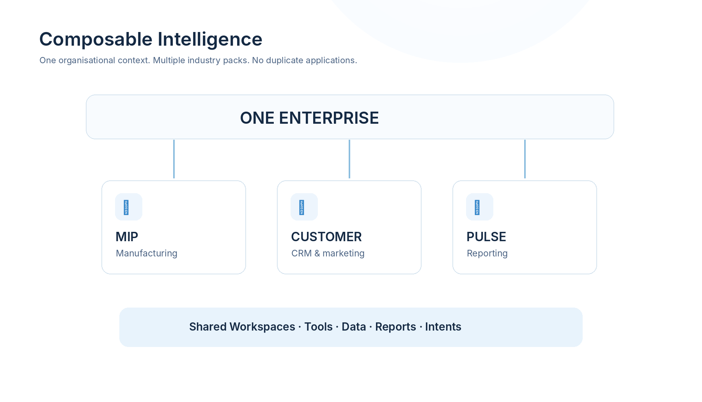

Figure 32.1 — Multiple industry packs share one enterprise and its governed services.

## 32.1 Composition principles

- Each Industry Pack declares domain entities, standard Workspace blueprints, specialist tools, metrics, report definitions and automation templates.

- A Workspace may use capabilities from multiple entitled packs, subject to a clear primary owner and conflict-free business semantics.

- A common integration can be consumed by more than one Workspace through distinct, audited bindings.

- Conflicting calculations, policy definitions or tool names must be resolved explicitly at configuration time, not guessed by the model.

- Licensing and permissions determine pack availability; UI visibility is not a substitute for backend authorisation.

## 32.2 Cross-pack reference journey

A manufacturer receives an increase in customer orders. The Sales Workspace invokes Customer & Marketing Intelligence for demand trends, MIP for plant capacity and material constraints, and Pulse for working-capital and margin scenarios. A consolidated answer is produced with source references. Any proposed production schedule change remains an approved action, not a silent consequence of analytical reasoning.

| **Concern**            | **Required architecture behaviour**                                 |
|------------------------|---------------------------------------------------------------------|
| Identity               | One organisation hierarchy with company/plant/department scopes     |
| Data ownership         | Source system remains system of record; no uncontrolled duplication |
| Tool routing           | Intent Planner selects allowed pack tools and records selections    |
| Semantic compatibility | Canonical object mappings plus pack-specific vocabulary             |
| Observability          | Trace cross-pack source reads, tool steps, approvals and cost       |
| Governance             | Policy checks apply across every pack and Workspace boundary        |

# 33 Verifiable, temporal and evidence-linked intelligence

Every consequential analytical output should be accompanied by an Intelligence Evidence Record: the exact data snapshot or version, business period, source references, tool and formula versions, model configuration, access policy evaluation and validation outcome. This enables users and auditors to reproduce a report or understand why two answers differ.

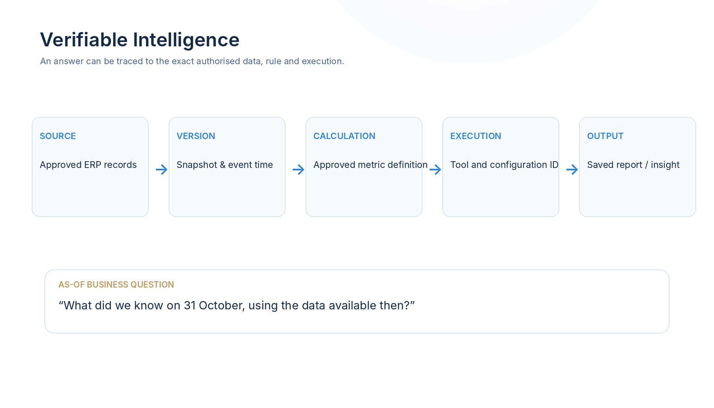

Figure 33.1 — Verifiable intelligence captures data, method, execution and output provenance.

## 33.1 Point-in-time analysis

The platform should distinguish valid business time (when an event was effective) from record/observation time (when the platform learned about it). This supports questions such as “What did the bank know on 31 October?” without incorporating records that were only discovered in November. Where sources cannot support a historical as-of reconstruction, the system must disclose that limitation.

## 33.2 Required evidence fields

| **Evidence field**             | **Purpose**                                                  |
|--------------------------------|--------------------------------------------------------------|
| source_refs / source_versions  | Trace approved originating systems and snapshots             |
| business_period / observed_at  | Make the analysis time-bounded and reproducible              |
| metric_definition_version      | Preserve the exact calculation semantics                     |
| tool_trace / model_config      | Identify analyses performed and relevant model configuration |
| validation_status / exceptions | Show reconciliation and known limitations                    |
| access_policy_hash             | Reconstruct the effective permission policy where permitted  |
| artifact_id / output_digest    | Link the saved report or result to its immutable evidence    |

## 33.3 Truthfulness and uncertainty

- Display verified values separately from projections, assumptions and inferred explanations.

- Expose source freshness and known data gaps in high-impact analyses.

- Store evidence links for generated Reports and important proactive Insights.

- Do not claim causation from correlations without an appropriately supported methodology.

- Permit redaction and retention controls without breaking the audit trail required by policy.

# 34 AI Business Discovery Consultant and specification generation

A new prospect may not arrive with a complete BRD, FSD or TSD. Otic should offer an internal Business Discovery Assistant that conducts structured interviews, reviews authorised sample documents, maps observed operational processes and generates first-draft specifications. Drafts shall clearly mark customer-confirmed facts, AI recommendations and unanswered questions.

## 34.1 Discovery to specification sequence

1\. Interview business sponsors to establish outcomes, measures and cost of inaction.

2\. Import approved departmental chart, sample Excel reports, policies and system inventory.

3\. Identify candidate Workspaces, missing inputs, integrations and operating pain points.

4\. Draft a BRD and trace each assertion to an interview or source artifact.

5\. Develop the FSD user journeys: chat, Workspace, report, automation, approval and notifications.

6\. Prepare the TSD assumptions: data interfaces, hosting, security, data residency, performance and deployment.

7\. Run an engineering gap assessment against certified platform components.

8\. Obtain customer review and approval before configuration compilation.

## 34.2 Human-in-the-loop questions

Questions should be ranked by business impact. For example, “What constitutes a critical production delay?”, “Which person may approve a purchase requisition?”, “How is risk-tier eligibility defined?”, or “Which drawing version is approved?” The assistant should not invent policies to fill gaps.

> **COMMERCIAL BENEFIT**
>
> This can shorten discovery and standardise proposal quality, but it does not remove the need for technical access validation, domain experts or formal customer sign-off.

# 35 Generative Intelligence Interfaces in conversation

The universal chat shall be able to render trusted, structured interactive artifacts based on a user request. The AI generates a typed UI description referencing components in an approved registry; the browser renders those components. It must not execute model-authored JavaScript, untrusted markup or arbitrary action handlers.


Figure 35.1 — The shell stays fixed; analytical components appear within the conversation.

## 35.1 Trusted component catalogue

| **Component**        | **Example use**                               | **Validation requirement**                           |
|----------------------|-----------------------------------------------|------------------------------------------------------|
| Chart / KPI strip    | Manufacturing output, credit portfolio trends | Approved data binding and labelled periods           |
| Data table / pivot   | Inventory, claims, campaign performance       | Pagination, authorization and exports                |
| Report viewer        | Saved Excel, PDF or interactive report        | Artifact identity, permission and version            |
| Map / route          | Shipment patterns and delivery corridors      | Validated geospatial inputs and source timestamps    |
| BIM / drawing viewer | Architectural model coordination              | Trusted renderer and provenance of model files       |
| Approval control     | Approve an automation or prepared action      | Server-side policy and anti-forgery validation       |
| Scenario sliders     | Simulate cost, demand and portfolio changes   | Explicit assumptions and certified calculation tools |

## 35.2 Implementation contract

An artifact schema should declare component type, schema version, title, source bindings, permitted interactions, refresh strategy, access scope and accessibility labels. The orchestrator may select or parameterise a component; the UI renderer must validate the schema and block unknown fields or actions. A result requiring persistence becomes a saved Report artifact; otherwise it may remain a transient conversation component.

## 35.3 Design safeguards

- No permanent right-hand sidebar; an expandable canvas may be opened only on demand.

- Use consistent typographic scale, mobile adaptation and keyboard access.

- Make data source and generation status visible on meaningful analytics.

- Never imply the generated UI has authority to update records without policy checks.

- Use fixed component layouts for high-risk workflows where variability would reduce clarity.

# 36 Continuous business process discovery and optimisation

The BRD explains the intended process; enterprise event histories often reveal the actual process. A Process Discovery extension should analyse authorised event logs, transaction histories and workflow traces to identify rework, bottlenecks, duplicate approvals and manual reconciliation. This should be implemented as a specialist analytic tool, not as another standalone application.

## 36.1 Reference methodology

1\. Define a business process and its relevant case/object identities.

2\. Connect event logs with timestamps, activity labels and participant roles.

3\. Validate completeness and business meaning before analysis.

4\. Discover the observed process and compare it with approved SOPs or the FSD.

5\. Quantify cycle time, rework, exceptions and avoidable effort.

6\. Propose elimination, redesign or automation—distinguishing the three approaches.

7\. Validate impact and approve the revised workflow before rollout.

## 36.2 Industry examples

| **Product**          | **Discovery opportunity**                                               |
|----------------------|-------------------------------------------------------------------------|
| MIP                  | Duplicate spreadsheet approval steps between procurement and production |
| CIP                  | Manual handoffs causing origination or underwriting delays              |
| IIP                  | Repeated data-entry and claims-document review delays                   |
| LIP                  | Matter intake, review and sign-off bottlenecks                          |
| Logistics            | Shipment status handoffs and recurrent dispatch exceptions              |
| Culinary             | Kitchen preparation delays and ingredient handling waste                |
| Architecture         | Drawing revision loops and coordination review bottlenecks              |
| Customer & Marketing | Lead qualification and follow-up leakage                                |
| Pulse                | Report preparation, reconciliation and distribution bottlenecks         |

# 37 Collaborative agents and cross-Workspace orchestration

The Intent Orchestrator may delegate bounded analytic tasks to specialised domain workers. A worker could be a deterministic tool, a retrieval pipeline or an AI agent. Agent creation is justified by genuine autonomy or planning needs—not simply because a department exists. All delegation must use typed contracts and enforce the initiating user’s effective authority.

## 37.1 Cross-department investigation example

An Executive asks why manufacturing profitability declined. The orchestrator creates independent scoped analysis tasks for Production, Procurement, Finance and Sales. It combines the results, identifies contradictions, requests missing evidence where needed and generates a consolidated Executive Report. Each worker has a time budget, token budget, permitted source list, output schema and trace identity.

## 37.2 Coordination protocol

| **Boundary**                     | **Recommended pattern**                                            |
|----------------------------------|--------------------------------------------------------------------|
| Inside Otic single runtime       | Typed internal orchestration with durable task IDs                 |
| Across independent agent vendors | Interoperability protocol only after compatibility/security review |
| Across Workspaces                | Per-task delegated scopes and source-level policy enforcement      |
| On conflicting results           | Evidence comparison, not simple model voting                       |
| On errors / timeout              | Partial result with explicit missing sections and retry status     |
| On execution                     | Human approval and separate Action Service                         |

# 38 Adaptive Workspaces, Intent Registry and Outcome Intelligence

Workspaces should be capable of proposing governed enhancements based on usage patterns, new approved requirements and persistent operational gaps. The system may recommend additional KPIs, a report definition, an automation template or a new data binding, but shall never silently revise enterprise policy or increase its own permissions.

## 38.1 Recommendation lifecycle

1\. Observe recurring user requests, report creation and approved event histories.

2\. Identify a candidate enhancement and its source evidence.

3\. Check whether a certified template or tool already satisfies the need.

4\. Draft a change proposal with business value, affected components and risk level.

5\. Test in a configuration sandbox or Shadow Mode.

6\. Obtain approval and record the configuration version before release.

## 38.2 The four distinct objects

| **Object** | **Definition**                                | **Example**                                    |
|------------|-----------------------------------------------|------------------------------------------------|
| Intent     | Approved business objective                   | Protect production continuity                  |
| Insight    | Evidence-backed detected condition            | Material shortage may disrupt a run            |
| Automation | Executable monitoring / response procedure    | Daily stock monitoring and approved escalation |
| Outcome    | Observed consequence and attribution evidence | Fewer interruptions after intervention         |

## 38.3 Intelligence Inbox and Notification Policy


Figure 38.1 — Actionable insight delivered inside the existing conversation experience.

The Intelligence Inbox shall be accessible from the current Workspace and through an Automations view, not through an additional permanent sidebar tab. Notifications are classified as Informational, Advisory, Important or Critical. Deduplication, grouping, confidence, quiet hours, role routing and response tracking must prevent alert fatigue.

## 38.4 Decision Journal and business measurement

Each substantive intervention should link the triggering condition, evidence, recommendation, human decision, executed action and measured outcome. Outcome metrics need baselines, business periods, provenance and explicit caveats about attribution. The engine may propose subsequent optimisations but cannot claim an intervention caused an improvement without sufficient evidence.

# 39 Shadow Intelligence and progressive releases

Before activating a high-impact automation or a new inference policy, Otic shall support Shadow Mode: the system receives the relevant events and proposes decisions without performing external actions. Engineers compare results with approved historical cases and observed business outcomes, then graduate through limited release gates.

## 39.1 Release ladder

| **Gate** | **Behaviour**                                    | **Approval evidence**                          |
|----------|--------------------------------------------------|------------------------------------------------|
| Sandbox  | Synthetic and test data, no real actions         | Component, security and workflow tests         |
| Replay   | Historical production events, non-executing      | Precision, recall and incident-specific review |
| Shadow   | Read-only live observations, no outbound actions | False-positive rate and no-leakage review      |
| Pilot    | Limited users or sites; approved action scopes   | User acceptance and monitoring thresholds      |
| Scaled   | Broader controlled rollout                       | SLOs, rollback procedures and sign-off         |

## 39.2 Evaluation dimensions

- Business correctness: validated calculations and policy outcomes.

- Intelligence quality: supporting evidence, useful insights, false-positive and false-negative rates.

- Action safety: no unauthorised external communication, write-back or data access.

- Reliability: duplicate-event handling, retry outcomes, recovery and latency.

- Economics: compute cost, Otic Credits, user effort saved and operating value.

# 40 Industry Pack SDK, Connector SDK and certification

Otic shall establish a controlled development kit enabling its engineering teams and approved contributors to publish new Industry Packs and Connector Plugins that conform to stable platform contracts. An extension shall not be allowed to change the universal shell or bypass the shared policy enforcement layer.

## 40.1 Industry Pack package

| **Manifest field**   | **Required content**                                          |
|----------------------|---------------------------------------------------------------|
| identity             | Name, version, domain, owner and dependencies                 |
| semantic_schema      | Entities, synonyms, metric definitions and relationships      |
| workspace_blueprints | Department, project or matter templates                       |
| specialist_tools     | Typed input/output schemas, policy needs and evaluations      |
| report_templates     | Artifact definitions and reconciliation tests                 |
| automation_templates | Triggers, actions, approvals and test scenarios               |
| intent_templates     | Monitored objectives and notification policies                |
| compatibility        | Minimum platform version, migrations and supported connectors |

## 40.2 Certification before publication

1\. Validate schemas and digital signatures.

2\. Verify declared permissions and data classifications.

3\. Run contract, unit, integration and security tests.

4\. Execute domain-specific accuracy and negative-path evaluations.

5\. Confirm upgrade, rollback and interoperability behaviour.

6\. Publish a signed version to the internal registry and release catalogue.

# 41 Enterprise entitlements, commercial configuration and Otic Credits

The platform shall separate commercial access from the technical availability of a capability. An enterprise may activate more than one Industry Pack under its subscription. Entitlements, usage limits, allowed connectors and privileged tool access must be enforced in backend policy rather than only by hiding controls in the frontend.

## 41.1 Entitlement categories

| **Category**        | **Examples**                                       | **Enforcement point**                 |
|---------------------|----------------------------------------------------|---------------------------------------|
| Industry Pack       | MIP, Pulse, IIP, CIP                               | Configuration and tool registry       |
| Workspace allowance | Departments / sites / specialised contexts         | Workspace provisioning                |
| Connector tier      | Standard / enterprise / premium connectors         | Connection registry and query service |
| Automation tier     | Active workflows, event throughput, action classes | Workflow creation and execution       |
| Otic Credits        | Pooled or allocated intelligence usage             | Model gateway and cost meter          |
| Advanced outputs    | BIM, multimodal, deep simulation                   | Specialised tool service              |

## 41.2 Usage accounting and spend control

Each invocation should emit a metering record referencing tenant, Workspace, tool, model, token/compute amount, execution ID and billable policy. The cost governance service shall support customer-visible usage summaries, pooled Otic Credits, thresholds, alerts and explicit treatment of deployment or discovery phases where usage is commercially different.

## 41.3 Intelligent compute routing

Use deterministic SQL or a certified formula service when a calculation is fully specified. Use retrieval for factual documents and a reasoning model only when synthesis or uncertain interpretation is required. This minimises cost and improves reproducibility without weakening analysis quality.

# 42 Reliability, migration, mobile and edge operations

## 42.1 Customer provisioning and onboarding

Customer onboarding should be a repeatable controlled pipeline: establish tenant and organisation hierarchy; activate entitled packs; provision users and groups; apply Workspace Blueprints; configure connectors and secrets; validate mappings; instantiate report templates and draft automations; perform UAT; and activate monitoring. Every step must be recoverable and auditable.

## 42.2 Reliability targets

Availability, response time, report latency, data freshness, recovery time and recovery-point objectives shall be specified per service and contractual criticality. Otic should define service-level indicators, objectives and an error-budget policy before rolling high-risk autonomous actions into production. No one universal numerical target should be assumed across all industries.

## 42.3 Existing customer migration

1\. Inventory existing tenant users, data connections, generated reports, templates, automations and history.

2\. Map each legacy object to its canonical equivalent and record data ownership.

3\. Migrate into a separate validation environment using idempotent scripts.

4\. Reconcile totals, formulas, permissions and event histories.

5\. Run parallel operations for critical reports and workflows.

6\. Obtain approval, cut over with a rollback plan and archive retired state appropriately.

## 42.4 Mobile, offline and edge

MIP on the Go, logistics operations, kitchen inspections and field architectural visits may require intermittent connectivity. The mobile client should queue explicitly permitted observations, encrypt temporary storage and synchronise through conflict-aware APIs. High-impact decisions or operations dependent on live source data should remain blocked or subject to enhanced approval while offline.

# 43 Contextual agent authority and defence in depth

An agent shall not inherit all permissions held by a human user. Its effective authority must be the intersection of user permissions, Workspace policy, Industry Pack entitlement, declared workflow scope and tool-level restrictions. Every read, external communication and write-back action is checked at execution time, not merely when a conversation begins.

## 43.1 Bound delegation model

| **Security control**     | **Engineering requirement**                                          |
|--------------------------|----------------------------------------------------------------------|
| Purpose binding          | Agent tasks are limited to an approved business Intent               |
| Minimum scopes           | Data and action permissions narrower than or equal to user authority |
| Context boundaries       | No cross-tenant or cross-Workspace retrieval without permission      |
| Tool allowlists          | Calls only registered, versioned and policy-approved tools           |
| Egress controls          | No arbitrary external endpoint or sensitive data export              |
| Human approval           | Separate sign-off for material or regulated actions                  |
| Circuit breakers         | Emergency pause, key revocation, budgets and rate limits             |
| Prompt injection defence | Source material treated as data; control plane remains authoritative |

## 43.2 Emergency controls

Administrators shall be able to suspend a Workspace, revoke a connector binding, pause an automation family, disable outbound notifications, isolate a tool version or force a new security approval. Emergency controls shall not depend on the model cooperating with the instruction.

# PART F \| Implementation-ready operating model

# 44 Reference implementation: MIP and Otic Pulse

The strongest first reference implementation is a single organisational tenant with MIP and Pulse activated together. This tests departmental Workspaces, ERP connection reuse, natural-language Excel report generation, automated monitoring and proactive Intent without duplicating the shell. It should use representative, authorised data and a scoped number of departments.


Figure 44.1 — Engineering Control Centre: the deployment path and validation gates.

## 44.1 Reference scope

| **Area**             | **Demonstration objective**                       | **Observable evidence**                              |
|----------------------|---------------------------------------------------|------------------------------------------------------|
| Tenant + entitlement | One organisation licensed for MIP and Pulse       | Entitlement and identity records                     |
| Departments          | Procurement, Production and Finance Workspaces    | Approved Blueprint manifests                         |
| Connector            | Read-only Business Central + uploaded Excel       | Query logs, freshness, access tests                  |
| Capabilities         | NL analytics and Excel recreation                 | Source-backed outputs, validated formulas            |
| Reports              | Create, save, reopen and schedule an Excel report | Persistent artifact IDs and versions                 |
| Automations          | Inventory threshold workflow in Shadow Mode       | Trigger logs, approvals and replay traces            |
| Intent               | Proactive material-shortage card                  | Evidence, routing, deduplication and acknowledgement |
| Cross-pack           | MIP + Pulse management review                     | One answer with scoped multi-source provenance       |

## 44.2 Acceptance demonstration script

1\. Upload a validated BRD/FSD/TSD bundle and approve the generated product configuration.

2\. Create the organisational hierarchy and the three department-first Workspaces.

3\. Connect the authorised ERP and import two existing Excel reports.

4\. Ask for the production-versus-plan analysis and inspect source references.

5\. Generate an Excel report, save it, reopen it from Reports and continue the conversation.

6\. Convert the report or threshold into a Draft Automation and run simulation.

7\. Feed a test stock event into Shadow Mode and inspect the in-chat Intent card.

8\. Approve the limited workflow, demonstrate action gating, and confirm audit/usage records.

9\. Activate a second pack without creating duplicate user records, connectors or interfaces.

# 45 Cross-product configuration and integration matrix

Every product retains the same frontend and shared runtime. The following mapping identifies how each Industry Pack changes the business context, data connectors, automation templates and saved-report examples.

| **Pack**             | **Core Workspace identity**                       | **Representative connectors** | **Proactive Intent example**       |
|----------------------|---------------------------------------------------|-------------------------------|------------------------------------|
| MIP                  | Production, Procurement, QA, Finance              | ERP, MES, WMS, sensors        | Protect production continuity      |
| CIP                  | Origination, Underwriting, Portfolio, Collections | Core banking, CRB, LOS        | Prevent credit deterioration       |
| IIP                  | Bancassurance, Policy, Claims, Renewals           | Policy system, CRM, messaging | Improve approved renewal follow-up |
| LIP                  | Matters, Contracts, Research, Compliance          | DMS, legal sources, e-sign    | Prevent missed legal obligations   |
| Logistics            | Fleet, Dispatch, Warehouse, Routes                | TMS, WMS, GPS                 | Maintain delivery commitments      |
| Culinary             | Recipes, Kitchen, Costing, Marketing              | POS, suppliers, inventory     | Protect menu profitability         |
| Architecture         | Concept, BIM, Costing, Coordination               | IFC, CAD/BIM, GIS             | Resolve design coordination risks  |
| Customer & Marketing | Customer 360, Sales, Campaigns                    | CRM, support, marketing       | Improve retention or conversion    |
| Pulse                | Every actual organisation department              | Excel, ERP, DB, documents     | Explain material KPI variances     |

## 45.1 Universal versus variable implementation matrix

| **Function**  | **Always shared**                               | **What BRD/FSD/TSD configures**                  |
|---------------|-------------------------------------------------|--------------------------------------------------|
| Shell         | Sidebar, chat, composer, Capabilities toggle    | Product label and context only                   |
| Workspaces    | Creation UI, runtime, templates, permissions    | Department structure, knowledge, source scopes   |
| Automations   | Builder, event fabric, durable workflow engine  | Triggers, rules, approvals, actions              |
| Reports       | Saved artifact library and standard viewers     | Templates, data mappings, retention              |
| Integrations  | Connector framework, secrets, health and events | Endpoints, field maps, permitted operations      |
| Intent        | Registry, inbox, notification policy engine     | Objectives, thresholds, relevance and recipients |
| Generative UI | Trusted component renderer                      | Which component and approved source data         |

# 46 Canonical contracts and acceptance tests

## 46.1 Proposed specification output manifest

The Configuration Compiler should publish a signed, versioned declarative artifact. The following pseudo-YAML is illustrative; field names must be finalised during detailed schema design:

```yaml
schema_version: otic.config/v2
tenant_id: <authorised_tenant>
industry_packs: [mip, pulse]
organisation: { hierarchy_ref: org_v3 }
workspaces:
  - blueprint: mip.production
    scope: { company: company_a, department: production }
    connector_bindings: [bc_production_read]
    capabilities: [explore_data, excel_intelligence, deep_intelligence]
    reports: [production_variance_v2]
    intents: [protect_production_continuity]
automations:
  - definition: material_shortage_v1
    state: draft
    action_policy: human_approval_required
release: { environment: staging, approval_status: pending }
```

## 46.2 A minimum contract for proactive intelligence

| **Property**    | **Minimum requirement**                                   |
|-----------------|-----------------------------------------------------------|
| Intent          | Approved business goal, owner, Workspace and metric       |
| Observation     | Event ID, source time, data version and validity          |
| Insight         | Claim, evidence refs, severity and confidence limitations |
| Proposed action | Typed tool/Workflow, scope, parameters and approval       |
| Delivery        | Recipient scope, channel, dedupe and escalation rule      |
| Outcome         | Decision, execution result, measured business effect      |

## 46.3 Cross-product acceptance matrix

| **Test**            | **Pass condition**                                            |
|---------------------|---------------------------------------------------------------|
| Shell invariance    | Same left navigation and composer in every product            |
| Tenant isolation    | A user cannot read another tenant’s data or artifacts         |
| Report persistence  | Created report reopens identically with provenance            |
| Connector scope     | Read-only binding cannot execute write actions                |
| Intent card         | Actionable insight links to evidence and correct Workspace    |
| Automation safety   | Approval required; retries cannot duplicate an action         |
| Product composition | Multiple packs share tenant identity without data leakage     |
| Shadow / rollback   | No live external side effect; rollback restores prior config  |
| Temporal analysis   | As-of response excludes later-unavailable information         |
| Usage               | Metered executions attributed correctly to tenant / Workspace |

# 47 Technical delivery sequence and decision gates

The following sequence balances implementation discipline with rapid value delivery. It is a capability sequence rather than a commitment to calendar dates. Phase gates should be objectively testable and aligned with customer acceptance.

| **Phase**                | **Deliverables**                                            | **Gate**                                                |
|--------------------------|-------------------------------------------------------------|---------------------------------------------------------|
| 0 — Contracts            | Canonical entities, config schemas, API and event contracts | Architecture + security sign-off                        |
| 1 — Shell & Workspace    | Universal UX, identity, tenant hierarchy, template registry | One tenant creates Workspace and conversation           |
| 2 — Connectors & Reports | Reusable read connectors, semantic layer, artifact store    | Existing Excel outputs reconcile                        |
| 3 — Automations & Intent | Durable workflows, event fabric, approvals, in-chat Insight | Shadow scenario passes failure and safety tests         |
| 4 — Composition & UX     | Multi-pack entitlements and trusted generative UI           | Cross-pack query and artifact render pass               |
| 5 — Industrialise        | SDKs, certification, migration, observability and SLOs      | Reference customer meets production-readiness checklist |

## 47.1 Ownership and accountability

- Platform Architect: versioned component boundaries, canonical contracts and architecture decision records.

- Frontend Lead: universal shell, responsive layout, trusted component rendering and accessibility.

- Backend Lead: Workspace, report, automation, connector and identity services.

- AI/Agent Lead: tool orchestration, model gateway, evaluation and prompt/tool boundary testing.

- Domain Leads: Industry Packs, semantic definitions, report acceptance and specialist-tool correctness.

- Security & Compliance: authorisation, secrets, audit, external communication policies and incident controls.

- Delivery & Customer Product Owner: requirement validation, UAT, training and acceptance.

## 47.2 Definition of ready for production

1\. Approved BRD/FSD/TSD traceability and signed configuration manifest.

2\. Documented source-system ownership, data lineage and data-freshness tests.

3\. Passed functionality and reconciliation tests for every in-scope report.

4\. Passed tool-authorisation, penetration and agentic misuse scenarios.

5\. Passed Automation replay, duplicate event, approval and failure-recovery tests.

6\. Documented SLOs, operational monitoring, cost budgets and escalation ownership.

7\. Tested rollback, customer acceptance and support handover.

# 48 Engineering handover, decisions and final doctrine

## 48.1 Decisions required from leadership

| **Decision**          | **Proposed default**                                                                    |
|-----------------------|-----------------------------------------------------------------------------------------|
| Product code strategy | One shared platform repository with modular domains; split services only when justified |
| Workspace identity    | Department-first with permitted project, matter and cross-functional scopes             |
| Capabilities          | Eight primary options; advanced tools in expandable catalogue                           |
| Report creation       | Natural-language-first; Reports page stores generated artifacts                         |
| Automations           | Draft → Test → Approve → Active; Shadow Mode for sensitive workflows                    |
| Intent notifications  | In-chat cards plus existing Workspace/Automation views; no added main sidebar           |
| Connector policy      | Read-only first, progressive write privileges with verified results                     |
| Industry Packs        | Reusable and composable, versioned and separately entitled                              |
| Deployment            | Configuration-first with immutable manifests and safety gates                           |

## 48.2 Engineering handover artifacts

- Reference diagrams and agreed Architecture Decision Records (ADRs).

- Canonical configuration schema and object lifecycle specification.

- OpenAPI and event contract definitions for each shared service.

- Approved Workspace, Report, Automation, Intent and Connector manifests.

- Domain validation datasets and golden-reference reports.

- Shadow and end-to-end test scripts for the initial reference customer.

- Deployment runbook, monitoring dashboards, on-call ownership and incident response procedures.

- Commercial entitlement, Otic Credits and cost accounting policies.

## 48.3 The final governing principle

> **OTIC ENGINEERING DOCTRINE**
>
> One reusable frontend and backend. The BRD, FSD and TSD define the customer-specific intelligence identity. Workspaces provide the operational context; universal Capabilities invoke specialised tools; Automations carry out approved work; Reports preserve generated outputs; integrations connect systems of record; and Intelligence with Intent detects what matters, supports action and measures outcomes.

The architecture should evolve through reusable, governed components and verifiable configuration releases. Every proposed new feature must first be tested against the existing component registry: reuse, configure, extend and only then build custom. Commercial scale should come from a growing platform and pack ecosystem—not an expanding collection of disconnected applications.

# Appendix \| Reference standards and technology considerations

The following are engineering references to evaluate during TSD design, not commitments to particular vendors or versions: OpenAPI for HTTP service contracts; AsyncAPI and CloudEvents for message/event contracts; MCP for selected tool interoperability; BPMN/DMN for workflow and decision specification; IFC/openBIM and supported CAD/BIM APIs for architectural data; OpenTelemetry for tracing; OpenLineage for data provenance; OpenFeature for entitlements and rollout controls; NIST AI RMF and OWASP agentic security guidance for governance and evaluation. Validate current specifications, licensing and vendor constraints before implementation.

Scope: this is a target-state engineering reference. Interface mockups, illustrative data and example workflows are conceptual—not claims of existing deployments. All nine Industry Packs are covered; customer-specific commitments require approved specifications and a validated release plan.

> **PUBLICATION PRINCIPLE**
>
> Build the shared platform once. Configure intelligence by industry and customer specification. Measure outcomes, preserve human authority and release improvements through governed validation.


Otic Technologies \| Universal Intelligence Architecture \| Premium Engineering Reference
