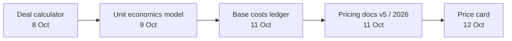
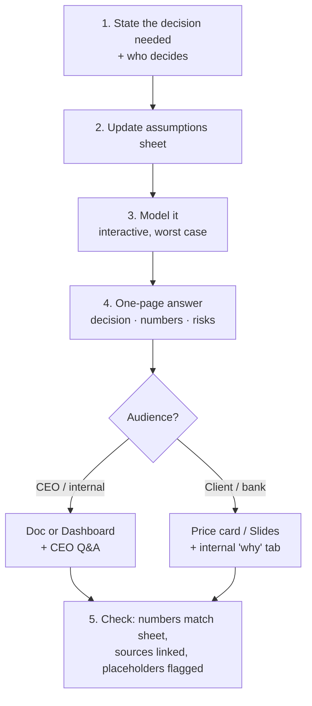

# How I Create Work — Playbook

*Built from my six Claude artifacts (8–12 Oct 2026). Use this as the brief for any future piece.*

> **Scope note:** none of these were made on the Claude Design canvas. They are 4 interactive HTML pages and 2 Claude Docs, all on IIP pricing. Add any Claude Design links to extend this guide.

---

## 1. What I've made so far

| Date | Artifact | Format | Audience | Job it did |
|---|---|---|---|---|
| 8 Oct | IIP Bancassurance Pricing | Interactive calculator | Internal / Pearl Bank deal | Price one deal, two scenarios side by side |
| 9 Oct | IIP Unit Economics | Interactive model (levers + charts) | CEO | Portfolio margin, break-even, tier mix |
| 11 Oct | IIP Base Costs | Static ledger page | Internal | Sourced cost per claim / lead / month |
| 11 Oct | IIP Pricing 2026 | Doc (~4.2k words, 18 tables) | CEO / sales | Package definitions + Q&A |
| 11 Oct | IIP Pricing v5: 80% After All Costs | Doc (~3.9k words, 11 tables) | CEO | Margin target test |
| 12 Oct | IIP Price Card | Client card + internal "why" tab | Clients + CEO | Final prices, benchmarked to CIP |

**Pattern:** I start with a specific deal, widen to the model, ground it in costs, write it up, then ship one clean client-facing output.

---

## 2. What works — keep doing it

- **Answer first.** "The answer", "Decision for the CEO" open the piece. Detail follows.
- **Worst-case test.** Margins proven at full usage, costliest item, all costs in.
- **Anticipate the CEO.** A "Questions you'll be asked" section with live answers.
- **Two views, one page.** Client-facing front + internal justification tab (Price Card).
- **Levers, not static numbers.** Every assumption editable; everything recalculates.
- **Benchmark.** Side-by-side with a known reference (CIP).
- **Flag placeholders.** Unknowns (Sunbird price, overhead) labelled, not hidden.
- **Close with decisions + sources.** "Decisions and what to confirm", then links.
- **Plain language.** "Profit as % of cost", "what it costs us", no jargon.

---

## 3. What to fix

| Problem seen | Fix |
|---|---|
| Three different looks (navy/amber, teal/Plex, Segoe dashboard) | Make an **Otic / IIP Design System** once; use it for every page and deck |
| Numbers drift between pieces (UGX 1.5M–90M → UGX 2–6M → $529–1,759) | One **assumptions sheet** as the single source; every artifact reads from it |
| Currency switches (UGX vs USD) | Pick one per audience: **USD for card/CIP, UGX for Ugandan banks**; always show the rate |
| Docs run ~4k words — too long to skim | **1-page summary** up front; detail in tabs or an appendix |
| Versions scattered ("v5", "v8", "2026") | Name as `IIP <Topic> — v<N> — <date>`; mark old ones **Superseded** |
| Decisions buried at the end | Put the decision box **at the top** too |

---

## 4. My default workflow

---

## 5. Pick the right format

| I need… | Use |
|---|---|
| A number I can play with | **Dashboard** artifact (sources traceable) |
| A decision write-up | **Doc** — 1-page summary + appendix |
| To pitch a bank / CEO meeting | **Slides** (from the Design System) |
| A client price sheet or one-pager | **Design** canvas |
| Shared assumptions / cost inputs | **Sheet** |
| A consistent look | **Design System** (build once) |

---

## 6. House style checklist

- [ ] Title: `IIP <Topic>` — 2–4 words
- [ ] First screen: the answer + decision needed
- [ ] Bullets and tables over prose; diagrams where flow matters
- [ ] Tabular numbers; one currency, rate stated
- [ ] Worst case shown alongside typical case
- [ ] CEO Q&A section
- [ ] Placeholders labelled
- [ ] "Decisions / to confirm" + Sources at the end
- [ ] Light and dark mode; works on phone
- [ ] Old versions marked superseded

---

## 7. Prompt starters

**New analysis**
> Using my IIP assumptions sheet, build a [dashboard/doc] on **[question]** for **[CEO / bank name]**. Lead with the answer and the decision needed. Show worst case. Add CEO questions with live answers. Bullets and tables, under one page before the appendix. Use the IIP design system.

**Client-facing piece**
> Turn **[artifact]** into a client one-pager in Claude Design: prices, what's included, who it's for. Keep the internal justification on a separate tab. [USD/UGX] only.

**Update**
> Update **[artifact]** to the latest figures in the assumptions sheet. List what changed at the top. Mark the old version superseded.

---

## 8. Next three moves

1. Build the **Otic / IIP Design System** (colours from the Price Card: navy `#0f128c`, amber `#e9a124`, Libre Franklin).
2. Move every assumption into **one IIP Assumptions sheet**.
3. Mark Bancassurance Pricing, Unit Economics and Pricing v5 as **superseded** by the Price Card, or refresh them to its numbers.
