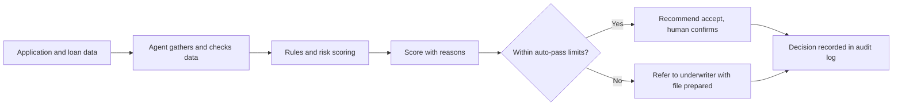
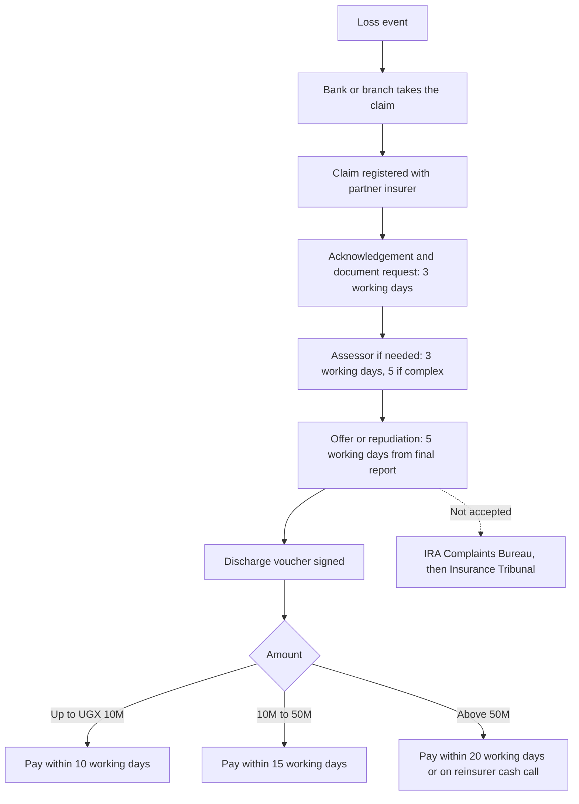
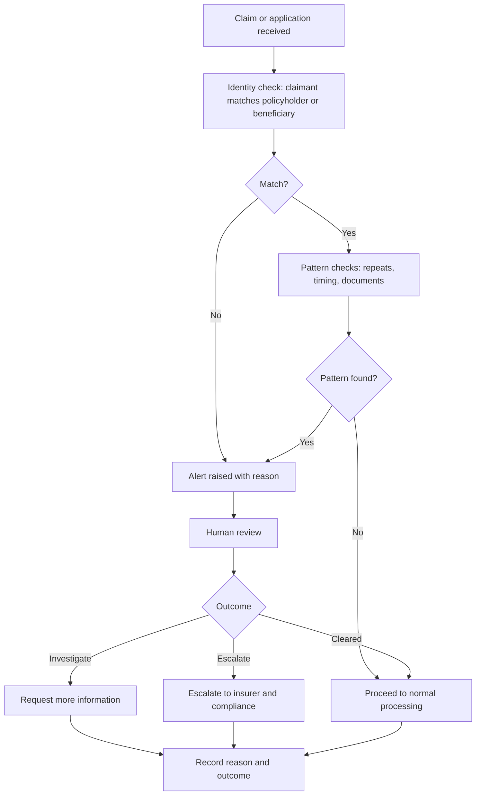
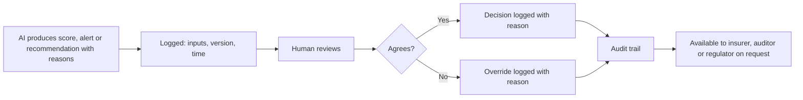
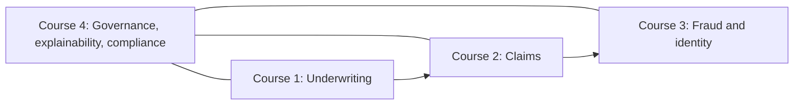

# IIP Training Courses: Brief for Claude Code

## 0. What this document is

This is a build brief. You (Claude Code) will build **example course pages** for four AI training courses delivered with the **Insurance Intelligence Platform (IIP)**. You will also **capture screenshots of the real IIP screens** that each course teaches against, and place them in the course pages.

The courses are being prepared for the bancassurance team at a Ugandan bank, but the content must read as a reusable IIP training catalogue. Do not hard-code the bank's name or any named individual into course pages.

Read this whole document before writing any code.

---

## 1. Context you need

### 1.1 What IIP is

IIP is an AI-powered intelligence layer for insurers. Its landing page lists these capabilities:

- Intelligent underwriting (AI-assisted decision support)
- Claims intelligence (faster reviews, bottleneck detection)
- Fraud detection (suspicious pattern detection)
- Portfolio monitoring
- Risk scoring (transparent assessments)
- Operational analytics
- Governance: audit logging, tenant isolation, explainable AI, Azure native architecture

### 1.2 Why these four courses

Research on how insurance claims and bancassurance work in Uganda (see `uganda-insurance-claims-systems.md` if it is in the repo or shared with you) points to four needs:

1. In bancassurance, **loan-linked cover** (credit life, asset finance cover, crop cover on agriculture loans) is the core business, so underwriting and referral quality matter.
2. The bank is the **claims intake point** while the partner insurer decides and pays. Tracking claims against the regulator's service standards is a daily need.
3. Credit-linked claims pay large sums and depend on **paying the right person**, so identity and fraud controls matter. National ID numbers (NIN) held by NIRA can be verified digitally by licensed financial institutions.
4. Every AI-assisted decision must be **explainable, auditable and compliant** to stand up to insurer, regulator and bank review.

### 1.3 Facts you may use in course content (sourced)

| Fact | Use |
|---|---|
| IRA claims service standards: acknowledge and request documents within 3 working days; assessor within 3 working days (5 if complex); offer or repudiation within 5 working days of the final report; payment within 10 working days (up to UGX 10M), 15 working days (above 10M up to 50M), 20 working days or on reinsurer cash call (above UGX 50M), all counted from the signed discharge voucher | Claims course SLA logic |
| A repudiation needs a written reason, and disputes go to the IRA Complaints Bureau then the Insurance Tribunal | Claims and governance courses |
| A NIN is a 14-character alphanumeric number issued by NIRA | Fraud and identity course |
| Financial institutions, including insurers, can access NIRA for digital KYC, and the Bank of Uganda requires ID verification for transactions of UGX 1 million and above | Fraud and identity course |
| Bancassurance in Uganda is an agency model: the bank sells and supports, the insurer underwrites and pays | All courses, especially underwriting |

### 1.4 Rules for what you write

- **Never invent IIP features.** Describe only what the platform actually does. If a screen or feature does not exist, say so in the manifest (section 3.5) and mark it **PROPOSED, NOT BUILT**. Do not fake a screenshot.
- **Outcome percentages** (60, 45, 35, 92) appear on the IIP landing page. Do not present them as measured results. If you mention them, label them **targets**.
- **Certification wording:** use "certificate of completion". Do not claim an accredited qualification.
- **No real customer data** in any screenshot or example. Use synthetic data only (section 3.4).
- **Agency model:** the partner insurer makes the underwriting decision. Frame IIP as improving the bank's pre-screening, referral quality and monitoring, not as replacing the insurer's decision.
- **Style:** plain language, short sentences, no jargon without a definition. **Do not use em dashes anywhere** in page copy, comments, or this build's documentation. Use commas, colons or full stops.
- **Visual first:** every module needs at least one diagram or screenshot before long text. Prefer flowcharts and annotated screens to paragraphs.

---

## 2. What to build

### 2.1 Deliverables

1. A **course catalogue page** listing all four courses.
2. For **each course**: a **course landing page** plus **one fully built example module page** (the module marked "build this one" below).
3. A **screenshots folder** and **manifest** (section 3).
4. A short `BUILD_NOTES.md` listing what was built, what was captured, what is missing, and any questions.

### 2.2 Tech and design

- Inspect the existing IIP front end first (framework, component library, design tokens, fonts, colours). **Reuse them** so the course pages look like part of IIP.
- If there is no obvious front end to match, build static HTML with a single CSS file and no build step, and say so in `BUILD_NOTES.md`.
- Pages must be responsive and readable on a laptop projector and on mobile.
- Support light and dark themes if the platform does.
- Diagrams: use Mermaid blocks (render them in the page) or inline SVG. Mermaid labels must be quoted.
- Where to put things: `training/` at the repo root (or the closest sensible location), with `training/screens/` for images.

### 2.3 Page template for every module

Each module page uses the same structure:

1. **Title and one-sentence goal**
2. **What you will be able to do** (3 to 5 outcomes, each starting with a verb)
3. **The idea in one picture** (diagram)
4. **In IIP: where this lives** (annotated screenshot with numbered callouts)
5. **Worked example** (synthetic case, step by step, referencing the callouts)
6. **Try it yourself** (an exercise done in IIP with a clear expected result)
7. **Check your understanding** (3 to 5 questions with answers and reasons)
8. **Key takeaways** (3 bullets)
9. **Next module** link

### 2.4 Course landing page template

Title, who it is for, estimated duration (proposed values below, label as proposed), the aim in IIP's context, module list, the IIP modules used, the final exercise, and the certificate of completion criteria.

---

## 3. Screenshot instructions

### 3.1 Goal

Capture the real IIP screens that demonstrate what each course teaches, so the course pages show the actual platform and not mockups.

### 3.2 How to capture

1. Work out how to run IIP locally or find its running URL. Check the repo README, environment files and package scripts. If login or a URL is needed and you cannot find it, **stop and ask me** rather than guessing.
2. Use **Playwright** (or the repo's existing browser tooling) to capture.
3. Settings: viewport **1440 x 900**, device scale factor **2**, light theme first, then dark theme for the screens listed as "also dark".
4. Capture the **full relevant region**. Crop to the meaningful element where a full page would be noisy. Keep browser chrome out.
5. Wait for data and charts to finish loading before capturing. Disable animations if they cause blur.
6. Use **demo or seed data**. If no demo data exists, create synthetic records (section 3.4) and note that you did.
7. After capturing, **add numbered callouts** (small circled numbers) over key areas. Save both the clean and the annotated versions.

### 3.3 Naming and folders

```
training/
  screens/
    c1-underwriting/
      01-application-intake.png
      01-application-intake.annotated.png
      ...
    c2-claims/
    c3-fraud-identity/
    c4-governance/
  screens/manifest.json
```

File name format: `NN-short-slug.png` where NN is the order the screen appears in the course.

### 3.4 Synthetic data rules

- Names: obviously fictional Ugandan-style names (for example "Test Borrower A"), not real people.
- NINs: fake strings in the correct 14-character shape, clearly marked as test data. **Never use a real NIN.**
- Phone numbers: use reserved or clearly fake numbers.
- Amounts: realistic UGX figures that exercise the thresholds (below 10M, between 10M and 50M, above 50M).
- If any screenshot accidentally shows real data, **delete it and recapture**.

### 3.5 The manifest

`training/screens/manifest.json` is an array. Each entry:

```json
{
  "course": "c1-underwriting",
  "order": 1,
  "file": "c1-underwriting/01-application-intake.png",
  "annotated": "c1-underwriting/01-application-intake.annotated.png",
  "screen": "Application intake",
  "route_or_url": "<where in the app>",
  "purpose": "Shows how a loan-linked cover application enters IIP",
  "callouts": ["1: applicant fields", "2: loan details", "3: submit for assessment"],
  "theme": "light",
  "status": "captured | missing | proposed-not-built",
  "notes": ""
}
```

If a screen the course needs does not exist in IIP, set `status` to `missing` or `proposed-not-built`, explain in `notes`, and in the course page show a clearly labelled placeholder box that says **"Screen not yet available in IIP"**. Do not draw a fake interface.

---

## 4. Course 1: Agentic AI in SME and credit-linked underwriting

**Course id:** `c1-underwriting`
**Proposed duration:** 1 to 1.5 days (proposed)
**Audience:** bancassurance team, credit officers, relationship managers who prepare insurance applications

### 4.1 What we want to achieve in IIP's context

- Show how an AI agent in IIP **gathers applicant and loan data, checks it against underwriting rules, scores the risk and prepares a file** for a human decision.
- Make clear **where the agent recommends and where a person decides**. Trainees should leave knowing the human sign-off points.
- Teach trainees to **read an IIP risk score and its explanation**, and to judge whether the reasons are sound.
- Improve the **quality and consistency of pre-screening and referrals** to the partner insurer for SME and loan-linked cover (credit life, asset finance, crop cover on agriculture loans, business property cover).
- Build the habit of **challenging the score** instead of accepting it.

### 4.2 Learning outcomes

By the end, a trainee can:

1. Explain in plain words what an underwriting agent does at each step.
2. Run a loan-linked cover application through IIP and interpret the risk score.
3. Decide when to accept the recommendation, refer, or ask for more information.
4. Record the decision and the reason so it can be audited.
5. Spot a score whose explanation does not match the facts.

### 4.3 Modules

| # | Module | Teaches | IIP screens to capture |
|---|---|---|---|
| 1.1 | How an underwriting agent works | Data in, rules, score, human decision | Underwriting overview or workflow screen |
| 1.2 | Capturing a complete application | Required fields for SME and loan-linked cover; data quality | Application intake form |
| 1.3 | Reading the risk score **(build this one)** | Score, factors, explanation, confidence | Risk score result with explanation panel |
| 1.4 | Accept, refer or decline | Thresholds, referral rules, referral queue | Referral queue, decision actions |
| 1.5 | Recording decisions | Reasons, audit trail | Decision record or log entry |

### 4.4 Diagram to include (module 1.1)



### 4.5 Worked example for module 1.3 (use synthetic data)

An SME borrower applies for a loan with attached cover. IIP scores the application, lists the top factors that moved the score, and flags missing information. The trainee walks through each factor, decides whether the explanation is reasonable, and chooses accept, refer or request more information.

### 4.6 Exercise and check

- **Exercise:** three synthetic applications (clean, borderline, incomplete). For each, record a decision and a one-sentence reason in IIP.
- **Check questions:** what does a high-confidence score still not tell you; when must a person decide; what makes a recorded reason audit-ready.
- **Certificate criteria:** complete the modules, record correct decisions on at least two of three exercise cases, and pass the check questions.

### 4.7 Screens required (c1)

1. Underwriting overview or workflow
2. Application intake
3. Risk score result with explanation (annotated heavily, this is the hero screen)
4. Referral queue
5. Decision record or audit entry

---

## 5. Course 2: AI-assisted claims for bancassurance

**Course id:** `c2-claims`
**Proposed duration:** 1 day (proposed)
**Audience:** claims coordinators, branch staff who act as the claims contact, bancassurance managers

### 5.1 What we want to achieve in IIP's context

- Show how IIP's claims intelligence tracks every claim against the **IRA service standards**, so the bank can see which claims are about to breach.
- Give the bank **one view of open claims across several partner insurers**, including **turnaround comparison between insurers**.
- Teach trainees to use document completeness checks so claims are **submitted right the first time**.
- Teach trainees to give customers **accurate status updates** without waiting on insurers.
- Show how to **escalate** a stalled claim and how disputes and repudiations are handled, including the requirement for a written reason.

### 5.2 Learning outcomes

By the end, a trainee can:

1. State the IRA claim milestones and the three payment tiers.
2. Read an IIP claim timeline and say which clock is running and how much time is left.
3. Use the claims list to find claims at risk of breach and decide the next action.
4. Check a claim file for missing documents before submission.
5. Use the insurer comparison view to identify slow partners and prepare an escalation.

### 5.3 Modules

| # | Module | Teaches | IIP screens to capture |
|---|---|---|---|
| 2.1 | The life of a bancassurance claim | Who does what: bank, insurer, assessor, reinsurer | Claims overview |
| 2.2 | The IRA clocks **(build this one)** | Milestones, payment tiers, discharge voucher | Claim detail with SLA timeline and clocks |
| 2.3 | Complete files first time | Document checklist by claim type | Document checklist or completeness check |
| 2.4 | Claims at risk | Breach warnings, prioritising the list | Claims list with SLA status and filters |
| 2.5 | Comparing insurers and escalating | Turnaround by insurer, escalation steps, disputes | Insurer comparison, escalation or dispute view |

### 5.4 Diagrams to include

Module 2.1 (claim lifecycle):



### 5.5 Worked example for module 2.2 (synthetic data)

A loan-linked claim has been acknowledged and assessed. The trainee reads the timeline in IIP, finds the discharge voucher date, identifies the amount tier, calculates the payment deadline, and decides whether to chase the insurer today.

### 5.6 Exercise and check

- **Exercise:** five synthetic claims at different stages and amounts. Trainee sorts by urgency, names the running clock for each, and drafts the next action.
- **Check questions:** which date starts the payment clock; what is the deadline for a UGX 30M claim; what must accompany a repudiation.
- **Certificate criteria:** complete modules, correctly order at least four of five exercise claims, and pass the check questions.

### 5.7 Screens required (c2)

1. Claims overview or dashboard
2. Claims list with SLA status and filters
3. Claim detail with SLA timeline and clocks (hero screen)
4. Document checklist or completeness check
5. Insurer comparison view
6. Escalation or dispute view, if present

---

## 6. Course 3: AI for fraud and identity in credit-linked cover

**Course id:** `c3-fraud-identity`
**Proposed duration:** 1 day (proposed)
**Audience:** bancassurance, risk, compliance and claims staff

### 6.1 What we want to achieve in IIP's context

- Show how IIP's fraud detection surfaces **suspicious patterns** on credit-linked claims and applications, with **reasons a human can review**.
- Teach the **identity checks** around a claim: matching the claimant to the policyholder or named beneficiary, and using NIN-based verification where the insurer or bank has access.
- Teach **rules first, then models**: simple, transparent rules catch most cases and are easy to explain; statistical models improve over time with pilot data.
- Teach trainees to **read an alert without accusing a customer**. An alert is a reason to look closer, not a finding.
- Show how to **record a disposition** (cleared, investigate, escalate) so the outcome improves the system.

### 6.2 Learning outcomes

By the end, a trainee can:

1. Name the common fraud and identity risks on loan-linked cover.
2. Explain what an identity match check does and what a mismatch means.
3. Read an IIP alert, its evidence and its reasons.
4. Decide whether to clear, investigate or escalate, and record why.
5. Communicate with a customer about a flagged case respectfully and accurately.

### 6.3 Patterns to teach (rules-first)

- NIN or ID details that do not match the policyholder record
- Beneficiary or next of kin mismatch on a death claim
- The same phone number or NIN appearing across unrelated claimants
- A claim made very soon after the policy start
- Documents that are incomplete, inconsistent or reused
- Repeated claims on the same loan or account

Present these as examples of patterns, not as a complete or proven list.

### 6.4 Modules

| # | Module | Teaches | IIP screens to capture |
|---|---|---|---|
| 3.1 | Where fraud and identity risk sit | Application, claim and payout stages | Fraud overview or dashboard |
| 3.2 | Identity checks and NIN | What is verified, match and mismatch, test data only | Identity or KYC check result |
| 3.3 | Reading an alert **(build this one)** | Reasons, evidence, severity, confidence | Alert detail with reasons and evidence |
| 3.4 | Patterns across claims | Repeated phones, NINs, timing | Link or pattern view, if present |
| 3.5 | Deciding and recording | Clear, investigate, escalate, record reason | Alert queue with disposition actions |

### 6.5 Diagram to include (module 3.1)



### 6.6 Worked example for module 3.3 (synthetic data)

A death claim on a loan-linked policy raises an alert: the claimant's ID details differ from the next of kin on file, and the same phone number appears on another claim. The trainee reads the alert, weighs each piece of evidence, decides to investigate, and records the reason.

### 6.7 Exercise and check

- **Exercise:** four synthetic alerts, including one false alarm. Trainee decides and records a reason for each.
- **Check questions:** why is an alert not a finding; what should you do before telling a customer their claim is flagged; why are rules explained before models.
- **Certificate criteria:** complete modules, correctly handle the false alarm without escalating it unfairly, and pass the check questions.

### 6.8 Screens required (c3)

1. Fraud overview or dashboard
2. Identity or KYC check result
3. Alert queue
4. Alert detail with reasons and evidence (hero screen)
5. Pattern or link view, if present
6. Disposition and recording action

**Safety note for this course:** never show a real NIN or a real person in any screenshot. Use clearly fake values only.

---

## 7. Course 4: AI governance, explainability and compliance

**Course id:** `c4-governance`
**Proposed duration:** half to 1 day (proposed)
**Audience:** leadership, compliance, internal audit, risk, and course leads from the other three tracks

### 7.1 What we want to achieve in IIP's context

- Show how IIP supports **explainable decisions**: every score, alert and recommendation carries reasons that a non-technical reviewer can read.
- Show how **audit logging** records who did what, when, on what data, and what the AI recommended versus what a person decided.
- Teach **human oversight**: where review is mandatory, how overrides are recorded, and how escalation works.
- Teach **data protection basics** for the data IIP handles: national ID numbers, contact details, medical and financial information.
- Give leadership a **checklist they can use to review any AI-assisted insurance decision** and to prepare for insurer, regulator or audit questions.
- Position the course as the foundation the other three courses rely on.

### 7.2 Learning outcomes

By the end, a trainee can:

1. Explain what "explainable" means and judge whether an explanation is good enough.
2. Find a past decision in the IIP audit trail and reconstruct who decided what and why.
3. Identify the human review points in each of the other three courses.
4. Describe how access control and tenant isolation protect customer data.
5. Use the governance checklist on a sample decision.

### 7.3 Important honesty rule for this course

Do not state that IIP is certified or compliant with any named standard or law unless the repo, docs or product evidence clearly shows it. Where legal obligations apply (Uganda's data protection law, the Insurance Regulatory Authority's expectations, Bank of Uganda requirements), list them as **"to be confirmed with legal and compliance"** and add them to `BUILD_NOTES.md` as open questions. The course should teach the process of checking, not assert compliance that has not been verified.

### 7.4 Modules

| # | Module | Teaches | IIP screens to capture |
|---|---|---|---|
| 4.1 | Why governance matters in insurance AI | Stakes: money, customers, regulators | Governance overview, if present |
| 4.2 | Explainability in practice **(build this one)** | Reasons, factors, limits of explanations | Explanation panel on a score or alert |
| 4.3 | Audit trails | Who, what, when, AI versus human | Audit log with filters and a decision entry |
| 4.4 | Human oversight and overrides | Review points, override records, escalation | Override or approval record |
| 4.5 | Data protection and access | Roles, permissions, tenant isolation | User roles or access settings, tenant or isolation setting |
| 4.6 | The governance checklist | A reusable review checklist | None (checklist page), plus one audit entry as an example |

### 7.5 Diagram to include (module 4.3)



### 7.6 The governance checklist (build this as a page)

A one-page checklist reviewers can use on any AI-assisted decision:

1. What decision was made, by whom, and when?
2. What did the AI recommend, and with what reasons?
3. Were the reasons accurate against the facts?
4. Was a human review required, and did it happen?
5. If a person overrode the AI, is the reason recorded?
6. What data was used, and was it appropriate to use?
7. Who could see the data, and was access justified?
8. Could we explain this decision to the customer, the insurer and the regulator?

### 7.7 Exercise and check

- **Exercise:** given three synthetic decisions (one clean, one with a weak explanation, one overridden without a reason), apply the checklist and write up findings.
- **Check questions:** what is the difference between a log and an explanation; who needs to see an override reason; why is "the AI said so" not an acceptable reason.
- **Certificate criteria:** complete modules, correctly identify the weak explanation and the missing override reason in the exercise, and pass the check questions.

### 7.8 Screens required (c4)

1. Explanation panel on a score or alert (can reuse c1 and c3 captures)
2. Audit log list with filters
3. Single audit entry showing AI recommendation versus human decision (hero screen)
4. Override or approval record
5. User roles or access settings
6. Tenant isolation or data separation setting, if present

---

## 8. The catalogue page

Build a catalogue page with four cards, one per course, each showing the title, who it is for, the proposed duration, the one-line aim, and a link to the course landing page. Add a short "how the four fit together" diagram:



Add one line under it: "Course 4 is the foundation. Courses 1 to 3 follow the life of a credit-linked policy: underwrite, claim, protect."

---

## 9. Order of work

1. Inspect the IIP front end and find how to run it. Ask me if blocked.
2. Capture the screenshots for all four courses and write the manifest.
3. Build the catalogue page.
4. Build each course landing page and its single example module page.
5. Insert screenshots with callouts. Use placeholders for missing screens as described in section 3.5.
6. Write `BUILD_NOTES.md`.

## 10. Definition of done

- All four landing pages and four example module pages exist and look native to IIP.
- Every screenshot in the pages is real, uses synthetic data, and is listed in `manifest.json`.
- Missing screens are shown as labelled placeholders, never faked.
- No em dashes anywhere in page copy or documentation.
- No statement of compliance, certification or measured outcome that the repo or product does not support.
- `BUILD_NOTES.md` lists open questions, especially on legal obligations (Course 4) and NIRA verification access (Course 3).
