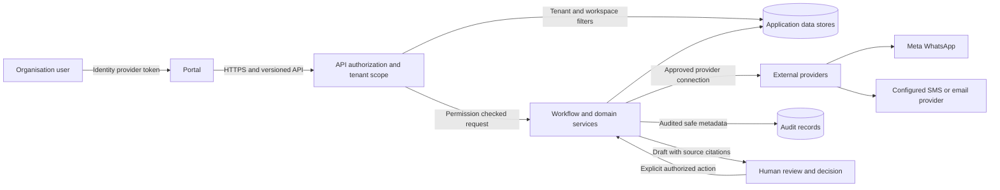

# IIP security architecture overview

**Status: discussion diagram.** It describes the application boundaries visible in the current source and does not certify a deployment configuration.

## Boundaries and controls

1. The identity provider authenticates the person. IIP resolves organisation membership and workspace context server-side.
2. API authorization checks permissions on each protected request. Browser-supplied tenant identifiers are not sufficient authority.
3. Repositories scope customer records by tenant and workspace. Current database-level row security is not configured.
4. Provider credentials are encrypted before persistence and are write-only in the portal. Secrets and verification codes are not included in audit metadata.
5. WhatsApp traffic is processed through Meta. The message path is not described as end-to-end encrypted to IIP.
6. AI produces preparatory work. A person reviews source evidence and performs consequential actions.
7. Audit records capture important actors and actions without copying document or message content. SIEM export is not available.

## Deployment facts to verify

The diagram does not establish the target deployment's region, network topology, storage encryption settings, key location, availability, backup configuration or recovery objectives. Confirm these directly for each environment before making a deployment-specific statement.
