# Bevaya Competitive Benchmark for an Uganda Insurance AI Platform

**Research date:** 16 July 2026  
**Subject:** Bevaya by Roots Automation  
**Primary sites:** [bevaya.ai](https://www.bevaya.ai/) and the [interactive product tour](https://tour.demo.bevaya.ai/)  
**Purpose:** Product, agent, architecture, integration, commercial, and user-experience benchmark for the Insurance Intelligence Platform (IIP), with specific implications for Uganda.

---

## 1. Executive assessment

Bevaya is a vertical AI workflow-automation platform for insurance operations. Its strongest public evidence is in document-heavy US property-and-casualty workflows: submission intake, loss-run processing, FNOL/FROI setup, claims indexing, claim-file summarization, endorsements, certificates of insurance, and premium audits. The core problem it solves is not general insurance reasoning. It removes manual intake, classification, extraction, validation, routing, and system-entry work that slows underwriting, claims, and policy-servicing teams.

The most important architectural conclusion is that Bevaya's “AI agents” appear to be **governed workflow agents**, not a society of autonomous agents reasoning freely with one another. Public material and the live tour show:

```text
Inbound document/event
-> deterministic flow graph
-> OCR/page splitting/classification
-> specialist insurance extraction model(s)
-> verifier + confidence scoring
-> business-rule decision
-> straight-through processing OR human review
-> audited write-back to the system of record
```

That is a sound pattern to benchmark. It is observable, debuggable, versionable, and operationally safer than open-ended multi-agent delegation.

Bevaya's best product ideas for IIP are its field-level review experience, source-coordinate highlighting, confidence-based routing, flow versioning/debugging, and explicit separation of draft and production environments. The areas where IIP should be stronger are evidence visibility in chat, fixed human-decision ceilings, retrieval-on-demand, protected-runtime zero-simulation controls, customer-controlled deployment, transparent evaluation methodology, and Uganda-specific data and integrations.

The central limitation is evidence quality. Bevaya publishes rich product material, benchmark scores, and case studies, but most performance and security statements are first-party claims. Public material does not disclose its programming stack, databases, orchestration framework, model-provider roster, prompt implementation, context-storage design, tenant-isolation mechanism, complete benchmark methodology, or pricing. The product tour is a scripted demo environment containing illustrative data; it is useful evidence of interaction design, not proof of production behavior or production architecture.

### Bottom-line recommendation

Use Bevaya as a benchmark for **insurance document operations and workflow governance**, not as a complete blueprint for IIP. IIP should adopt the observable workflow/review mechanics, preserve its broader chat-first command-center and audit architecture, and localize deeply for Uganda rather than cloning Bevaya's US P&C taxonomy or integration assumptions.

---

## 2. Evidence method and confidence labels

This report distinguishes evidence as follows:

| Label | Meaning |
|---|---|
| **Observed** | Directly visible in the public interactive tour during this research. |
| **Vendor-stated** | Published by Bevaya/Roots; useful but not independently verified. |
| **Corroborated** | Supported by a customer, marketplace, regulator, statute, or credible third party. |
| **Inference** | Reasoned from observed behavior or public descriptions; not confirmed implementation detail. |
| **UNVERIFIED** | No reliable public evidence was found, or the available evidence is insufficient to confirm the claim. |

The tour appeared to use synthetic or illustrative organization, work-item, role, metric, and configuration data. No demo metric in this report is treated as a customer production result.

---

## 3. Company and product overview

### 3.1 What the platform is

Roots Automation launched Bevaya as its new flagship insurance AI-agent platform in May 2026. Roots was founded in 2018 and is headquartered in New York. The company describes Bevaya as a platform for deploying pre-built insurance agents in weeks rather than building generic AI automation from scratch. [Bevaya launch announcement](https://www.bevaya.ai/news/roots-automation-inc-launches-bevaya-new-flagship-ai-agent-platform-insurance)

The platform has three visible operating surfaces:

1. **Flows** — a visual workflow builder and production runtime.
2. **Items** — an operational queue and human-review workbench.
3. **AI Assistant** — natural-language flow building, queue questions, and document/workspace questions.

Administration adds workspaces, agent configuration, users, roles, API keys, environments, and scoped variables.

### 3.2 Who it serves

Bevaya targets:

- property-and-casualty insurers;
- commercial carriers and workers' compensation insurers;
- brokers and agencies;
- third-party administrators and claims operations teams;
- underwriting, claims, and policy-servicing functions.

Its reference customers and workflows are predominantly North American. The public case-study evidence is strongest for US commercial insurance and workers' compensation. The Eastern Alliance example is corroborated by the insurer's parent, ProAssurance, which describes the “Phyllis” digital worker and its document-indexing role. [ProAssurance customer account](https://agents.proassurance.com/provisions/may25), [Insurance Innovation Reporter coverage](https://iireporter.com/eastern-alliance-insurance-group-adopts-roots-automations-digital-coworker/)

### 3.3 Core operational problem

Bevaya addresses high-volume, variable, document-driven work that often arrives through email, fax, portals, mailrooms, SFTP, and APIs. Staff otherwise have to:

- split document bundles;
- identify document types;
- extract and validate fields;
- locate the right policy or claim;
- route work;
- create or update records in a core system;
- review uncertain fields;
- maintain audit evidence.

The platform's differentiation is insurance-domain specificity: pre-built taxonomies, ACORD and loss-run understanding, insurance terminology, configurable business rules, and native core-system nodes. [Platform overview](https://www.bevaya.ai/platform), [InsurGPT overview](https://www.bevaya.ai/insurgpt)

### 3.4 Public product modules and agent library

| Business area | Publicly presented agents/workflows | Primary responsibility |
|---|---|---|
| Underwriting | Submission Intake | Ingest submission packages, classify files, extract exposure and application data, and create an underwriting-ready record. |
| Underwriting | Loss Run Processing | Normalize carrier loss runs, extract claims history, calculate totals/trends, and flag anomalies for review. |
| Underwriting | Schedules/SOV Processing | Extract and validate statement-of-values and schedule data. |
| Underwriting | ACORD Processing | Read insurance application forms and map fields into underwriting systems. |
| Underwriting | Policy Renewal | Assemble renewal data and compare existing information. |
| Underwriting | Policy-to-Policy Comparison | Identify differences between policy documents. |
| Claims | FNOL/FROI and Claims Setup | Ingest notice of loss/injury, deduplicate, check available policy context, create a claim, assign it, and prepare a brief. |
| Claims | Claims Indexing | Split, classify, extract, index, and route inbound claim documents. |
| Claims | Claim-to-Policy | Match claim facts against policy data and prepare coverage-related context. |
| Claims | Claim File Summarization | Assemble claim facts, documents, activity, and issues into a summary. |
| Claims | Legal Demand Processing | Extract demand details and prepare the item for handling. |
| Claims | Medical Bill Processing | Extract and validate bill data. |
| Claims | Invoice Payment Processing | Extract invoice information and prepare payment-related work. |
| Policy servicing | Endorsement Processing | Read endorsement requests, validate data, route ambiguity, and update a policy system when allowed. |
| Policy servicing | Certificate of Insurance | Extract requests and prepare/create certificates. |
| Policy servicing | Premium Audit | Extract payroll/classification data and prepare audit calculations and review. |

Sources: [Bevaya pricing/agent catalog](https://www.bevaya.ai/pricing), [FNOL agent](https://www.bevaya.ai/platform/ai-agents/fnol-froi-claims-setup), [loss-run agent](https://www.bevaya.ai/platform/ai-agents/loss-run-processing), [endorsement agent](https://www.bevaya.ai/platform/ai-agents/endorsement-processing).

---

## 4. AI-agent workflow and orchestration model

### 4.1 What “agent” means in Bevaya

The public product uses “AI agent” as a business-workflow unit: an automation configured for an insurance process inside a workspace. An agent may contain several model calls, rules, loops, tools, human tasks, and system actions.

It is important not to equate each named agent with one LLM prompt or one autonomous persona. The tour shows named agents bound to flows, and flows containing multiple operational nodes. The public InsurGPT description separately shows a chain of specialist models and a verifier. Therefore:

- **Confirmed at product level:** agents are configured automations tied to insurance workflows.
- **Observed:** execution is represented as a directed flow graph with branches, loops, tools, and review nodes.
- **Vendor-stated:** proprietary specialist models and frontier models are combined in a “mosaic” architecture.
- **UNVERIFIED:** whether any production workflow uses an agent-to-agent framework such as Microsoft Agent Framework, LangGraph, Semantic Kernel, AutoGen, CrewAI, or an internal equivalent.

### 4.2 Canonical execution pattern

```mermaid
flowchart LR
    A["Email, fax, portal, SFTP, API, or upload"] --> B["Ingest and deduplicate"]
    B --> C["Page Stream and OCR"]
    C --> D["Split and classify document"]
    D --> E["Specialist insurance extraction"]
    E --> F["Verifier and confidence score"]
    F --> G{"Confidence and business rules"}
    G -->|"High confidence; rule allows"| H["Straight-through action"]
    G -->|"Uncertain, missing, or exceptional"| I["Human review queue"]
    I --> J["Confirm, correct, mark missing, or flag"]
    J --> K["Selective recompute or continue"]
    H --> L["Create or update system of record"]
    K --> L
    L --> M["Immutable run and audit history"]
    M --> N["Analytics, drift, and exception monitoring"]
```



This synthesis is supported by the [Canvas runtime description](https://www.bevaya.ai/platform/canvas), [human-in-the-loop documentation](https://www.bevaya.ai/platform/human-in-the-loop), and [InsurGPT model pipeline](https://www.bevaya.ai/insurgpt).

### 4.3 Handoffs and decision points

The publicly visible handoffs are primarily **model-to-model, node-to-node, and agent-to-human**, rather than free-form agent-to-agent conversation:

1. **Page/OCR handoff:** a page-streaming component prepares inputs for OCR.
2. **OCR-to-specialist handoff:** recognized content is passed to the relevant insurance extraction model.
3. **Specialist-to-verifier handoff:** a separate verifier checks the answer, grounding, and confidence.
4. **Confidence/rules decision:** thresholds and business rules determine whether work can proceed or requires a reviewer.
5. **Reviewer-to-flow handoff:** a correction resumes or selectively recomputes the flow.
6. **Flow-to-system handoff:** a connector creates, searches, or updates a core-system record.
7. **Assistant-to-builder handoff:** the AI Assistant proposes a flow from natural language; the user confirms fields and logic before publishing.

There is no public evidence that one business agent negotiates with another or transfers autonomous authority mid-process. Bevaya's observable design is closer to a typed state machine with model-enabled nodes.

### 4.4 Human-review pattern

Bevaya's human-in-the-loop model is one of its clearest strengths:

- thresholds can be set per field or flow;
- missing documents, business-rule exceptions, appetite issues, and possible duplicates can force review;
- reviewers see the extracted field beside the original source;
- Highlight Mode traces a value to a page, paragraph, and coordinates;
- reviewers can Confirm, Correct, Mark missing, or Flag;
- corrections, original output, reviewer, confidence, and time are audited;
- correction can trigger selective recomputation;
- override rates are monitored for drift.

These are vendor-stated capabilities and were substantially consistent with the interaction design observed in the tour. [Human-in-the-loop product page](https://www.bevaya.ai/platform/human-in-the-loop)

### 4.5 Consequential-decision boundary

Bevaya says its agents augment teams and route uncertain work for review. Some agent pages also describe high-confidence endorsement requests being automatically applied and FNOL flows creating/assigning claims. This may be appropriate for bounded administrative actions, but public material does not expose a universal platform-level prohibition against autonomous consequential insurance decisions.

For IIP, the safer rule is stronger and non-configurable: AI may extract, summarize, draft, recommend, route, and prepare actions, but it must not finally approve/reject claims, bind policies, set premiums, release payments, accuse fraud, or make adverse underwriting decisions. Administrative write-back should still use explicit action classes, permissions, idempotency, audit, and approval requirements.

---

## 5. Technical architecture

### 5.1 Publicly supported architecture facts

| Layer | Public evidence | Confidence and caveat |
|---|---|---|
| Product delivery | Bevaya describes a multi-tenant SaaS platform on Microsoft Azure, with dedicated per-tenant environments and regional deployment. | **Vendor-stated.** “Multi-tenant” plus “dedicated per-tenant environments” needs architectural clarification. [Platform FAQ](https://www.bevaya.ai/platform) |
| Model layer | InsurGPT combines proprietary insurance-specific models with selected frontier models. Named capabilities include Page Stream, GutenOCR, Loss Run Model, ACORD models, Grounding, Universal Form, and Verifier. | **Vendor-stated.** Production model providers and routing rules are not named. [InsurGPT](https://www.bevaya.ai/insurgpt) |
| Workflow engine | Stateful visual flow execution with branches, loops, retries, recovery, idempotency, run IDs, run history, versioning, human review, custom code, and system connectors. | **Vendor-stated and tour-observed.** [Canvas](https://www.bevaya.ai/platform/canvas) |
| Ingestion | Email/Outlook, SFTP/mailroom, fax in the tour, API, portal/upload, and document bundles. | **Vendor-stated and tour-observed.** [Integrations](https://www.bevaya.ai/integrations) |
| Systems of record | Guidewire ClaimCenter/PolicyCenter, Salesforce, Duck Creek, and other insurance platforms; Slack/Teams for alerts. | **Vendor-stated; Guidewire accelerator externally corroborated.** [Guidewire marketplace asset](https://marketplace.guidewire.com/sfc/servlet.shepherd/version/download/068PW00000gqbHqYAI) |
| Security | AES-256 at rest, TLS 1.3 in transit, SSO/SCIM, RBAC, customer-managed keys, immutable audit logs, secret redaction, 24/7 monitoring, annual penetration testing, and SOC 2 Type II among stated controls. | **Vendor-stated.** Public attestations/reports were not available for independent inspection. [Security](https://www.bevaya.ai/security) |
| Availability/scaling | 99.9% target availability and multi-availability-zone Azure architecture are claimed. | **Vendor-stated.** Capacity model, autoscaling design, RTO/RPO, queues, and tenant noisy-neighbor controls are not public. [Security](https://www.bevaya.ai/security) |
| Environments | Separate staging and production environments; draft/published flow lifecycle. | **Tour-observed.** |
| Governance | Workspace-scoped agents, granular roles/permissions, scoped API keys, and variables scoped globally, by environment, workspace, agent, or flow. | **Tour-observed.** |

### 5.2 What the tour revealed—and did not reveal

The Settings tour showed example secret/configuration names including `S3_BUCKET_NAME`, `REDIS_URL`, `SENTRY_DSN`, database connection strings, OCR tokens, SMTP keys, and webhook secrets. These demonstrate a flexible variable-scoping user interface. They do **not** establish that Bevaya production uses Amazon S3, Redis, Sentry, a particular database, or any specific OCR vendor. They may be fixtures.

Likewise, the tour exposed run identifiers, workspace/organization identifiers, node input/output, timing, and diagnostics. This supports the existence of a structured execution state and observability model, but not its database or queue implementation.

### 5.3 Cloud-deployment ambiguity

Public pages present several deployment statements:

- the platform FAQ describes Azure SaaS and per-tenant dedicated environments;
- the platform page also mentions AWS private VPC and GCP-native options;
- the InsurGPT page says data can run in a customer's AWS, Azure, or GCP environment;
- marketplace positioning includes Azure and Guidewire.

These statements may describe different products, model-serving arrangements, or enterprise deployment tiers, but the public material does not reconcile them. This is a diligence question, not proof of contradiction.

### 5.4 UNVERIFIED implementation details not publicly disclosed

No reliable public source was found for:

- application programming languages or frontend framework;
- workflow-orchestration framework or scheduler;
- containers, Kubernetes, serverless functions, or queue technology;
- operational databases, object storage, vector store, or search engine;
- exact LLM providers/models used in production;
- OCR provider composition behind GutenOCR;
- model-routing policy and fallback behavior;
- tenant encryption-key hierarchy and physical-isolation design;
- customer data-retention defaults;
- disaster-recovery RTO/RPO;
- public API schemas, SDKs, or rate limits;
- on-premises deployment support (the FAQ says no on-prem, while private-cloud wording needs clarification).

Any claim about those details would be speculation.

---

## 6. Agent implementation details

### 6.1 Model construction

Bevaya calls InsurGPT a mosaic or ensemble of proprietary specialist insurance models plus frontier AI. The public pipeline example is:

```text
Page Stream -> GutenOCR -> Loss Run Model -> Verifier
```

The vendor says the models were developed using more than 300 million proprietary insurance documents and that a separate verifier grounds answers to exact sources and assigns confidence. The provenance, licensing, customer-consent basis, de-identification method, corpus composition, and update schedule of this dataset are not public. [InsurGPT](https://www.bevaya.ai/insurgpt)

### 6.2 Prompting strategy

Public material supports only limited conclusions:

- the AI Assistant converts natural-language workflow descriptions into proposed nodes, fields, rules, and thresholds;
- the user confirms changes before publishing;
- flow nodes expose custom insurance extraction and custom-code actions;
- the Assistant can modify configuration through conversation.

System prompts, few-shot examples, prompt versioning, template ownership, prompt-injection defenses, and evaluation-by-prompt-version are **not public**.

### 6.3 Tool use

The agents appear to use tools through typed flow nodes:

- document input and OCR;
- classification and extraction;
- looping over files or records;
- conditional switches;
- custom validation code;
- analytics/Insights;
- human Review;
- Guidewire Create/Search/Update;
- HTTP APIs and custom connectors;
- notification destinations;
- completion and exception nodes.

This is a valuable design choice: tools have visible inputs/outputs and can be debugged node by node. [Canvas](https://www.bevaya.ai/platform/canvas), [Integrations](https://www.bevaya.ai/integrations)

### 6.4 Memory and context

The tour showed saved Assistant conversations. Bevaya says Assistant context persists across Canvas, queues, items, and dashboards. It did not publicly describe:

- what context is stored;
- whether raw documents or extracted evidence enter conversation memory;
- retention and deletion policy;
- context-window/compaction strategy;
- cross-tenant isolation tests;
- whether every consequential turn re-retrieves source data;
- how authorization changes invalidate saved context.

For IIP, saved conversational continuity should contain only bounded operational pointers. Claim, policy, document, OCR, or email evidence must be re-retrieved under current tenant/workspace permission for each consequential turn.

### 6.5 Guardrails

Publicly presented controls include:

- separate verifier;
- grounding and confidence scores;
- configurable review thresholds;
- business-rule exceptions;
- human review;
- RBAC-aware Assistant actions;
- audit trails;
- draft-before-publish flow building;
- version locking and rollback;
- input validation and idempotent runs;
- production/staging separation;
- encrypted/scoped variables.

The live Assistant carried a visible warning that it can make mistakes and users should double-check its output.

### 6.6 Evaluation and monitoring

Bevaya says it uses held-out evaluations, continuous model monitoring, reviewer-correction feedback, workflow versioning, model-version lock/rollback, drift detection, A/B rollout, quarterly reviews, and a managed model-health team. [Implementation model](https://www.bevaya.ai/implementation), [Platform FAQ](https://www.bevaya.ai/platform)

Its Analytics surface is positioned around:

- volume and live work status;
- confidence/accuracy trends;
- straight-through-processing rate;
- review rate and queue age;
- override/error trends;
- cycle time;
- leakage and exception categories;
- time-to-quote and bind-rate metrics;
- conversion of automation to estimated FTE hours.

[Analytics](https://www.bevaya.ai/platform/analytics)

Bevaya publishes benchmark tables comparing its models with frontier models and presents high accuracy on selected fields at a confidence threshold. However, the public benchmark page does not provide enough methodology to reproduce or properly interpret the results. Missing details include:

- sample size and document distribution;
- customer/source composition and representativeness;
- train/test contamination controls;
- exact train/validation/test split;
- field-matching tolerances and normalization;
- confidence calibration method;
- the percentage of fields retained after applying the confidence threshold;
- abstention/review coverage;
- latency, throughput, and cost;
- error severity weighting;
- independent evaluator or replication.

The threshold issue is particularly important: 98–100% accuracy among predictions above 0.9 confidence can coexist with a low automation rate if many predictions fall below the threshold. Accuracy must be reported together with coverage/STP and review load. [Public benchmarks](https://www.bevaya.ai/benchmarks)

---

## 7. Data and integrations

### 7.1 Insurance data handled

Public workflows demonstrate or claim handling of:

- claim notices and injury notices;
- claim correspondence and bundled claim files;
- legal demands;
- medical bills and invoices;
- policy documents and endorsements;
- ACORD applications and forms;
- loss runs;
- schedules of values;
- payroll and premium-audit data;
- certificates of insurance;
- coverage and policy context;
- email, fax, and document metadata.

The demo claims-indexing flow used a 62-category taxonomy and universal plus category-specific fields. That is a tour fixture, not necessarily the production taxonomy for every insurer.

### 7.2 Core and third-party integrations

| Integration class | Publicly named systems/channels |
|---|---|
| Insurance core systems | Guidewire ClaimCenter and PolicyCenter, Duck Creek, Insurity, Origami, Sapiens, Majesco |
| CRM/agency platforms | Salesforce, Applied Epic, AMS360 |
| Inbound channels | Outlook/email, fax in the demo, portal/upload, mailroom/SFTP, API |
| Collaboration/alerts | Microsoft Teams, Slack |
| Validation services | Endorsement material cites NHTSA VIN and USPS address checks |
| Generic extensibility | HTTP APIs, custom connectors, sandboxed custom code |

Sources: [Integrations](https://www.bevaya.ai/integrations), [Endorsement Processing](https://www.bevaya.ai/platform/ai-agents/endorsement-processing).

The Guidewire Claims Indexing asset provides external marketplace corroboration that Roots/Bevaya had a ClaimCenter-oriented document-indexing accelerator. [Guidewire marketplace datasheet](https://marketplace.guidewire.com/sfc/servlet.shepherd/version/download/068PW00000gqbHqYAI)

### 7.3 Data controls

Bevaya says credentials are stored in a secret manager, every API request is validated, runs are idempotent and traceable by Run ID, tenant data is isolated, and immutable audit logs capture actions. Public technical evidence is insufficient to evaluate field-level authorization, row-level tenant controls, data-deletion execution, or the boundary between customer data and model-improvement data.

### 7.4 Regulatory integrations

No public evidence was found of Bevaya integrating with:

- the Insurance Regulatory Authority of Uganda;
- Uganda's Personal Data Protection Office;
- Uganda Revenue Authority;
- National Identification and Registration Authority;
- Ugandan police/traffic/vehicle records;
- Ugandan mobile-money providers;
- a Ugandan shared insurance fraud database.

Those integrations must not be assumed. Uganda's proposed shared insurance fraud database was still being discussed publicly in 2026, not presented as an available production API. [IRA discussion of a shared database](https://ira.go.ug/insurance-industry-mull-introduction-of-shared-data-base-to-curb-fraud/)

---

## 8. Live UI tour findings

### 8.1 Global product shell

**Observed:** the tour navigation contains **Flows**, **Items**, and **Settings**, with an organization/environment/workspace selector. The demo showed a production environment label inside a demo organization. This indicates the intended governance model but does not prove production controls.

The home experience is the AI Assistant, with:

- saved conversations;
- suggested operational questions;
- text input and attachment affordance;
- conversational streaming;
- a visible “can make mistakes; double check” warning.

### 8.2 AI Assistant tour

The four-step Assistant tour showed:

1. Assistant as the home base for questions about work, flows, and the workspace.
2. Suggested prompts.
3. Streaming answers.
4. Saved conversation history.

Two sample conversations returned operational backlog and overnight-flow summaries. In the inspected demo DOM, the answers did **not** display visible source citations, source-document links, confidence, or expandable reasoning. This differs from the public Assistant page, which says every response includes citations, confidence, and reasoning. The safest interpretation is a demo limitation or implementation inconsistency, not proof that production lacks citations. It should be included in product diligence. [AI Assistant product page](https://www.bevaya.ai/platform/ai-assistant)

### 8.3 Items and review workbench

The nine-step Items tour demonstrated:

- queue-level KPIs and status filters;
- work-item rows across indexing, rollover, endorsement, audit, submission, FNOL, and claim-summary flows;
- “View Brief” and “Open Document Review” entry points;
- agent-generated briefs;
- an Insights/Review mode switch;
- filters for fields needing review;
- side-by-side document and extracted-field review;
- source tracing with Highlight Mode;
- submission that completes review and records an audit trail.

An inspected claims-indexing work item contained a six-component bundle received through email and fax. The agent brief summarized splitting/classification, a 62-category taxonomy, universal and category-specific extraction, confidence, one low-confidence demand-versus-correspondence edge case, and a proposed push to Guidewire.

The detailed review showed:

- completion percentage;
- field count, populated count, empty count, and needs-review count;
- source/group/status filters;
- per-field confidence;
- per-field source reference;
- Confirm, Correct, Mark missing, and Flag actions;
- original document beside extracted fields;
- an audit/event timeline.

This is the most transferable portion of the UX for IIP.

### 8.4 Flow Builder and runtime debugger

The ten-step Flow tour showed:

- a list of existing flows with status and editing controls;
- prebuilt blueprints;
- “Build with AI” from a natural-language description;
- a visual canvas;
- editable nodes and conditional branches;
- draft execution;
- pause, resume, step, and stop controls;
- a node-by-node execution timeline;
- Input, Output, and Diagnostics tabs;
- run timing and status illumination;
- draft/production lifecycle and Publish.

Demo flows included Submission Intake & Underwriting, workers' compensation premium audit, commercial-auto endorsement, FNOL, claim-file summarization, FNOL with coverage analysis, carrier rollover, and claims indexing.

Observed node types included upload, OCR, loops, custom InsurGPT extraction, custom validation code, Insights, Review, completion, cancelled-review handling, classification, conditional Switch, and document-specific extraction nodes.

The combination of typed nodes, inspectable inputs/outputs, and step execution is a strong operations and debugging model.

### 8.5 Settings and governance

The Settings tour exposed:

- workspaces by function or line of business;
- agents configured within a workspace;
- user invitations, statuses, and roles;
- granular permission bundles and scope;
- scoped API keys;
- staging and production environments;
- encrypted variables with global/environment/workspace/agent/flow scope.

The demo included Claims, Underwriting, Policy Servicing, and Test workspaces. It also included 14 sample agent configurations, including FNOL/FROI, indexing/summarization, risk triage, appetite check, quote preparation, endorsement processing, certificate issuance, renewal preparation, and sandbox/test agents.

Some demo role names and permission counts were unusual and likely fixtures. They should not be treated as Bevaya's production RBAC taxonomy.

### 8.6 UI strengths

- Clear separation between operational queue, document review, and workflow configuration.
- Strong provenance interaction at field level.
- Low-friction movement from agent brief to source evidence.
- Flow debugging that an operations engineer can understand without raw logs.
- Draft/publish and environment separation.
- Human review designed as a first-class work surface, not an error modal.
- Saved Assistant history and cross-surface access.

### 8.7 UI weaknesses or open questions

- Demo Assistant answers lacked visible citations/confidence despite product claims.
- Demo KPIs and configuration values are illustrative, so data authenticity cannot be assessed.
- Confidence is prominent, but calibration quality and coverage are not explained in-product.
- A recommendation such as “Approve Indexing” could be mistaken for approval authority unless action boundaries are explicit.
- The tour did not demonstrate tenant switching failure, permission denial, token expiry, provider outage, partial write-back failure, rollback, or disaster recovery.
- The tour did not demonstrate customer-safe redaction, adversarial document handling, prompt-injection resistance, or privacy controls.
- Mobile and low-bandwidth behavior were not shown.

---

## 9. Business model and market positioning

### 9.1 Pricing

Bevaya publicly describes:

- per-agent pricing;
- shared usage credits;
- an annual subscription;
- scaling by volume and use case;
- a fully managed service and implementation model.

No public dollar pricing, credit conversion, minimum contract, implementation fee, overage price, SLA credit, storage/egress price, or model-pass-through cost was found. [Pricing](https://www.bevaya.ai/pricing)

### 9.2 Implementation model

The vendor states that most deployments take 8–12 weeks and some prebuilt workflows can go live in about three weeks. Its described process is workflow mapping, system inventory, building/testing with real work, operations signoff, launch, and ongoing improvement. [Implementation](https://www.bevaya.ai/implementation)

This suggests a software-plus-managed-services model, not a pure self-service SaaS sale.

### 9.3 Funding and commercial maturity

Roots announced a $22.2 million Series B in September 2024, led by Harbert Growth Partners with participation including MissionOG, Liberty Mutual Strategic Ventures, and Vestigo Ventures. The announcement said the company had 35 US customers at that time. This is historical, not a current customer count. [Series B announcement](https://www.prnewswire.com/news-releases/roots-automation-raises-22-2-million-to-unlock-the-value-held-within-insurance-with-ai-302250212.html)

### 9.4 Differentiation

Bevaya positions itself against:

- generic frontier-model wrappers;
- horizontal document AI;
- conventional RPA;
- insurers building and operating custom AI stacks;
- long, brittle integration projects.

Its differentiators are:

- insurance-specific models and taxonomies;
- pre-built workflow agents;
- confidence-gated straight-through processing;
- field-level human review;
- visual production workflow operations;
- native insurance-core integrations;
- managed deployment and model operations;
- claimed high accuracy and rapid time to value.

### 9.5 Customer evidence

The strongest identifiable public example is Eastern Alliance. ProAssurance says the system evolved to handle almost all Eastern claims mail either fully automatically or with minimal intervention after an extensive training period. A trade publication reported a reduction from five days to one hour for the highest-volume mail and 2,700 hours saved at the time of publication. [ProAssurance](https://agents.proassurance.com/provisions/may25), [Insurance Innovation Reporter](https://iireporter.com/eastern-alliance-insurance-group-adopts-roots-automations-digital-coworker/)

This supports genuine customer adoption. It does not independently validate every metric on Bevaya's current case-study page or prove generalization to different insurers and jurisdictions.

---

## 10. Gaps, limitations, complaints, and diligence risks

### 10.1 Confirmed public-information gaps

1. **Architecture opacity.** Core implementation technologies, model providers, databases, queues, retrieval stack, and tenancy mechanisms are not public.
2. **Pricing opacity.** No public unit economics or contract floor.
3. **Benchmark reproducibility.** Public evaluation tables omit essential dataset, coverage, confidence-calibration, and cost details.
4. **Deployment ambiguity.** Azure SaaS, dedicated tenant environments, customer-cloud execution, AWS private VPC, and GCP-native wording are not clearly reconciled.
5. **Training-data governance.** The 300M+ proprietary-document claim lacks public provenance, rights, consent, and de-identification detail.
6. **Context/memory design.** Cross-screen context is marketed, but retention and evidence-security boundaries are not explained.
7. **Universal human-decision ceiling.** Public material shows review controls but not a non-bypassable platform ceiling for all consequential insurance decisions.
8. **Patent verification.** The HITL page uses “patented”; no patent number or independently verifiable patent reference was located in this review.
9. **Independent security evidence.** Security claims are detailed, but audit/penetration-test artifacts were not public.
10. **Independent customer-review depth.** Public customer proof is limited relative to the breadth of performance claims.

### 10.2 Product risks inferred from the design

These are risks to investigate, not known failures:

- model confidence can be poorly calibrated even when field accuracy is high;
- a threshold optimized for accuracy may create a large human-review queue;
- feedback loops may reinforce reviewer mistakes or insurer-specific bias;
- fine-tuning per customer can improve accuracy but increase operational complexity and model sprawl;
- straight-through write-back increases the impact of classification or entity-matching errors;
- a workflow builder can create unsafe automation unless typed permissions and action ceilings are enforced at runtime;
- proprietary model and flow formats may create vendor lock-in;
- managed-service dependence may constrain customer operational independence;
- model upgrades can change behavior even when workflows are unchanged;
- document prompt injection and malicious attachments require defenses not demonstrated in the tour.

### 10.3 Public complaints and negative signals

No substantial body of independent customer complaints was found. That absence should not be read as proof of customer satisfaction because the public review sample is very small.

- G2 showed only one review, rated 4.5/5 and marked incentivized; G2 itself indicated insufficient reviews for meaningful buying insight. [G2 review page](https://www.g2.com/products/roots-automation-roots/reviews?qs=pros-and-cons)
- Glassdoor showed a mixed employee-review profile, including anonymous allegations about layoffs, delivery/rollout problems, and management instability. Employee reviews are anecdotal, cannot be verified, and do not establish product failure. They are best treated as a delivery-capacity and vendor-continuity diligence signal. [Glassdoor reviews](https://www.glassdoor.com/Reviews/Roots-Automation-Reviews-E5716865.htm)

### 10.4 Questions a buyer should ask Bevaya

1. What exact deployment model applies to this customer: shared SaaS, dedicated environment, customer VPC/VNet, or customer subscription?
2. Which data leaves the customer's environment, for which model calls, and in which regions?
3. Which production model providers and model versions are used for each node?
4. Can customers lock model versions, prohibit provider fallback, and export all flows and prompts?
5. What are the benchmark sample sizes, dataset splits, confidence coverage, error tolerances, latency, and per-document cost?
6. What percentage of each published STP result was achieved after exclusions or confidence abstention?
7. How are reviewer corrections approved before entering training or evaluation data?
8. What rights and consent support the 300M+ document corpus?
9. What raw evidence is stored in Assistant history, and how is it invalidated when permissions change?
10. How are prompt injection, document malware, hidden text, and adversarial forms tested?
11. Which actions are always human-controlled regardless of tenant configuration?
12. What happens when a downstream write succeeds but the run acknowledgement fails?
13. Can customers inspect idempotency keys, reconciliation records, and compensating actions?
14. What are RTO, RPO, support response, queue-backlog, and disaster-recovery commitments?
15. What are implementation fees, minimum annual spend, credit units, overages, storage, and model pass-through charges?
16. Can the customer receive the SOC 2 report, penetration-test executive summary, DPA, subprocessors, and data-location schedule?
17. Is Uganda/Africa deployment supported, and can all personal data remain in an approved geography?

---

## 11. Uganda-specific fit and regulatory implications

### 11.1 Where Bevaya's pattern fits Uganda

Ugandan insurers face the same broad operational problems: manual document intake, slow claims registration, incomplete claim files, inconsistent communication, fragmented data, and limited operational visibility. The Insurance Regulatory Authority of Uganda has publicly encouraged innovation and regulatory-sandbox participation, while emphasizing quicker claims, consumer protection, privacy, and public trust. [IRA on insurance innovation](https://ira.go.ug/insurers-urged-to-innovate-more-in-micro-insurance/), [IRA on simpler policies and claims](https://ira.go.ug/insurers-urged-to-simplify-policies-improve-claims-process-to-enhance-public-trust/)

High-value Uganda workflows are likely to include:

- FNOL/claim intake from email, portal, branch, broker, mobile, and approved messaging channels;
- document classification and missing-document checks;
- medical-bill and provider-document extraction;
- claim-file summarization with source evidence;
- policy and endorsement retrieval;
- complaint intake and SLA monitoring;
- premium/commission reconciliation;
- audit-evidence preparation;
- regulator-ready reporting from real aggregates;
- customer-update drafting with human approval.

### 11.2 Uganda data-protection requirements

Uganda's Data Protection and Privacy Act applies to processing in Uganda and to certain processing outside Uganda involving Ugandan citizens. It requires lawful and fair processing, purpose limitation, data minimization, accuracy, retention controls, transparency, and security. Health/medical and financial information receive heightened protection, and cross-border processing requires adequate protection or another lawful basis. [Data Protection and Privacy Act, 2019](https://ulii.org/en/akn/ug/act/2019/9/eng%402019-05-03)

The Personal Data Protection Office says data controllers, processors, and collectors must register and maintain privacy governance. Current insurer compliance planning should verify annual registration, DPO/privacy-officer obligations, data-processing agreements, subprocessor disclosure, breach handling, and data-subject rights, including rights related to automated decision-taking. [PDPO organization guidance](https://pdpo.go.ug/information-center/organisation), [PDPO FAQs](https://pdpo.go.ug/information-center/faqs)

Implication for IIP: every model/provider route must have a documented data-flow map, legal basis, residency/transfer decision, retention rule, redaction rule, and human-decision boundary.

### 11.3 Localization gaps to solve

Bevaya's public specialization is heavily US-oriented. An Uganda platform requires a different integration and ontology program:

| US-oriented assumption to avoid | Uganda requirement to investigate and build |
|---|---|
| ACORD-first document taxonomy | Local insurer proposal forms, policy schedules, claim forms, medical invoices, police reports, and regulator formats. |
| NHTSA VIN and USPS validation | Lawful local vehicle/identity/address validation only through verified agreements and APIs. |
| Guidewire-centric write-back | Provider-agnostic adapters for each insurer's actual core, including legacy databases, file interfaces, and APIs. |
| Email/SFTP as dominant intake | Mobile-first, low-bandwidth, branch, broker, SMS, and approved WhatsApp/mobile channels where lawful. |
| US workers' compensation vocabulary | Ugandan product, legal, medical, motor, life, health, agriculture, microinsurance, takaful, and bancassurance terminology. |
| US-only payment assumptions | MTN MoMo, Airtel Money, banking, and insurer payment/reconciliation flows, subject to contracts and regulatory controls. |
| Always-online operations | Resilient upload, resumable transfer, asynchronous processing, and honest provider/connection status. |
| Large-carrier economics | Per-workflow and volume pricing that works for smaller insurers and shared-service operations without sacrificing isolation. |

No integration with NIRA, URA, mobile-money providers, health networks, police data, or a future shared fraud database should be claimed until legal authority, data-sharing agreements, APIs, reliability, and security are confirmed.

### 11.4 Regulatory engagement path

The IRA publishes regulatory guidance across complaints, outsourcing, AML, and other insurance obligations, and encourages sandbox engagement for innovation. IIP should treat regulator engagement as part of product design, not a launch-stage paperwork task. [IRA regulatory guidelines](https://ira.go.ug/downloads/regulatory-guidelines/)

A prudent sequence is:

1. select a bounded, non-consequential workflow;
2. document data flows and human control;
3. complete insurer/PDPO governance and impact assessment;
4. validate with synthetic and lawfully prepared historical data;
5. run a supervised pilot with no autonomous adverse decisions;
6. engage the IRA sandbox/InsureX path where appropriate;
7. publish measured accuracy, coverage, review load, latency, and error severity.

---

## 12. What IIP should adopt, improve, and avoid

### 12.1 Adopt

| Bevaya pattern | IIP adaptation |
|---|---|
| Field-level review with source coordinate highlighting | Add the same traceability to document extraction and correction, with immutable before/after audit. |
| Confidence plus business-rule routing | Route uncertainty to trained reviewers, but calibrate confidence against Uganda-specific data and report coverage. |
| Typed visual flow graph | Use explicit nodes for retrieval, extraction, validation, approval, audit, write-back, and notification. |
| Draft/publish plus staging/production separation | Preserve protected-runtime fail-closed validation and deployment promotion gates. |
| Node-level input/output/diagnostics and step execution | Give operations teams debuggable workflow runs without exposing secrets or raw model traces to unauthorized users. |
| Idempotency, run IDs, retries, recovery, and full history | Make these mandatory for every provider and write-back action. |
| Specialist-model routing plus independent verifier | Use the best approved model for each task and a separate grounding/validation stage where risk warrants it. |
| Work queue plus agent brief | Provide an operational summary, exception explanation, evidence, recommendation, and required human action. |
| Workspace-scoped RBAC, secrets, keys, agents, and flows | Map these to IIP's server-resolved tenant/workspace context and fine-grained internal permissions. |
| Metrics tied to operations | Measure cycle time, STP, review load, override rate, exception rate, and SLA impact—not only token/model metrics. |

### 12.2 Improve beyond Bevaya's public model

| Area | Recommended IIP position |
|---|---|
| Chat grounding | Every consequential answer should render explicit evidence references in the right rail and structured response blocks; no uncited operational answer. |
| Decision authority | Enforce a platform ceiling that tenants cannot relax; humans remain final for claims, payments, binding, pricing, fraud conclusions, underwriting outcomes, and regulatory submissions. |
| Context and memory | Store only bounded operational continuity; re-retrieve claim/policy/document evidence under current authorization each turn. |
| Deployment sovereignty | Prefer one-insurer-per-Azure-Managed-Application instance in the customer's subscription, with logical workspaces and explicit publisher access. |
| Provider transparency | Record provider/model/version, reason for routing, fallback status, latency, and safe failure for every provider-touching run. |
| Evaluation | Publish dataset cards, label policy, confidence calibration, coverage/STP, review burden, severe-error rate, latency, and cost. |
| Uganda specialization | Train and evaluate on lawful Uganda-specific forms, terminology, workflows, and operational conditions. |
| Integration neutrality | Keep email, communication, core, model, document, retrieval, and payment providers behind application ports. |
| Protected environments | Fail startup/readiness if a protected runtime resolves to mock, simulated, placeholder, in-memory, SQLite, development auth, seeded-demo, or fallback-to-mock behavior. |
| Empty/error states | Never fabricate work, metrics, provider health, or AI success. Return honest empty states and `Not configured`. |
| Data governance | Provide a customer-readable data-flow register, retention controls, cross-border transfer status, subprocessors, and audit export. |
| Adversarial safety | Treat documents, OCR, email, and retrieved text as untrusted; isolate instructions in documents from system/tool authority. |

### 12.3 Avoid

- Do not copy US document taxonomies and call them Uganda-ready.
- Do not use model confidence as a substitute for calibrated risk and business rules.
- Do not publish accuracy without coverage, review rate, severe-error rate, sample size, latency, and cost.
- Do not allow an AI workflow builder to grant itself new permissions or bypass an approval gate.
- Do not permit autonomous consequential decisions through tenant configuration.
- Do not let raw claim, policy, medical, OCR, email, or prompt content accumulate in chat memory.
- Do not create hidden fallback-to-mock behavior when a provider is unavailable.
- Do not show synthetic metrics or demo business records in deployed insurer environments.
- Do not tie the application layer directly to one LLM, document-AI, email, core-system, or payment provider.
- Do not assume a proposed regulator/shared-industry database is an available integration.
- Do not treat a polished guided tour as production-security or scaling evidence.
- Do not depend on a proprietary flow/model format without export, audit, version-lock, rollback, and exit provisions.

---

## 13. Recommended IIP benchmark design

### 13.1 First two proof-of-value workflows

#### A. Claims document intake and indexing

```text
Authorized inbound channel
-> malware/file validation
-> tenant/workspace resolution
-> document upload
-> split/classify
-> field extraction
-> source grounding
-> confidence + rule gate
-> human correction if required
-> index and route
-> audit
```

Success measures:

- document-class accuracy by class;
- field accuracy by field;
- confidence calibration;
- automation coverage/STP;
- reviewer minutes per item;
- severe routing errors;
- duplicate rate;
- end-to-end processing time;
- cost per processed bundle.

#### B. FNOL intake and completeness preparation

```text
Authorized FNOL channel
-> identity/policy lookup
-> claim-intake extraction
-> duplicate indication
-> required-document rules
-> missing-information summary
-> human-reviewed claim-setup proposal
-> approved creation
-> customer-update draft
-> audit
```

The agent prepares and recommends; a human controls consequential claim decisions.

### 13.2 Evaluation dataset

Build a lawful, de-identified, versioned Uganda benchmark corpus with:

- representative products and insurers;
- scanned, photographed, digital, handwritten, and low-quality documents;
- English and relevant local terminology/language cases;
- document bundles and mixed-order pages;
- missing, conflicting, and duplicate documents;
- adversarial and prompt-injection samples;
- rare high-severity errors;
- double-reviewed ground truth and disagreement adjudication.

Report metrics by document type, source quality, insurer, product, and severity—not only one aggregate accuracy score.

### 13.3 Competitive scorecard for vendor or build decisions

| Dimension | Required evidence |
|---|---|
| Accuracy | Field/class metrics on the same held-out Uganda set. |
| Coverage | Percentage processed at each confidence threshold. |
| Review burden | Minutes and fields reviewed per 100 items. |
| Severe error | Wrong-entity, wrong-policy, wrong-claim, missed document, unsafe write-back. |
| Grounding | Exact source, coordinates, and evidence retrieval success. |
| Resilience | Retry, duplicate, partial failure, downstream outage, and reconciliation behavior. |
| Security | Tenant breakout, RBAC, secrets, injection, malware, audit, and deletion tests. |
| Governance | Human-action boundary, version lock, approval, rollback, and data lineage. |
| Local fit | Uganda forms, language, connectivity, providers, and regulatory requirements. |
| Economics | Total implementation, model, storage, support, review, and change cost. |
| Exit | Data/flow/prompt export, connector portability, and provider replacement. |

---

## 14. Final comparative verdict

Bevaya is a serious and relevant benchmark because it combines insurance-specific models with an operations-grade workflow and review experience. The public evidence suggests the product is strongest when the task is bounded, document-heavy, repetitive, and integrated with a known system of record. Its design is most compelling at the point where automation meets uncertainty: source-grounded field review, thresholds, exception queues, and resumable audited flows.

It is not a complete public blueprint. The deepest implementation details remain proprietary, the benchmark methodology is incomplete, the independent review base is small, and Uganda localization is absent from public material. Its marketing sometimes compresses distinctions among model accuracy, confidence, STP, and business outcomes that a buyer should separate.

For IIP, the optimal strategy is:

1. **Adopt** the workflow-engine, field-review, provenance, debugging, and operational-metrics patterns.
2. **Improve** grounding visibility, decision governance, retrieval/context safety, deployment sovereignty, evaluation transparency, and provider independence.
3. **Localize** around Uganda's forms, channels, connectivity, data-protection obligations, payment ecosystem, insurer systems, and regulator engagement.
4. **Avoid** autonomous consequential decisions, confidence theater, hidden simulation, opaque fallback, US-only ontology, and unmeasured vendor lock-in.

That would position IIP not as a copy of Bevaya, but as a more transparent, human-accountable, Uganda-ready insurance operations platform.

---

## 15. Additional company, team, distribution, legal, and governance findings

### 15.1 Corporate identity, history, headquarters, and operating scale

- **DOCUMENTED — HIGH confidence:** Roots Automation, Inc. was founded in 2018 by Chaz Perera and John Cottongim, both former AIG insurance-operations leaders. The company says it is now Bevaya and is headquartered in New York. [Bevaya About](https://www.bevaya.ai/company/about-us), [founder history](https://www.bevaya.ai/blog/creating-roots-automation)
- **DOCUMENTED — HIGH confidence as a vendor claim, not independently audited:** Bevaya’s current About page states 115+ production deployments, customers including three of the five largest P&C carriers, and a training corpus of 300M+ insurance documents. [Bevaya About](https://www.bevaya.ai/company/about-us)
- **DOCUMENTED — MEDIUM confidence:** the legacy Roots LinkedIn company page listed the company as privately held, founded in 2018, headquartered at 88 Pine Street, Suite 1800, New York, and in the 51–200 employee-size band. LinkedIn’s jobs surface displayed 127 associated profiles at the time indexed. LinkedIn figures are self-reported/platform-derived and fluctuate; they are not an audited headcount. [Roots LinkedIn](https://www.linkedin.com/company/rootsaiagents), [Roots jobs page](https://www.linkedin.com/company/rootsaiagents/jobs)
- **UNVERIFIED:** current legal-entity subsidiaries, exact active employee count, employee distribution by country, revenue, profitability, valuation, customer-retention rate, and current customer count were not publicly confirmed.

### 15.2 Founders and team

- **DOCUMENTED — HIGH confidence:** Chaz Perera and John Cottongim met while working at AIG. The company’s founder account says Perera ran AIG Shared Services and Cottongim led process-automation work at AIG and later worked at Mars. [Founder history](https://www.bevaya.ai/blog/creating-roots-automation)
- **DOCUMENTED — HIGH confidence:** John Cottongim is publicly identified as co-founder and CTO. [InsurGPT announcement](https://www.bevaya.ai/news/insurgpt-announcement), [NAMIC claims-conference recap](https://www.bevaya.ai/blog/namic-claims-conference-2024-embraces-ai)
- **DOCUMENTED — HIGH confidence:** Bevaya describes its applied-research function as “Bevaya Labs,” combining AI scientists and insurance veterans, and its model-curation workforce as insurance-domain experts/model tutors. [Bevaya About](https://www.bevaya.ai/company/about-us), [Responsible AI](https://www.bevaya.ai/responsible-ai)
- **DOCUMENTED — HIGH confidence:** the implementation offer includes a named customer team, continuous accuracy/model monitoring, quarterly reviews, insurance-domain model curation, drift detection, retraining, controlled A/B rollout, side-by-side model comparisons, and rollback. [Implementation](https://www.bevaya.ai/implementation)
- **UNVERIFIED:** a complete current leadership roster, board membership, named heads of product/security/compliance, staff turnover, delivery capacity, and the ratio of software staff to managed-service/model-tutor staff were not available in authoritative public material reviewed.

### 15.3 Geographic footprint and market scope

- **DOCUMENTED — HIGH confidence:** corporate headquarters is New York, and the strongest customer, workflow, regulatory, form, and integration evidence is North American P&C insurance. [Bevaya About](https://www.bevaya.ai/company/about-us), [Platform](https://www.bevaya.ai/platform), [Integrations](https://www.bevaya.ai/integrations)
- **DOCUMENTED — MEDIUM confidence:** public product material presents deployment or model execution in Azure and also refers to AWS/GCP or customer-cloud options. These claims may refer to different enterprise arrangements and are not reconciled publicly. [Platform](https://www.bevaya.ai/platform), [InsurGPT](https://www.bevaya.ai/insurgpt)
- **UNVERIFIED:** a staffed office, legal entity, production customer, data region, support operation, channel partner, or insurer deployment in Uganda or elsewhere in Africa was not found.
- **UNVERIFIED:** availability of Uganda-local data residency, African Azure-region deployment, local-currency contracting, local support hours, or compliance with Uganda-specific insurance reporting has not been publicly demonstrated.

### 15.4 Distribution and go-to-market model

- **DOCUMENTED — HIGH confidence:** Bevaya uses a consultative enterprise sales motion: “Get a Demo”/“See It in Action” calls to action, workflow mapping, system inventory, configuration against customer rules, testing with real work, operations signoff, launch, and continuous management. [Bevaya home](https://www.bevaya.ai/), [Implementation](https://www.bevaya.ai/implementation)
- **DOCUMENTED — HIGH confidence:** distribution is reinforced through pre-built agents, direct implementation services, insurance-core integrations, and ecosystem assets such as the Guidewire marketplace claims-indexing accelerator. [Pricing and agent catalog](https://www.bevaya.ai/pricing), [Integrations](https://www.bevaya.ai/integrations), [Guidewire marketplace datasheet](https://marketplace.guidewire.com/sfc/servlet.shepherd/version/download/068PW00000gqbHqYAI)
- **DOCUMENTED — MEDIUM confidence:** customer and industry credibility is built through insurer case studies, trade-press coverage, conference participation, and analyst/award recognition listed by the vendor. [Case studies](https://www.bevaya.ai/case-studies), [Bevaya About](https://www.bevaya.ai/company/about-us), [NAMIC recap](https://www.bevaya.ai/blog/namic-claims-conference-2024-embraces-ai)
- **INFERRED — MEDIUM confidence:** the named-team, ongoing model curation, quarterly-review, and workflow-configuration commitments make the offer software plus implementation/managed operations, with land-and-expand potential across claims, underwriting, and policy servicing. Alternative explanation: these services may be bundled only in selected enterprise packages. Confirmation requires a current order form and packaging sheet. [Implementation](https://www.bevaya.ai/implementation)
- **UNVERIFIED:** reseller margins, referral agreements, cloud-marketplace procurement terms, geographic channel partners, Guidewire commercial terms, trial-to-paid conversion, sales-cycle length, and renewal/expansion economics are not public.

### 15.5 Funding history and investors

- **CORROBORATED — HIGH confidence:** Roots Automation announced a $22.2 million Series B on 17 September 2024. Harbert Growth Partners led; MissionOG, Liberty Mutual Strategic Ventures, and Vestigo Ventures participated. The announcement said the capital would accelerate product development and market expansion and reported 35 U.S. customers at that historical point. [PR Newswire Series B announcement](https://www.prnewswire.com/news-releases/roots-automation-raises-22-2-million-to-unlock-the-value-held-within-insurance-with-ai-302250212.html), [Axios funding mention](https://www.axios.com/newsletters/axios-pro-rata-92ee70a6-70eb-4d78-bd4d-1c093815f905)
- **SECONDARY — MEDIUM confidence:** CB Insights lists the latest round as the $22.2M Series B and reports $57.4M total funding, with investors including Vestigo Ventures, MissionOG, Liberty Mutual Strategic Ventures, Harbert Growth Partners, and Erie Strategic Ventures. The total was not reconciled against a complete primary-source round ledger in this review. [CB Insights company profile](https://www.cbinsights.com/company/roots-automation), [CB Insights financials](https://www.cbinsights.com/company/roots-automation/financials)
- **UNVERIFIED:** exact seed and Series A dates/amounts, post-money valuations, dilution, runway, debt, 2025–2026 financing, current cash position, and any funding after the 2024 Series B were not confirmed from a complete primary-source history.

### 15.6 Privacy, legal terms, responsible AI, and regulatory posture

- **DOCUMENTED — HIGH confidence:** Bevaya publishes website/service Terms and a Privacy Policy under Roots Automation, Inc. The terms describe access to websites, platform, APIs, tools, data, content, and related documentation under customer agreements. [Terms](https://www.bevaya.ai/legal/terms-and-conditions), [Privacy Policy](https://www.bevaya.ai/legal/privacy-policy)
- **DOCUMENTED — HIGH confidence as vendor statement:** Bevaya says InsurGPT was trained on 300M+ non-public insurance documents annotated by insurance-domain model tutors and says customer data is never used to train models for other customers. [Responsible AI](https://www.bevaya.ai/responsible-ai)
- **DOCUMENTED — HIGH confidence as vendor statement:** public governance material emphasizes human judgment: agents read, analyze, and recommend while customer teams judge and decide. [Bevaya About](https://www.bevaya.ai/company/about-us), [Responsible AI](https://www.bevaya.ai/responsible-ai)
- **DOCUMENTED — HIGH confidence as vendor statement:** the security page claims SOC 2 Type II and controls including encryption, SSO/SCIM, RBAC, customer-managed keys, audit logging, monitoring, and penetration testing. These are organization-stated controls; no attestation report or penetration-test report was publicly inspected. [Security](https://www.bevaya.ai/security)
- **UNVERIFIED:** insurance-regulator approvals, model-risk certifications, ISO 27001 certification, independent bias/fairness audits, public model cards, subprocessor list, DPA text, precise retention/deletion schedules, cross-border transfer mechanisms, U.S. state-specific insurance approvals, and Uganda IRA/PDPO registration or approval were not verified.
- **UNVERIFIED:** the legal basis, provenance, consent, de-identification, jurisdictional rights, and representativeness of the 300M+ training-document corpus remain undisclosed in sufficient detail for independent assessment.

### 15.7 Current scale and recognition claims

- **DOCUMENTED — HIGH confidence as vendor claims:** the current About page lists 115+ production deployments and three of the top five P&C carriers. The legacy Roots LinkedIn description additionally claims three of the top ten brokers and three of the top twenty TPAs, 3–4× capacity gains, and measurable ROI from day one. These performance and ranking claims were not independently audited in this research. [Bevaya About](https://www.bevaya.ai/company/about-us), [Roots LinkedIn](https://www.linkedin.com/company/rootsaiagents)
- **DOCUMENTED — HIGH confidence that the vendor lists them; UNVERIFIED as to award methodology/current standing:** Bevaya lists Inc. 5000, InsurTech 100 2025, QKS SPARK Matrix IDP Leader 2025, CB Insights Insurtech 50 2025, Everest Group Major Contender 2026, and PropertyCasualty360 Insurance Luminaries 2025 recognition. [Bevaya About](https://www.bevaya.ai/company/about-us)

---

## 16. Consulted-source register preserved from the original research

### Bevaya / Roots primary sources

- [Bevaya home](https://www.bevaya.ai/)
- [Platform overview and FAQ](https://www.bevaya.ai/platform)
- [InsurGPT](https://www.bevaya.ai/insurgpt)
- [Canvas workflow runtime](https://www.bevaya.ai/platform/canvas)
- [Human-in-the-loop](https://www.bevaya.ai/platform/human-in-the-loop)
- [AI Assistant](https://www.bevaya.ai/platform/ai-assistant)
- [Analytics](https://www.bevaya.ai/platform/analytics)
- [Integrations](https://www.bevaya.ai/integrations)
- [Security](https://www.bevaya.ai/security)
- [Implementation](https://www.bevaya.ai/implementation)
- [Pricing and agent catalog](https://www.bevaya.ai/pricing)
- [Benchmarks](https://www.bevaya.ai/benchmarks)
- [Case studies](https://www.bevaya.ai/case-studies)
- [FNOL/FROI agent](https://www.bevaya.ai/platform/ai-agents/fnol-froi-claims-setup)
- [Loss-run agent](https://www.bevaya.ai/platform/ai-agents/loss-run-processing)
- [Endorsement agent](https://www.bevaya.ai/platform/ai-agents/endorsement-processing)
- [Bevaya launch announcement](https://www.bevaya.ai/news/roots-automation-inc-launches-bevaya-new-flagship-ai-agent-platform-insurance)
- [Interactive product tour](https://tour.demo.bevaya.ai/)

### Customer, marketplace, finance, and review sources

- [ProAssurance: two years of Eastern Alliance's AI-powered associate](https://agents.proassurance.com/provisions/may25)
- [Insurance Innovation Reporter: Eastern Alliance adoption](https://iireporter.com/eastern-alliance-insurance-group-adopts-roots-automations-digital-coworker/)
- [Guidewire marketplace claims-indexing datasheet](https://marketplace.guidewire.com/sfc/servlet.shepherd/version/download/068PW00000gqbHqYAI)
- [Series B announcement](https://www.prnewswire.com/news-releases/roots-automation-raises-22-2-million-to-unlock-the-value-held-within-insurance-with-ai-302250212.html)
- [G2 review page](https://www.g2.com/products/roots-automation-roots/reviews?qs=pros-and-cons)
- [Glassdoor employee reviews](https://www.glassdoor.com/Reviews/Roots-Automation-Reviews-E5716865.htm)

### Uganda regulatory and legal sources

- [Insurance Regulatory Authority of Uganda](https://ira.go.ug/)
- [IRA: innovation and microinsurance](https://ira.go.ug/insurers-urged-to-innovate-more-in-micro-insurance/)
- [IRA: simpler policies, better claims, and public trust](https://ira.go.ug/insurers-urged-to-simplify-policies-improve-claims-process-to-enhance-public-trust/)
- [IRA: proposed shared insurance fraud database](https://ira.go.ug/insurance-industry-mull-introduction-of-shared-data-base-to-curb-fraud/)
- [IRA regulatory guidelines](https://ira.go.ug/downloads/regulatory-guidelines/)
- [Uganda Data Protection and Privacy Act, 2019](https://ulii.org/en/akn/ug/act/2019/9/eng%402019-05-03)
- [PDPO organization guidance](https://pdpo.go.ug/information-center/organisation)
- [PDPO FAQs](https://pdpo.go.ug/information-center/faqs)

---

## 17. Explicit UNVERIFIED unknowns

The following could not be verified and should remain marked unknown until Bevaya supplies evidence:

- exact production programming stack;
- exact production LLM/model-provider list;
- database, vector-search, cache, queue, and container technologies;
- production prompt templates and prompt-defense design;
- detailed conversational-memory storage and retention;
- model-training document provenance and rights;
- full benchmark methodology and raw results;
- current customer count and retention rate;
- public price points and implementation cost;
- Uganda availability, local hosting, and local integrations;
- whether the claimed HITL patent is granted and which claims it covers;
- complete RTO/RPO and tenant-isolation implementation;
- whether every production Assistant answer actually includes visible citations and confidence;
- which administrative write-backs always require human approval.

---

## 18. Current verification addendum — 3 August 2026

### 18.1 Current pricing and packaging evidence

- **DOCUMENTED — HIGH confidence, subject to the contradiction below:** the live pricing page states $4,000 per AI agent per month, billed annually; each agent adds 100,000 credits to a shared pool; the displayed multi-agent discounts are 5% for two agents, 10% for three agents, and up to 20% for four or more. Its three-agent example is $10,800 per month billed annually. [Pricing](https://www.bevaya.ai/pricing)
- **DOCUMENTED — HIGH confidence:** example usage charges are one credit for standard-page classification, four credits for cross-document extraction/reconciliation, 20 credits for an endorsement transaction, and 60 credits for FNOL setup. Volume tiers are advertised through 100 million annual credits with 5%, 10%, and 15% discounts; more than 100 million uses custom enterprise pricing. [Pricing](https://www.bevaya.ai/pricing)
- **UNVERIFIED/CONTRADICTORY:** the same dynamically rendered page showed “Starting as low as $0 per AI agent/month” and one section said 200,000 credits per agent annually, while later sections repeatedly stated $4,000/month and 100,000 credits. Exact pricing, credits, discounts, minimums, implementation fees, and overages require a signed quote/order form. [Pricing](https://www.bevaya.ai/pricing)

### 18.2 Complete publicly named agent catalog and example workflow detail

- **DOCUMENTED — HIGH confidence:** underwriting agents are Submission Intake, Loss Run Processing, Schedules/SOV Extraction, ACORD Form Extraction, Policy Renewal Handling, and Policy-to-Policy Comparison. Claims agents are FNOL/FROI Setup, Claim-to-Policy Comparison, Claim Indexing, Legal Demands Identification and Extraction, Medical Bill Identification and Extraction, Invoice Payment Processing, and Claim File Summarization. Policy-servicing agents are Endorsement Processing, COI Creation, and Premium Audit Processing. [AI-agent catalog](https://www.bevaya.ai/platform/ai-agents), [how agents work](https://www.bevaya.ai/platform/ai-agents/how-it-works)
- **DOCUMENTED — HIGH confidence:** Claim Indexing ingests email, mailroom/SFTP, broker, and API documents; classifies and splits packets; extracts claim-linking fields; checks duplicates/missing data; queries claims systems for ambiguous associations; ranks candidate matches; sends unresolved cases to review; and routes high-confidence files downstream. [Claims Indexing](https://www.bevaya.ai/platform/ai-agents/claims-indexing)
- **DOCUMENTED — HIGH confidence:** Policy Renewal monitors renewal windows, gathers current loss runs/exposures, detects changed facts, validates insurer checklists, requests missing broker information on a configured cadence, creates a one-page brief, notifies the assigned underwriter, and writes outcomes back. The renewal decision remains human. [Policy Renewal](https://www.bevaya.ai/platform/ai-agents/policy-renewal)
- **DOCUMENTED — HIGH confidence:** the Endorsement page describes classifier/router handoff: endorsement requests route to the Endorsement Processing Agent while renewals route to the Renewal Agent. This is bounded workflow routing, not evidence of unrestricted autonomous inter-agent delegation. [Endorsement Processing](https://www.bevaya.ai/platform/ai-agents/endorsement-processing)

### 18.3 Runtime, administration, and self-service availability

- **DOCUMENTED — HIGH confidence:** publicly listed triggers/nodes include Outlook, HTTP, manual upload, schedulers, If/Switch, For/While loops, HITL Review, sandboxed code, HTTP calls, Guidewire Create/Search/Update Claim, email/Slack/Teams alerts, InsurGPT nodes, and AI Assistant. [Canvas](https://www.bevaya.ai/platform/canvas)
- **DOCUMENTED — HIGH confidence:** Live Runs describes Run IDs, idempotency/deduplication, transient retries, durable pause/resume, restart recovery, selective node recomputation, per-node input/output/duration/model traces, branch/loop traces, environment isolation, version rollback, and masked secret references. [Live Runs](https://www.bevaya.ai/platform/live-runs)
- **DOCUMENTED — HIGH confidence:** Organization/Admin material describes organization/workspace/project hierarchy, logical separation, workspace/project RBAC, and standard Admin, Builder, Reviewer, and Annotator roles. [Organization and Admin](https://www.bevaya.ai/platform/organization-and-admin)
- **UNVERIFIED/CONTRADICTORY:** the Assistant page presents business-user flow configuration, while the Canvas FAQ states workflows are currently built by Bevaya or an implementation partner and self-service “build it yourself” is planned for late 2026. Broad customer self-service should be treated as limited/not generally available until demonstrated contractually. [AI Assistant](https://www.bevaya.ai/platform/ai-assistant), [Canvas](https://www.bevaya.ai/platform/canvas)

### 18.4 Model-provider and governance detail

- **DOCUMENTED — HIGH confidence as vendor representation:** InsurGPT displays GPT-5, Gemini 3, and Claude as possible frontier components selected by job, alongside proprietary Page Stream, GutenOCR, specialist, Grounding, and Verifier components. Bevaya does not disclose provider contracts, exact production model versions, routing/fallback logic, or whether each deployment uses all three. [InsurGPT](https://www.bevaya.ai/insurgpt)
- **DOCUMENTED — HIGH confidence as vendor representation:** Responsible AI material says drift is evaluated by document type, carrier, geography, and line of business; protected characteristics are excluded as model signals; new versions undergo pre-production evaluation, A/B tests, confidence-band monitoring, traffic promotion only when improved, explicit versioning, rollback, historical model/flow/training-data pinning, reproducible reruns, and tenant-scoped corrections/fine-tuning. [Responsible AI](https://www.bevaya.ai/responsible-ai)
- **DOCUMENTED — HIGH confidence as vendor representation:** Assistant audit records reportedly include user, prompt, proposed change, confirmation, resulting flow/work-item update, timestamp, reviewer ID, and outcome, partitioned by RBAC. [AI Assistant](https://www.bevaya.ai/platform/ai-assistant)
- **UNVERIFIED/CONTRADICTORY:** internal December 2025 testing is presented as 99% claims accuracy and 93% underwriting accuracy against general models, but a dynamically rendered InsurGPT value displayed 0% beside prose saying 93%. Public test sets, external reproduction, confusion matrices, calibration plots, and Uganda/Africa evaluation were not found. [Why Bevaya](https://www.bevaya.ai/why-bevaya), [InsurGPT](https://www.bevaya.ai/insurgpt)

### 18.5 Integrations and partner distribution

- **DOCUMENTED — HIGH confidence:** named systems include Guidewire ClaimCenter/InsuranceSuite/InsuranceNow, Duck Creek, Salesforce, OnBase, Outlook, SFTP, custom APIs, email, Slack, Teams, and policy-admin, rating, bill-review, claims, document-management, and warehouse systems. The pricing FAQ additionally names Mitchell, CompIQ, MedRisk, Coventry, and Sedgwick for medical/bill-review contexts. [Integrations](https://www.bevaya.ai/integrations), [Pricing](https://www.bevaya.ai/pricing), [Canvas](https://www.bevaya.ai/platform/canvas)
- **DOCUMENTED — HIGH confidence:** named technology partners are Guidewire, Microsoft Azure, and Snowflake; named strategic/SI partners are Cognizant, NXT Level Technology, PwC Canada, Virtusa, and Winlen Technologies; ACORD is listed as an affiliate partner. Bevaya says both partner-led and Bevaya-led delivery are supported. [Partners](https://www.bevaya.ai/partners)
- **DOCUMENTED — HIGH confidence:** marketplace distribution includes Guidewire Marketplace and Azure Marketplace. [Integrations](https://www.bevaya.ai/integrations), [Partners](https://www.bevaya.ai/partners)

### 18.6 Complete publicly announced funding ledger

- **DOCUMENTED — HIGH confidence:** $3.2M seed announced 26 August 2022, led by Vestigo Ventures. [Seed announcement](https://www.bevaya.ai/news/roots-automation-secures-3-2-million-seed-funding-round)
- **DOCUMENTED — HIGH confidence:** $10M Series A announced 1 November 2022, led by MissionOG with Liberty Mutual Strategic Ventures, Vestigo Ventures, and CRV; Scott Stephenson was also described as an investor. [PR Newswire Series A](https://www.prnewswire.com/news-releases/roots-automation-raises-10-million-series-a-round-to-accelerate-growth-301664684.html), [company Series A note](https://www.bevaya.ai/blog/an-exciting-milestone-announcing-our-10m-series-a)
- **DOCUMENTED — HIGH confidence:** $22.2M Series B closed 17 September 2024, led by Harbert Growth Partners with MissionOG, Liberty Mutual Strategic Ventures, and Vestigo Ventures. [Series B announcement](https://www.bevaya.ai/news/roots-automation-raises-22-2-million)
- **DERIVED — HIGH confidence subject to non-overlap:** the three named public rounds total $35.4M.
- **UNVERIFIED:** CB Insights reports $57.4M total and a $10.2M July 2024 convertible note, but this secondary/paywalled figure was not corroborated by a company release. [CB Insights](https://www.cbinsights.com/company/roots-automation)

### 18.7 Current public leadership and board roster

- **DOCUMENTED — HIGH confidence:** management listed publicly: Chaz Perera (Co-Founder/CEO), John Cottongim (Co-Founder/CTO), Ratish Dalvi (Head of AI), Darlene Durand (VP Operations), Jermaine Everett (Head of Sales), Sunny Chen (CFO), and Deirdre Grubbs (CMO). The Head of AI description mentions large vision-language reasoning models; VP Operations owns customer experience, implementation planning, and ongoing engagement. [Leadership](https://www.bevaya.ai/company/leadership)
- **DOCUMENTED — HIGH confidence:** public board roster: Chaz Perera; John Cottongim; George Krautzel (MissionOG); Ian Sheridan (Vestigo Ventures); Anand Rao (independent/Carnegie Mellon); Brian Carney (Harbert Growth Partners); Rob Metzger (MissionOG); and David DeSisto (Liberty Mutual Strategic Ventures). [Leadership](https://www.bevaya.ai/company/leadership)
- **UNVERIFIED:** exact current headcount. LinkedIn’s range/profile counts and third-party estimates are not authoritative payroll figures.

### 18.8 Expanded security and compliance claim ledger

- **ORGANIZATION-STATED — HIGH confidence that the claims exist, not independent proof:** Bevaya claims SOC 2 Type II attestation with annual audits and more than five years of clean audits/no exceptions; HIPAA, GDPR, CCPA, and 23 NYCRR 500 compliance; AES-256 at rest; TLS 1.2+ or 1.3 in transit; annual penetration tests; quarterly access reviews; 99.9% uptime target; daily/weekly backups retained up to 35 days; contract-governed incident notification; post-retention deletion with written destruction confirmation; zero security incidents/customer breaches; RBAC; immutable logs; SSO; SCIM; and customer-managed keys. [Security](https://www.bevaya.ai/security)
- **CAUTION:** HIPAA, GDPR, CCPA, and 23 NYCRR 500 are legal regimes, not product certifications, and AES-256 is an encryption standard. A visual label grouping these as certifications is imprecise. Buyers should request the SOC report, scope/dates, DPA, BAA, subprocessor list, penetration-test executive letter, and evidence for each compliance representation. [Security](https://www.bevaya.ai/security)
- **DOCUMENTED — HIGH confidence:** Bevaya explicitly says it does not handle the insurer’s regulatory compliance; it provides controls and evidence. [Security](https://www.bevaya.ai/security)
- **UNVERIFIED/CONTRADICTORY:** older/current secondary page copy mentions ISO 27001, while the main current security page does not present it among principal claims. Obtain a current certificate and scope before relying on ISO 27001 status. [Older platform announcement](https://www.bevaya.ai/news/roots-automation-unveils-revolutionary-new-autonomous-workforce-platform), [Canvas](https://www.bevaya.ai/platform/canvas), [Security](https://www.bevaya.ai/security)
- **UNVERIFIED:** no public evidence establishes Uganda Data Protection and Privacy Act compliance, PDPO registration, IRA approval, Uganda data residency, local breach procedures, or lawful Uganda cross-border-transfer mechanisms.

---

## Sources

Every direct URL consulted or preserved from the underlying research is listed below. Search-result pages are excluded; direct destination URLs are retained.

### Bevaya and Roots Automation

- https://www.bevaya.ai/
- https://www.bevaya.ai/platform
- https://www.bevaya.ai/insurgpt
- https://www.bevaya.ai/platform/canvas
- https://www.bevaya.ai/platform/human-in-the-loop
- https://www.bevaya.ai/platform/ai-assistant
- https://www.bevaya.ai/platform/analytics
- https://www.bevaya.ai/platform/workspaces
- https://www.bevaya.ai/platform/live-runs
- https://www.bevaya.ai/platform/organization-and-admin
- https://www.bevaya.ai/platform/ai-agents
- https://www.bevaya.ai/platform/ai-agents/how-it-works
- https://www.bevaya.ai/platform/ai-agents/claims-indexing
- https://www.bevaya.ai/platform/ai-agents/policy-renewal
- https://www.bevaya.ai/integrations
- https://www.bevaya.ai/security
- https://www.bevaya.ai/responsible-ai
- https://www.bevaya.ai/implementation
- https://www.bevaya.ai/pricing
- https://www.bevaya.ai/benchmarks
- https://www.bevaya.ai/case-studies
- https://www.bevaya.ai/company/about-us
- https://www.bevaya.ai/company/leadership
- https://www.bevaya.ai/why-bevaya
- https://www.bevaya.ai/partners
- https://www.bevaya.ai/news
- https://www.bevaya.ai/platform/ai-agents/fnol-froi-claims-setup
- https://www.bevaya.ai/platform/ai-agents/loss-run-processing
- https://www.bevaya.ai/platform/ai-agents/endorsement-processing
- https://www.bevaya.ai/news/roots-automation-inc-launches-bevaya-new-flagship-ai-agent-platform-insurance
- https://www.bevaya.ai/news/insurgpt-announcement
- https://www.bevaya.ai/news/roots-automation-secures-3-2-million-seed-funding-round
- https://www.bevaya.ai/news/roots-automation-raises-22-2-million
- https://www.bevaya.ai/news/roots-automation-unveils-revolutionary-new-autonomous-workforce-platform
- https://www.bevaya.ai/blog/an-exciting-milestone-announcing-our-10m-series-a
- https://www.bevaya.ai/blog/creating-roots-automation
- https://www.bevaya.ai/blog/roots-partners-with-leading-insurance-tpa
- https://www.bevaya.ai/blog/namic-claims-conference-2024-embraces-ai
- https://www.bevaya.ai/blog/celebrating-our-roots-as-part-of-iwd2024
- https://www.bevaya.ai/legal/privacy-policy
- https://www.bevaya.ai/legal/terms-and-conditions
- https://tour.demo.bevaya.ai/

### Customer, marketplace, funding, company-profile, and review sources

- https://agents.proassurance.com/provisions/may25
- https://iireporter.com/eastern-alliance-insurance-group-adopts-roots-automations-digital-coworker/
- https://marketplace.guidewire.com/sfc/servlet.shepherd/version/download/068PW00000gqbHqYAI
- https://www.prnewswire.com/news-releases/roots-automation-raises-22-2-million-to-unlock-the-value-held-within-insurance-with-ai-302250212.html
- https://www.prnewswire.com/news-releases/roots-automation-raises-10-million-series-a-round-to-accelerate-growth-301664684.html
- https://www.axios.com/newsletters/axios-pro-rata-92ee70a6-70eb-4d78-bd4d-1c093815f905
- https://www.cbinsights.com/company/roots-automation
- https://www.cbinsights.com/company/roots-automation/financials
- https://www.linkedin.com/company/rootsaiagents
- https://www.linkedin.com/company/rootsaiagents/jobs
- https://www.g2.com/products/roots-automation-roots/reviews?qs=pros-and-cons
- https://www.glassdoor.com/Reviews/Roots-Automation-Reviews-E5716865.htm

### Uganda regulatory and legal sources

- https://ira.go.ug/
- https://ira.go.ug/insurers-urged-to-innovate-more-in-micro-insurance/
- https://ira.go.ug/insurers-urged-to-simplify-policies-improve-claims-process-to-enhance-public-trust/
- https://ira.go.ug/insurance-industry-mull-introduction-of-shared-data-base-to-curb-fraud/
- https://ira.go.ug/downloads/regulatory-guidelines/
- https://ulii.org/en/akn/ug/act/2019/9/eng%402019-05-03
- https://pdpo.go.ug/information-center/organisation
- https://pdpo.go.ug/information-center/faqs
